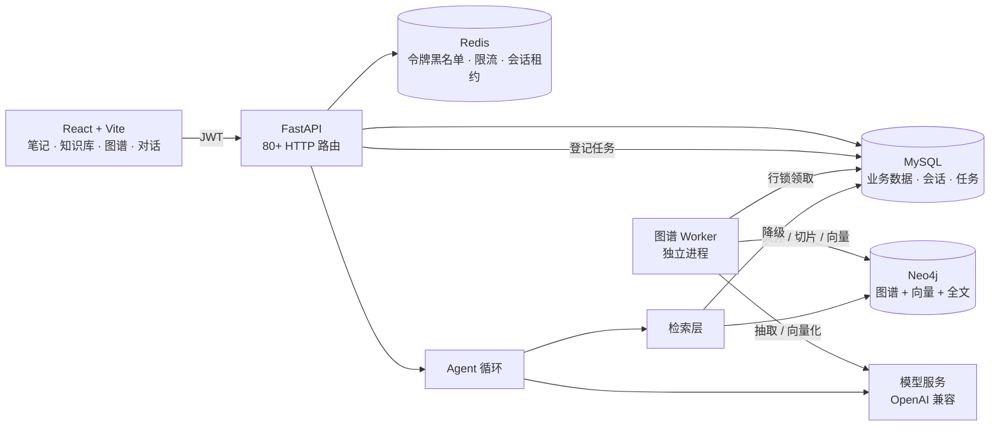
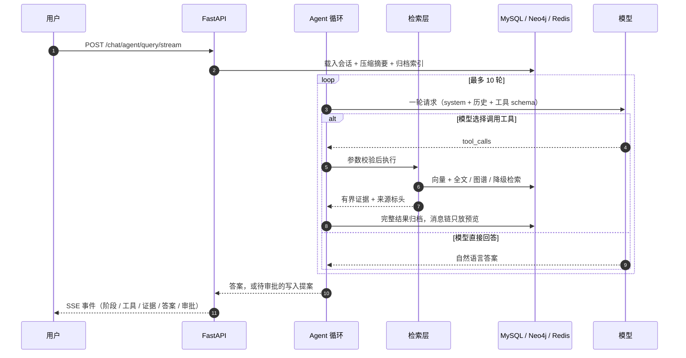
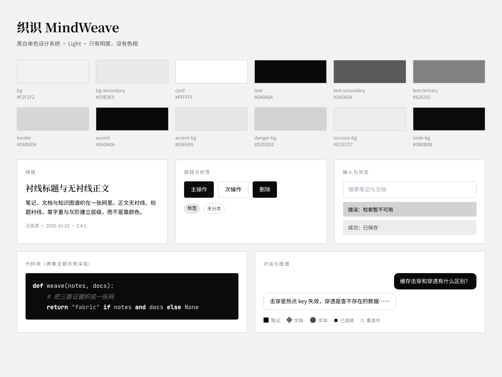
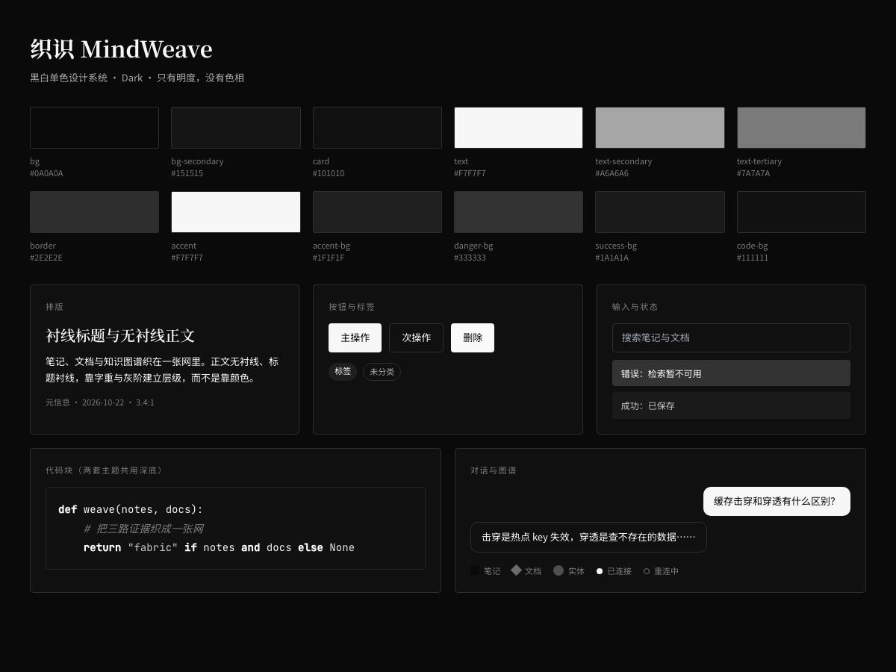

<h1 align="center">织识 · MindWeave</h1>

<p align="center">
  <strong>把笔记、文档与知识图谱织成一张可检索的网</strong><br />
  <sub>An agentic knowledge workspace — notes, documents and a knowledge graph, woven into one fabric.</sub>
</p>

<p align="center">
  
  
  
  
  
</p>

<p align="center">
  
</p>

> 本项目在 MIT 开源项目 [RMA-MUN/RAGNotebook](https://github.com/RMA-MUN/RAGNotebook) 的基础上二次开发：
> 业务骨架与前端沿用上游，**对话编排、检索融合、上下文治理、请求级观测与界面设计**做了重写。
> 逐项差异见[与上游的差异](#与上游的差异)，上游版权与许可见 [LICENSE](./LICENSE)。

---

## 目录

- [这是什么](#这是什么)
- [核心特性](#核心特性)
- [界面预览](#界面预览)
- [系统架构](#系统架构)
- [一次问答发生了什么](#一次问答发生了什么)
- [快速开始](#快速开始)
- [技术栈](#技术栈)
- [配置说明](#配置说明)
- [与上游的差异](#与上游的差异)
- [工程化改造](#工程化改造2026-10)
- [能力边界](#能力边界)
- [项目结构](#项目结构)
- [开发与测试](#开发与测试)
- [设计系统](#设计系统)
- [评测](#评测)
- [故障排查](#故障排查)
- [Roadmap](#roadmap)
- [文档](#文档)
- [致谢与许可](#致谢与许可)

## 这是什么

MindWeave 是一个**面向个人学习的知识工作台**。它把三件通常分散的事放进一个系统：

1. **写** —— Markdown 笔记、模板、富文本编辑、AI 补全与续写；
2. **存** —— TXT / Markdown / PDF / DOCX / PPTX 导入，结构化切片，实体关系抽取成知识图谱；
3. **用** —— 一个会自己决定"要不要查、查几次、查不到怎么办"的 Agent，边检索边回答，写操作必须人工审批。

它解决的是一个很具体的问题：**笔记写了不回看、资料存了搜不到、搜到了也拼不成答案。**

**项目状态**：个人项目，未上生产。前端复用上游源码后重做了视觉与交互；后端主链路（循环 / 检索 / 审批 / 上下文）已按自己的设计重写；
单元与契约测试覆盖审批状态机、上下文压缩、检索降级等关键路径，但不依赖任何外部服务。

## 核心特性

**知识摄入**

- **多格式导入** —— TXT / Markdown / PDF / DOCX / PPTX；单文件 ≤ 10 MB，一次最多 5 个。
- **结构化切片** —— 按标题层级、段落与代码围栏切分，块内保留 `[章节]` 前缀；PDF 按页切片，引用能回跳到页号。
- **PDF 视觉增强** —— 文字过少的页面渲染成图片交给视觉模型描述，感知哈希去重，默认最多 50 页。
- **去重与清理** —— 同用户同名或同 MD5 拒绝导入；删除文档时同步清理切片、页面图片与图谱任务。
- **异步索引** —— 文档与切片同事务落库；图谱与向量索引由独立 Worker 构建，可重试、可审计。

**检索**

- **双路召回** —— Neo4j 向量索引 + 全文索引，RRF 只融合**名次**，不比较不同来源的原始分。
- **统一重排** —— 候选交给模型按 0–3 分级重排，再按来源限额选取最终证据，限制同源冗余。
- **上下文回填** —— 命中子块后按 `chunk_id` 扩展相邻片段，避免答案只有半句话。
- **证据预算** —— 单条与总量双重预算；来源标头保留文档、页号与章节。
- **图谱证据** —— 从问题抽实体，反查实体描述与提及片段，与文本证据一起进入重排。
- **降级兜底** —— 图库、索引或 Embedding 任一环节异常时退回 MySQL 字面检索，并明确降低语义能力。
- **条件联网** —— 本地证据不足且配置了搜索服务时才外查，默认关闭。

**Agent**

- **原生工具循环** —— 直接使用 `tool_calls`，工具结果回到同一消息链，模型可基于刚拿到的结果决定下一步。
- **11 个工具** —— 笔记搜索、分类统计、今日回顾、关联片段、知识检索、归档读回、上下文整理、创建笔记、标记回顾等。
- **防失控** —— 轮数上限、同签名重复检测、重复调用 ID 拒绝、整请求截止时间。
- **人工审批** —— 写操作只生成提案；`pending → executing → completed` 状态机 + 数据库行锁领取，不自动重复执行。
- **上下文治理** —— 字节预算 → 旧工具结果归档 → 结构化摘要（目标 / 约束 / 事实 / 已完成 / 未解决 / 来源）→ 原文按页读回。
- **用户隔离** —— 用户 ID 由服务端从 JWT 注入，不接受模型传参；所有查询带归属条件。

**工程**

- **请求级诊断** —— 每次对话生成 trace：span 耗时、token 用量、工具序列，可按会话回查。
- **会话串行化** —— 聊天与审批共用 Redis 租约，避免同一会话并发覆盖工作状态。
- **限流与预热** —— Redis 固定窗口限流；启动后台预热 Embedding，失败不影响应用启动。
- **容器化** —— MySQL / Redis / Neo4j / API / Worker / 前端六容器编排，含健康检查与数据卷。

## 界面预览

| 笔记（浅色） | 笔记（深色） |
|---|---|
|  |  |

| AI 对话 | 知识库 |
|---|---|
|  |  |

## 系统架构



三个刻意的取舍：

| 取舍 | 为什么 | 代价 |
|---|---|---|
| 图谱异步构建 | 保存笔记不该等实体抽取与向量化；失败可重试 | "保存成功"与"索引就绪"是两个时刻 |
| 用原生工具循环而非固定工作流 | 让模型自己决定查几次，每轮预算可控 | 行为不如脚本确定，需要更强的防护与观测 |
| 写操作必须审批 | 模型提出的参数和业务影响要让人看见 | 多一步交互，且审批后不会自动续跑剩余任务 |

## 一次问答发生了什么



## 快速开始

**最短路径**：装好 Docker Desktop → 填 `.env` 里四个密码和两个 API Key → `docker compose up -d` → 打开 <http://127.0.0.1:3100>。

### 方式一：Docker（推荐）

```bash
git clone <your-repo-url> mindweave
cd mindweave

cp .env.example .env
# 必填：MYSQL_PASSWORD / MYSQL_ROOT_PASSWORD / NEO4J_PASSWORD / SECRET_KEY
#       DEEPSEEK_API_KEY / EMBEDDING_API_KEY

docker compose up -d
docker compose ps          # 六个容器都应为 running / healthy
```

| 入口 | 地址 |
|---|---|
| 前端 | <http://127.0.0.1:3100> |
| 后端 API 文档 | <http://127.0.0.1:8100/docs> |
| 健康检查 | <http://127.0.0.1:8100/health/ready> |
| Neo4j Browser | <http://127.0.0.1:17474> |

前端注册入口默认关闭（保留注册 API），首次使用先建账号：

```bash
curl -X POST http://127.0.0.1:8100/user/register/ \
  -H 'Content-Type: application/json' \
  -d '{"username":"demo","email":"demo@example.com","password":"demo123456","confirm_password":"demo123456"}'
```

### 方式二：本地开发（三进程）

```bash
docker compose up -d mysql redis neo4j   # 只起依赖
./scripts/start-dev.sh                   # 后端 + Worker + 前端
```

也可以分别启动：

```bash
cd backend && uv run uvicorn main:app --reload --host 127.0.0.1 --port 8100
cd backend && uv run python -m app.graph.worker        # 图谱任务必需
cd front   && npm run dev -- --host 127.0.0.1 --port 3100
```

| 服务 | 本机端口 |
|---|---|
| 前端 / 后端 | 3100 / 8100 |
| MySQL / Redis | 13306 / 16379 |
| Neo4j Bolt / Browser | 17687 / 17474 |

> **只启动 API 与前端时，图谱任务会停在 `pending`**：向量与全文索引由 Worker 创建，检索会降级到 MySQL 字面匹配。
> `/health/ready` 目前只检查 MySQL 与 Redis；图与索引的检查见 [Roadmap](#roadmap)。

## 技术栈

| 层 | 技术 |
|---|---|
| 前端 | React 19 · TypeScript · Vite · Tailwind CSS · Zustand · Tiptap · React Markdown · AntV G6 |
| 后端 | FastAPI · Pydantic v2 · SQLAlchemy 2（异步）· aiomysql · python-jose · httpx |
| 存储 | MySQL 8（业务数据）· Neo4j 5.26（图谱 + 向量 + 全文）· Redis 7（令牌 / 限流 / 租约） |
| 模型 | 任意 OpenAI 兼容接口：对话、Embedding、视觉；主备 API Key 自动切换 |

## 配置说明

配置集中在**仓库根目录的 `.env`**（不是 `backend/.env`），模板见 [.env.example](./.env.example)；密钥已被 `.gitignore` 排除。

| 分组 | 变量 | 说明 |
|---|---|---|
| 运行 | `ENV` / `LOG_LEVEL` | `dev` / `test` / `prod`；日志级别 |
| MySQL | `MYSQL_HOST` `MYSQL_PORT` `MYSQL_USER` `MYSQL_PASSWORD` `MYSQL_DATABASE` | 宿主机默认 `127.0.0.1:13306` |
| Redis | `REDIS_HOST` `REDIS_PORT` `REDIS_DB` | 宿主机默认 `127.0.0.1:16379` |
| Neo4j | `NEO4J_URI` `NEO4J_USER` `NEO4J_PASSWORD` | 留空则图功能不可用，API 仍可启动 |
| 对话模型 | `DEEPSEEK_BASE_URL` `DEEPSEEK_API_KEY` `DEEPSEEK_API_KEY_BACKUP` `DEEPSEEK_MODEL` | 主备密钥，指定错误码自动切换 |
| Embedding | `EMBEDDING_PROVIDER` `EMBEDDING_MODEL` `EMBEDDING_DIMENSIONS` `EMBEDDING_BASE_URL` `EMBEDDING_API_KEY` | `local` 才加载 PyTorch；维度必须与现有索引一致 |
| 缓存 / 全文 | `EMBEDDING_CACHE_ENABLED` `EMBEDDING_CACHE_TTL` `RAG_FULLTEXT_ANALYZER` | 查询向量缓存 7 天；全文分析器默认 `cjk` |
| Agent | `AGENT_MAX_STEPS` `AGENT_INPUT_BYTES` `AGENT_OUTPUT_TOKENS` | 默认 10 轮 / 60 KB 输入 / 2048 输出 |
| 检索 | `RAG_RECALL_LIMIT` `RAG_RERANK_LIMIT` `RAG_FINAL_LIMIT` `RAG_CONTEXT_CHARS` `RAG_VECTOR_QUOTA` `RAG_FULLTEXT_QUOTA` `RAG_VECTOR_OVERFETCH` | 召回 30 / 重排 20 / 最终 6 / 证据 8000 字符；双路各 20 条配额，向量过采样 1000 |
| 视觉 | `VISION_BATCH_SIZE` `VISION_MAX_PAGES` `VISION_DEDUP_ENABLED` | PDF 页面视觉批处理 |
| 联网 | `WEB_SEARCH_ENABLED` `WEB_SEARCH_PROVIDER` `WEB_SEARCH_API_KEY` | 默认关闭 |
| 限流 | `RATE_LIMIT_ENABLED` `RATE_LIMIT_CHAT_PER_MINUTE` `RATE_LIMIT_UPLOAD_PER_MINUTE` | 固定窗口，按 scope + 客户端地址 |

**换 Embedding 模型时**：维度变化会让已有向量索引不可用（启动会显式报错，而不是静默算错）。
需要先重建：`uv run python -m scripts.requeue_rag_index --username <name>`，或清空 Neo4j 中的 `Chunk` 节点后重新导入。

## 与上游的差异

| 模块 | 上游 | 本仓库 | 原因 |
|---|---|---|---|
| 对话编排 | LangChain `create_agent` + 固定工作流 | **原生 `tool_calls` 循环**，工具结果回到同一消息链 | 让模型自己决定检索几次，每轮预算可控 |
| 上下文 | 截断历史 | **字节预算 → 工具结果归档 → 结构化摘要 → 按页读回** | 长对话不丢证据，且丢的内容可追溯 |
| 检索融合 | RRF 后按分数排序 | **RRF 融合名次 + 模型分级重排**，最终证据按来源限额选取 | 不同检索器量纲不同，直接比大小会丢掉图谱证据 |
| 切分 | 定长切分 | **结构化切片**：标题层级 + 段落 + 代码围栏 | 召回片段自带上下文，减少"半句话" |
| 重排 | 云端 rerank API | **模型分级重排 + 邻居扩展**，失败回退原序 | 少一个外部依赖；分级比分数更稳 |
| 观测 | 普通日志 | **请求级 trace**：span 耗时、token 用量、工具序列 | 出问题能定位到某一层，而不是只看到 500 |
| 界面 | 上游默认视觉 | **黑白单色设计系统**：自有品牌标记、空状态插图、明暗双主题 | 让工具像成品，而不是脚手架 |
| 评测 | 无 | **仓库内 60 条回归集**（检索 / 引用 / 拒答）+ 离线对比实验 | 改动需要能被量化 |

Compose 项目名与数据库名统一为 `mindweave`；首次启动会创建空数据卷，升级时先备份再迁移。

## 工程化改造（2026-10）

这一轮不加功能，只把"能跑"变成"可测、可观测、可降级"。

| 改造 | 之前 | 现在 | 代码 |
|---|---|---|---|
| 多路融合 | 两路名次分直接相加，单路可能挤掉另一路 | RRF 名次 + 每路配额 + 同 chunk 去重 | `backend/app/rag/fusion.py` |
| 中文全文 | 查询里的 `+ ( ) " ~ *` 会让解析失败，整链降级 MySQL | Lucene 转义 + `cjk` 分析器 + 过采样 | `hybrid_retrieval.py` / `neo4j_client.py` |
| 成本观测 | 只有日志，答不出"一次问答多少钱" | `request.usage` 每次必发（失败记零用量）+ P50/P95/成本/中止率报表 | `deepseek_client.py` / `scripts/metrics_report.py` |
| 稳定性 | 循环到上限、重复工具、上下文超限 → 500 | 统一 `agent.loop_stopped` + 部分答案 | `agent/chat_loop.py` |
| 查询缓存 | 同一个问题重复 embedding、重复计费 | Redis 缓存查询向量（7 天；索引写入不缓存） | `rag/embedding.py` |
| 父子块 | 命中子块后只能取相邻片段 | 子块召回 + 父块回填（同章节合并，超长强制切组） | `structured_chunks.py` / `evidence_selection.py` |
| 长期记忆 | 只有会话内摘要 | `remember` 走审批写入 `user_memories`，下一轮注入 system | `user_memory.py` / `user_context.py` |
| 技能 / MCP | 无 | `load_skill` 只读加载；stdio MCP 服务暴露 list/read skills | `skills/` / `mcp_server/server.py` |
| 评测 | 无 | 60 条仓库内回归集：Recall@3 0.96、引用捏造 0、拒答 10/10 | `eval/` |

配套测试：`cd backend && uv run python -m unittest discover -s tests`，**133 项全绿**。

## 能力边界

这一节写给使用者，也写给自己：**下面这些不是"还没做"，而是当前设计明确不支持。**

| 容易误解的点 | 实际情况 |
|---|---|
| 每个回答都逐 token 输出 | 最终答案整段返回；写作辅助接口另有文本流 |
| Agent 能调用全部后端接口 | 只注册了 13 个工具，写操作需要审批 |
| 这是多 Agent 系统 | 单个模型 + 工具循环，没有 Planner/Worker 分工与委派 |
| 有跨会话长期记忆 | 有，但只存用户显式确认的内容（`remember` 审批），不会自动抽取 |
| 图谱能多跳推理 | 当前是实体名匹配 + 提及反查，不是路径规划 |
| 上传长文后整本都能被检索 | 切片全量入库，但向量索引受 Embedding 模型输入上限约束（当前 900 字符/块） |
| 图谱与笔记实时一致 | Worker 异步构建，存在延迟与失败重试 |
| 外部检索都有可点击原文链接 | 保留来源标题与摘要，未完整保留原 URL 契约 |
| 所有图谱编辑都有界面 | 后端接口齐全，前端主要接通展示、搜索、详情与删除 |
| 生产级可用性 | 单机 Docker 编排，没有压测、灰度与多副本验证 |
| 多租户隔离已完善 | 业务层按 `user_id` 隔离；向量检索仍是全局索引 + 后置过滤，已加过采样缓解，但用户量大时仍会稀释召回 |
| 主链路已完全不用 LangGraph | 主入口走原生工具循环；`agent/workflow.py` 与 checkpoint 表仍在，供旧路径兼容 |
| 切片长度适配所有 Embedding 模型 | 当前 900 字符/块；本地 `bge-small-zh` 上限 512 token，超出部分会被静默截断 |

## 项目结构

```text
mindweave/
├── backend/
│   ├── app/
│   │   ├── agent/          # 工具循环、工具适配、审批状态机、会话租约
│   │   ├── core/           # 配置、响应封装、限流、日志、trace、生命周期
│   │   ├── db/             # MySQL / Redis 连接与建表迁移
│   │   ├── graph/          # 实体抽取、图谱写入、任务队列与 Worker
│   │   ├── models/         # SQLAlchemy 模型（笔记/文档/会话/任务/审批/trace）
│   │   ├── prompt/         # 提示词（循环策略、规划、重排、可答性、摘要、抽取）
│   │   ├── rag/            # 向量、全文、融合、重排、证据预算、联网兜底
│   │   ├── router/         # HTTP 路由（账号/笔记/模板/回顾/知识库/聊天/图谱/健康）
│   │   ├── schemas/        # Pydantic 请求与响应模型
│   │   ├── services/       # 业务服务（笔记/文档/回顾/会话/上下文/模型客户端）
│   │   └── utils/          # JWT 与鉴权工具
│   ├── scripts/            # 重建索引入口
│   ├── tests/              # 契约与单元测试（不依赖外部服务）
│   ├── Dockerfile
│   └── main.py
├── front/                  # React 19 + Vite + Tailwind（沿用上游，重做视觉）
├── docs/                   # 功能全景、设计系统、视觉资产、环境记录
├── eval/                   # 仓库内评测：seed / validate / retrieval / e2e / report
├── skills/                 # 只读技能说明（供 load_skill 与 MCP 读取）
├── mcp_server/             # 最小 stdio MCP 服务（技能只读）
├── scripts/start-dev.sh    # 一键起三进程（API / Worker / 前端）
├── docker-compose.yml      # 六容器编排
├── .env.example
└── README.md
```

## 开发与测试

```bash
cd backend
uv sync --locked                 # 安装依赖
uv run uvicorn main:app --reload --host 127.0.0.1 --port 8100
uv run python -m unittest discover -s tests -v     # 契约与单元测试（无需外部服务）

cd front
npm ci
npm run dev -- --host 127.0.0.1 --port 3100
npm run build                    # tsc + vite 生产构建
```

约定：

- 数据库写入在服务层显式提交，路由只负责参数与响应；跨 MySQL / Neo4j / Redis **没有**分布式事务。
- 派生数据（向量、图谱）失败可重放，业务数据（笔记、文档）以 MySQL 为准。
- 出错时优先降级并留痕，不静默兜底成"看起来正常"。

## 设计系统

界面只有一条明度轴：不出现任何色相。强调色在浅色下是墨黑、深色下是纸白，
强调块上的文字统一用 `--color-accent-contrast` 自动反相；配色集中在 `front/src/index.css` 的 CSS 变量里，组件不写具体色值。

- 层级靠灰阶、间距与 1px 发丝线，不靠阴影；
- 圆角收到 2/4/6px，只有标签、头像、开关保留全圆角；
- 语义（成功 / 错误）用深浅与文案表达，不用红绿黄；
- 两套主题共用一份深底 + 灰阶高亮的代码块；支持 `prefers-reduced-motion`。

令牌表与对比度数据见 [设计系统](docs/design-system.md)；新增 Logo、插图或图片的提示词与后处理见 [视觉资产清单](docs/visual-assets.md)。

<p align="center">
  
  
</p>

## 评测

仓库内置一套轻量评测，用于回归而不是宣称绝对分数：

```bash
uv run --project backend python eval/seed.py        # demo-docs + 设计文档冲洗评测语料
uv run --project backend python eval/run.py         # validate → retrieval → e2e
```

| 指标（60 条：50 可答 + 10 不可答） | 结果 |
|---|---|
| Recall@3 / Recall@5 | 0.96 / 0.96 |
| MRR@5 | 0.89 |
| 引用捏造 | 0 |
| 拒答正确率 | 10/10 |

报告见 `eval/results/report.md`。另外做过一轮 120 条股票课程语料的离线对比（80 调参 / 40 测试），
实验数据与结论没有随仓库发布。

工程侧检查项：

| 检查 | 命令 | 期望 |
|---|---|---|
| 单元与契约测试 | `cd backend && uv run python -m unittest discover -s tests` | 133 项全绿 |
| 前端构建 | `cd front && npm run build` | 无类型错误 |
| 健康检查 | `curl -s 127.0.0.1:8100/health/ready` | MySQL / Redis 正常 |
| 容器编排 | `docker compose config -q` | 无错误 |
| 成本与延迟 | `uv run --project backend python scripts/metrics_report.py --days 7` | P50/P95、token、成本、中止率 |

## 故障排查

| 现象 | 排查 |
|---|---|
| 问答报"模型服务未配置" | 检查根目录 `.env` 的 `DEEPSEEK_API_KEY`，改完重启后端 |
| 上传成功但搜不到 | Worker 是否在跑；`graph_tasks` 是否有 `pending`；`/health/ready` |
| 检索结果明显变差 | 向量维度是否与 `EMBEDDING_DIMENSIONS` 一致；全文索引是否缺失（会降级到 MySQL） |
| 启动报"已有向量索引维度不同" | 换过 Embedding 模型，按[配置说明](#配置说明)重建索引 |
| 同一会话提示"正在处理上一条请求" | 上一次请求的 Redis 租约未释放（TTL 240 秒），或前端重复提交 |
| Neo4j Browser 打不开 | 端口是 `17474`，不是默认的 `7474` |
| 想彻底重置数据 | `docker compose down -v`（会清空数据卷，慎用） |

## Roadmap

**已完成**

- [x] 黑白单色设计系统与品牌资产（标记 / 空状态插图 / App Icon / OG）
- [x] 界面精修：笔记、知识库、对话、模板页、侧边栏与动效
- [x] 请求级 trace 与按会话回查
- [x] **候选融合**：按来源配额合并、同 chunk 去重、Lucene 转义（`rag/fusion.py`）
- [x] **中文全文**：CJK 分析器 + 查询转义 + 过采样配置
- [x] **成本观测**：`request.usage` 事件与 `metrics_report.py`
- [x] **循环降级**：上限/重复工具/上下文超限返回部分答案
- [x] **评测体系**：120 条离线集 + 80/40 拆分 + AutoRAG 三组对比

**已完成（续）**

- [x] **父子块**：`parent_id` / `parent_text` 列 + 子块召回 + 父块回填
- [x] **跨会话记忆**：`remember` 审批后写入，下一轮注入 system
- [x] **技能**：`skills/` + `load_skill` 只读加载
- [x] **MCP**：stdio 服务，暴露 `list_skills` / `read_skill`
- [x] **仓库内 eval harness**：`eval.validate / retrieval / e2e` 三个 CLI

**计划中**

- [ ] **真流式输出**：逐 token 推送与 TTFT（当前最终答案仍整段返回）
- [ ] **健康检查补全**：把 Neo4j 与索引存在性纳入 `/health/ready`
- [ ] **多租户向量检索**：带元数据过滤的向量索引，替代全局索引后置过滤

## 文档

| 文档 | 内容 |
|---|---|
| [功能与接口全景](docs/AI-Agent功能全景说明.md) | 页面地图、模块能力、接口清单、数据表与默认预算 |
| [设计系统](docs/design-system.md) | 黑白令牌、对比度、组件约定、图形资产、动效规则 |
| [视觉资产清单](docs/visual-assets.md) | Logo / 插图 / OG 的生成提示词与后处理流程 |
| [复刻教程](docs/rebuild-guide/README.md) | 从空目录到完整应用的 70 篇后端教学与前端接入记录 |
| [评测报告](eval/results/report.md) | 60 条回归集的检索、引用与拒答结果 |

## 致谢与许可

- 本项目基于 [RMA-MUN/RAGNotebook](https://github.com/RMA-MUN/RAGNotebook)（MIT）二次开发，前端沿用其源码，版权归原作者所有。
- 上游 README、项目结构与设计思路是很好的学习材料，建议对照阅读。
- 本项目同样以 [MIT](./LICENSE) 协议开源。

---

<p align="center">
  <sub>如果这个项目对你有帮助，欢迎 Star；有 bug 或建议请提 Issue。</sub>
</p>
