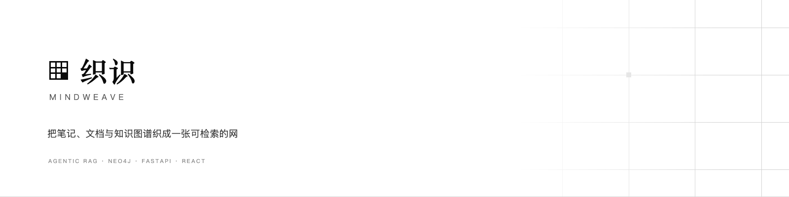
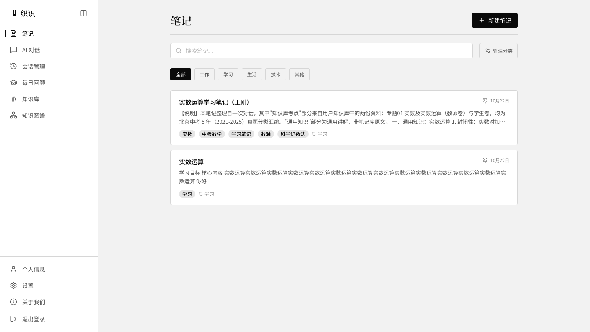
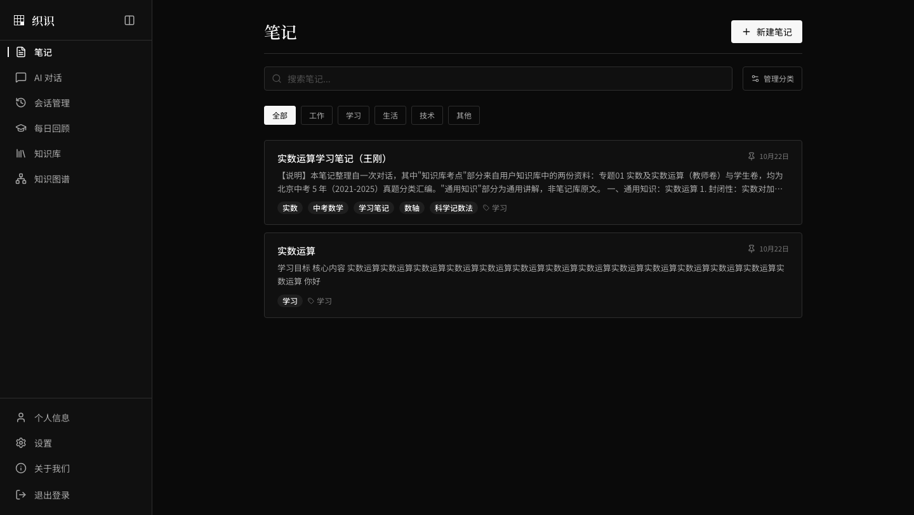
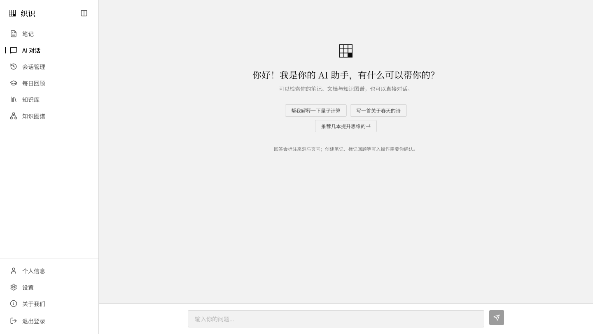
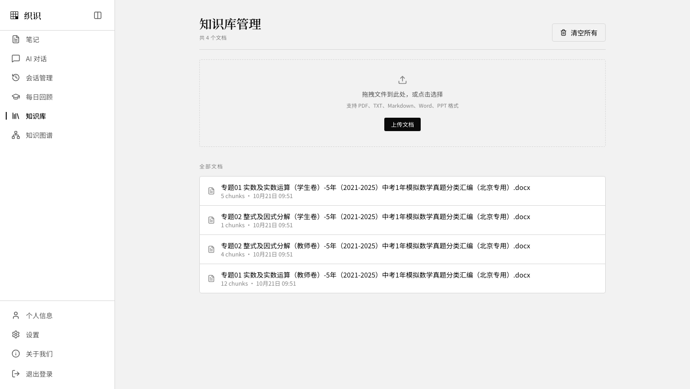
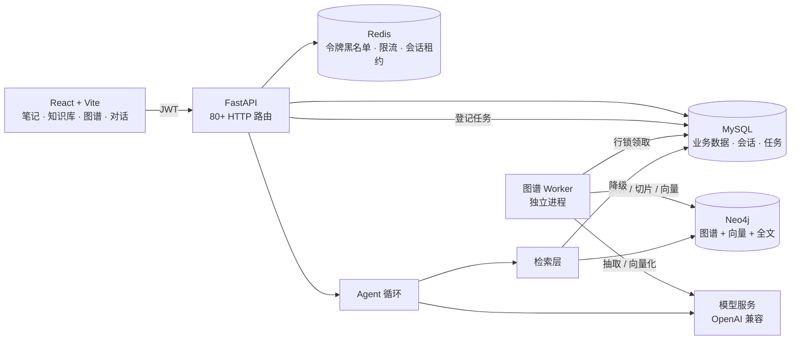
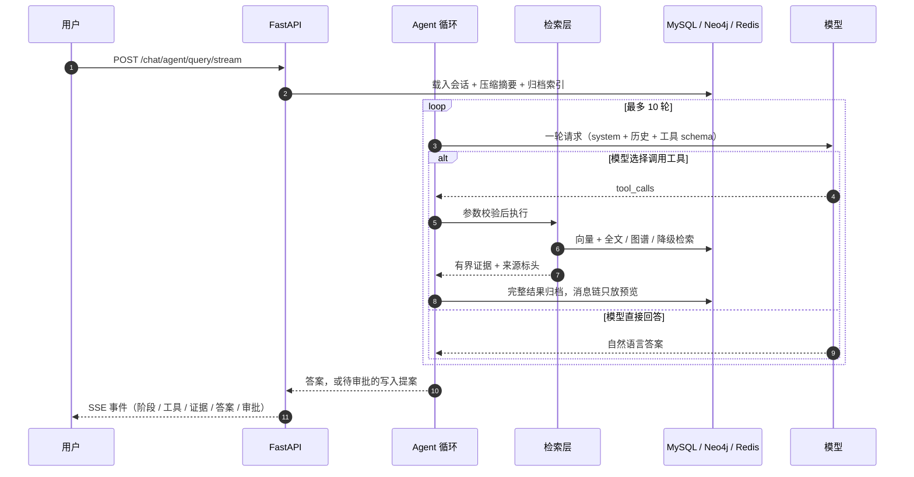

<h1 align="center">织识 · MindWeave</h1>

<p align="center">
  <strong>把笔记、文档与知识图谱织成一张可检索的网</strong><br />
  <sub>An agentic knowledge workspace — notes, documents and a knowledge graph, woven into one fabric.</sub>
</p>

<p align="center">
  
  
  
  
  
</p>

<p align="center">
  
</p>

> 本项目在 MIT 开源项目 [RMA-MUN/RAGNotebook](https://github.com/RMA-MUN/RAGNotebook) 的基础上二次开发：
> 业务骨架与前端沿用上游，**对话编排、检索融合、上下文治理、请求级观测与界面设计**做了重写。
> 上游版权与许可见 [LICENSE](./LICENSE)。

---

## 目录

| 章节 | 内容 |
|---|---|
| [这是什么](#这是什么) | 项目定位与要解决的问题 |
| [核心特性](#核心特性) | 摄入、检索、Agent 与工程能力 |
| [界面预览](#界面预览) | 明暗主题与关键页面 |
| [系统架构](#系统架构) | 组件、存储与数据流 |
| [一次问答发生了什么](#一次问答发生了什么) | 从提问到引用的完整链路 |
| [快速开始](#快速开始) | Docker 一键启动或本地三进程 |
| [技术栈](#技术栈) | 后端、前端与存储选型 |
| [项目结构](#项目结构) | 目录与模块职责 |
| [API 文档](#api-文档) | 交互式文档与常用接口 |
| [配置说明](#配置说明) | 模型、Embedding、存储与索引重建 |
| [评测](#评测) | 60 条回归集与指标 |
| [故障排查](#故障排查) | 常见现象与处理 |
| [文档](#文档) | 扩展阅读 |
| [致谢与许可](#致谢与许可) | 上游归属与协议 |

## 这是什么

MindWeave 是一个**面向个人学习的知识工作台**。它把三件通常分散的事放进一个系统：

1. **写** —— Markdown 笔记、模板、富文本编辑、AI 补全与续写；
2. **存** —— TXT / Markdown / PDF / DOCX / PPTX 导入，结构化切片，实体关系抽取成知识图谱；
3. **用** —— 一个会自己决定“要不要查、查几次、查不到怎么办”的 Agent，边检索边回答，写操作必须人工审批。

它解决的是一个很具体的问题：**笔记写了不回看、资料存了搜不到、搜到了也拼不成答案。**

所以它不只是一个聊天框：回答会带上实际检索到的资料与来源，长对话会压缩旧轮次并把原文留在归档里；
知识库、笔记与图谱共享同一次检索，而不是三个互不相通的入口。

## 核心特性

**知识摄入**

- 📥 **多格式导入**：TXT / Markdown / PDF / DOCX / PPTX；单文件 ≤ 10 MB，一次最多 5 个。
- 🧩 **结构化切片**：按标题层级、段落与代码围栏切分，保留 `[章节]` 前缀；PDF 按页切片，引用能回跳到页号。
- 🖼️ **PDF 视觉增强**：文字过少的页面渲染成图片交给视觉模型描述，感知哈希去重，默认最多 50 页。
- 🧹 **去重与清理**：同用户同名或同 MD5 拒绝导入；删除文档时同步清理切片、页面图片与图谱任务。
- ⚙️ **异步索引**：文档与切片同事务落库；图谱与向量索引由独立 Worker 构建，可重试、可审计。

**检索**

- 🔍 **双路召回**：Neo4j 向量索引 + 全文索引，RRF 只融合**名次**，不比较不同来源的原始分。
- 🎯 **统一重排**：候选交给模型按 0–3 分级重排，再按来源限额选取最终证据，限制同源冗余。
- 🧵 **上下文回填**：命中子块后优先回填父块，再按 `chunk_id` 扩展相邻片段，避免答案只有半句话。
- 📏 **证据预算**：单条与总量双重预算；来源标头保留文档、页号与章节。
- 🕸️ **图谱证据**：从问题抽实体，反查实体描述与提及片段，与文本证据一起进入重排。
- 🛟 **降级兜底**：图库、索引或 Embedding 任一环节异常时退回 MySQL 字面检索，并明确降低语义能力。
- 🌐 **条件联网**：本地证据不足且配置了搜索服务时才外查，默认关闭。

**Agent**

- 🔁 **原生工具循环**：直接使用 `tool_calls`，工具结果回到同一消息链，模型可基于刚拿到的结果决定下一步。
- 🧰 **13 个工具**：笔记搜索、分类统计、今日回顾、关联片段、知识检索、归档读回、上下文整理、创建笔记、标记回顾、记忆与技能等。
- 🛑 **防失控**：轮数上限、同签名重复检测、重复调用 ID 拒绝、整请求截止时间。
- ✅ **人工审批**：写操作只生成提案；`pending → executing → completed` 状态机 + 数据库行锁领取，不自动重复执行。
- 🗜️ **上下文治理**：字节预算 → 旧工具结果归档 → 结构化摘要（目标 / 约束 / 事实 / 已完成 / 未解决 / 来源）→ 原文按页读回。
- 🔐 **用户隔离**：用户 ID 由服务端从 JWT 注入，不接受模型传参；所有查询带归属条件。

**工程**

- 📊 **请求级诊断**：每次对话生成 trace：span 耗时、token 用量、工具序列，可按会话回查。
- 🔒 **会话串行化**：聊天与审批共用 Redis 租约，避免同一会话并发覆盖工作状态。
- 🚦 **限流与预热**：Redis 固定窗口限流；启动后台预热 Embedding，失败不影响应用启动。
- 🐳 **容器化**：MySQL / Redis / Neo4j / API / Worker / 前端六容器编排，含健康检查与数据卷。

## 界面预览

**笔记（浅色）**



**笔记（深色）**



**AI 对话**



**知识库**



## 系统架构



## 一次问答发生了什么



## 快速开始

> 💡 想最快跑起来？直接用 Docker 一键启动，无需在本机安装 Python、Node、MySQL、Redis 或 Neo4j。

### Docker 一键启动（推荐）

**前置要求**：Docker Desktop 已启动；建议内存 ≥ 4 GB；首次构建约 5–10 分钟。

```bash
git clone <your-repo-url> mindweave
cd mindweave

cp .env.example .env
# 至少填写：
#   MYSQL_PASSWORD / MYSQL_ROOT_PASSWORD / NEO4J_PASSWORD / SECRET_KEY
#   DEEPSEEK_API_KEY
#   EMBEDDING_API_KEY（使用远程 Embedding 时）
docker compose up -d --build
```

启动完成后：

| 入口 | 地址 | 说明 |
|---|---|---|
| 前端 | <http://127.0.0.1:3100> | 笔记、对话、知识库、图谱 |
| 后端 API 文档 | <http://127.0.0.1:8100/docs> | Swagger，便于调试 |
| 健康检查 | <http://127.0.0.1:8100/health/ready> | MySQL / Redis 就绪状态 |
| Neo4j Browser | <http://127.0.0.1:17474> | 图谱与索引排查 |

前端注册入口默认关闭，首次使用先建账号：

```bash
curl -X POST http://127.0.0.1:8100/user/register/ \
  -H 'Content-Type: application/json' \
  -d '{"username":"demo","email":"demo@example.com","password":"demo123456","confirm_password":"demo123456"}'
```

常用操作：

```bash
docker compose ps                 # 六个容器：mysql / redis / neo4j / backend / worker / front
docker compose logs -f backend    # 查看后端日志
docker compose restart backend    # 修改 .env 后重启后端
docker compose down               # 停止（数据保留）
docker compose down -v            # 停止并清空全部数据卷（慎用）
```

> **模型密钥只从根目录 `.env` 注入**，不会打进镜像。Compose 会自动把 MySQL / Redis / Neo4j 的地址改成服务名，
> 不需要也不应该把 `.env` 里的 host 改成容器名。未配置模型 Key 时页面可以打开，但对话与索引不可用。

**数据持久化**：MySQL / Redis / Neo4j 使用 Docker 数据卷；上传文件、切片与日志使用独立卷。
执行 `docker compose down -v` 会清空数据库，升级前先备份。

### 本地开发（非 Docker）

**环境要求**

| 环境 | 版本 |
|---|---|
| Python | 3.12+ |
| uv | 0.8+ |
| Node.js | 20+ |
| Docker | 仅用于 MySQL / Redis / Neo4j |

```bash
git clone <your-repo-url> mindweave
cd mindweave
```

**后端依赖**

```bash
cd backend
uv sync --locked
```

**前端依赖**

```bash
cd front
npm ci
```

**环境配置**

复制根目录模板并填写：

```bash
cp .env.example .env
```

```dotenv
# 对话模型（DeepSeek，OpenAI 兼容协议）
DEEPSEEK_BASE_URL=https://api.deepseek.com
DEEPSEEK_API_KEY=sk-xxx
DEEPSEEK_API_KEY_BACKUP=
DEEPSEEK_MODEL=deepseek-flash

# Embedding（本地或 OpenAI 兼容服务）
EMBEDDING_PROVIDER=remote
EMBEDDING_MODEL=text-embedding-v4
EMBEDDING_DIMENSIONS=512
EMBEDDING_BASE_URL=https://your-compatible-endpoint/v1
EMBEDDING_API_KEY=sk-xxx

# 存储
MYSQL_HOST=127.0.0.1
MYSQL_PORT=13306
MYSQL_USER=rag_learner
MYSQL_PASSWORD=change_me
MYSQL_DATABASE=mindweave
REDIS_HOST=127.0.0.1
REDIS_PORT=16379
REDIS_DB=3
NEO4J_URI=bolt://127.0.0.1:17687
NEO4J_USER=neo4j
NEO4J_PASSWORD=change_me
```

完整变量见 `.env.example`。

**启动服务**

```bash
# 只起依赖
docker compose up -d mysql redis neo4j

# 一键起后端 + Worker + 前端
./scripts/start-dev.sh

# 或分别启动
cd backend && uv run uvicorn main:app --reload --host 127.0.0.1 --port 8100
cd backend && uv run python -m app.graph.worker
cd front   && npm run dev -- --host 127.0.0.1 --port 3100
```

| 服务 | 地址 |
|---|---|
| 前端 | <http://127.0.0.1:3100> |
| 后端 / API 文档 | <http://127.0.0.1:8100> / `/docs` |
| MySQL / Redis | `127.0.0.1:13306` / `127.0.0.1:16379` |
| Neo4j Bolt / Browser | `127.0.0.1:17687` / `127.0.0.1:17474` |

> 只启动 API 与前端时，图谱任务会停在 `pending`，检索会降级到 MySQL 字面匹配。

## 技术栈

**后端**

| 技术 | 说明 |
|---|---|
| FastAPI | 异步 Web 框架，SSE 流式对话 |
| Pydantic v2 | 请求 / 响应与工具参数校验 |
| SQLAlchemy 2（异步） | MySQL ORM，显式事务 |
| aiomysql | MySQL 异步驱动 |
| Neo4j Driver | 图谱、向量索引与全文索引 |
| Redis | 令牌黑名单、限流、会话租约、查询缓存 |
| httpx | 模型、Embedding 与联网搜索 |

**前端**

| 技术 | 说明 |
|---|---|
| React 19 + TypeScript | 页面与类型安全 |
| Vite | 开发服务器与生产构建 |
| Tailwind CSS | 黑白设计系统的样式实现 |
| Radix UI | 无头组件（对话框等） |
| Tiptap | Markdown / 富文本编辑器 |
| Zustand | 轻量状态管理 |
| i18next | 中英文界面 |
| React Router | 路由与登录守卫 |
| react-markdown + rehype | Markdown 渲染与代码高亮 |
| AntV G6 | 知识图谱画布 |

**存储与模型**

| 组件 | 用途 |
|---|---|
| MySQL 8 | 笔记、文档、会话、审批、任务与 trace |
| Neo4j 5.26 | 实体关系、Chunk 向量索引与全文索引 |
| Redis 7 | 令牌、限流、租约、Embedding 缓存 |
| DeepSeek | 对话、工具调用、重排与摘要 |
| Embedding 服务 | 本地 bge 或任意 OpenAI 兼容向量接口 |

## 项目结构

```text
MindWeave/
├── backend/
│   ├── app/
│   │   ├── agent/          # 原生工具循环、审批、租约、run store
│   │   ├── core/           # 配置、限流、trace、生命周期
│   │   ├── db/             # MySQL / Redis 连接与增量迁移
│   │   ├── graph/          # 实体抽取、图谱写入、任务 Worker、图谱 API
│   │   ├── models/         # SQLAlchemy 模型
│   │   ├── prompt/         # 循环、重排、摘要、抽取提示词
│   │   ├── rag/            # 检索、融合、重排、证据预算、联网
│   │   ├── router/         # 账号 / 笔记 / 知识库 / 对话 / 图谱 / 健康
│   │   ├── schemas/        # Pydantic 模型
│   │   └── services/       # 业务服务、模型客户端、记忆、用量
│   ├── scripts/            # 重建索引、导入语料
│   ├── tests/              # 契约与单元测试
│   ├── Dockerfile
│   └── main.py
├── front/
│   ├── src/
│   │   ├── api/            # 请求层
│   │   ├── components/     # 通用 / 图谱 / 笔记 / 布局组件
│   │   ├── hooks/          # SSE、图谱事件
│   │   ├── pages/          # 笔记、对话、知识库、图谱、用量、设置
│   │   ├── router/         # 路由
│   │   ├── stores/         # Zustand
│   │   └── i18n/           # 中英文
│   ├── Dockerfile
│   └── nginx.conf
├── eval/                   # 60 条回归集：seed / validate / retrieval / e2e
├── skills/                 # 只读技能说明（load_skill / MCP）
├── mcp_server/             # stdio MCP 服务
├── scripts/                # 启动、种子数据、指标报表
├── docs/
│   ├── design-system.md
│   ├── AI-Agent功能全景说明.md
│   └── rebuild-guide/      # 70 篇复刻教程
├── demo-docs/              # 演示语料
├── docker-compose.yml      # 六容器编排
└── .env.example
```

## API 文档

启动后访问 Swagger：

- Docker：<http://127.0.0.1:8100/docs>
- 本地：<http://127.0.0.1:8100/docs>

常用接口：

| 能力 | 方法 | 路径 |
|---|---|---|
| 注册 / 登录 | POST | `/user/register/`、`/user/login/` |
| 笔记 | GET/POST | `/note/list`、`/note/create` |
| 知识库 | POST/GET | `/knowledge/add/single`、`/knowledge/list` |
| 流式对话 | POST | `/chat/agent/query/stream` |
| 审批恢复 | POST | `/chat/agent/resume` |
| 图谱总览 | GET | `/api/graph/overview` |
| 用量统计 | GET | `/chat/usage` |
| 健康检查 | GET | `/health/ready` |

对话接口使用 SSE，事件包括 `thinking`、`response`、`interrupt`、`error`、`done`。

## 配置说明

### 切换对话模型

所有模型调用走 OpenAI 兼容协议，改三个变量即可切换服务商：

```dotenv
DEEPSEEK_BASE_URL=https://api.deepseek.com
DEEPSEEK_API_KEY=sk-xxx
DEEPSEEK_MODEL=deepseek-flash
```

主 Key 返回 402 / 401 / 429 / 5xx 时会自动尝试 `DEEPSEEK_API_KEY_BACKUP`。

### Embedding

```dotenv
EMBEDDING_PROVIDER=remote        # local 则加载本地 sentence-transformers
EMBEDDING_MODEL=text-embedding-v4
EMBEDDING_DIMENSIONS=512
EMBEDDING_BASE_URL=https://your-endpoint/v1
EMBEDDING_API_KEY=sk-xxx
```

**换模型或维度会与已有向量索引不兼容**，启动会显式报错而不是静默算错。重建方式：

```bash
cd backend
uv run python -m scripts.requeue_rag_index --username <name>
```

也可以清空 Neo4j 中的 `Chunk` 节点后重新导入。

### 存储与限流

Compose 会自动覆盖 `MYSQL_HOST`、`REDIS_HOST`、`NEO4J_URI` 为服务名；本地开发才使用 `127.0.0.1` 与映射端口。
`RATE_LIMIT_*` 控制聊天与上传频率，`WEB_SEARCH_*` 控制联网兜底，默认关闭。

## 评测

仓库内置一套**可重复运行的轻量评测**，目的不是刷一个好看的绝对分，而是让检索、引用与拒答的改动能被量化。

### 评测什么

| 层 | 问题 | 指标 |
|---|---|---|
| 检索 | 含答案的片段有没有排进前 k | Recall@3 / Recall@5 / MRR@5 |
| 引用 | 回答里的 `[n]` 是否真的对应本次证据 | 引用捏造数 |
| 拒答 | 资料里没有答案时会不会硬编 | 拒答正确率 |

不覆盖：多轮对话、端到端延迟、主观文风、跨文档推理。

### 数据集

评测语料来自仓库内的三份 Markdown，共 **80 个切片**：

```text
demo-docs/缓存与检索.md
docs/design-system.md
docs/AI-Agent功能全景说明.md
```

题目共 **60 条**：

| 类型 | 条数 | 说明 |
|---|---|---|
| 可答 | 50 | 答案能在指定切片中找到 |
| 不可答 | 10 | 语料里没有答案，用来测拒答 |

生成方式：模型从切片出题 → `quote` 必须是切片中**连续出现的原文** → 脚本回查引文 → 题目去重。
因此 `chunk_id` 与标准答案天然对齐；但**没有逐条人工改写**，题目分布也偏向项目文档，这是它的局限。

单条数据长这样（`eval/dataset/test.jsonl`）：

```json
{
  "qid": "e001",
  "question": "为什么混合检索中 BM25 和向量的分数不能直接相加？",
  "quote": "两者分数不可直接相加，常见做法是用 RRF 融合名次",
  "answer": "因为两者分数尺度不同，通常用 RRF 融合名次。",
  "chunk_id": "6f052efffbb500f3704a113ceb234f19",
  "filename": "demo-docs/缓存与检索.md",
  "answerable": true
}
```

### 指标口径

| 指标 | 定义 |
|---|---|
| Recall@3 / @5 | 前 3 / 5 条召回片段中，是否存在包含 `quote` 的切片 |
| MRR@5 | 第一个命中片段名次的倒数，未命中记 0 |
| 引用捏造 | 回答出现 `[n]`，但 `n` 不在本次证据编号范围内 |
| 拒答正确率 | 10 条不可答题中，回答明确表示“资料不足/无法回答”的比例 |

检索只调用 `hybrid_retrieval.search`，不经过生成模型；端到端只抽 20 条可答题 + 10 条不可答题。

### 运行

```bash
# 1) 重建评测语料（会清空并重新灌入 eval-bot 账号的知识库）
uv run --project backend python eval/seed.py

# 2) 校验 → 检索 → 端到端 → 生成报告
uv run --project backend python eval/run.py
```

也可以单独跑某一步：

```bash
uv run --project backend python eval/validate.py    # 只校验数据集
uv run --project backend python eval/retrieval.py   # 只跑检索指标
uv run --project backend python eval/e2e.py         # 只跑引用与拒答
```

`seed.py` 会创建 `eval-bot` 用户；重复执行会先清空该账号的文档再导入，不影响其他账号。

耗时主要花在 Embedding 与端到端生成上，60 条通常几分钟内完成。

### 当前结果

| 指标（60 条） | 结果 |
|---|---|
| Recall@3 | **0.96** |
| Recall@5 | **0.96** |
| MRR@5 | **0.89** |
| 引用捏造 | **0**（20 条可答抽样） |
| 拒答正确率 | **10 / 10** |

报告与明细：

- `eval/results/report.md`
- `eval/results/retrieval.json`
- `eval/results/e2e.json`

**怎么读**：0.96 / 0.89 说明在这套小语料上检索基本稳定；引用捏造为 0、拒答 10/10 说明“没有资料就明说”的约束生效。
但它只有 60 条、题目由模型生成、且不测多轮，所以这些数字只适合做**回归基线**，不适合对外宣称系统效果。

### 离线对比：AutoRAG 120 条

仓库内的 60 条 harness 用来防回归；在调检索参数时，还做过一轮更大规模的离线对比。
这一轮用 [AutoRAG](https://github.com/Marker-Inc-Korea/AutoRAG) 跑，原因是它把"节点 / 模块组合"写成 YAML，
自动遍历组合并输出 Recall、nDCG 等指标，比自己写评测脚本更适合比较 BM25、向量、混合与重排。

**语料**

| 项 | 值 |
|---|---|
| 原始文档 | 24 份股票课程 PDF，扫描件 |
| 解析 | macOS Vision OCR，368 页、123,834 字 |
| 切片 | 复用项目 `split_structured`，190 片，平均 655 字 |

**题目**

共 120 条，按题型分层拆成 **80 调参 / 40 测试**：

- 50 条可答题由模型从切片出题，`quote` 回查原文；
- 人工剔除 14 条“涨幅 / 换手 / 收盘价”等行情数值题，以及 9 条界面字段、指标参数类低质量题；
- 补入 23 条条件 / 流程 / 对比题，保持 120 条。

**实验设置**

| 项 | 配置 |
|---|---|
| 框架 | AutoRAG 0.3.27 |
| 对话模型 | DeepSeek `deepseek-flash`，关闭 thinking |
| Embedding | `text-embedding-v4`，512 维 |
| 检索 | BM25（Qwen tokenizer）、向量、混合 RRF（权重 30） |
| 重排 | RankGPT + DeepSeek，上游 8 条 → 输出 3 条 |
| 生成 | 严格 / 简洁两套 prompt，BLEU + ROUGE |

**测试集结果（40 条，只跑一次）**

| 配置 | Recall@3 | Recall@5 | nDCG@3 | nDCG@5 |
|---|---|---|---|---|
| BM25 | 0.900 | 0.950 | 0.860 | 0.879 |
| 向量 | 0.825 | 0.900 | 0.779 | 0.809 |
| 混合 RRF（w=30） | — | **0.975** | — | 0.877 |
| 向量 top8（重排前） | — | 0.950 | — | 0.835 |
| RankGPT top3（重排后） | **0.950** | — | **0.928** | — |

训练集趋势一致：混合检索 Recall@5 0.938，向量 0.825；重排把 nDCG@3 从 0.716 提到 0.825。

**四条结论**

1. **混合检索稳定领先**：测试集 Recall@5 从向量的 0.900 提到 0.975，训练集也从 0.825 提到 0.938。
   两路错的题不一样，RRF 才有收益。
2. **中文 BM25 的关键在分词**：默认 porter 分词几乎不可用；换 Qwen tokenizer 后，测试集 Recall@5 达到 0.950。
3. **重排买的是排序，不是召回**：上游已经取到 8 条，重排不再提升召回，但把 nDCG@3 从 0.779 拉到 0.928；
   代价是单题多约 0.6 秒、多一次模型调用。
4. **生成指标只能用来选 prompt**：训练集 BLEU 0.370，测试集掉到 0.176；换题就波动，不能当“答案正确率”。

**这轮实验的局限**

- 测试集只有 40 条，1 条 = 2.5 个点，置信区间约 ±9 点；
- 语料来自 OCR，图表与公式有噪声；
- 题目由模型生成、人工只做剔除，没有逐条改写；
- AutoRAG 是逐节点择优，不保证全局最优；
- RankGPT 是 listwise 重排，与线上 pointwise 0–3 打分不等价。

> 实验脚本、OCR 文本与原始数据没有随仓库发布；这里保留的是方法、配置与结论。

### 两套评测的关系

| | 仓库内 harness（60 条） | AutoRAG 离线对比（120 条） |
|---|---|---|
| 目的 | 防回归，改代码后快速验证 | 选配置，比较模块组合 |
| 语料 | 项目文档，随仓库更新 | 领域课程语料，固定快照 |
| 运行 | `eval/run.py`，几分钟 | AutoRAG YAML，离线一次性 |
| 结果 | Recall 0.96 / 引用 0 / 拒答 10/10 | 混合 0.975、重排 nDCG 0.928 |

AutoRAG 的结论被固化成默认值：混合权重 30、`top_k=5`、重排 8→3、简洁 prompt；
仓库内 harness 则负责守住这些默认值不被后续改动破坏。

### 怎么加题

在 `eval/dataset/test.jsonl` 追加一行，保证：

1. `qid` 唯一；
2. 可答题的 `quote` 是 `chunk_id` 对应切片的连续原文；
3. 不可答题 `answerable: false`，其余字段留空。

然后重跑 `validate.py`；不通过时它会打印具体是哪条、缺什么。

## 故障排查
## 故障排查

| 现象 | 排查 |
|---|---|
| 问答报"模型服务未配置" | 检查根目录 `.env` 的 `DEEPSEEK_API_KEY`，改完重启后端 |
| 主 Key 报 402 / 401 | 配置 `DEEPSEEK_API_KEY_BACKUP`，客户端会自动切换 |
| 上传成功但搜不到 | Worker 是否运行；`graph_tasks` 是否有 `pending`；`/health/ready` |
| 检索结果明显变差 | 向量维度是否与 `EMBEDDING_DIMENSIONS` 一致；全文索引是否缺失 |
| 启动报"已有向量索引维度不同" | 换过 Embedding 模型，按配置说明重建索引 |
| 同一会话提示"正在处理上一条请求" | Redis 租约未释放（TTL 240 秒），或前端重复提交 |
| Neo4j Browser 打不开 | 端口是 `17474`，不是 `7474` |
| 想彻底重置数据 | `docker compose down -v`（会清空数据卷） |

## 文档

| 文档 | 内容 |
|---|---|
| [功能与接口全景](docs/AI-Agent功能全景说明.md) | 页面地图、模块能力、接口清单、数据表与默认预算 |
| [设计系统](docs/design-system.md) | 黑白令牌、对比度、组件约定、图形资产、动效规则 |
| [视觉资产清单](docs/visual-assets.md) | Logo / 插图 / OG 的生成提示词与后处理流程 |
| [复刻教程](docs/rebuild-guide/README.md) | 从空目录到完整应用的 70 篇后端教学与前端接入记录 |
| [评测报告](eval/results/report.md) | 60 条回归集的检索、引用与拒答结果 |

## 致谢与许可

- 本项目基于 [RMA-MUN/RAGNotebook](https://github.com/RMA-MUN/RAGNotebook)（MIT）二次开发，前端沿用其源码，版权归原作者所有。
- 上游 README、项目结构与设计思路是很好的学习材料，建议对照阅读。
- 本项目同样以 [MIT](./LICENSE) 协议开源。

---

<p align="center">
  <sub>如果这个项目对你有帮助，欢迎 Star；有 bug 或建议请提 Issue。</sub>
</p>
