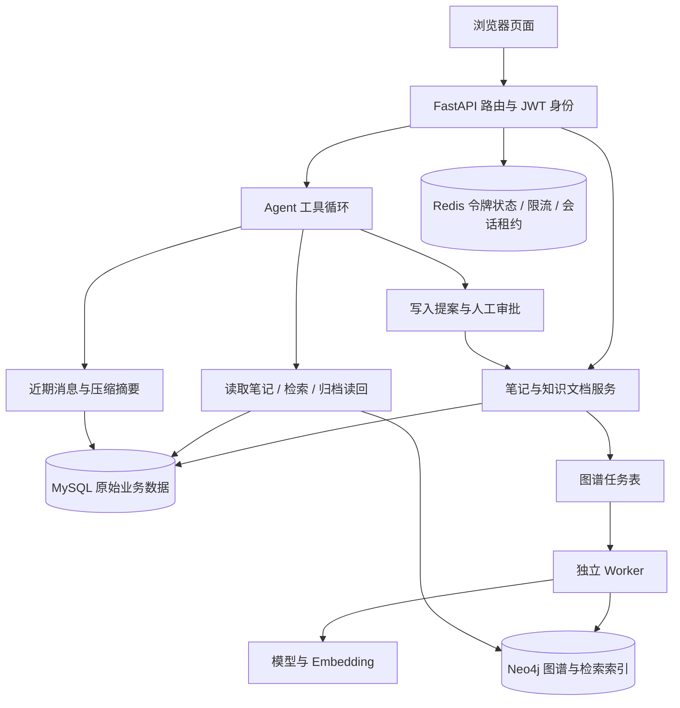
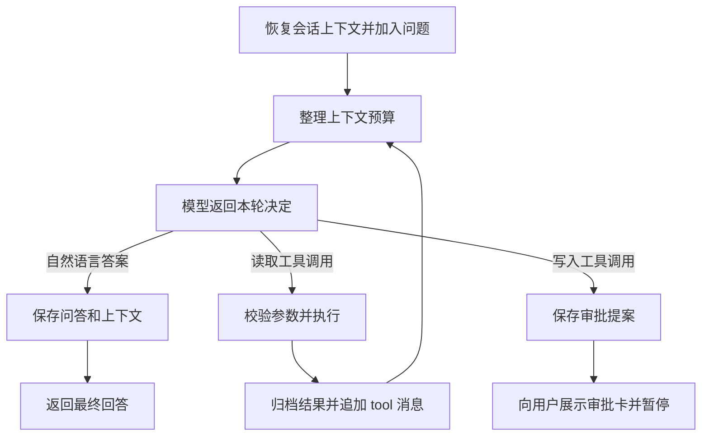

# 织识 MindWeave：AI Agent 项目功能全景说明

> 整理日期：2026-10-22。范围是正式复刻目录中的当前代码，包含第 67 篇完成后的原生工具循环与上下文压缩。
>
> 本文是一份功能说明书，依据前端页面、已注册路由、业务服务、数据模型和 Worker 源码整理。本次没有运行测试、构建、HTTP 请求或模型验收。“已实现”表示存在接通的代码路径，不表示所有外部服务配置及运行效果都已验证。全文不展示密钥、口令或令牌。

项目完整地址：

```text
.
```

本文文件地址：

```text
./docs/AI-Agent功能全景说明.md
```

## 1. 项目全貌与使用入口

### 1.1 这个项目实际解决什么问题

它把个人笔记、上传资料、学习回顾、知识图谱和 AI 助手放到同一个应用中。用户可以先写笔记或导入文档，让系统建立可检索的资料，再向 AI 提问；AI 可以按需要查资料、调用业务工具、申请创建笔记，并在长对话中整理上下文。

例如，你上传一份缓存课程 PDF，写下自己的 Redis 笔记，再问：“结合我的资料解释缓存击穿，并把结论整理成笔记。”系统可以分几轮检索、读取证据，最后提出创建笔记的审批卡。你批准后才执行创建。新笔记会进入回顾安排，并产生图谱构建任务。是否检索、检索几次以及何时提出审批，由模型在工具与预算约束下决定，并非固定脚本保证每次都走同样的步骤。

当前可以分成以下功能域：

| 功能域 | 用户能做什么 | 主要入口 |
|---|---|---|
| 账号与个人资料 | 登录、退出、编辑资料、修改密码；后端支持注册与令牌刷新 | 登录页、个人资料页、用户 API |
| 笔记管理 | 新建、编辑、搜索、筛选、置顶、分类、批量处理和导出 | 笔记列表、笔记编辑页 |
| 编辑与模板 | 富文本编辑、Markdown 预览、目录、草稿、Wiki 链接、自定义模板 | 笔记编辑页 |
| AI 写作 | 光标补全、续写、扩写、缩写、生成标签及空分类填充 | 编辑器与笔记服务 |
| 学习回顾 | 获取到期笔记、生成选择题、标记回顾、推进下次时间 | 每日回顾页 |
| 知识库 | 导入五种格式、切片、去重、展示正文和 PDF 页面、删除资料 | 知识库页 |
| 检索增强 | 向量与全文混合检索、图谱证据、问题拆解、可答性判断、条件联网补查 | Agent 的 `search_rag` 工具 |
| Agent 对话 | 连续问答、循环调用工具、补查资料、输出答案、审批写操作 | AI 聊天页 |
| 对话记忆 | 会话持久化、近期原文、旧轮次摘要、工具原文归档与分页读回 | 聊天内部机制、会话列表 |
| 知识图谱 | 自动抽取、节点关系展示、来源跳转、人工编辑接口、任务状态 | 图谱页与图谱 API |
| 工程支撑 | 用户隔离、限流、主备密钥、超时、后台任务、日志和容器配置 | 后端与开发脚本 |

### 1.2 前端页面地图

以下页面路径均相对于本机前端地址 `http://127.0.0.1:3100`。

| 页面路径 | 页面职责 | 当前情况 |
|---|---|---|
| `/login` | 用户名和密码登录、密码显示切换、错误提示 | 账号密码输入框初始为空，没有预填凭据 |
| `/register` | 注册入口 | 当前重定向到 `/login`；注册 API 仍存在 |
| `/` | 应用入口 | 默认显示笔记列表，受登录状态约束 |
| `/notes` | 笔记列表、筛选、搜索与批量操作 | 主工作入口 |
| `/notes/new` | 创建笔记、选择模板 | 编辑器入口 |
| `/notes/:id` | 编辑已有笔记、关联资料和导出 | 按笔记 ID 加载 |
| `/chat` | 开始 AI 对话 | 支持新会话 |
| `/chat/:sessionId` | 继续历史对话 | 恢复该会话的聊天记录与审批展示 |
| `/sessions` | 会话列表、进入会话、删除会话 | 只访问当前用户会话 |
| `/review` | 到期回顾、选择题及完成操作 | 使用后端到期记录 |
| `/knowledge` | 上传、浏览和删除知识文档 | 文档详情使用抽屉展示 |
| `/graph` | 图谱画布、类型过滤、搜索、详情与来源 | 图谱查询依赖 Neo4j |
| `/profile` | 显示与修改个人资料、修改密码 | 邮箱展示不等于支持修改邮箱 |
| `/settings` | 明暗主题、中英文界面 | 浏览器侧偏好 |
| `/about` | 项目介绍 | 展示性页面 |

依据：[前端路由](../front/src/router/index.tsx)、[侧边栏](../front/src/components/layout/Sidebar.tsx)、[登录页](../front/src/pages/Login.tsx)。前端页面只说明交互职责，本文不逐行解释前端代码。

### 1.3 数据怎样连接成一个产品



MySQL 是笔记、文档、会话等业务记录的主要存储；Neo4j 提供图关系和派生检索索引；Redis 管理短期控制状态。保存笔记与构建图谱分开执行，所以“笔记保存成功”和“图谱已经更新”是两个时刻。

## 2. 各模块的详细功能

### 2.1 账号、身份和个人资料

**入口与源码：** [user.py](../backend/app/router/user.py)、[user_service.py](../backend/app/services/user_service.py)、[auth_utils.py](../backend/app/utils/auth_utils.py)、[Profile.tsx](../front/src/pages/Profile.tsx)。

| 功能 | 具体行为 | 当前边界 |
|---|---|---|
| 注册账号 | 接收用户名、邮箱、密码、确认密码和可选手机号；检查后保存用户并返回令牌 | 后端入口保留，前端 `/register` 已关闭跳转 |
| 用户登录 | 后端支持用户名或邮箱配合密码；前端提供用户名登录 | 登录时检查用户可用状态；没有免登录模式 |
| 密码存储 | 服务层使用密码哈希及校验函数 | 不在数据库保存可直接使用的明文密码 |
| JWT 身份 | 签发带用户 ID、有效期和唯一 `jti` 的令牌 | 有效期代码设为 24 小时；HS256 签名 |
| 退出登录 | 将当前令牌的 `jti` 放入 Redis 黑名单 | TTL 随令牌剩余寿命设置；不是删除用户账号 |
| 令牌刷新 | 消费旧令牌并签发新令牌 | Redis `NX` 防止同一旧令牌重复刷新；前端没有接通通用自动刷新拦截器 |
| 获取个人资料 | 返回用户名、邮箱、电话、性别、简介、头像等 | 仅当前登录用户 |
| 修改资料 | 更新用户名、电话、性别、简介或头像地址等支持字段 | 更新后撤销当前令牌并返回新令牌；更新模型不包含邮箱 |
| 修改密码 | 验证旧密码与两次新密码后写入新哈希 | 属于已登录改密，没有短信、邮件找回密码流程 |
| 头像上传 | 接收 PNG、JPG/JPEG、WebP，最多 5 MB，保存随机文件名并更新用户头像 | 后端已接入；当前资料页相机图标没有完整上传交互接线 |
| 用户隔离 | 从 JWT 取得用户 ID，再查询用户自己的数据 | 不是靠前端隐藏别人记录；也没有完整团队角色与权限系统 |

**一个容易误解的点：** 登录后浏览器携带的是令牌，后端仍会检查令牌黑名单和用户可用状态。不是“JWT 能解码就全部放行”。Redis 故障时，相关鉴权会返回不可用错误。

**现有兼容差异：** 登录允许至少三位密码，以兼容本地练习账号；普通注册和改密要求至少六位。改密请求连旧密码也要求至少六位，因此三位口令的历史练习账号不能直接走这条改密请求。本文不记录实际账号口令。

### 2.2 笔记的创建、组织、搜索与导出

**入口与源码：** [note_router.py](../backend/app/router/note_router.py)、[note_service.py](../backend/app/services/note_service.py)、[NoteList.tsx](../front/src/pages/NoteList.tsx)。

| 功能 | 具体行为 |
|---|---|
| 新建笔记 | 保存标题、正文、分类、标签；服务端生成 ID 和用户归属 |
| 读取详情 | 按笔记 ID 和当前用户获取正文与元数据 |
| 修改笔记 | 仅更新请求明确提交的字段，未提交字段保留 |
| 删除笔记 | 删除当前用户拥有的笔记，并提交相应图谱更新任务 |
| 分页列表 | 支持页码和每页数量；每页最多 100 条 |
| 分类过滤 | 按分类字段筛选 |
| 标签过滤 | 精确匹配标签，再返回过滤后的总数与分页 |
| 排序 | 支持更新时间、创建时间、标题；置顶笔记优先 |
| 搜索 | 当前实现已经走语义/混合检索候选，再到 MySQL 取回笔记并复核归属 |
| 单篇置顶 | 切换当前笔记的置顶状态 |
| 批量置顶或取消 | 对一批笔记设置明确的置顶值 |
| 批量改分类 | 将选中的笔记移到指定分类 |
| 批量删除 | 只处理当前用户匹配到的记录，并返回实际影响数量 |
| 分类删除 | 删除分类下的笔记，不只是删除一个分类标签 |
| 分类统计 | 返回总笔记数、各分类数量及未分类数量 |
| 单篇 Markdown 下载 | 下载一篇笔记的 Markdown 内容 |
| 单篇导出接口 | 返回 Markdown 内容，独立于带附件下载头的接口 |
| 批量 ZIP 下载 | 将选中的笔记导出为 ZIP 中的 Markdown 文件 |

一次创建笔记还会同时创建回顾记录、提交图谱任务。就像把一本新书登记进图书馆：书本先入库，借阅提醒同时登记，索引员随后处理分类关系。

**设计与限制：**

- 笔记、首次回顾记录及图任务在创建时共享数据库提交，减少只建了笔记却漏建回顾的情况。
- 批量请求的 ID 列表上限为 100；请求中的他人 ID 不会扩大可操作范围。
- 当前标签过滤会先把该用户的候选笔记取到 Python 中过滤，大量笔记时不等同于数据库索引分页。
- 当前语义搜索总数是召回候选中的笔记数，不是全库所有可能相关笔记的精确总数。向量/全文混合召回当前只保留少量候选。
- 没有回收站、笔记版本历史或多人协作编辑。分类删除应理解为实际删掉该分类笔记。

### 2.3 编辑器、草稿和知识链接

**入口与源码：** [NoteEditor.tsx](../front/src/pages/NoteEditor.tsx)、[TiptapEditor.tsx](../front/src/components/TiptapEditor.tsx)、[OutlinePanel.tsx](../front/src/components/note/OutlinePanel.tsx)、[WikiLink.tsx](../front/src/components/WikiLink.tsx)。

编辑器支持加粗、斜体、删除线、行内代码、标题、无序列表、有序列表、任务列表、引用、代码块与语言选择、分割线、撤销和重做。表格可以插入、调整列宽、增删行列以及删除整表。

编辑过程中使用富文本结构，保存到笔记服务的正文仍是 Markdown。界面提供预览切换和大纲面板，方便在长笔记中定位章节；支持保存快捷键，以及标题、预览、表格等编辑快捷操作。

| 配套能力 | 行为与边界 |
|---|---|
| 本地草稿 | 新建笔记的标题、正文、分类和标签可留在浏览器 localStorage；不等于服务端自动保存或跨设备同步 |
| 保存状态 | 展示未保存/已保存及保存中的状态；明确保存才调用笔记写入接口 |
| Wiki 链接输入 | 输入 `[[` 后可以搜索笔记与实体候选，用键盘选择并插入链接 |
| Wiki 链接展示与跳转 | 保留 `[[目标]]` 的 Markdown 表达，页面按目标导航 |
| 关联片段面板 | 为已有笔记获取相关笔记或知识库片段，展示摘要和相关度 |
| 目录导航 | 根据编辑内容组织标题目录，帮助定位内容 |
| 模板选择与另存模板 | 新建时套用模板，也可以将当前内容保存为模板 |

Wiki 链接的前端导航和图数据库中的关系是不同环节。Worker 会解析正文中的链接标题，在当前用户的笔记中寻找对应目标，再建立 `WIKI` 边；不存在的目标不会自动变成一篇新笔记。

### 2.4 笔记模板

**源码：** [note_template_service.py](../backend/app/services/note_template_service.py)、[note_template_router.py](../backend/app/router/note_template_router.py)。

系统提供空白笔记、会议纪要、学习笔记、日记、项目计划、读书笔记六种默认模板。用户首次取模板列表且没有模板时，会初始化一套自己的默认模板。

用户可以新建模板、修改模板、删除自定义模板、拖动调整顺序，以及把笔记另存为模板。模板保存名称、图标、预设标题、正文、分类、标签和排序字段。默认模板不能走删除接口删除；排序请求必须包含该用户完整且匹配的模板 ID 集合。

模板相当于一张可重复使用的空白登记表。套用以后生成的是笔记内容，不是与模板实时同步的引用。修改模板不会自动改写已经创建的笔记。默认模板初始化目前没有独立的并发去重机制，不能把它描述成完整解决首次多请求竞争。

### 2.5 AI 写作与笔记元信息

**源码：** [note_ai_service.py](../backend/app/services/note_ai_service.py)、[note_enrichment.py](../backend/app/services/note_enrichment.py)。

| 功能 | 触发与输入 | 输出如何使用 |
|---|---|---|
| 光标补全 | 编辑器停止输入一段时间后，取光标前文本请求补全 | 以提示文字展示，Tab 可接受；不自动提交数据库 |
| 续写 | 以已有内容为上下文，要求延续原文 | 流式返回建议段落 |
| 扩写 | 根据原文补充解释 | 生成扩展文本，是否保存由编辑操作决定 |
| 缩写/总结 | 压缩原文并保留主要含义 | 返回较短文本 |
| 手动生成标签 | 对指定笔记重新提取 1–5 个标签 | 校验后更新标签字段 |
| 后台补充标签与分类 | 新建时分类和标签均未提供，或正文更新触发后台任务 | 只有分类和标签仍同时为空时才填充，避免覆盖用户手工填写 |

后台分类限定为 `work`、`study`、`life`、`project`。标签必须非空、长度受限，模型返回 JSON 也要经过结构校验。

**前端接入状态：** 当前编辑器已接通光标补全；续写、扩写、缩写和手动生成标签有后端接口，但当前编辑页面没有接通相应操作按钮。不能把接口功能直接写成已可在页面点击使用。

**实际调用链：** 编辑器提出补全请求 → 写作服务构造业务要求 → DeepSeek 客户端调用模型 → 返回文本给编辑器。其他写作能力通过对应后端接口调用。写作建议与数据库保存是两条操作；手动生成标签接口则会实际写库。

**工程取舍：** 自动元信息补充使用进程内异步任务，失败会放弃本次补充；它不是持久化任务队列。重启进程可能丢掉尚未完成的补充任务。写作接口仍使用模型文本流，第 67 篇“最终答案整段返回”的变化仅针对主聊天循环。

### 2.6 每日回顾与 AI 选择题

**源码：** [review_service.py](../backend/app/services/review_service.py)、[review_schedule.py](../backend/app/services/review_schedule.py)、[DailyReview.tsx](../front/src/pages/DailyReview.tsx)。

1. 创建笔记时安排首次回顾，时间为创建后的 1 天。
2. 今日列表读取 `next_review_at` 已到期的当前用户笔记，因此也包括以前逾期未处理的笔记。
3. 用户可以阅读笔记后直接标记完成，也可以请求 AI 根据正文生成一道四选一题。
4. 前端展示选项、正确答案、当前进度，并支持重新生成题目。
5. 标记完成后，后端增加回顾次数，记录最近回顾时间并安排下一次回顾。

间隔序列为 **1、2、4、7、15、30 天**。首次安排使用 1 天；完成第 1 次后使用 2 天，此后逐步增加，达到末档后保持 30 天。

生成题目只读取当前用户该笔记的正文或标题，截取最多 2000 字符。返回模型要求四个唯一选项，答案必须属于选项。生成失败不会当成一道正确题目返回。

**边界：** 这是固定间隔回顾，不是 FSRS 或根据答题表现自适应调整的算法。后端没有考试答卷、成绩历史或错题本表；答案判断主要在前端进行。当前前端发出完成请求后就推进本地进度，错误被忽略，可能出现页面显示完成但数据库没有成功更新的差异。重新生成题目会重新调用模型，未实现服务端题目缓存。

### 2.7 知识库导入、解析和清理

**源码：** [knowledge_router.py](../backend/app/router/knowledge_router.py)、[knowledge_service.py](../backend/app/services/knowledge_service.py)、[document_extract.py](../backend/app/services/document_extract.py)、[KnowledgeBase.tsx](../front/src/pages/KnowledgeBase.tsx)。

| 格式 | 当前提取方式 | 输出粒度 |
|---|---|---|
| TXT | UTF-8/UTF-8 BOM 文本解码和换行规范化 | 文本切片 |
| Markdown | 按文本读取 Markdown 内容 | 文本切片 |
| PDF | 提取每页文字，符合条件的页面再尝试视觉增强 | 页号、切片、部分页面图片 |
| DOCX | 按文档块读取段落和表格行 | 合并正文后切片 |
| PPTX | 读取每页幻灯片文字和表格 | 幻灯片页号与切片 |

单文件必须非空且不超过 **10 MB**。多文件接口一次最多 **5 个**。不支持把旧 `.doc`、旧 `.ppt`、音频、视频、任意网页 URL 当成已实现的导入格式。

| 功能 | 当前行为 |
|---|---|
| 单文件导入 | 解析文件、创建文档及切片、提交图谱任务 |
| 普通多文件导入 | 逐个导入后返回文件名；此前文件可能已提交，不能当成整批事务回滚 |
| SSE 多文件导入 | 逐文件返回 processing、completed 或 error，最后发 finish；单个失败不阻止后续文件 |
| 文件选择与拖拽 | 前端支持选择文件或拖到上传区域 |
| 文件名清理 | 去掉客户端路径成分，保留展示文件名 |
| 去重 | 同一用户的相同文件名或相同原始文件 MD5 会被拒绝；数据库唯一约束处理并发重复 |
| 文本切片 | 每片最多 1000 字符，邻片重叠 200 字符，减少边界内容丢失 |
| 文档列表 | 展示文件名、格式、大小、切片数量、时间与预览等 |
| 文档详情 | 返回正文、MD5 和有序切片，前端抽屉展示 |
| 切片读取 | 返回切片内容、索引、可用页号和图片引用 |
| MD5 记录 | 提供当前用户的 MD5 列表与单条记录查询 |
| 删除指定文档 | 支持按文件名或 MD5 删除，同时处理正文、切片、图片及图谱清理任务 |
| 清空知识库 | 清理当前用户的全部文档及相关数据，不影响其他用户 |

**导入链路：** 原始文件 → 格式解析 → 可选 PDF 视觉描述 → MySQL 文档和切片 → 图谱任务 → Worker 向量化及实体关系处理。

SSE 中的上传“完成”表示文档导入阶段完成，不代表 Neo4j 已经完成索引。当前进度主要是阶段值，不是按照解析字节计算的精确百分比。没有断点续传或原始二进制文件下载接口；系统主要保存解析后的正文及派生页面图片。

`delete_documents=false` 的“只清 MD5、保留文档”当前明确返回业务错误，因为 MD5 就在文档记录中，并没有独立的去重账本。

### 2.8 PDF 图片和视觉理解

**源码：** [pdf_vision.py](../backend/app/services/pdf_vision.py)、[vision_pages.py](../backend/app/services/vision_pages.py)、[DocumentDetailDrawer.tsx](../front/src/components/knowledge/DocumentDetailDrawer.tsx)。

对于文字不足 100 字符或包含图片的 PDF 页面，系统会尝试渲染页面图片，再让模型描述可见文字、表格和图形。描述与原页面提取文本合并后进入切片流程。

具体能力包括：

- 按页渲染 PNG，保存到 `data/extracted_images/<user_id>/<md5>/`。
- 使用感知哈希识别相似页面，复用代表页面的描述，减少重复模型调用。
- 分批把页面送入视觉请求，默认每批 5 页，默认最多处理 50 个候选页面。
- 提供需身份校验的单张页面图片接口，以及一个文档全部已保存图片的 Base64 列表接口。
- 删除文档时清理页面图片；数据库提交失败时处理相应文件清理。

**必须区分代码能力与模型能力：** 视觉代码复用当前 `DeepSeekClient`，没有独立的视觉供应商客户端。只有实际配置的接口和模型支持 `image_url` 输入时，这条路径才可能成功。文字聊天成功不能证明图片理解成功。

视觉增强失败时会尝试保留已提取的文字；没有可读取文字且视觉也失败的扫描 PDF 会导入失败。感知哈希是相似性判断，不是逐字相等证明。DOCX/PPTX 当前主要提取文字和表格，不会自动获得 PDF 同款页面视觉理解。

### 2.9 Embedding、混合检索和关联推荐

**源码：** [embedding.py](../backend/app/rag/embedding.py)、[hybrid_retrieval.py](../backend/app/rag/hybrid_retrieval.py)、[note_search.py](../backend/app/rag/note_search.py)、[related.py](../backend/app/rag/related.py)。

把 Embedding 想成给每段资料计算一个“语义坐标”。用户问题也变成坐标，系统据此寻找意思接近的内容，再结合文字匹配，而不只要求字面相同。

| 能力 | 当前实现 | 重要范围 |
|---|---|---|
| 本地向量模型 | `sentence-transformers` 延迟加载模型 | 使用本地模式时才加载对应大型依赖 |
| 远程向量接口 | 调用兼容 `/embeddings` 的服务，支持模型名、维度和批量设置 | 与聊天模型配置独立 |
| 向量规范化 | 校验维度、拒绝零向量并进行 L2 归一化 | 模型或维度变更不能直接沿用旧索引 |
| 向量索引 | Neo4j Chunk 节点保存文本向量 | 用于相似语义召回 |
| 全文索引 | Neo4j 全文查询召回 Chunk | 补充词语匹配 |
| 双路融合 | 使用排名倒数积分合并向量与全文结果 | 分数是排序值，不是正确率 |
| MySQL 降级 | 图服务、索引或 Embedding 调用异常时改走 MySQL 字面检索 | 语义能力会下降；正常返回空候选不一定触发降级 |
| 笔记搜索回填 | 召回后重新按用户 ID 到 MySQL 读取笔记 | 防止把无归属或已经不存在的候选直接展示 |
| 关联片段 | 以当前笔记为种子召回，再用向量相似度排序 | 返回最多 5 条相关笔记/文档片段 |
| 候选重排序 API | 对传入的一组短文档与问题计算向量相似度 | 是独立接口，不是已经嵌入全部 RAG 流程的交叉编码器 |

**长文限制：** MySQL 可以保存导入后的全部切片，但 Neo4j 的 `replace_chunks` 当前只索引每个来源前 50 片。不能因为上传成功就宣称整本长文档都已进入向量召回范围。

### 2.10 RAG 问题规划、图谱证据与条件联网搜索

**源码：** [agentic_service.py](../backend/app/rag/agentic_service.py)、[graph_retrieval.py](../backend/app/rag/graph_retrieval.py)、[answerability.py](../backend/app/rag/answerability.py)、[web_search.py](../backend/app/rag/web_search.py)。

当 Agent 调用 `search_rag`，内部还会执行一轮检索规划：

1. 将问题规划成最多 3 个短查询；规划失败则退回原始问题。
2. 每个查询分别尝试图谱检索和混合文本检索。
3. 合并来源，去除同一来源类型与 ID 的重复候选。
4. 判断本地证据是否足以回答。
5. 本地不足且配置允许时，通过 Tavily 或 Serper 补充外部搜索结果。
6. 将片段、来源 ID、标题、分数、可答性和是否使用外部证据交回 Agent。

图谱检索先从问题提取实体名称，再寻找匹配实体及其来源和相关切片。它提供的是实体、描述及来源证据，不等于已经实现任意路径规划或复杂图算法推理。图谱查询失败时可以返回空图证据，文本检索仍可继续。

联网搜索需要同时启用开关、配置供应商和密钥。代码默认 `WEB_SEARCH_ENABLED=False`，不能默认宣传为实时联网。它目前使用搜索服务返回的摘要，没有通用浏览器操作、网页全文抓取或自动点击链接。

**第 67 篇后的衔接：** 外层 Agent 已经持有聊天历史，并被提示在调用 `search_rag` 前展开“这个”“第二个”等指代。新工具适配层将独立问题传给检索服务，并没有把整份压缩上下文再传入内部查询规划器。旧 `collect_evidence(history=...)` 参数仍保留。

### 2.11 Agent 的核心：连续模型与工具循环

**源码：** [chat_loop.py](../backend/app/agent/chat_loop.py)、[loop_protocol.py](../backend/app/agent/loop_protocol.py)、[loop_tools.py](../backend/app/agent/loop_tools.py)、[agent_loop.txt](../backend/app/prompt/agent_loop.txt)。

主聊天接口为 `POST /chat/agent/query/stream`。新的处理方式是：



模型无需先选一个固定工作流。它可以直接解释概念，也可以读资料，发现不足后换问题补查，再回答。前一轮的 `assistant.tool_calls` 和对应的 `tool.tool_call_id` 会一起进入下一轮请求，模型才能知道刚刚调用了什么、实际得到什么。

当前提供 **11 个工具**：

| 工具名 | 可以做什么 | 参数与执行边界 |
|---|---|---|
| `search_notes` | 搜索当前用户的笔记 | `query` 最多 100 字符；结果带 ID、标题及正文摘要 |
| `note_stats` | 读取当前用户的笔记分类统计 | 不接收用户 ID 参数 |
| `today_reviews` | 列出当前用户到期的回顾笔记 | 返回可供后续操作的笔记 ID 和标题 |
| `what_time` | 读取服务器当前本地时间 | 不是联网新闻或用户位置工具 |
| `get_user_info` | 读取当前用户身份标识 | 当前返回用户 ID，不是完整资料检索 |
| `related_notes` | 查找指定笔记的关联片段 | 必须使用真实且属于当前用户的 `note_id` |
| `create_note` | 提出创建笔记申请 | 标题、正文经校验后生成审批提案，不立即写入 |
| `mark_reviewed` | 提出完成回顾申请 | 经审批后才调用业务服务推进回顾 |
| `search_rag` | 获取知识库、笔记、图谱及条件外部证据 | 查询最多 2000 字符，可换角度再次调用 |
| `read_artifact` | 分页读回本会话归档的原文 | `artifact_id`、`offset`；每页最多 2000 字符 |
| `compact` | 请求整理旧轮次 | 只改变工作上下文，不改笔记正文或知识库 |

**工具执行控制：**

- 工具目录以 JSON Schema 交给模型，服务器收到参数后再次使用 Pydantic 校验。
- 用户 ID 和会话 ID 由服务端注入，不让模型通过参数选择其他用户。
- 每个模型轮次最多允许一个工具调用；不支持一次并行返回多个工具后并行执行。
- 相同工具与相同参数在一次请求中最多执行两次，第三次会中止；重复调用 ID 会被拒绝。
- 主循环默认最多 10 轮；请求总截止时间为 180 秒。摘要与检索中的额外模型调用也消耗这段时间，但不单独计入主循环轮数。
- 默认输出预算为 2048 token，可由配置调整；达到预算并不保证模型一定已经完成任务。

普通概念问答不强制检索；涉及用户自己的笔记和统计时，提示词要求获取工具证据。这个区别让“解释 Redis 是什么”和“我的 Redis 笔记写了什么”采用不同材料来源。

### 2.12 人工审批与受控写入

**源码：** [run_store.py](../backend/app/agent/run_store.py)、[approval_stream.py](../backend/app/agent/approval_stream.py)、[tools.py](../backend/app/agent/tools.py)、[AIChat.tsx](../front/src/pages/AIChat.tsx)。

如果用户说“把这个结论记成笔记”，Agent 可以提出 `create_note`，前端显示操作名、参数和说明。批准或拒绝后，前端调用 `/chat/agent/resume`。

| 阶段 | 数据变化与行为 |
|---|---|
| 提案 | MySQL `agent_runs` 保存请求和参数，状态为 pending；会话记录 pending_run_id |
| 等待 | 当前会话不能继续提交另一项普通聊天任务；界面可恢复待审批卡片 |
| 领取 | 后端通过数据库行锁领取审批，将 pending 改为 executing |
| 拒绝 | 保存 rejected 和取消说明，随后追加聊天记录 |
| 批准 | 执行已登记的业务写操作，保存 completed，再解释实际结果 |
| 状态不确定 | 写入可能已发生时不自动重复执行，保留状态并提示核对 |
| 刷新恢复 | 提供待审批查询和最近审批状态快照接口 |

**边界要准确：** 当前写工具只有创建笔记、完成回顾。不是所有后端接口都能由 Agent 自主调用。批准后执行并解释，下一条用户消息才继续新循环；还没有“批准后自动恢复上次循环剩余任务”的机制。

已有领取保护可阻止常规重复点击，但业务提交与审批状态封存不是跨服务的统一事务。极端断线或崩溃场景仍可能留下需要人工确认的 executing 状态，不能宣称绝对 exactly-once。

### 2.13 会话历史、上下文压缩和原文恢复

**源码：** [chat_context.py](../backend/app/services/chat_context.py)、[chat_memory_store.py](../backend/app/services/chat_memory_store.py)、[chat_session_service.py](../backend/app/services/chat_session_service.py)。

这里有三类不同用途的数据：

| 数据 | 存储位置 | 用途 |
|---|---|---|
| 用户和助手的原始问答 | `chat_messages` | 页面重开时显示历史 |
| 当前模型工作上下文 | `chat_sessions.metadata.agent_context` | 保存近期消息、摘要、归档索引和水位线 |
| 完整工具结果与压缩快照 | `chat_artifacts` | 输入被缩短后仍能读回原文 |

工作上下文可以理解成研究员的办公桌：近期对话在桌面，过去几轮的要点写进交接笔记，完整工具材料放进编号档案柜。桌面容量不足时整理桌面，而不是删除用户的原始笔记。

**压缩顺序：**

1. 工具返回后，先把完整结果保存为归档，再给模型一份默认最多 2500 字符的预览和归档 ID。
2. 每次模型请求前，计算系统提示、消息和工具定义序列化后的 UTF-8 字节数。
3. 超过默认 60000 字节时，先把较旧工具结果的预览换成短归档指针；最新两个工具结果先保留。
4. 仍超预算时，把旧用户轮次归档并逐段总结，保留最近两个用户轮次的原文。
5. 摘要按目标、约束、事实、已完成事项、未解决问题和来源六类保存，经过结构与大小校验才替换上下文。
6. 模型明确拒绝上下文过长时，最多再进行一次强制压缩重试；其他错误不会冒充长度错误无限重试。
7. 需要逐字内容时，模型调用 `read_artifact` 分页取回。已分页内容不会再次套用 2500 字符截断。

切分位置按用户轮次边界选择，避免只留下工具调用却丢掉对应结果。成功回答与新的上下文状态在同一事务保存。`through_id` 表示已经吸收的最后一条聊天消息，审批流程产生的新消息会在下次加载时补入。

**长期记忆边界：** 这是一份会话内、可恢复但有损的摘要，不是跨会话的用户画像，也没有永久正确的知识记忆承诺。最近两个轮次本身过大时可以拒绝请求，不会无限截断当前问题。失败请求可能留下空会话或尚未被成功上下文引用的归档；归档随会话删除，尚未实现按容量或时间自动清理。

### 2.14 会话管理、SSE 与模型接入

**源码：** [chat_router.py](../backend/app/router/chat_router.py)、[chat_stream_service.py](../backend/app/services/chat_stream_service.py)、[deepseek_client.py](../backend/app/services/deepseek_client.py)、[Sessions.tsx](../front/src/pages/Sessions.tsx)。

| 功能 | 当前行为 |
|---|---|
| 新会话 | 为新问题分配会话 ID，以问题开头生成初始标题 |
| 历史会话列表 | 按更新时间列出当前用户会话 |
| 历史记录恢复 | 按会话加载原始用户和助手消息 |
| 会话删除 | 删除会话及外键关联的消息、归档，并尝试清理旧 checkpoint |
| 最近会话导航 | 前端保存最近会话 ID，便于继续对话 |
| 阶段事件 | SSE 发送循环进度、工具开始/结束和部分检索证据 |
| 审批卡 | SSE `interrupt` 携带审批请求，另有状态查询用于恢复 |
| 最终答案 | 第 67 篇主循环使用非流式模型轮次，最终 `response` 整段发出 |
| 错误与结束 | 返回 error、done 事件，便于结束当前页面等待状态 |
| 主备密钥 | 先尝试主密钥，在指定 HTTP 错误或连接建立失败时尝试备用密钥 |
| 模型格式控制 | 普通文本、JSON 模式、原生工具消息分别有调用入口 |
| 响应校验 | 检查响应结构、空答案、结束原因与截断；工具调用信息保留给下一轮 |

主备切换处理指定的认证、余额、限流和部分服务端错误；不是每次失败都轮换，更不是换成另一个更强的模型。文本流一旦已经输出内容，不会切换密钥并把两次回答拼起来。

界面里的“思考过程”实际是应用阶段和工具活动记录，不是模型的完整内部推理。主聊天保留 SSE，并不意味着保留逐 token 打字效果。当前没有会话重命名 API、全文搜索聊天记录或跨会话自动记忆功能。

### 2.15 图谱的自动构建、索引同步和任务恢复

**源码：** [task_queue.py](../backend/app/graph/task_queue.py)、[worker.py](../backend/app/graph/worker.py)、[extractor.py](../backend/app/graph/extractor.py)、[graph_store.py](../backend/app/graph/graph_store.py)、[task_recovery.py](../backend/app/graph/task_recovery.py)。

保存或删除笔记、导入或删除文档时，业务服务把需要更新的来源登记到 MySQL 图谱任务表。独立 Worker 随后处理：

- 领取待处理任务，通过数据库行锁与 `skip_locked` 避免多个 Worker 同时领取同一任务。
- 重新读取当前来源；来源已删除则清理图节点和对应向量切片。
- 计算内容哈希，在已有成功抽取且内容未变化时跳过不必要处理；强制重新抽取可绕过这项判断。
- 调用模型提取实体和关系，再用结构模型校验。
- 写入来源、实体、关系与切片向量；维护 Chunk 对实体的提及边。
- 解析笔记 Wiki 链接，建立对应的笔记引用边。
- 记录抽取状态、内容哈希、数量和错误信息，供页面或 API 读取。
- 处理失败时在尝试次数约束内重排队；达到 3 次后进入 failed。
- 回收运行超过 30 分钟的任务，根据尝试次数重排队或标记失败。
- 使用运行令牌区分任务处理者，旧运行不能随意覆盖新运行的任务状态。

系统还提供概念、人物、组织、技术四种系统实体类型，以及无来源引用的自动实体清理。人工标记的实体不按普通自动孤儿实体删除。

**工程边界：** 图数据库是异步更新的派生数据，不与 MySQL 构成跨库原子事务。请求返回后图谱可能暂时落后，需要 Worker 继续处理。实体抽取当前只取输入前 6000 字符，向量索引只处理每来源前 50 片。抽取日志中的 new_count、update_count 当前分别使用输出实体数、关系数，不应当成精确数据库新增/更新差分统计。

### 2.16 图谱浏览、来源追踪和人工编辑

**源码：** [graph/router.py](../backend/app/graph/router.py)、[views.py](../backend/app/graph/views.py)、[edit_service.py](../backend/app/graph/edit_service.py)、[GraphPage.tsx](../front/src/pages/GraphPage.tsx)。

| 功能 | 当前范围 | 页面与接口状态 |
|---|---|---|
| 图谱概览 | 返回当前用户的实体、笔记、文档节点和关系，支持类型过滤与数量限制 | 图谱页面使用 |
| 交互画布 | 力导向布局、拖拽、缩放和视图定位等 | 前端画布组件 |
| 图谱搜索 | 搜索实体名称和笔记标题 | 页面搜索与 Wiki 候选可使用 |
| 实体详情 | 展示实体类型、描述、别名等返回字段 | 详情面板 |
| 实体来源 | 查询实体关联的笔记或文档来源 | 从图回到资料 |
| 邻居展开 | 提供 1–3 层关系邻域查询，限制返回规模 | 后端接口能力 |
| 笔记/文档相关图 | 按一个来源过滤展示关联子图 | 页面详情与 API |
| 重新抽取笔记 | 对有权限的笔记提交强制重建任务 | 后端接口能力 |
| 抽取日志 | 查询任务与抽取审计结果 | 后端接口能力 |
| 图任务事件 | SSE 每隔约 2 秒读取状态变化，推送完成或失败事件 | 页面可以据此刷新图 |
| 人工创建实体 | 指定名称、类型、描述等字段 | 后端接口已实现 |
| 人工修改实体 | 更新实体展示字段 | 后端接口已实现 |
| 删除实体 | 删除实体及关联边 | 详情面板有删除入口，后端也提供接口 |
| 合并实体 | 把一个实体的提及与关系迁移到目标实体，再删除源实体 | 后端接口已实现 |
| 类型管理 | 列表、新增、修改、删除实体类型；删除时解除相应类型引用 | 后端接口已实现 |
| 人工关系管理 | 新建、删除人工关系 | 后端接口已实现 |

“接口已实现”不表示前端拥有每一种操作的完整表单。当前页面主要接通展示、过滤、搜索、详情和删除；新增/合并实体、类型与关系编辑等不能仅凭 API 存在就宣称全部在页面可操作。

邻居 API 还受当前图视图的数量限制影响，不是无限图遍历。实体自动重新抽取可能改变派生关系，人工修订与后续模型抽取之间也没有完整的版本合并系统。

### 2.17 主题、语言与通用交互

**源码：** [Settings.tsx](../front/src/pages/Settings.tsx)、[useThemeStore.ts](../front/src/stores/useThemeStore.ts)、[useLanguageStore.ts](../front/src/stores/useLanguageStore.ts)、[client.ts](../front/src/api/client.ts)。

- 明亮/深色主题切换，浏览器保存选择。
- 中文/英文界面切换；部分功能提示仍有硬编码中文，不等于每个文案都有完整双语覆盖。
- 页面加载占位、空状态、消息提示和删除确认对话框。
- 应用侧边栏折叠与展开，以及未登录时跳转登录页。
- HTTP 请求统一附带 Bearer token；401 时清理本地登录状态并跳回登录页。
- 公共 API 客户端识别非成功业务码并作为错误处理。
- 聊天 Markdown 展示、来源/工具记录展开、审批内容展开和历史会话导航。

这里没有“在设置页修改模型、API key、温度或上下文预算”的界面。模型配置仍在后端配置体系中。

### 2.18 运行、可观测性与并发控制

**源码：** [settings.py](../backend/app/core/settings.py)、[rate_limit.py](../backend/app/core/rate_limit.py)、[observability.py](../backend/app/core/observability.py)、[session_lease.py](../backend/app/agent/session_lease.py)、[docker-compose.yml](../docker-compose.yml)。

| 工程功能 | 已有机制 | 实际边界 |
|---|---|---|
| 统一配置 | 从复刻根目录 `.env` 读取配置，使用 Pydantic 限定类型和范围 | 不需要依赖终端当前目录定位配置 |
| 统一响应与异常 | 提供成功响应、业务异常、输入错误和 HTTP 异常处理 | 用户接口保留部分兼容结构，不能说所有接口完全相同 |
| 数据库会话 | 请求使用独立 AsyncSession，异常回滚，业务层显式提交 | 不能代替跨 MySQL/Neo4j/Redis 事务 |
| 启动与关闭 | 初始化缺失表、启动预热，退出时清理连接池和驱动 | create_all 不会自动完成所有历史表结构迁移 |
| 存活接口 | `/health/live` 表示应用可接请求 | 不依赖模型回答 |
| 就绪接口 | `/health/ready` 检查 MySQL 与 Redis | 没有把 Neo4j、Embedding、LLM 全部纳入检查 |
| 固定窗口限流 | Redis 计数；聊天默认每分钟 10 次、上传默认每分钟 5 次 | 按 scope 与客户端地址计数，不是按用户账单配额 |
| 耗时与日志 | 返回 `X-Process-Time`，记录路径、方法、状态和耗时 | SSE 的该耗时不等于完整模型流耗时；没有完整分布式追踪 |
| 会话串行化 | 聊天和审批共用 Redis NX 租约 | TTL 240 秒，令牌比较后释放；没有完整分布式 fencing 机制 |
| 模型超时 | 客户端网络超时与聊天请求总截止时间 | 超时不代表所有外部请求都未计费 |
| Embedding 预热 | 后端启动后后台触发一次嵌入加载/调用 | 远程模式也可能发出远程请求；失败不会当成应用启动失败 |
| 容器编排 | MySQL、Redis、Neo4j、API、Worker、前端及持久卷配置 | 本文没有执行镜像构建或部署验收 |
| 本地启动 | `scripts/start-dev.sh` 及各进程独立启动方式 | 图任务需要独立 Worker，只有网页与 API 不够 |

## 3. 接口清单、数据归属与能力边界

### 3.1 HTTP 接口总表

以下按源码中实际注册的路由列出。它是静态接口索引，不是本次调用结果。列表中的动态参数保持后端真实写法；输入字段和响应模型以对应源码为准。

共列出 **83 个显式 HTTP 路由**，另有 `/media` 静态挂载和 FastAPI 默认接口文档入口。一个业务能力可能有多个接口，接口数量不等于独立产品功能数量。

#### 账号与资料（7 个）

源码：[backend/app/router/user.py](../backend/app/router/user.py)。

| 方法 | 路径 | 用途 |
|---|---|---|
| POST | `/user/register/` | 注册并签发令牌（前端注册入口关闭） |
| POST | `/user/login/` | 用户登录并签发令牌 |
| POST | `/user/logout/` | 注销当前令牌 |
| POST | `/user/refresh-token/` | 一次性消费旧令牌并刷新 |
| GET | `/user/detail/` | 读取当前用户资料 |
| PUT | `/user/update/` | 修改资料并换发令牌 |
| POST | `/user/reset-password/` | 校验旧密码后改密 |

#### 文件上传（1 个）

源码：[backend/app/router/file_router.py](../backend/app/router/file_router.py)。

| 方法 | 路径 | 用途 |
|---|---|---|
| POST | `/file/upload/` | 上传头像并更新用户头像地址 |

#### 笔记与 AI 写作（19 个）

源码：[backend/app/router/note_router.py](../backend/app/router/note_router.py)。

| 方法 | 路径 | 用途 |
|---|---|---|
| POST | `/note/create` | 创建笔记、回顾记录和图任务 |
| GET | `/note/list` | 分页、分类/标签筛选与排序 |
| POST | `/note/batch/delete` | 批量删除自己的笔记 |
| PUT | `/note/batch/pin` | 批量设置置顶状态 |
| PUT | `/note/batch/category` | 批量设置分类 |
| DELETE | `/note/category/{category}` | 删除分类下笔记 |
| POST | `/note/batch/download` | 批量导出 ZIP |
| GET | `/note/{note_id}/download` | 下载 Markdown 附件 |
| GET | `/note/{note_id}/export` | 返回 Markdown 内容 |
| GET | `/note/{note_id}/related` | 查询关联片段 |
| POST | `/note/autocomplete` | 光标文本补全 |
| POST | `/note/assist/stream` | 续写、扩写或缩写的文本流 |
| GET | `/note/search` | 语义/混合搜索自己的笔记 |
| GET | `/note/stats` | 分类与总量统计 |
| GET | `/note/{note_id}` | 笔记详情 |
| PUT | `/note/{note_id}` | 更新指定字段 |
| PUT | `/note/{note_id}/pin` | 切换单篇置顶 |
| POST | `/note/{note_id}/auto-tag` | 生成并写回标签 |
| DELETE | `/note/{note_id}` | 删除单篇笔记 |

#### 笔记模板（5 个）

源码：[backend/app/router/note_template_router.py](../backend/app/router/note_template_router.py)。

| 方法 | 路径 | 用途 |
|---|---|---|
| GET | `/note-template/list` | 获取模板，必要时初始化默认模板 |
| POST | `/note-template/create` | 创建个人模板 |
| PUT | `/note-template/reorder` | 设置完整模板顺序 |
| PUT | `/note-template/{template_id}` | 修改模板 |
| DELETE | `/note-template/{template_id}` | 删除自定义模板 |

#### 学习回顾（3 个）

源码：[backend/app/router/review_router.py](../backend/app/router/review_router.py)。

| 方法 | 路径 | 用途 |
|---|---|---|
| GET | `/review/today` | 查询已到期的回顾笔记 |
| POST | `/review/done/{note_id}` | 完成回顾并推进间隔 |
| GET | `/review/question/{note_id}` | 根据笔记生成一道四选一题 |

#### 知识库（14 个）

源码：[backend/app/router/knowledge_router.py](../backend/app/router/knowledge_router.py)。

| 方法 | 路径 | 用途 |
|---|---|---|
| POST | `/knowledge/add/multiple/stream` | 多文件逐项处理并返回 SSE 进度 |
| POST | `/knowledge/add/multiple` | 普通多文件导入 |
| POST | `/knowledge/add/single` | 单文件导入 |
| GET | `/knowledge/list` | 列出当前用户文档 |
| GET | `/knowledge/detail` | 按文件名读取文档正文与切片 |
| GET | `/knowledge/chunks` | 按文件名读取切片 |
| GET | `/knowledge/md5/list` | 列出 MD5 记录 |
| GET | `/knowledge/md5/{md5_value}` | 读取单条 MD5 记录 |
| DELETE | `/knowledge/md5/clear` | 清空文档记录；不支持仅清 MD5 保留正文 |
| DELETE | `/knowledge/delete/filename` | 按文件名删除文档 |
| DELETE | `/knowledge/md5/delete/{md5_value}` | 按 MD5 删除文档 |
| DELETE | `/knowledge/clean` | 清空当前用户知识库 |
| GET | `/knowledge/image/{md5_value}/{filename}` | 读取有权限的 PDF 页面 PNG |
| GET | `/knowledge/images/all/{md5_value}` | 取得已保存页面图片的 Base64 列表 |

#### 聊天与会话（9 个）

源码：[backend/app/router/chat_router.py](../backend/app/router/chat_router.py)。

| 方法 | 路径 | 用途 |
|---|---|---|
| POST | `/chat/agent/query/stream` | 运行原生 Agent 循环并发送 SSE |
| GET | `/chat/session/{session_id}/pending` | 获取当前待审批提案 |
| GET | `/chat/session/{session_id}/approval` | 获取最近审批状态快照 |
| POST | `/chat/agent/resume` | 批准或拒绝提案并返回处理事件 |
| POST | `/chat/reorder` | 对给定候选执行向量重排序 |
| GET | `/chat/sessions` | 当前用户会话列表 |
| GET | `/chat/sessions/{path_user_id}` | 指定用户会话列表，仅允许当前用户 |
| GET | `/chat/session/{session_id}` | 恢复会话原始问答 |
| DELETE | `/chat/session/{session_id}` | 删除会话及关联消息、归档 |

#### 知识图谱（20 个）

源码：[backend/app/graph/router.py](../backend/app/graph/router.py)。

| 方法 | 路径 | 用途 |
|---|---|---|
| GET | `/api/graph/overview` | 带类型过滤和规模限制的图谱概览 |
| GET | `/api/graph/entity/{entity_id}` | 实体详情 |
| GET | `/api/graph/entity/{entity_id}/neighbors` | 查询实体有限深度邻居 |
| GET | `/api/graph/entity/{entity_id}/notes` | 实体关联来源 |
| GET | `/api/graph/notes/{note_id}/related` | 笔记关联子图 |
| POST | `/api/graph/notes/{note_id}/re-extract` | 提交笔记强制重新抽取任务 |
| GET | `/api/graph/docs/{doc_id}/related` | 文档关联子图 |
| GET | `/api/graph/search` | 搜索实体名称和笔记标题 |
| GET | `/api/graph/extract-logs` | 查询图任务和抽取日志 |
| GET | `/api/graph/events` | 图任务状态 SSE |
| POST | `/api/graph/entities` | 人工创建实体 |
| PUT | `/api/graph/entities/{entity_id}` | 更新实体字段 |
| DELETE | `/api/graph/entities/{entity_id}` | 删除实体及关联边 |
| POST | `/api/graph/entities/merge` | 合并两个实体 |
| GET | `/api/graph/types` | 实体类型列表 |
| POST | `/api/graph/types` | 创建实体类型 |
| PUT | `/api/graph/types/{type_id}` | 修改实体类型 |
| DELETE | `/api/graph/types/{type_id}` | 删除类型并解除引用 |
| POST | `/api/graph/relations` | 创建人工关系 |
| DELETE | `/api/graph/relations/{relation_id}` | 删除人工关系 |

#### 运行状态（2 个）

源码：[backend/app/router/health.py](../backend/app/router/health.py)。

| 方法 | 路径 | 用途 |
|---|---|---|
| GET | `/health/live` | 应用存活状态 |
| GET | `/health/ready` | MySQL 与 Redis 就绪状态 |

#### 应用基础入口（3 个）

源码：[backend/main.py](../backend/main.py)。

| 方法 | 路径 | 用途 |
|---|---|---|
| GET | `/` | 基础欢迎信息 |
| GET | `/hello/{name}` | 演示问候接口 |
| GET | `/health` | 基础健康文案，不检查依赖 |

默认文档入口为 `/docs`、`/redoc` 和 `/openapi.json`。`/media` 用于已上传头像的静态访问；PDF 页面走带用户归属检查的 `/knowledge/image/...`，两者访问方式不同。

### 3.2 功能与数据表的对应关系

以下是代码声明的 MySQL 表及用途；没有为本文连接数据库查询数据。

| 表 | 负责保存什么 | 主要模型 |
|---|---|---|
| `user_service` | 用户身份、密码哈希与个人资料 | [user_model.py](../backend/app/models/user_model.py) |
| `notes` | 笔记标题、正文、分类、标签、置顶与归属 | [note.py](../backend/app/models/note.py) |
| `note_templates` | 默认与自定义模板、排序 | [note_template.py](../backend/app/models/note_template.py) |
| `review_records` | 回顾次数、上次时间、下次时间、间隔 | [review_record.py](../backend/app/models/review_record.py) |
| `knowledge_documents` | 文档文件名、MD5、正文、状态和大小等 | [knowledge_document.py](../backend/app/models/knowledge_document.py) |
| `knowledge_chunks` | 文档切片、页号与图片引用 | 同上 |
| `chat_sessions` | 会话标题、归属、待审批 ID、压缩上下文 | [chat_history.py](../backend/app/models/chat_history.py) |
| `chat_messages` | 用户与助手原始问答 | 同上 |
| `chat_artifacts` | 工具完整输出及压缩前快照 | [chat_artifact.py](../backend/app/models/chat_artifact.py) |
| `agent_runs` | 写操作审批的提案、状态和结果 | [agent_run.py](../backend/app/models/agent_run.py) |
| `graph_tasks` | 图谱后台任务、尝试次数、运行令牌等 | [graph_task.py](../backend/app/models/graph_task.py) |
| `graph_extract_logs` | 抽取结果状态、哈希、数量与错误 | [graph_extract_log.py](../backend/app/models/graph_extract_log.py) |
| `agent_checkpoints` | 旧 LangGraph 工作流检查点 | [agent_checkpoint.py](../backend/app/models/agent_checkpoint.py) |
| `agent_checkpoint_writes` | 旧工作流中间写入记录 | 同上 |

**旧实现的当前地位：** `workflow.py` 和 MySQL checkpointer 仍在仓库中，供兼容与旧代码使用。第 67 篇的主聊天入口已经调用 `chat_loop.py`，新的持久记忆在会话 metadata 和归档表中。因此不能把“有 LangGraph checkpoint 表”写成“当前聊天循环支持从任意中间节点断点恢复”。

Neo4j 主要保存来源、笔记、实体、实体类型、Chunk 及关系，支持语义/全文索引与图展示。Redis 保存令牌黑名单、固定窗口计数和会话租约，不是当前长期聊天历史的存储。浏览器 localStorage/sessionStorage 保存登录状态、主题语言、草稿或最近会话等前端状态，不代表已同步到服务器。

### 3.3 核心配置与默认预算

以下来自源码默认值；本机 `.env` 可以覆盖部分值。为避免泄露凭据，本次没有读取或复制秘密配置文件。

| 设置或规则 | 默认/代码值 | 含义 |
|---|---|---|
| `AGENT_MAX_STEPS` | 10 | 一次请求主循环最多模型轮数 |
| `AGENT_INPUT_BYTES` | 60000 | 序列化模型输入字节预算，不是 token 数 |
| `AGENT_OUTPUT_TOKENS` | 2048 | 主 Agent 单次模型输出预算 |
| 请求总截止时间 | 180 秒 | 包括主循环与嵌套的模型/工具等待 |
| 会话租约 TTL | 240 秒 | 避免同会话普通聊天与审批并发更新 |
| 同签名工具重复限制 | 最多两次 | 第三次相同工具和参数触发中止 |
| 最近轮次保留 | 两个用户轮次 | 旧轮次摘要后保留原文的近端范围 |
| 工具默认预览 | 2500 字符 | 完整原文先归档 |
| 原文读取页大小 | 2000 字符 | SQL 层按 offset 分页 |
| 上传单文件 | 10 MB | 五种支持文档的共用上限 |
| 多文件上传 | 最多 5 个 | 一次请求的文件数量 |
| 头像上传 | 5 MB | PNG/JPEG/WebP |
| 文档切片 | 1000 字符，重叠 200 | 按字符切片，不按 token 切片 |
| Neo4j 来源切片 | 前 50 片 | 当前每来源向量化范围 |
| 图实体抽取输入 | 前 6000 字符 | 模型抽取的当前内容上限 |
| `VISION_BATCH_SIZE` | 5 | 视觉请求的页面批大小 |
| `VISION_MAX_PAGES` | 50 | 候选视觉页面处理上限 |
| `WEB_SEARCH_ENABLED` | False | 联网搜索默认关闭 |
| 聊天固定窗口限流 | 10 次/分钟 | 需启用限流，按地址和业务范围 |
| 上传固定窗口限流 | 5 次/分钟 | 需启用限流，按地址和业务范围 |
| JWT 有效期 | 24 小时 | 刷新使用新令牌，旧令牌被消费 |

### 3.4 目前不能算作已完成的功能

| 容易产生的理解 | 当前真实边界 |
|---|---|
| 每个聊天答案都逐 token 输出 | 主聊天循环最终答案整段返回；写作辅助等其他路径仍有文本流 |
| Agent 能调用项目所有 API | 注册工具只有 11 个，其中业务写工具只有创建笔记与标记回顾 |
| Agent 能执行任意代码和命令 | 没有 shell、任意文件读写、浏览器控制或代码执行工具 |
| 这是多 Agent 协作系统 | 当前是一个模型与工具循环，没有多智能体委派架构 |
| 有完整长期个人记忆 | 当前只有会话内上下文和摘要，没有跨会话用户记忆库 |
| 压缩后所有细节自动保留 | 摘要有损；精确内容依赖原始聊天或归档读回 |
| 审批后会继续完成剩下的任务 | 当前批准后执行并解释，需要下一次用户请求继续 |
| 已实现实时联网问答 | 需搜索开关、供应商、密钥全部满足；未配置时不能据此回答实时事实 |
| 任意 PDF 图片均能理解 | 取决于模型支持图片输入、页面预算和实际识别成功情况 |
| 上传长文后整本均被语义索引 | 当前 Neo4j 每来源只取前 50 个切片 |
| 图谱永远与笔记即时一致 | 图谱由 Worker 异步更新，存在等待和失败重试 |
| 每条引用都是原网页可点击链接 | 当前外部检索命中保留来源 ID、标题和摘要，未完整保留可点击原 URL 的引用契约 |
| 所有图谱编辑都有页面 | 后端有编辑接口，前端主要是展示、搜索、详情及删除 |
| 头像上传已经在资料页完整可用 | 后端接口存在；当前相机图标没有接入完整上传行为 |
| 编辑页已接入全部 AI 写作按钮 | 当前接通光标补全；续写、扩写、缩写和手动生成标签主要是后端接口能力 |
| 注册界面可用 | `/register` 重定向登录，只有注册 API 保留 |
| 登录后自动刷新 JWT | 有刷新 API，当前 Axios 拦截器主要处理 401 退出，没有统一自动刷新流程 |
| 修改密码会强制退出所有设备 | 当前撤销请求携带的令牌，没有用户所有历史令牌的全量撤销机制 |
| 完整的团队知识库或权限平台 | 目前以单用户归属隔离为主，没有团队共享、组织和角色权限界面 |
| 完整考试系统 | 没有答卷、成绩历史、错题本和自适应回顾算法 |
| 完整可观测与成本管理 | 有基础日志和限流，没有完整 token 账单、调用成本看板与分布式追踪 |
| 生产部署已经验收 | 仓库有 Docker 配置，本文没有构建、部署或压力测试结果 |

### 3.5 用工程视角介绍这个项目

你可以这样介绍当前系统：

> 我复刻了一个面向个人学习的 AI 笔记系统。用户可以编写笔记、导入多格式文档、安排回顾并浏览知识图谱。后端使用 MySQL 保存业务数据，通过独立 Worker 将资料构建成 Neo4j 图谱和向量/全文索引。聊天采用原生工具调用循环，模型根据工具返回继续检索或回答；写笔记等操作需要人工审批。长对话采用归档、旧工具结果缩减和结构化摘要控制上下文，并提供按用户和会话隔离的原文读回能力。

被追问“为什么这样设计”时，可以围绕下列已有代码说明，不要把计划中的能力说成已实现：

| 工程问题 | 当前设计理由 | 必须同时说明的代价 |
|---|---|---|
| 为什么笔记先保存、图谱后处理？ | 保存请求不必一直等待抽取和 Embedding，任务能失败重试 | 接受图谱与主数据短时间不一致 |
| 为什么工具结果要回到同一消息链？ | 模型能根据刚得到的事实决定下一步，不把结果只写在日志里 | 需要维护工具调用 ID 与结果配对，处理循环预算 |
| 为什么不能永远把全部历史发送给模型？ | 控制输入规模、延迟和重复资料干扰 | 摘要有损，必须保留原文恢复路径 |
| 为什么写操作要审批？ | 让用户确认模型提出的真实参数和业务影响 | 增加交互步骤，当前暂停后不自动恢复剩余任务 |
| 为什么需要 Redis 会话租约？ | 防止同一会话两个请求互相覆盖工作状态 | Redis 变成聊天依赖，TTL 仍不能完全覆盖极端分布式故障 |
| 为什么保留 MySQL 字面检索？ | Neo4j 或向量服务异常时，仍可用已有文本 | 降级后语义匹配质量降低 |
| 为什么不把模型生成的标签或题目直接接受？ | JSON 可解析不代表符合业务结构，服务端还需字段校验 | 结构校验也不能保证内容事实正确 |
| 为什么还要给调用次数和总时长上限？ | 上下文压缩只节省输入，不能保证模型不反复查资料 | 复杂任务可能在完成前被预算中止 |

这份文档对应的是当前代码功能地图。后续增加工具、改变主聊天流程、开放新的前端入口或调整长文索引范围时，应同步更新相关功能表、接口索引和能力边界。
