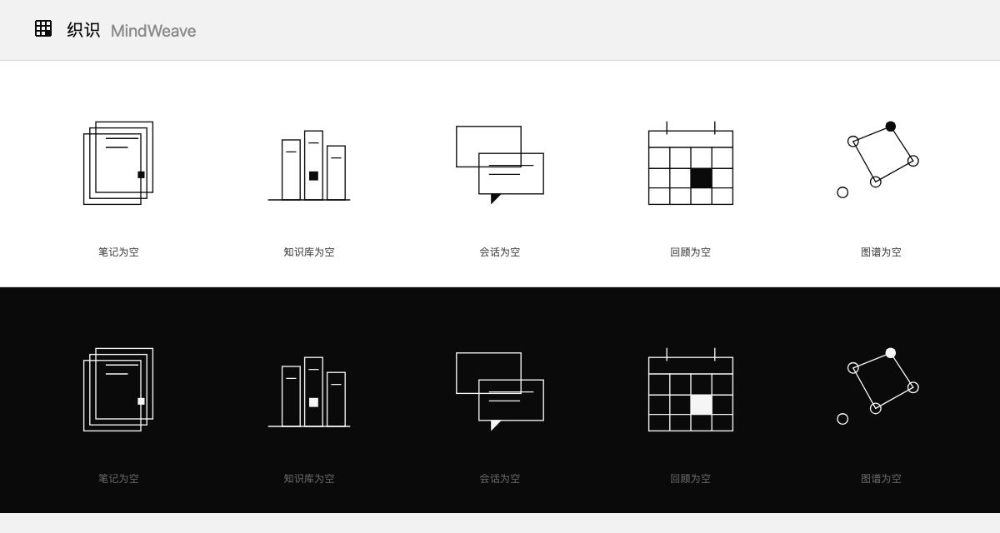

# 设计系统：黑白单色

> 目标：整套界面只使用**同一条明度轴**上的灰阶，不出现任何色相。
> 所有颜色都来自 `front/src/index.css` 的 CSS 变量；组件里不写具体色值。

| 浅色 | 深色 |
|---|---|
|  |  |

## 1. 四条原则

1. **只用明度，不用色相。** 红绿黄在这里没有位置，语义靠深浅、字重和文字本身表达。
2. **层级靠灰阶 + 间距，不靠阴影。** 全站只有一层极淡阴影（`--color-shadow`），用于浮层。
3. **边框是主要的分隔手段。** 发丝线（1px）+ 留白，而不是卡片投影。
4. **强调 = 反相。** 浅色主题下强调是墨黑，深色主题下强调是纸白；强调块上的文字用 `--color-accent-contrast` 自动反相。

## 2. 令牌

| 令牌 | 浅色 | 深色 | 用途 |
|---|---|---|---|
| `--color-bg` | `#F2F2F2` | `#0A0A0A` | 画布底色 |
| `--color-bg-secondary` | `#E9E9E9` | `#151515` | 悬停底、次级块 |
| `--color-bg-tertiary` | `#DEDEDE` | `#1F1F1F` | 开关轨道、选中底 |
| `--color-card` | `#FFFFFF` | `#101010` | 卡片、浮层、输入框 |
| `--color-text` | `#0A0A0A` | `#F7F7F7` | 正文 |
| `--color-text-secondary` | `#5A5A5A` | `#A6A6A6` | 次要说明 |
| `--color-text-tertiary` | `#828282` | `#7A7A7A` | 元信息、占位标签 |
| `--color-border` | `#D6D6D6` | `#2E2E2E` | 发丝线、输入框边界 |
| `--color-accent` | `#0A0A0A` | `#F7F7F7` | 主按钮底、链接、激活态 |
| `--color-accent-hover` | `#2B2B2B` | `#DCDCDC` | 主按钮悬停 |
| `--color-accent-contrast` | `#FFFFFF` | `#0A0A0A` | **强调块上的文字/图标** |
| `--color-accent-bg` | `#E6E6E6` | `#1F1F1F` | 弱强调底、标签底 |
| `--color-danger` / `-bg` | `#0A0A0A` / `#D2D2D2` | `#FAFAFA` / `#333333` | 错误、删除 |
| `--color-success` / `-bg` | `#444444` / `#ECECEC` | `#C4C4C4` / `#1A1A1A` | 成功、已选 |
| `--color-warning` / `-bg` | `#5A5A5A` / `#F0F0F0` | `#A8A8A8` / `#1E1E1E` | 提醒 |
| `--color-code-bg` | `#0B0B0B` | `#111111` | 代码块（两套主题都是深底） |

圆角：`--radius-sm: 2px` / `md: 4px` / `lg: 6px`；只有标签、头像、开关用 `rounded-full`。

## 3. 对比度

| 组合 | 浅色 | 深色 |
|---|---|---|
| 正文 / 画布 | 17.7 | 18.5 |
| 次要文字 / 卡片 | 6.9 | 7.8 |
| 元信息 / 画布 | 3.4 | 4.6 |
| 强调块文字 / 强调底 | 19.8 | 18.5 |
| 发丝线 / 卡片 | 1.45 | 1.40 |

正文与次要文字均超过 WCAG AA（4.5）；元信息按"辅助信息"处理，控制在 3.4 以上；
发丝线刻意低于 3:1——它承担的是分隔而不是信息，视觉上要"几乎不存在"。

## 4. 组件约定

- **主按钮**：`bg-[var(--color-accent)] text-[var(--color-accent-contrast)]` + `hover:bg-[var(--color-accent-hover)]`。
- **次按钮/图标按钮**：透明底 + `text-[var(--color-text-secondary)]`，悬停时 `bg-[var(--color-bg-secondary)]`。
- **卡片**：`bg-[var(--color-card)]` + `border border-[var(--color-border)]`，不加阴影。
- **标签**：`bg-[var(--color-accent-bg)]` + `text-[var(--color-accent)]`，全圆角。
- **错误提示**：`bg-[var(--color-danger-bg)]` + `text-[var(--color-danger)]`；危险按钮与主按钮同形，只靠文案与位置区分。
- **图谱节点**：笔记=实心方块（墨色）、文档=菱形（中灰）、实体=圆形（按类型哈希取灰阶，见 `src/utils/monoColor.ts`）。
- **代码高亮**：只用灰阶 + 字重，关键字最亮、注释最暗。

## 5. 新增颜色时的检查清单

- [ ] 它是灰阶吗（R=G=B，或至少不含可辨识色相）？
- [ ] 浅色与深色两套都给了值吗？
- [ ] 作为文字时，与所在底色对比度 ≥ 4.5（正文）或 ≥ 3（辅助）？
- [ ] 它出现在强调块上时，是否用了 `--color-accent-contrast` 而不是写死白/黑？
- [ ] 有没有引入第二个圆角或第二层阴影？

## 6. 图形资产

| 资产 | 文件 | 规格 |
|---|---|---|
| 品牌标记 | `front/public/brand/mark.svg`、`src/components/common/BrandMark.tsx` | 24×24 视框，3×3 织格 + 一格实心，`currentColor` |
| 应用图标 | `front/public/brand/app-icon.svg` → `icon-512/192/32.png`、`apple-touch-icon.png` | 深底白线，512 起导出 |
| 浏览器图标 | `front/public/favicon.svg` | 32×32，深底，与标记同几何 |
| 空状态插图 | `front/public/illustrations/*-empty.svg` | 200×200，1.5px 描边，各一个实心块 |
| 登录背景 | `.grid-backdrop`（`index.css`） | 32px 织格，前景色 5%，径向遮罩淡出 |

三条规则：

1. **标记必须用 `currentColor`**，不要写死 `#0A0A0A`——浅色/深色共用一份，跟随文字颜色。
2. **插图只在浅色下画黑线**，深色靠 `.dark .empty-illustration { filter: invert(1) }` 整体反相，不维护两套文件。
3. **每张图最多一个实心形状**。两个以上，画面就会"变重"，破坏极简。

> 需要新增插图时的提示词与后处理命令见 [视觉资产清单](visual-assets.md)。

## 7. 交互与动效

| 场景 | 规则 |
|---|---|
| 路由切换 | 页面淡入 200ms，只动 `opacity`（不动 transform，避免破坏 sticky 定位） |
| 悬停 / 选中 | 颜色与边框过渡 150ms；卡片悬停只加深边框，不投影、不位移 |
| 按下 | 按钮下移 0.5px，模拟"压下去"的触感 |
| 侧边栏激活 | 左侧 2px 竖线 + 文字加重，不再用整块底色 |
| 页面标题 | 26px 衬线、`tracking -0.01em`，下方一条 1px 分隔线 |
| 减弱动效 | 尊重 `prefers-reduced-motion`，关闭淡入与过渡 |

原则：**动效只用来提示状态变化，不用来表达"科技感"**。任何超过 250ms 的动画都要能说明理由。

## 6. 已知取舍

- 深色主题下"删除"这类危险按钮是白底黑字，语义只能靠文案与位置表达——这是放弃色相换统一的代价。
- 多个实体类型可能撞到同一灰阶，靠节点形状与大小区分。
- 代码块在浅色主题里仍是深底：这是刻意的"印刷纸上的黑块"效果，也让两套主题共用一套高亮规则。
