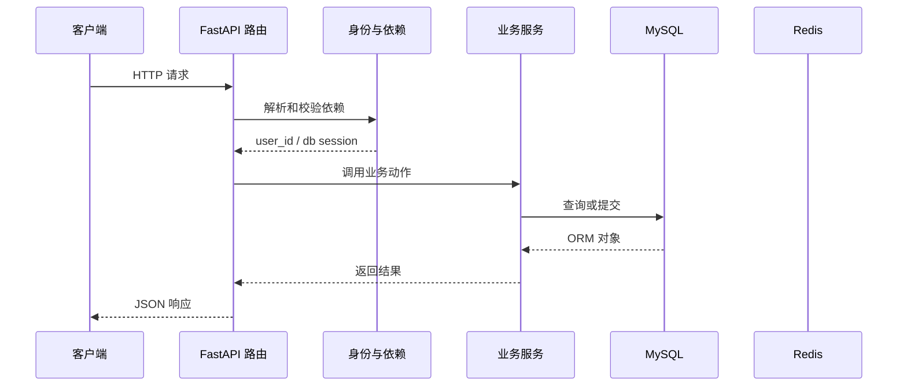

# 第 07 篇：建立用户表与注册接口

> 日期：2026-10-20。新版连续复刻教程；对象是有 Python/HTTP/异步基础的学习者。
> 前置：[第 06 篇](06-note-pagination-filter-and-sort.md)完成后再操作。
> 成果：把账号保存为真实数据库记录，并只保存密码哈希。
> 2026-10-20 正式复刻目录已完成本篇代码和依赖，并通过真实 MySQL 注册、查重、输入校验与哈希保存验证。Passlib 1.7.4 与 bcrypt 4.3.0 首次运行可能打印读取版本的警告；本次实际注册和哈希保存成功。

**技术路线原理与同类比较：** [Q07：bcrypt 与 Argon2id、PBKDF2](technology-routes/Q07-password-hashing.md)。

## 1. 目标与文件变化总览

这一篇围绕 **User 表、注册输入、密码散列、重复账号检查与事务提交**。先看改变了哪些文件，再按路径逐个完成；前端界面暂不参与代码讲解。

本篇核心接口：`/user/register/`。

| 标记 | 文件 | 本篇作用 |
|---|---|---|
| 【修改】 | `backend/app/db/db_config.py` | MySQL 引擎、请求级会话和建表入口。|
| 【新增文件】 | `backend/app/models/user_model.py` | 数据库用户表映射；约束账号字段并保存密码哈希。|
| 【新增文件】 | `backend/app/router/user.py` | 用户接口；把 HTTP 参数、依赖、服务和响应接起来。|
| 【新增文件】 | `backend/app/schemas/user_schemas.py` | HTTP 输入输出边界；验证请求，控制响应公开字段。|
| 【新增文件】 | `backend/app/services/user_service.py` | 用户业务动作；查询、校验、哈希、提交由这里协调。|
| 【修改】 | `backend/main.py` | FastAPI 实例与路由总装入口。|

**阶段边界：** 此时注册返回的 token 暂为空；第 08 篇签发 JWT，第 09 篇才把笔记绑定真实账号。

## 2. 从哪个目录开始

本篇六处代码变更与依赖已在正式复刻目录完成，下面保留操作过程供学习和复核。第 07 篇只建立后端注册接口，不制作注册页面；你要求跳过的注册界面继续跳过。第 08 篇必须承接本篇最终文件，不能跳步。

终端执行位置：

```text
.
```

```bash
cd "."
pwd
git status --short
```

### 本篇新增依赖

下面命令在后端项目目录执行。`uv add` 同时维护 `pyproject.toml` 与 `uv.lock`；随后导出兼容 `pip` 的 `requirements.txt`。这些生成文件不要求手工抄写。

```bash
cd "./backend"
uv add 'passlib==1.7.4' 'bcrypt==4.3.0' 'pydantic[email]==2.12.5'
uv export --locked --no-dev --no-emit-project --no-hashes --format requirements.txt --output-file requirements.txt
uv sync
```

运行后检查三个文件及环境：

```bash
cd "./backend"
ls -l pyproject.toml uv.lock requirements.txt .venv
uv run python -c "import fastapi, sqlalchemy; print('依赖可导入')"
```

## 3. 按顺序改文件

先完成依赖和父目录，再逐个编辑下面文件。修改已有文件只给前后对照和整体解释，新建文件才给完整内容；diff 的正负号只供定位，不能复制进源码。

### 步骤 1：【修改】`backend/app/db/db_config.py`

**编辑文件的完整地址：**

```text
./backend/app/db/db_config.py
```

**修改定位与前后对照：**

```diff
--- backend/app/db/db_config.py（修改前）
+++ backend/app/db/db_config.py（修改后）
@@ -54,6 +54,7 @@
 async def init_db() -> None:
     # 【新增 C01】导入模型完成注册后，统一检查并创建缺失表。
     from app.models.note import Note  # noqa: F401
+    from app.models.user_model import User  # noqa: F401
 
     async with async_engine.begin() as connection:
         await connection.run_sync(Base.metadata.create_all)
```

**整体解释：** User 类虽然存在，建表登记簿还需要导入它。新增导入让 users 表进入 Base.metadata，启动时 create_all 才知道检查这张表；建好空表不等于已经注册用户。

**保存后检查：**

```bash
test -f "./backend/app/db/db_config.py" && echo "已找到 backend/app/db/db_config.py"
```

### 步骤 2：【新增文件】`backend/app/models/user_model.py`

**编辑文件的完整地址：**

```text
./backend/app/models/user_model.py
```

父目录如果尚不存在，先创建：

```bash
mkdir -p "./backend/app/models"
```

**完整文件内容：**

```python
from uuid import uuid4

from sqlalchemy import Boolean, Column, DateTime, Integer, String, Text, func

from app.models.base import Base


class UserStatusChoice:
    DISABLED = 0
    ACTIVE = 1
    LOCKED = 2


class User(Base):
    __tablename__ = "user_service"

    uuid = Column(String(36), primary_key=True, default=lambda: uuid4().hex[:24])
    username = Column(String(150), nullable=False)
    email = Column(String(255), unique=True, nullable=False)
    telephone = Column(String(11), unique=True, nullable=True)
    password = Column(String(255), nullable=False)
    is_active = Column(Boolean, default=True, nullable=False)
    status = Column(Integer, default=UserStatusChoice.ACTIVE, nullable=False)
    gender = Column(Integer, nullable=True)
    bio = Column(Text, nullable=True)
    avatar = Column(String(255), nullable=True)
    date_joined = Column(DateTime(), server_default=func.now(), nullable=False)
    last_login = Column(DateTime(), nullable=True)
```

**文件职责：** 数据库用户表映射；约束账号字段并保存密码哈希。

**保存后检查：**

```bash
test -f "./backend/app/models/user_model.py" && echo "已找到 backend/app/models/user_model.py"
```

### 步骤 3：【新增文件】`backend/app/router/user.py`

**编辑文件的完整地址：**

```text
./backend/app/router/user.py
```

父目录如果尚不存在，先创建：

```bash
mkdir -p "./backend/app/router"
```

**完整文件内容：**

```python
from fastapi import APIRouter, Depends
from sqlalchemy.ext.asyncio import AsyncSession

from app.db.db_config import get_db
from app.schemas.user_schemas import RegisterRequest, UserResponse
from app.services.user_service import user_service

user_router = APIRouter(prefix="/user", tags=["user"])


@user_router.post("/register/")
async def register(
    payload: RegisterRequest,
    db: AsyncSession = Depends(get_db),
) -> dict:
    user = await user_service.register(db, payload)
    return {
        "status": 201,
        "message": f"{user.username} 注册成功",
        "user": UserResponse.model_validate(user).model_dump(mode="json"),
        "token": None,  # 第 08 篇颁发 JWT；当前先验证账户落库。
    }
```

**文件职责：** 用户接口；把 HTTP 参数、依赖、服务和响应接起来。

**保存后检查：**

```bash
test -f "./backend/app/router/user.py" && echo "已找到 backend/app/router/user.py"
```

### 步骤 4：【新增文件】`backend/app/schemas/user_schemas.py`

**编辑文件的完整地址：**

```text
./backend/app/schemas/user_schemas.py
```

父目录如果尚不存在，先创建：

```bash
mkdir -p "./backend/app/schemas"
```

**完整文件内容：**

```python
from datetime import datetime

from pydantic import BaseModel, ConfigDict, EmailStr, Field


class RegisterRequest(BaseModel):
    username: str = Field(min_length=1, max_length=150)
    email: EmailStr
    password: str = Field(min_length=6, max_length=72)
    confirm_password: str
    telephone: str | None = Field(default=None, max_length=11)


class UserResponse(BaseModel):
    model_config = ConfigDict(from_attributes=True)

    uuid: str
    username: str
    email: EmailStr
    telephone: str | None = None
    gender: int | None = None
    bio: str | None = None
    avatar: str | None = None
    status: int
    date_joined: datetime | None = None
    last_login: datetime | None = None
    is_active: bool
```

**文件职责：** HTTP 输入输出边界；验证请求，控制响应公开字段。

**保存后检查：**

```bash
test -f "./backend/app/schemas/user_schemas.py" && echo "已找到 backend/app/schemas/user_schemas.py"
```

### 步骤 5：【新增文件】`backend/app/services/user_service.py`

**编辑文件的完整地址：**

```text
./backend/app/services/user_service.py
```

父目录如果尚不存在，先创建：

```bash
mkdir -p "./backend/app/services"
```

**完整文件内容：**

```python
from passlib.context import CryptContext
from sqlalchemy import or_, select
from sqlalchemy.ext.asyncio import AsyncSession

from app.core.failed_response import BusinessException
from app.models.user_model import User, UserStatusChoice
from app.schemas.user_schemas import RegisterRequest

pwd_context = CryptContext(schemes=["bcrypt"], deprecated="auto")


def hash_password(password: str) -> str:
    return pwd_context.hash(password)


def verify_password(password: str, hashed_password: str) -> bool:
    return pwd_context.verify(password, hashed_password)


class UserService:
    async def register(self, db: AsyncSession, payload: RegisterRequest) -> User:
        if payload.password != payload.confirm_password:
            raise BusinessException(code=4001, message="两次密码不一致")
        conditions = [User.email == str(payload.email)]
        if payload.telephone:
            conditions.append(User.telephone == payload.telephone)
        existing = await db.execute(select(User).where(or_(*conditions)))
        if existing.scalars().first() is not None:
            raise BusinessException(code=4002, message="邮箱或手机号已被注册")

        user = User(
            username=payload.username,
            email=str(payload.email),
            telephone=payload.telephone,
            password=hash_password(payload.password),
            status=UserStatusChoice.ACTIVE,
            is_active=True,
        )
        db.add(user)
        await db.commit()
        await db.refresh(user)
        return user


user_service = UserService()
```

**文件职责：** 用户业务动作；查询、校验、哈希、提交由这里协调。

**保存后检查：**

```bash
test -f "./backend/app/services/user_service.py" && echo "已找到 backend/app/services/user_service.py"
```

### 步骤 6：【修改】`backend/main.py`

**编辑文件的完整地址：**

```text
./backend/main.py
```

**修改定位与前后对照：**

```diff
--- backend/main.py（修改前）
+++ backend/main.py（修改后）
@@ -5,6 +5,7 @@
 from app.core.settings import settings
 from app.router.health import health_router
 from app.router.note_router import note_router
+from app.router.user import user_router
 
 # 【修改 C01】应用启动检查和关闭清理由 lifespan 管理。
 app = FastAPI(title=settings.APP_NAME, lifespan=lifespan)
@@ -12,6 +13,8 @@
 app.include_router(health_router)
 # 【新增 C01】把笔记接口组注册到同一个应用。
 app.include_router(note_router)
+# 【新增 C01】注册用户相关接口。
+app.include_router(user_router)
 register_exception_handlers(app)
 
 
```

**整体解释：** 用户路由定义了处理函数，main.py 的 include_router 才把地址交给 FastAPI。启动时完成登记，之后注册等请求才能被送到用户路由，再由它调用服务和数据库。

**保存后检查：**

```bash
test -f "./backend/main.py" && echo "已找到 backend/main.py"
```

## 4. 把这些文件连成一次真实执行

本次例子：注册一名新用户。先记住接口 `/user/register/`。下面每一站都写清谁把什么交给谁。

### 先用一个形象场景理解核心机制

把注册想成办借书证：`RegisterRequest` 是柜台先检查申请表，`UserService.register` 是工作人员核对身份证明和重名情况，`User` 是要存进档案柜的那一行。`db.add(user)` 只相当于把表格放在待办托盘，并没有落进档案柜；`await db.commit()` 才是正式盖章入库。`refresh` 再把数据库生成的编号读回来。由于 `uuid` 默认值在写入时生成，不能在提交前假设它已经有值。
密码不能像标题那样直接存。服务调用 `hash_password` 得到不可直接还原的哈希；下一次登录时不会把两个哈希文本直接比较，而是把用户输入和数据库里的哈希交给 `verify_password`。响应的 `UserResponse` 有意没有 password 字段，相当于柜台只把借书证信息交给用户，不把内部验证凭据印在凭证上。
注册路由体内的 `status: 201` 是 JSON 字段；当前装饰器没有设置 `status_code=201`，所以 HTTP 状态仍是 200。验收时分别看 HTTP 状态行和 JSON body，别把这两个数字混为一谈。密码或邮箱非法由 Pydantic 在进入服务前拦住；重复邮箱由业务查询或数据库唯一约束阻止。两个并发请求可能都通过业务预查，真正的最终防线仍是数据库唯一约束。

### 第 1 站：客户端提交 username、email、password、confirm_password。

这一站的输入来自上一层：客户端提交 username、email、password、confirm_password。可在本篇对应的 diff 或新建文件代码中找到相关函数。

观察时分清三种时刻：导入模块时只创建声明；收到 HTTP 请求后才执行路由和依赖；数据库 `commit` 后数据才作为事务结果保存。

### 第 2 站：FastAPI 先用 RegisterRequest 验证邮箱格式和密码长度。

这一站的输入来自上一层：FastAPI 先用 RegisterRequest 验证邮箱格式和密码长度。可在本篇对应的 diff 或新建文件代码中找到相关函数。

观察时分清三种时刻：导入模块时只创建声明；收到 HTTP 请求后才执行路由和依赖；数据库 `commit` 后数据才作为事务结果保存。

### 第 3 站：user_router.register 调用 UserService.register。

这一站的输入来自上一层：user_router.register 调用 UserService.register。可在本篇对应的 diff 或新建文件代码中找到相关函数。

观察时分清三种时刻：导入模块时只创建声明；收到 HTTP 请求后才执行路由和依赖；数据库 `commit` 后数据才作为事务结果保存。

### 第 4 站：服务检查两次密码一致，并查询邮箱或手机号是否已存在。

这一站的输入来自上一层：服务检查两次密码一致，并查询邮箱或手机号是否已存在。可在本篇对应的 diff 或新建文件代码中找到相关函数。

观察时分清三种时刻：导入模块时只创建声明；收到 HTTP 请求后才执行路由和依赖；数据库 `commit` 后数据才作为事务结果保存。

### 第 5 站：CryptContext 把明文变成 bcrypt 哈希，User 对象进入会话。

这一站的输入来自上一层：CryptContext 把明文变成 bcrypt 哈希，User 对象进入会话。可在本篇对应的 diff 或新建文件代码中找到相关函数。

观察时分清三种时刻：导入模块时只创建声明；收到 HTTP 请求后才执行路由和依赖；数据库 `commit` 后数据才作为事务结果保存。

### 第 6 站：commit 才让数据库里的 user_service 表出现这一行；refresh 取回生成的 uuid。

这一站的输入来自上一层：commit 才让数据库里的 user_service 表出现这一行；refresh 取回生成的 uuid。可在本篇对应的 diff 或新建文件代码中找到相关函数。

观察时分清三种时刻：导入模块时只创建声明；收到 HTTP 请求后才执行路由和依赖；数据库 `commit` 后数据才作为事务结果保存。

### 第 7 站：路由把安全字段转成 UserResponse，密码字段不进入响应。

这一站的输入来自上一层：路由把安全字段转成 UserResponse，密码字段不进入响应。可在本篇对应的 diff 或新建文件代码中找到相关函数。

观察时分清三种时刻：导入模块时只创建声明；收到 HTTP 请求后才执行路由和依赖；数据库 `commit` 后数据才作为事务结果保存。

### 请求到状态变化的路线图



这张图只表示典型路径。注册尚无当前用户依赖；第 10 篇以后令牌状态检查还会访问 Redis；并非每个请求都会写数据库。

## 5. 运行与验收

先在一个终端启动依赖并等待容器健康，再在另一个终端启动后端；已有服务正在运行时不要重复占用 8100。

```bash
cd "."
docker compose up -d --wait
docker compose ps
```

第二个终端执行：

```bash
cd "./backend"
uv run uvicorn main:app --host 127.0.0.1 --port 8100 --reload
```

一次可复制请求：

```bash
curl -i -X POST http://127.0.0.1:8100/user/register/ -H "Content-Type: application/json" -d '{"username":"learner07","email":"learner07@example.com","password":"sample123","confirm_password":"sample123"}'
```

### 验收时看三层结果

1. **HTTP 状态**：成功请求通常是 200；参数无效、身份无效和依赖故障分别观察对应错误。
2. **响应 JSON**：看公开字段、业务消息和返回的 token/模板列表；密码哈希不应出现在用户响应里。
3. **持久化状态**：注册、修改、密码重置、模板增删改排序要在重启后仍存在；令牌黑名单要遵守 TTL 语义。

如果某一步报错，先读终端堆栈的第一处项目文件路径，再按本文文件步骤检查导入、配置与先后顺序。

### 已代执行的真实验收（2026-10-20）

- 六处手写文件与本篇最终代码一致；`passlib==1.7.4`、`bcrypt==4.3.0`、`pydantic[email]==2.12.5` 已在复刻项目的依赖声明和虚拟环境中。
- 已重启 8100 后端；`/openapi.json` 出现 `/user/register/`，`/health/ready` 返回 HTTP 200。
- 复刻 MySQL 中出现 `user_service` 表；测试账号 `lesson07_check_20261020@example.com` 注册成功，响应为 HTTP 200，JSON 内 `status=201`、`token=null`，未包含密码字段。
- 同一邮箱再次注册时，当前统一业务异常处理器返回 **HTTP 200、JSON `code=4002`**；邮箱格式错误返回 HTTP 422。数据库只保存一条测试账号记录，密码列以 `$2b$` 开头且不等于明文。
- 上述测试账号留在本机复刻数据库供后续登录练习；本篇没有创建注册页面，也没有改动参考项目数据库。

## 6. 逐案推演：输入、经过、结果

下列是读代码与手工验证结合的练习卡。每张卡都让你先预测、再请求、最后回到具体函数解释。某些卡要求用第二个测试账号或临时停服务，请只操作复刻项目容器。

### 案例 01：首次注册

- **准备**：全新邮箱、密码和确认密码相同。
- **预期**：写入一行用户，响应不含密码。
- **先预测**：客户端会先经过哪个路由？哪些 Pydantic 字段会提前阻断？
- **依赖追踪**：如果路由用了 `Depends`，把每个依赖的输入值来源写下来。
- **服务追踪**：指出服务查询时的用户范围；若有状态变化，指出哪行 `commit` 让它持久化。
- **异常追踪**：本案例如果失败，错误由请求验证、业务异常、HTTP 异常还是依赖网络错误产生？
- **验证动作**：执行对应请求后，先读 HTTP 状态，再读 JSON 字段，必要时查询数据库或 Redis。
- **回滚观察**：失败后检查是否发生了本不该发生的数据库改动。
- **复盘**：用一句话解释为什么输出符合预期，再对照上面的完整代码。

#### 01.1 变体：缺省字段

把“首次注册”这一案例与“缺省字段”组合，先判断输入验证、路由、服务与存储哪一层会改变结果。
原始预期是“写入一行用户，响应不含密码”。若变体不改变本案例实际输入，就保持原预期；若改变，写出发生变化的那一行代码。
不要凭“通常会这样”作答：在文件里定位 `Field`、`Depends`、`where`、`commit` 或 Redis 操作。

#### 01.2 变体：边界长度

把“首次注册”这一案例与“边界长度”组合，先判断输入验证、路由、服务与存储哪一层会改变结果。
原始预期是“写入一行用户，响应不含密码”。若变体不改变本案例实际输入，就保持原预期；若改变，写出发生变化的那一行代码。
不要凭“通常会这样”作答：在文件里定位 `Field`、`Depends`、`where`、`commit` 或 Redis 操作。

#### 01.3 变体：重复提交

把“首次注册”这一案例与“重复提交”组合，先判断输入验证、路由、服务与存储哪一层会改变结果。
原始预期是“写入一行用户，响应不含密码”。若变体不改变本案例实际输入，就保持原预期；若改变，写出发生变化的那一行代码。
不要凭“通常会这样”作答：在文件里定位 `Field`、`Depends`、`where`、`commit` 或 Redis 操作。

#### 01.4 变体：并发请求

把“首次注册”这一案例与“并发请求”组合，先判断输入验证、路由、服务与存储哪一层会改变结果。
原始预期是“写入一行用户，响应不含密码”。若变体不改变本案例实际输入，就保持原预期；若改变，写出发生变化的那一行代码。
不要凭“通常会这样”作答：在文件里定位 `Field`、`Depends`、`where`、`commit` 或 Redis 操作。

#### 01.5 变体：服务重启

把“首次注册”这一案例与“服务重启”组合，先判断输入验证、路由、服务与存储哪一层会改变结果。
原始预期是“写入一行用户，响应不含密码”。若变体不改变本案例实际输入，就保持原预期；若改变，写出发生变化的那一行代码。
不要凭“通常会这样”作答：在文件里定位 `Field`、`Depends`、`where`、`commit` 或 Redis 操作。

### 案例 02：确认密码错

- **准备**：两次密码不同。
- **预期**：业务错误，数据库不新增用户。
- **先预测**：客户端会先经过哪个路由？哪些 Pydantic 字段会提前阻断？
- **依赖追踪**：如果路由用了 `Depends`，把每个依赖的输入值来源写下来。
- **服务追踪**：指出服务查询时的用户范围；若有状态变化，指出哪行 `commit` 让它持久化。
- **异常追踪**：本案例如果失败，错误由请求验证、业务异常、HTTP 异常还是依赖网络错误产生？
- **验证动作**：执行对应请求后，先读 HTTP 状态，再读 JSON 字段，必要时查询数据库或 Redis。
- **回滚观察**：失败后检查是否发生了本不该发生的数据库改动。
- **复盘**：用一句话解释为什么输出符合预期，再对照上面的完整代码。

#### 02.1 变体：缺省字段

把“确认密码错”这一案例与“缺省字段”组合，先判断输入验证、路由、服务与存储哪一层会改变结果。
原始预期是“业务错误，数据库不新增用户”。若变体不改变本案例实际输入，就保持原预期；若改变，写出发生变化的那一行代码。
不要凭“通常会这样”作答：在文件里定位 `Field`、`Depends`、`where`、`commit` 或 Redis 操作。

#### 02.2 变体：边界长度

把“确认密码错”这一案例与“边界长度”组合，先判断输入验证、路由、服务与存储哪一层会改变结果。
原始预期是“业务错误，数据库不新增用户”。若变体不改变本案例实际输入，就保持原预期；若改变，写出发生变化的那一行代码。
不要凭“通常会这样”作答：在文件里定位 `Field`、`Depends`、`where`、`commit` 或 Redis 操作。

#### 02.3 变体：重复提交

把“确认密码错”这一案例与“重复提交”组合，先判断输入验证、路由、服务与存储哪一层会改变结果。
原始预期是“业务错误，数据库不新增用户”。若变体不改变本案例实际输入，就保持原预期；若改变，写出发生变化的那一行代码。
不要凭“通常会这样”作答：在文件里定位 `Field`、`Depends`、`where`、`commit` 或 Redis 操作。

#### 02.4 变体：并发请求

把“确认密码错”这一案例与“并发请求”组合，先判断输入验证、路由、服务与存储哪一层会改变结果。
原始预期是“业务错误，数据库不新增用户”。若变体不改变本案例实际输入，就保持原预期；若改变，写出发生变化的那一行代码。
不要凭“通常会这样”作答：在文件里定位 `Field`、`Depends`、`where`、`commit` 或 Redis 操作。

#### 02.5 变体：服务重启

把“确认密码错”这一案例与“服务重启”组合，先判断输入验证、路由、服务与存储哪一层会改变结果。
原始预期是“业务错误，数据库不新增用户”。若变体不改变本案例实际输入，就保持原预期；若改变，写出发生变化的那一行代码。
不要凭“通常会这样”作答：在文件里定位 `Field`、`Depends`、`where`、`commit` 或 Redis 操作。

### 案例 03：邮箱重复

- **准备**：再次提交同一邮箱。
- **预期**：业务错误，原用户保留。
- **先预测**：客户端会先经过哪个路由？哪些 Pydantic 字段会提前阻断？
- **依赖追踪**：如果路由用了 `Depends`，把每个依赖的输入值来源写下来。
- **服务追踪**：指出服务查询时的用户范围；若有状态变化，指出哪行 `commit` 让它持久化。
- **异常追踪**：本案例如果失败，错误由请求验证、业务异常、HTTP 异常还是依赖网络错误产生？
- **验证动作**：执行对应请求后，先读 HTTP 状态，再读 JSON 字段，必要时查询数据库或 Redis。
- **回滚观察**：失败后检查是否发生了本不该发生的数据库改动。
- **复盘**：用一句话解释为什么输出符合预期，再对照上面的完整代码。

#### 03.1 变体：缺省字段

把“邮箱重复”这一案例与“缺省字段”组合，先判断输入验证、路由、服务与存储哪一层会改变结果。
原始预期是“业务错误，原用户保留”。若变体不改变本案例实际输入，就保持原预期；若改变，写出发生变化的那一行代码。
不要凭“通常会这样”作答：在文件里定位 `Field`、`Depends`、`where`、`commit` 或 Redis 操作。

#### 03.2 变体：边界长度

把“邮箱重复”这一案例与“边界长度”组合，先判断输入验证、路由、服务与存储哪一层会改变结果。
原始预期是“业务错误，原用户保留”。若变体不改变本案例实际输入，就保持原预期；若改变，写出发生变化的那一行代码。
不要凭“通常会这样”作答：在文件里定位 `Field`、`Depends`、`where`、`commit` 或 Redis 操作。

#### 03.3 变体：重复提交

把“邮箱重复”这一案例与“重复提交”组合，先判断输入验证、路由、服务与存储哪一层会改变结果。
原始预期是“业务错误，原用户保留”。若变体不改变本案例实际输入，就保持原预期；若改变，写出发生变化的那一行代码。
不要凭“通常会这样”作答：在文件里定位 `Field`、`Depends`、`where`、`commit` 或 Redis 操作。

#### 03.4 变体：并发请求

把“邮箱重复”这一案例与“并发请求”组合，先判断输入验证、路由、服务与存储哪一层会改变结果。
原始预期是“业务错误，原用户保留”。若变体不改变本案例实际输入，就保持原预期；若改变，写出发生变化的那一行代码。
不要凭“通常会这样”作答：在文件里定位 `Field`、`Depends`、`where`、`commit` 或 Redis 操作。

#### 03.5 变体：服务重启

把“邮箱重复”这一案例与“服务重启”组合，先判断输入验证、路由、服务与存储哪一层会改变结果。
原始预期是“业务错误，原用户保留”。若变体不改变本案例实际输入，就保持原预期；若改变，写出发生变化的那一行代码。
不要凭“通常会这样”作答：在文件里定位 `Field`、`Depends`、`where`、`commit` 或 Redis 操作。

### 案例 04：邮箱非法

- **准备**：缺少有效域名。
- **预期**：请求验证失败，服务层不执行。
- **先预测**：客户端会先经过哪个路由？哪些 Pydantic 字段会提前阻断？
- **依赖追踪**：如果路由用了 `Depends`，把每个依赖的输入值来源写下来。
- **服务追踪**：指出服务查询时的用户范围；若有状态变化，指出哪行 `commit` 让它持久化。
- **异常追踪**：本案例如果失败，错误由请求验证、业务异常、HTTP 异常还是依赖网络错误产生？
- **验证动作**：执行对应请求后，先读 HTTP 状态，再读 JSON 字段，必要时查询数据库或 Redis。
- **回滚观察**：失败后检查是否发生了本不该发生的数据库改动。
- **复盘**：用一句话解释为什么输出符合预期，再对照上面的完整代码。

#### 04.1 变体：缺省字段

把“邮箱非法”这一案例与“缺省字段”组合，先判断输入验证、路由、服务与存储哪一层会改变结果。
原始预期是“请求验证失败，服务层不执行”。若变体不改变本案例实际输入，就保持原预期；若改变，写出发生变化的那一行代码。
不要凭“通常会这样”作答：在文件里定位 `Field`、`Depends`、`where`、`commit` 或 Redis 操作。

#### 04.2 变体：边界长度

把“邮箱非法”这一案例与“边界长度”组合，先判断输入验证、路由、服务与存储哪一层会改变结果。
原始预期是“请求验证失败，服务层不执行”。若变体不改变本案例实际输入，就保持原预期；若改变，写出发生变化的那一行代码。
不要凭“通常会这样”作答：在文件里定位 `Field`、`Depends`、`where`、`commit` 或 Redis 操作。

#### 04.3 变体：重复提交

把“邮箱非法”这一案例与“重复提交”组合，先判断输入验证、路由、服务与存储哪一层会改变结果。
原始预期是“请求验证失败，服务层不执行”。若变体不改变本案例实际输入，就保持原预期；若改变，写出发生变化的那一行代码。
不要凭“通常会这样”作答：在文件里定位 `Field`、`Depends`、`where`、`commit` 或 Redis 操作。

#### 04.4 变体：并发请求

把“邮箱非法”这一案例与“并发请求”组合，先判断输入验证、路由、服务与存储哪一层会改变结果。
原始预期是“请求验证失败，服务层不执行”。若变体不改变本案例实际输入，就保持原预期；若改变，写出发生变化的那一行代码。
不要凭“通常会这样”作答：在文件里定位 `Field`、`Depends`、`where`、`commit` 或 Redis 操作。

#### 04.5 变体：服务重启

把“邮箱非法”这一案例与“服务重启”组合，先判断输入验证、路由、服务与存储哪一层会改变结果。
原始预期是“请求验证失败，服务层不执行”。若变体不改变本案例实际输入，就保持原预期；若改变，写出发生变化的那一行代码。
不要凭“通常会这样”作答：在文件里定位 `Field`、`Depends`、`where`、`commit` 或 Redis 操作。

### 案例 05：手机号重复

- **准备**：第二个用户填写已占用号码。
- **预期**：拒绝第二次注册。
- **先预测**：客户端会先经过哪个路由？哪些 Pydantic 字段会提前阻断？
- **依赖追踪**：如果路由用了 `Depends`，把每个依赖的输入值来源写下来。
- **服务追踪**：指出服务查询时的用户范围；若有状态变化，指出哪行 `commit` 让它持久化。
- **异常追踪**：本案例如果失败，错误由请求验证、业务异常、HTTP 异常还是依赖网络错误产生？
- **验证动作**：执行对应请求后，先读 HTTP 状态，再读 JSON 字段，必要时查询数据库或 Redis。
- **回滚观察**：失败后检查是否发生了本不该发生的数据库改动。
- **复盘**：用一句话解释为什么输出符合预期，再对照上面的完整代码。

#### 05.1 变体：缺省字段

把“手机号重复”这一案例与“缺省字段”组合，先判断输入验证、路由、服务与存储哪一层会改变结果。
原始预期是“拒绝第二次注册”。若变体不改变本案例实际输入，就保持原预期；若改变，写出发生变化的那一行代码。
不要凭“通常会这样”作答：在文件里定位 `Field`、`Depends`、`where`、`commit` 或 Redis 操作。

#### 05.2 变体：边界长度

把“手机号重复”这一案例与“边界长度”组合，先判断输入验证、路由、服务与存储哪一层会改变结果。
原始预期是“拒绝第二次注册”。若变体不改变本案例实际输入，就保持原预期；若改变，写出发生变化的那一行代码。
不要凭“通常会这样”作答：在文件里定位 `Field`、`Depends`、`where`、`commit` 或 Redis 操作。

#### 05.3 变体：重复提交

把“手机号重复”这一案例与“重复提交”组合，先判断输入验证、路由、服务与存储哪一层会改变结果。
原始预期是“拒绝第二次注册”。若变体不改变本案例实际输入，就保持原预期；若改变，写出发生变化的那一行代码。
不要凭“通常会这样”作答：在文件里定位 `Field`、`Depends`、`where`、`commit` 或 Redis 操作。

#### 05.4 变体：并发请求

把“手机号重复”这一案例与“并发请求”组合，先判断输入验证、路由、服务与存储哪一层会改变结果。
原始预期是“拒绝第二次注册”。若变体不改变本案例实际输入，就保持原预期；若改变，写出发生变化的那一行代码。
不要凭“通常会这样”作答：在文件里定位 `Field`、`Depends`、`where`、`commit` 或 Redis 操作。

#### 05.5 变体：服务重启

把“手机号重复”这一案例与“服务重启”组合，先判断输入验证、路由、服务与存储哪一层会改变结果。
原始预期是“拒绝第二次注册”。若变体不改变本案例实际输入，就保持原预期；若改变，写出发生变化的那一行代码。
不要凭“通常会这样”作答：在文件里定位 `Field`、`Depends`、`where`、`commit` 或 Redis 操作。

### 案例 06：密码过短

- **准备**：少于六个字符。
- **预期**：请求验证失败。
- **先预测**：客户端会先经过哪个路由？哪些 Pydantic 字段会提前阻断？
- **依赖追踪**：如果路由用了 `Depends`，把每个依赖的输入值来源写下来。
- **服务追踪**：指出服务查询时的用户范围；若有状态变化，指出哪行 `commit` 让它持久化。
- **异常追踪**：本案例如果失败，错误由请求验证、业务异常、HTTP 异常还是依赖网络错误产生？
- **验证动作**：执行对应请求后，先读 HTTP 状态，再读 JSON 字段，必要时查询数据库或 Redis。
- **回滚观察**：失败后检查是否发生了本不该发生的数据库改动。
- **复盘**：用一句话解释为什么输出符合预期，再对照上面的完整代码。

#### 06.1 变体：缺省字段

把“密码过短”这一案例与“缺省字段”组合，先判断输入验证、路由、服务与存储哪一层会改变结果。
原始预期是“请求验证失败”。若变体不改变本案例实际输入，就保持原预期；若改变，写出发生变化的那一行代码。
不要凭“通常会这样”作答：在文件里定位 `Field`、`Depends`、`where`、`commit` 或 Redis 操作。

#### 06.2 变体：边界长度

把“密码过短”这一案例与“边界长度”组合，先判断输入验证、路由、服务与存储哪一层会改变结果。
原始预期是“请求验证失败”。若变体不改变本案例实际输入，就保持原预期；若改变，写出发生变化的那一行代码。
不要凭“通常会这样”作答：在文件里定位 `Field`、`Depends`、`where`、`commit` 或 Redis 操作。

#### 06.3 变体：重复提交

把“密码过短”这一案例与“重复提交”组合，先判断输入验证、路由、服务与存储哪一层会改变结果。
原始预期是“请求验证失败”。若变体不改变本案例实际输入，就保持原预期；若改变，写出发生变化的那一行代码。
不要凭“通常会这样”作答：在文件里定位 `Field`、`Depends`、`where`、`commit` 或 Redis 操作。

#### 06.4 变体：并发请求

把“密码过短”这一案例与“并发请求”组合，先判断输入验证、路由、服务与存储哪一层会改变结果。
原始预期是“请求验证失败”。若变体不改变本案例实际输入，就保持原预期；若改变，写出发生变化的那一行代码。
不要凭“通常会这样”作答：在文件里定位 `Field`、`Depends`、`where`、`commit` 或 Redis 操作。

#### 06.5 变体：服务重启

把“密码过短”这一案例与“服务重启”组合，先判断输入验证、路由、服务与存储哪一层会改变结果。
原始预期是“请求验证失败”。若变体不改变本案例实际输入，就保持原预期；若改变，写出发生变化的那一行代码。
不要凭“通常会这样”作答：在文件里定位 `Field`、`Depends`、`where`、`commit` 或 Redis 操作。

### 案例 07：手机号省略

- **准备**：telephone 不出现在 body。
- **预期**：允许空手机号。
- **先预测**：客户端会先经过哪个路由？哪些 Pydantic 字段会提前阻断？
- **依赖追踪**：如果路由用了 `Depends`，把每个依赖的输入值来源写下来。
- **服务追踪**：指出服务查询时的用户范围；若有状态变化，指出哪行 `commit` 让它持久化。
- **异常追踪**：本案例如果失败，错误由请求验证、业务异常、HTTP 异常还是依赖网络错误产生？
- **验证动作**：执行对应请求后，先读 HTTP 状态，再读 JSON 字段，必要时查询数据库或 Redis。
- **回滚观察**：失败后检查是否发生了本不该发生的数据库改动。
- **复盘**：用一句话解释为什么输出符合预期，再对照上面的完整代码。

#### 07.1 变体：缺省字段

把“手机号省略”这一案例与“缺省字段”组合，先判断输入验证、路由、服务与存储哪一层会改变结果。
原始预期是“允许空手机号”。若变体不改变本案例实际输入，就保持原预期；若改变，写出发生变化的那一行代码。
不要凭“通常会这样”作答：在文件里定位 `Field`、`Depends`、`where`、`commit` 或 Redis 操作。

#### 07.2 变体：边界长度

把“手机号省略”这一案例与“边界长度”组合，先判断输入验证、路由、服务与存储哪一层会改变结果。
原始预期是“允许空手机号”。若变体不改变本案例实际输入，就保持原预期；若改变，写出发生变化的那一行代码。
不要凭“通常会这样”作答：在文件里定位 `Field`、`Depends`、`where`、`commit` 或 Redis 操作。

#### 07.3 变体：重复提交

把“手机号省略”这一案例与“重复提交”组合，先判断输入验证、路由、服务与存储哪一层会改变结果。
原始预期是“允许空手机号”。若变体不改变本案例实际输入，就保持原预期；若改变，写出发生变化的那一行代码。
不要凭“通常会这样”作答：在文件里定位 `Field`、`Depends`、`where`、`commit` 或 Redis 操作。

#### 07.4 变体：并发请求

把“手机号省略”这一案例与“并发请求”组合，先判断输入验证、路由、服务与存储哪一层会改变结果。
原始预期是“允许空手机号”。若变体不改变本案例实际输入，就保持原预期；若改变，写出发生变化的那一行代码。
不要凭“通常会这样”作答：在文件里定位 `Field`、`Depends`、`where`、`commit` 或 Redis 操作。

#### 07.5 变体：服务重启

把“手机号省略”这一案例与“服务重启”组合，先判断输入验证、路由、服务与存储哪一层会改变结果。
原始预期是“允许空手机号”。若变体不改变本案例实际输入，就保持原预期；若改变，写出发生变化的那一行代码。
不要凭“通常会这样”作答：在文件里定位 `Field`、`Depends`、`where`、`commit` 或 Redis 操作。

### 案例 08：密码散列

- **准备**：注册成功后查询数据库 password 字段。
- **预期**：应看到哈希而非明文。
- **先预测**：客户端会先经过哪个路由？哪些 Pydantic 字段会提前阻断？
- **依赖追踪**：如果路由用了 `Depends`，把每个依赖的输入值来源写下来。
- **服务追踪**：指出服务查询时的用户范围；若有状态变化，指出哪行 `commit` 让它持久化。
- **异常追踪**：本案例如果失败，错误由请求验证、业务异常、HTTP 异常还是依赖网络错误产生？
- **验证动作**：执行对应请求后，先读 HTTP 状态，再读 JSON 字段，必要时查询数据库或 Redis。
- **回滚观察**：失败后检查是否发生了本不该发生的数据库改动。
- **复盘**：用一句话解释为什么输出符合预期，再对照上面的完整代码。

#### 08.1 变体：缺省字段

把“密码散列”这一案例与“缺省字段”组合，先判断输入验证、路由、服务与存储哪一层会改变结果。
原始预期是“应看到哈希而非明文”。若变体不改变本案例实际输入，就保持原预期；若改变，写出发生变化的那一行代码。
不要凭“通常会这样”作答：在文件里定位 `Field`、`Depends`、`where`、`commit` 或 Redis 操作。

#### 08.2 变体：边界长度

把“密码散列”这一案例与“边界长度”组合，先判断输入验证、路由、服务与存储哪一层会改变结果。
原始预期是“应看到哈希而非明文”。若变体不改变本案例实际输入，就保持原预期；若改变，写出发生变化的那一行代码。
不要凭“通常会这样”作答：在文件里定位 `Field`、`Depends`、`where`、`commit` 或 Redis 操作。

#### 08.3 变体：重复提交

把“密码散列”这一案例与“重复提交”组合，先判断输入验证、路由、服务与存储哪一层会改变结果。
原始预期是“应看到哈希而非明文”。若变体不改变本案例实际输入，就保持原预期；若改变，写出发生变化的那一行代码。
不要凭“通常会这样”作答：在文件里定位 `Field`、`Depends`、`where`、`commit` 或 Redis 操作。

#### 08.4 变体：并发请求

把“密码散列”这一案例与“并发请求”组合，先判断输入验证、路由、服务与存储哪一层会改变结果。
原始预期是“应看到哈希而非明文”。若变体不改变本案例实际输入，就保持原预期；若改变，写出发生变化的那一行代码。
不要凭“通常会这样”作答：在文件里定位 `Field`、`Depends`、`where`、`commit` 或 Redis 操作。

#### 08.5 变体：服务重启

把“密码散列”这一案例与“服务重启”组合，先判断输入验证、路由、服务与存储哪一层会改变结果。
原始预期是“应看到哈希而非明文”。若变体不改变本案例实际输入，就保持原预期；若改变，写出发生变化的那一行代码。
不要凭“通常会这样”作答：在文件里定位 `Field`、`Depends`、`where`、`commit` 或 Redis 操作。

## 7. 阶段末完整代码核对册

这一节是本阶段的**核对副本**：按路径展开关键后端文件，方便你逐文件确认最终状态。实际编辑仍以上面“按顺序改文件”的步骤为准；相同代码无需重复粘贴。复刻目录里的 `.env` 含本机秘密，不在这里展示。

### 核对文件：`backend/app/__init__.py`

完整地址：

```text
./backend/app/__init__.py
```

职责：本阶段应用组成部分。

```python
"""RAGNotebook 复刻项目的后端应用模块。"""
```

### 核对文件：`backend/app/core/__init__.py`

完整地址：

```text
./backend/app/core/__init__.py
```

职责：本阶段应用组成部分。

```python
"""供业务模块复用的基础工具。"""
```

### 核对文件：`backend/app/core/failed_response.py`

完整地址：

```text
./backend/app/core/failed_response.py
```

职责：本阶段应用组成部分。

```python
from fastapi import Request
from fastapi.encoders import jsonable_encoder
from fastapi.exceptions import RequestValidationError
from fastapi.responses import JSONResponse
from starlette.exceptions import HTTPException as StarletteHTTPException


class BusinessException(Exception):
    def __init__(self, code: int = 4001, message: str = "业务处理失败"):
        self.code = code
        self.message = message
        super().__init__(message)


async def business_exception_handler(request: Request, exc: BusinessException):
    # 【新增】参考项目约定：业务失败由正文 code 区分，HTTP 仍为 200。
    return JSONResponse(
        status_code=200,
        content={"code": exc.code, "message": exc.message, "data": None},
    )


async def http_exception_handler(request: Request, exc: StarletteHTTPException):
    return JSONResponse(
        status_code=exc.status_code,
        content=jsonable_encoder({
            "code": exc.status_code,
            "message": exc.detail,
            "data": None,
        }),
        headers=exc.headers,
    )


async def validation_exception_handler(request: Request, exc: RequestValidationError):
    # 【新增】不回传原始输入和校验上下文，保留字段位置、错误类型和提示。
    errors = [
        {"loc": list(error["loc"]), "type": error["type"], "message": error["msg"]}
        for error in exc.errors()
    ]
    return JSONResponse(
        status_code=422,
        content={"code": 422, "message": "请求参数校验失败", "data": errors},
    )
```

### 核对文件：`backend/app/core/failed_response_register.py`

完整地址：

```text
./backend/app/core/failed_response_register.py
```

职责：本阶段应用组成部分。

```python
from fastapi import FastAPI
from fastapi.exceptions import RequestValidationError
from starlette.exceptions import HTTPException as StarletteHTTPException

from app.core.failed_response import (
    BusinessException,
    business_exception_handler,
    http_exception_handler,
    validation_exception_handler,
)


def register_exception_handlers(app: FastAPI) -> None:
    # 【新增】登记错误类型与处理函数的对应关系；这里不调用处理函数。
    app.add_exception_handler(BusinessException, business_exception_handler)
    app.add_exception_handler(StarletteHTTPException, http_exception_handler)
    app.add_exception_handler(RequestValidationError, validation_exception_handler)
```

### 核对文件：`backend/app/core/lifespan.py`

完整地址：

```text
./backend/app/core/lifespan.py
```

职责：启动检查与关闭时的资源释放。

```python
from contextlib import asynccontextmanager

from fastapi import FastAPI
from sqlalchemy import text

from app.db.db_config import async_engine, init_db


@asynccontextmanager
async def lifespan(app: FastAPI):
    try:
        # 【新增】启动时先验证本项目账户可以连接目标数据库。
        async with async_engine.connect() as connection:
            await connection.execute(text("SELECT 1"))
        # 【新增 C01】开始接收请求前，保证本阶段的表已经存在。
        await init_db()
        yield
    finally:
        # 【新增】启动失败或应用正常关闭时，都释放连接池资源。
        await async_engine.dispose()
```

### 核对文件：`backend/app/core/settings.py`

完整地址：

```text
./backend/app/core/settings.py
```

职责：从本机环境读取并验证服务配置。

```python
from pathlib import Path
from typing import Literal

from pydantic import Field, SecretStr
from pydantic_settings import BaseSettings, SettingsConfigDict

REBUILD_ROOT = Path(__file__).resolve().parents[3]


class Settings(BaseSettings):
    model_config = SettingsConfigDict(
        env_file=REBUILD_ROOT / ".env",
        env_file_encoding="utf-8",
        extra="ignore",
    )

    APP_NAME: str = "RAGNotebook Rebuild"
    ENV: Literal["dev", "test", "prod"] = "dev"

    # 【新增 C01】这里是宿主机访问复刻 MySQL 的配置。
    MYSQL_HOST: str = "127.0.0.1"
    MYSQL_PORT: int = Field(default=13306, ge=1, le=65535)
    MYSQL_USER: str = "rag_learner"
    MYSQL_PASSWORD: SecretStr = SecretStr("mindweave_pass_change_me")
    MYSQL_DATABASE: str = "MindWeave"


settings = Settings()
```

### 核对文件：`backend/app/core/success_response.py`

完整地址：

```text
./backend/app/core/success_response.py
```

职责：本阶段应用组成部分。

```python
from fastapi.encoders import jsonable_encoder
from fastapi.responses import JSONResponse


def success_response(message: str = "success", data=None) -> JSONResponse:
    # 【新增】把不同业务的结果装进同一种响应结构。
    response = {
        "code": 200,
        "message": message,
        "data": data,
    }
    # 【新增】先整理为可编码的数据，再构造实际 HTTP 响应。
    return JSONResponse(content=jsonable_encoder(response))
```

### 核对文件：`backend/app/db/__init__.py`

完整地址：

```text
./backend/app/db/__init__.py
```

职责：本阶段应用组成部分。

```python
"""数据库连接与请求级会话依赖。"""
```

### 核对文件：`backend/app/db/db_config.py`

完整地址：

```text
./backend/app/db/db_config.py
```

职责：MySQL 引擎、请求级会话和建表入口。

```python
from collections.abc import AsyncIterator

from sqlalchemy import URL, text
from sqlalchemy.ext.asyncio import AsyncSession, async_sessionmaker, create_async_engine

from app.core.settings import settings
from app.models.base import Base

# 【新增】用结构化 URL 处理密码中的 @、: 等字符。
database_url = URL.create(
    drivername="mysql+aiomysql",
    username=settings.MYSQL_USER,
    password=settings.MYSQL_PASSWORD.get_secret_value(),
    host=settings.MYSQL_HOST,
    port=settings.MYSQL_PORT,
    database=settings.MYSQL_DATABASE,
    query={"charset": "utf8mb4"},
)

async_engine = create_async_engine(
    database_url,
    pool_pre_ping=True,
    pool_size=5,
    max_overflow=5,
    echo=False,
)

AsyncSessionLocal = async_sessionmaker(
    async_engine,
    class_=AsyncSession,
    expire_on_commit=False,
)


async def get_db() -> AsyncIterator[AsyncSession]:
    # 【新增】每个请求拿独立会话；写入提交由服务层明确执行。
    async with AsyncSessionLocal() as session:
        try:
            yield session
        except Exception:
            await session.rollback()
            raise


async def check_mysql_connection() -> bool:
    try:
        async with async_engine.connect() as connection:
            await connection.execute(text("SELECT 1"))
        return True
    except Exception:
        return False


async def init_db() -> None:
    # 【新增 C01】导入模型完成注册后，统一检查并创建缺失表。
    from app.models.note import Note  # noqa: F401
    from app.models.user_model import User  # noqa: F401

    async with async_engine.begin() as connection:
        await connection.run_sync(Base.metadata.create_all)
```

### 核对文件：`backend/app/models/__init__.py`

完整地址：

```text
./backend/app/models/__init__.py
```

职责：本阶段应用组成部分。

```python
"""数据库表映射与统一元数据。"""
```

### 核对文件：`backend/app/models/base.py`

完整地址：

```text
./backend/app/models/base.py
```

职责：本阶段应用组成部分。

```python
from sqlalchemy.orm import DeclarativeBase


class Base(DeclarativeBase):
    """全部数据库模型共享同一份 metadata。"""
```

### 核对文件：`backend/app/models/note.py`

完整地址：

```text
./backend/app/models/note.py
```

职责：本阶段应用组成部分。

```python
from sqlalchemy import JSON, Boolean, Column, DateTime, String, Text, func

from app.models.base import Base


class Note(Base):
    __tablename__ = "notes"

    # 【新增】字段与参考 Note 的核心结构对齐。
    id = Column(String(36), primary_key=True)
    user_id = Column(String(36), index=True, nullable=False)
    title = Column(String(200), nullable=False)
    content = Column(Text, nullable=False)
    tags = Column(JSON, nullable=True)
    category = Column(String(50), nullable=True)
    is_pinned = Column(Boolean, default=False, nullable=False)
    created_at = Column(DateTime(), server_default=func.now(), nullable=False)
    updated_at = Column(
        DateTime(), server_default=func.now(), onupdate=func.now(), nullable=False
    )
```

### 核对文件：`backend/app/models/user_model.py`

完整地址：

```text
./backend/app/models/user_model.py
```

职责：数据库用户表映射；约束账号字段并保存密码哈希。

```python
from uuid import uuid4

from sqlalchemy import Boolean, Column, DateTime, Integer, String, Text, func

from app.models.base import Base


class UserStatusChoice:
    DISABLED = 0
    ACTIVE = 1
    LOCKED = 2


class User(Base):
    __tablename__ = "user_service"

    uuid = Column(String(36), primary_key=True, default=lambda: uuid4().hex[:24])
    username = Column(String(150), nullable=False)
    email = Column(String(255), unique=True, nullable=False)
    telephone = Column(String(11), unique=True, nullable=True)
    password = Column(String(255), nullable=False)
    is_active = Column(Boolean, default=True, nullable=False)
    status = Column(Integer, default=UserStatusChoice.ACTIVE, nullable=False)
    gender = Column(Integer, nullable=True)
    bio = Column(Text, nullable=True)
    avatar = Column(String(255), nullable=True)
    date_joined = Column(DateTime(), server_default=func.now(), nullable=False)
    last_login = Column(DateTime(), nullable=True)
```

### 核对文件：`backend/app/router/__init__.py`

完整地址：

```text
./backend/app/router/__init__.py
```

职责：本阶段应用组成部分。

```python
"""按业务划分的 HTTP 路由。"""
```

### 核对文件：`backend/app/router/health.py`

完整地址：

```text
./backend/app/router/health.py
```

职责：存活和就绪接口。

```python
from fastapi import APIRouter, HTTPException
from fastapi.responses import JSONResponse

from app.core.success_response import success_response
from app.db.db_config import check_mysql_connection

health_router = APIRouter(prefix="/health")


@health_router.get("/live", tags=["健康检查"], summary="健康检查")
async def get_health_application_status() -> JSONResponse:
    return success_response(
        message="health application status",
        data={"status": "ok"},
    )


@health_router.get("/ready", tags=["健康检查"], summary="数据库就绪检查")
async def get_health_readiness() -> JSONResponse:
    # 【新增 C01】能接请求与能连接业务依赖，是两种不同状态。
    if not await check_mysql_connection():
        raise HTTPException(status_code=503, detail="MySQL连接失败")
    return success_response(
        message="health readiness status",
        data={"status": "ok"},
    )
```

### 核对文件：`backend/app/router/note_router.py`

完整地址：

```text
./backend/app/router/note_router.py
```

职责：本阶段应用组成部分。

```python
from typing import Literal

from fastapi import APIRouter, Depends, Query
from fastapi.responses import JSONResponse
from sqlalchemy.ext.asyncio import AsyncSession

from app.core.success_response import success_response
from app.db.db_config import get_db
from app.schemas.models import NoteCreate, NoteListResponse, NoteResponse, NoteUpdate
from app.services.note_service import note_service
from app.utils.auth_utils import get_current_user_id

note_router = APIRouter(prefix="/note", tags=["note"])


@note_router.post("/create")
async def create_note(
    payload: NoteCreate,
    user_id: str = Depends(get_current_user_id),
    db: AsyncSession = Depends(get_db),
) -> JSONResponse:
    note = await note_service.create_note(db, user_id, payload)
    return success_response(message="笔记创建成功", data=NoteResponse.model_validate(note))


@note_router.get("/list")
async def list_notes(
    user_id: str = Depends(get_current_user_id),
    db: AsyncSession = Depends(get_db),
    page: int = Query(default=1, ge=1),
    page_size: int = Query(default=20, ge=1, le=100),
    category: str | None = Query(default=None, max_length=50),
    tag: str | None = Query(default=None, min_length=1, max_length=50),
    sort_by: Literal["updated_at", "created_at", "title"] = "updated_at",
) -> JSONResponse:
    # 【修改 C02】接收服务返回的当前页和筛选总数，二者不要混淆。
    notes, total_count = await note_service.list_notes(
        db, user_id, page, page_size, category, tag, sort_by
    )
    data = NoteListResponse(
        notes=[NoteResponse.model_validate(note) for note in notes],
        total_count=total_count,
    )
    return success_response(data=data)


@note_router.get("/{note_id}")
async def get_note(
    note_id: str,
    user_id: str = Depends(get_current_user_id),
    db: AsyncSession = Depends(get_db),
) -> JSONResponse:
    note = await note_service.get_note(db, note_id, user_id)
    if note is None:
        return success_response(message="笔记不存在")
    return success_response(data=NoteResponse.model_validate(note))


@note_router.put("/{note_id}")
async def update_note(
    note_id: str,
    payload: NoteUpdate,
    user_id: str = Depends(get_current_user_id),
    db: AsyncSession = Depends(get_db),
) -> JSONResponse:
    # 【新增 C03】HTTP 参数与依赖准备好后，交给服务完成修改。
    note = await note_service.update_note(db, note_id, user_id, payload)
    if note is None:
        return success_response(message="笔记不存在")
    return success_response(message="笔记更新成功", data=NoteResponse.model_validate(note))


@note_router.put("/{note_id}/pin")
async def toggle_pin(
    note_id: str,
    user_id: str = Depends(get_current_user_id),
    db: AsyncSession = Depends(get_db),
) -> JSONResponse:
    note = await note_service.toggle_pin(db, note_id, user_id)
    if note is None:
        return success_response(message="笔记不存在")
    return success_response(message="置顶已更新", data=NoteResponse.model_validate(note))


@note_router.delete("/{note_id}")
async def delete_note(
    note_id: str,
    user_id: str = Depends(get_current_user_id),
    db: AsyncSession = Depends(get_db),
) -> JSONResponse:
    deleted = await note_service.delete_note(db, note_id, user_id)
    if not deleted:
        return success_response(message="笔记不存在")
    return success_response(message="笔记删除成功")
```

### 核对文件：`backend/app/router/user.py`

完整地址：

```text
./backend/app/router/user.py
```

职责：用户接口；把 HTTP 参数、依赖、服务和响应接起来。

```python
from fastapi import APIRouter, Depends
from sqlalchemy.ext.asyncio import AsyncSession

from app.db.db_config import get_db
from app.schemas.user_schemas import RegisterRequest, UserResponse
from app.services.user_service import user_service

user_router = APIRouter(prefix="/user", tags=["user"])


@user_router.post("/register/")
async def register(
    payload: RegisterRequest,
    db: AsyncSession = Depends(get_db),
) -> dict:
    user = await user_service.register(db, payload)
    return {
        "status": 201,
        "message": f"{user.username} 注册成功",
        "user": UserResponse.model_validate(user).model_dump(mode="json"),
        "token": None,  # 第 08 篇颁发 JWT；当前先验证账户落库。
    }
```

### 核对文件：`backend/app/schemas/__init__.py`

完整地址：

```text
./backend/app/schemas/__init__.py
```

职责：本阶段应用组成部分。

```python
"""HTTP 输入与输出的数据模型。"""
```

### 核对文件：`backend/app/schemas/models.py`

完整地址：

```text
./backend/app/schemas/models.py
```

职责：笔记和模板请求/响应字段校验。

```python
from datetime import datetime

from pydantic import BaseModel, ConfigDict, Field, field_validator, model_validator


class NoteCreate(BaseModel):
    # 【新增】先处理首尾空白，再检查标题长度。
    title: str = Field(min_length=1, max_length=200)
    content: str
    category: str | None = Field(default=None, max_length=50)
    tags: list[str] | None = None

    @field_validator("title", mode="before")
    @classmethod
    def normalize_title(cls, value):
        return value.strip() if isinstance(value, str) else value
class NoteResponse(BaseModel):
    # 【新增 C01】允许从 ORM 对象属性读取响应字段。
    model_config = ConfigDict(from_attributes=True)

    id: str
    user_id: str
    title: str
    content: str
    tags: list[str] | None = None
    category: str | None = None
    is_pinned: bool = False
    created_at: datetime | None = None
    updated_at: datetime | None = None


class NoteListResponse(BaseModel):
    notes: list[NoteResponse]
    total_count: int


class NoteUpdate(BaseModel):
    # 【新增 C01】所有字段可省略，但明确传 null 有单独约定。
    title: str | None = Field(default=None, min_length=1, max_length=200)
    content: str | None = None
    category: str | None = Field(default=None, max_length=50)
    tags: list[str] | None = None
    is_pinned: bool | None = None

    @field_validator("title", mode="before")
    @classmethod
    def normalize_title(cls, value):
        return value.strip() if isinstance(value, str) else value

    @model_validator(mode="after")
    def reject_null_for_required_columns(self):
        for name in ("title", "content", "is_pinned"):
            if name in self.model_fields_set and getattr(self, name) is None:
                raise ValueError(f"{name} 不能显式设为 null")
        return self
```

### 核对文件：`backend/app/schemas/user_schemas.py`

完整地址：

```text
./backend/app/schemas/user_schemas.py
```

职责：HTTP 输入输出边界；验证请求，控制响应公开字段。

```python
from datetime import datetime

from pydantic import BaseModel, ConfigDict, EmailStr, Field


class RegisterRequest(BaseModel):
    username: str = Field(min_length=1, max_length=150)
    email: EmailStr
    password: str = Field(min_length=6, max_length=72)
    confirm_password: str
    telephone: str | None = Field(default=None, max_length=11)


class UserResponse(BaseModel):
    model_config = ConfigDict(from_attributes=True)

    uuid: str
    username: str
    email: EmailStr
    telephone: str | None = None
    gender: int | None = None
    bio: str | None = None
    avatar: str | None = None
    status: int
    date_joined: datetime | None = None
    last_login: datetime | None = None
    is_active: bool
```

### 核对文件：`backend/app/services/__init__.py`

完整地址：

```text
./backend/app/services/__init__.py
```

职责：本阶段应用组成部分。

```python
"""笔记等业务处理逻辑。"""
```

### 核对文件：`backend/app/services/note_service.py`

完整地址：

```text
./backend/app/services/note_service.py
```

职责：本阶段应用组成部分。

```python
from uuid import uuid4

from sqlalchemy import func, select
from sqlalchemy.ext.asyncio import AsyncSession

from app.core.failed_response import BusinessException
from app.models.note import Note
from app.schemas.models import NoteCreate, NoteUpdate


class NoteService:
    async def create_note(
        self, db: AsyncSession, user_id: str, payload: NoteCreate
    ) -> Note:
        # 【新增】字段来源明确，归属取服务端依赖，不信任客户端 user_id。
        note = Note(
            id=str(uuid4()),
            user_id=user_id,
            title=payload.title,
            content=payload.content,
            tags=payload.tags,
            category=payload.category,
        )
        db.add(note)
        await db.commit()
        await db.refresh(note)
        return note

    async def get_note(
        self, db: AsyncSession, note_id: str, user_id: str
    ) -> Note | None:
        statement = select(Note).where(Note.id == note_id, Note.user_id == user_id)
        result = await db.execute(statement)
        return result.scalar_one_or_none()

    async def list_notes(
        self,
        db: AsyncSession,
        user_id: str,
        page: int = 1,
        page_size: int = 20,
        category: str | None = None,
        tag: str | None = None,
        sort_by: str = "updated_at",
    ) -> tuple[list[Note], int]:
        # 【修改 C01】先建立用户范围，任何后续分支都不能丢掉它。
        conditions = [Note.user_id == user_id]
        if category is not None:
            conditions.append(Note.category == category)

        sort_columns = {
            "updated_at": Note.updated_at,
            "created_at": Note.created_at,
            "title": Note.title,
        }
        if sort_by not in sort_columns:
            raise BusinessException(code=4002, message="不支持的排序字段")
        column = sort_columns[sort_by]
        primary_order = column.asc() if sort_by == "title" else column.desc()
        statement = select(Note).where(*conditions).order_by(primary_order, Note.id.desc())
        offset = (page - 1) * page_size

        if tag is not None:
            # 【新增】先在当前用户/分类候选中精确匹配标签，再计算总数和切页。
            result = await db.execute(statement)
            candidates = list(result.scalars().all())
            matched = [note for note in candidates if tag in (note.tags or [])]
            total_count = len(matched)
            return matched[offset:offset + page_size], total_count

        # 【新增】无标签筛选时，在数据库完成 COUNT、LIMIT 和 OFFSET。
        count_statement = select(func.count(Note.id)).where(*conditions)
        total_count = int((await db.execute(count_statement)).scalar_one())
        result = await db.execute(statement.offset(offset).limit(page_size))
        return list(result.scalars().all()), total_count

    async def update_note(
        self, db: AsyncSession, note_id: str, user_id: str, payload: NoteUpdate
    ) -> Note | None:
        note = await self.get_note(db, note_id, user_id)
        if note is None:
            return None
        # 【新增 C02】只更新请求中明确给出的字段，保留其他值。
        changes = payload.model_dump(exclude_unset=True)
        if not changes:
            raise BusinessException(code=4001, message="没有提交可修改字段")
        for name, value in changes.items():
            setattr(note, name, value)
        await db.commit()
        await db.refresh(note)
        return note

    async def delete_note(
        self, db: AsyncSession, note_id: str, user_id: str
    ) -> bool:
        note = await self.get_note(db, note_id, user_id)
        if note is None:
            return False
        await db.delete(note)
        await db.commit()
        return True

    async def toggle_pin(
        self, db: AsyncSession, note_id: str, user_id: str
    ) -> Note | None:
        note = await self.get_note(db, note_id, user_id)
        if note is None:
            return None
        note.is_pinned = not note.is_pinned
        await db.commit()
        await db.refresh(note)
        return note


note_service = NoteService()
```

### 核对文件：`backend/app/services/user_service.py`

完整地址：

```text
./backend/app/services/user_service.py
```

职责：用户业务动作；查询、校验、哈希、提交由这里协调。

```python
from passlib.context import CryptContext
from sqlalchemy import or_, select
from sqlalchemy.ext.asyncio import AsyncSession

from app.core.failed_response import BusinessException
from app.models.user_model import User, UserStatusChoice
from app.schemas.user_schemas import RegisterRequest

pwd_context = CryptContext(schemes=["bcrypt"], deprecated="auto")


def hash_password(password: str) -> str:
    return pwd_context.hash(password)


def verify_password(password: str, hashed_password: str) -> bool:
    return pwd_context.verify(password, hashed_password)


class UserService:
    async def register(self, db: AsyncSession, payload: RegisterRequest) -> User:
        if payload.password != payload.confirm_password:
            raise BusinessException(code=4001, message="两次密码不一致")
        conditions = [User.email == str(payload.email)]
        if payload.telephone:
            conditions.append(User.telephone == payload.telephone)
        existing = await db.execute(select(User).where(or_(*conditions)))
        if existing.scalars().first() is not None:
            raise BusinessException(code=4002, message="邮箱或手机号已被注册")

        user = User(
            username=payload.username,
            email=str(payload.email),
            telephone=payload.telephone,
            password=hash_password(payload.password),
            status=UserStatusChoice.ACTIVE,
            is_active=True,
        )
        db.add(user)
        await db.commit()
        await db.refresh(user)
        return user


user_service = UserService()
```

### 核对文件：`backend/app/utils/__init__.py`

完整地址：

```text
./backend/app/utils/__init__.py
```

职责：本阶段应用组成部分。

```python
"""可复用的依赖与小工具。"""
```

### 核对文件：`backend/app/utils/auth_utils.py`

完整地址：

```text
./backend/app/utils/auth_utils.py
```

职责：令牌签发、解码、鉴权与撤销的集中实现。

```python
DEMO_USER_ID = "learning-user"


async def get_current_user_id() -> str:
    # 【新增】仅限当前本机学习阶段；后续换成 JWT 验证后取得真实用户编号。
    return DEMO_USER_ID
```

### 核对文件：`backend/main.py`

完整地址：

```text
./backend/main.py
```

职责：FastAPI 实例与路由总装入口。

```python
from fastapi import FastAPI

from app.core.failed_response_register import register_exception_handlers
from app.core.lifespan import lifespan
from app.core.settings import settings
from app.router.health import health_router
from app.router.note_router import note_router
from app.router.user import user_router

# 【修改 C01】应用启动检查和关闭清理由 lifespan 管理。
app = FastAPI(title=settings.APP_NAME, lifespan=lifespan)

app.include_router(health_router)
# 【新增 C01】把笔记接口组注册到同一个应用。
app.include_router(note_router)
# 【新增 C01】注册用户相关接口。
app.include_router(user_router)
register_exception_handlers(app)


@app.get("/")
async def root() -> dict[str, str]:
    return {"message": "Hello World"}


@app.get("/hello/{name}")
async def say_hello(name: str) -> dict[str, str]:
    return {"message": f"Hello {name}"}


@app.get("/health")
async def health_check() -> dict[str, str]:
    return {"message": "The service is healthy"}
```

## 8. 函数调用索引：从定义跳回执行链

下面用本阶段最终代码生成索引。查某个动作时，先定位定义，再沿着 `Depends` 或显式调用寻找上一层。这里的行号以本篇核对册源码为准。

### `backend/app/core/failed_response.py:15` → `business_exception_handler`

- **输入**：request, exc。
- **执行性质**：异步，需要 await 或框架调度。
- **数据库参与**：本函数体没有直接操作请求级会话。
- **缓存/令牌参与**：本函数体没有直接管理令牌或 Redis。
- **找调用方**：搜索 `business_exception_handler(`，若由路由装饰器或 `Depends` 注册，检查同文件上方声明。

### `backend/app/core/failed_response.py:23` → `http_exception_handler`

- **输入**：request, exc。
- **执行性质**：异步，需要 await 或框架调度。
- **数据库参与**：本函数体没有直接操作请求级会话。
- **缓存/令牌参与**：本函数体没有直接管理令牌或 Redis。
- **找调用方**：搜索 `http_exception_handler(`，若由路由装饰器或 `Depends` 注册，检查同文件上方声明。

### `backend/app/core/failed_response.py:35` → `validation_exception_handler`

- **输入**：request, exc。
- **执行性质**：异步，需要 await 或框架调度。
- **数据库参与**：本函数体没有直接操作请求级会话。
- **缓存/令牌参与**：本函数体没有直接管理令牌或 Redis。
- **找调用方**：搜索 `validation_exception_handler(`，若由路由装饰器或 `Depends` 注册，检查同文件上方声明。

### `backend/app/core/failed_response_register.py:13` → `register_exception_handlers`

- **输入**：app。
- **执行性质**：同步，调用后在当前调用栈执行。
- **数据库参与**：本函数体没有直接操作请求级会话。
- **缓存/令牌参与**：本函数体没有直接管理令牌或 Redis。
- **找调用方**：搜索 `register_exception_handlers(`，若由路由装饰器或 `Depends` 注册，检查同文件上方声明。

### `backend/app/core/lifespan.py:10` → `lifespan`

- **输入**：app。
- **执行性质**：异步，需要 await 或框架调度。
- **数据库参与**：本函数体没有直接操作请求级会话。
- **缓存/令牌参与**：本函数体没有直接管理令牌或 Redis。
- **找调用方**：搜索 `lifespan(`，若由路由装饰器或 `Depends` 注册，检查同文件上方声明。

### `backend/app/core/success_response.py:5` → `success_response`

- **输入**：message, data。
- **执行性质**：同步，调用后在当前调用栈执行。
- **数据库参与**：本函数体没有直接操作请求级会话。
- **缓存/令牌参与**：本函数体没有直接管理令牌或 Redis。
- **找调用方**：搜索 `success_response(`，若由路由装饰器或 `Depends` 注册，检查同文件上方声明。

### `backend/app/db/db_config.py:35` → `get_db`

- **输入**：无显式参数；可能读取模块配置或被框架调用。
- **执行性质**：异步，需要 await 或框架调度。
- **数据库参与**：本函数体没有直接操作请求级会话。
- **缓存/令牌参与**：本函数体没有直接管理令牌或 Redis。
- **找调用方**：搜索 `get_db(`，若由路由装饰器或 `Depends` 注册，检查同文件上方声明。

### `backend/app/db/db_config.py:45` → `check_mysql_connection`

- **输入**：无显式参数；可能读取模块配置或被框架调用。
- **执行性质**：异步，需要 await 或框架调度。
- **数据库参与**：本函数体没有直接操作请求级会话。
- **缓存/令牌参与**：本函数体没有直接管理令牌或 Redis。
- **找调用方**：搜索 `check_mysql_connection(`，若由路由装饰器或 `Depends` 注册，检查同文件上方声明。

### `backend/app/db/db_config.py:54` → `init_db`

- **输入**：无显式参数；可能读取模块配置或被框架调用。
- **执行性质**：异步，需要 await 或框架调度。
- **数据库参与**：本函数体没有直接操作请求级会话。
- **缓存/令牌参与**：本函数体没有直接管理令牌或 Redis。
- **找调用方**：搜索 `init_db(`，若由路由装饰器或 `Depends` 注册，检查同文件上方声明。

### `backend/app/router/health.py:11` → `get_health_application_status`

- **输入**：无显式参数；可能读取模块配置或被框架调用。
- **执行性质**：异步，需要 await 或框架调度。
- **数据库参与**：本函数体没有直接操作请求级会话。
- **缓存/令牌参与**：本函数体没有直接管理令牌或 Redis。
- **找调用方**：搜索 `get_health_application_status(`，若由路由装饰器或 `Depends` 注册，检查同文件上方声明。

### `backend/app/router/health.py:19` → `get_health_readiness`

- **输入**：无显式参数；可能读取模块配置或被框架调用。
- **执行性质**：异步，需要 await 或框架调度。
- **数据库参与**：本函数体没有直接操作请求级会话。
- **缓存/令牌参与**：本函数体没有直接管理令牌或 Redis。
- **找调用方**：搜索 `get_health_readiness(`，若由路由装饰器或 `Depends` 注册，检查同文件上方声明。

### `backend/app/router/note_router.py:17` → `create_note`

- **输入**：payload, user_id, db。
- **执行性质**：异步，需要 await 或框架调度。
- **数据库参与**：本函数体没有直接操作请求级会话。
- **缓存/令牌参与**：本函数体没有直接管理令牌或 Redis。
- **找调用方**：搜索 `create_note(`，若由路由装饰器或 `Depends` 注册，检查同文件上方声明。

### `backend/app/router/note_router.py:27` → `list_notes`

- **输入**：user_id, db, page, page_size, category, tag, sort_by。
- **执行性质**：异步，需要 await 或框架调度。
- **数据库参与**：本函数体没有直接操作请求级会话。
- **缓存/令牌参与**：本函数体没有直接管理令牌或 Redis。
- **找调用方**：搜索 `list_notes(`，若由路由装饰器或 `Depends` 注册，检查同文件上方声明。

### `backend/app/router/note_router.py:48` → `get_note`

- **输入**：note_id, user_id, db。
- **执行性质**：异步，需要 await 或框架调度。
- **数据库参与**：本函数体没有直接操作请求级会话。
- **缓存/令牌参与**：本函数体没有直接管理令牌或 Redis。
- **找调用方**：搜索 `get_note(`，若由路由装饰器或 `Depends` 注册，检查同文件上方声明。

### `backend/app/router/note_router.py:60` → `update_note`

- **输入**：note_id, payload, user_id, db。
- **执行性质**：异步，需要 await 或框架调度。
- **数据库参与**：本函数体没有直接操作请求级会话。
- **缓存/令牌参与**：本函数体没有直接管理令牌或 Redis。
- **找调用方**：搜索 `update_note(`，若由路由装饰器或 `Depends` 注册，检查同文件上方声明。

### `backend/app/router/note_router.py:74` → `toggle_pin`

- **输入**：note_id, user_id, db。
- **执行性质**：异步，需要 await 或框架调度。
- **数据库参与**：本函数体没有直接操作请求级会话。
- **缓存/令牌参与**：本函数体没有直接管理令牌或 Redis。
- **找调用方**：搜索 `toggle_pin(`，若由路由装饰器或 `Depends` 注册，检查同文件上方声明。

### `backend/app/router/note_router.py:86` → `delete_note`

- **输入**：note_id, user_id, db。
- **执行性质**：异步，需要 await 或框架调度。
- **数据库参与**：本函数体没有直接操作请求级会话。
- **缓存/令牌参与**：本函数体没有直接管理令牌或 Redis。
- **找调用方**：搜索 `delete_note(`，若由路由装饰器或 `Depends` 注册，检查同文件上方声明。

### `backend/app/router/user.py:12` → `register`

- **输入**：payload, db。
- **执行性质**：异步，需要 await 或框架调度。
- **数据库参与**：本函数体没有直接操作请求级会话。
- **缓存/令牌参与**：有；检查 JWT 或 Redis 访问。
- **找调用方**：搜索 `register(`，若由路由装饰器或 `Depends` 注册，检查同文件上方声明。

### `backend/app/schemas/models.py:15` → `normalize_title`

- **输入**：value。
- **执行性质**：同步，调用后在当前调用栈执行。
- **数据库参与**：本函数体没有直接操作请求级会话。
- **缓存/令牌参与**：本函数体没有直接管理令牌或 Redis。
- **找调用方**：搜索 `normalize_title(`，若由路由装饰器或 `Depends` 注册，检查同文件上方声明。

### `backend/app/schemas/models.py:47` → `normalize_title`

- **输入**：value。
- **执行性质**：同步，调用后在当前调用栈执行。
- **数据库参与**：本函数体没有直接操作请求级会话。
- **缓存/令牌参与**：本函数体没有直接管理令牌或 Redis。
- **找调用方**：搜索 `normalize_title(`，若由路由装饰器或 `Depends` 注册，检查同文件上方声明。

### `backend/app/schemas/models.py:51` → `reject_null_for_required_columns`

- **输入**：无显式参数；可能读取模块配置或被框架调用。
- **执行性质**：同步，调用后在当前调用栈执行。
- **数据库参与**：本函数体没有直接操作请求级会话。
- **缓存/令牌参与**：本函数体没有直接管理令牌或 Redis。
- **找调用方**：搜索 `reject_null_for_required_columns(`，若由路由装饰器或 `Depends` 注册，检查同文件上方声明。

### `backend/app/services/note_service.py:12` → `create_note`

- **输入**：db, user_id, payload。
- **执行性质**：异步，需要 await 或框架调度。
- **数据库参与**：有；检查查询范围和提交时刻。
- **缓存/令牌参与**：本函数体没有直接管理令牌或 Redis。
- **找调用方**：搜索 `create_note(`，若由路由装饰器或 `Depends` 注册，检查同文件上方声明。

### `backend/app/services/note_service.py:29` → `get_note`

- **输入**：db, note_id, user_id。
- **执行性质**：异步，需要 await 或框架调度。
- **数据库参与**：有；检查查询范围和提交时刻。
- **缓存/令牌参与**：本函数体没有直接管理令牌或 Redis。
- **找调用方**：搜索 `get_note(`，若由路由装饰器或 `Depends` 注册，检查同文件上方声明。

### `backend/app/services/note_service.py:36` → `list_notes`

- **输入**：db, user_id, page, page_size, category, tag, sort_by。
- **执行性质**：异步，需要 await 或框架调度。
- **数据库参与**：有；检查查询范围和提交时刻。
- **缓存/令牌参与**：本函数体没有直接管理令牌或 Redis。
- **找调用方**：搜索 `list_notes(`，若由路由装饰器或 `Depends` 注册，检查同文件上方声明。

### `backend/app/services/note_service.py:77` → `update_note`

- **输入**：db, note_id, user_id, payload。
- **执行性质**：异步，需要 await 或框架调度。
- **数据库参与**：有；检查查询范围和提交时刻。
- **缓存/令牌参与**：本函数体没有直接管理令牌或 Redis。
- **找调用方**：搜索 `update_note(`，若由路由装饰器或 `Depends` 注册，检查同文件上方声明。

### `backend/app/services/note_service.py:93` → `delete_note`

- **输入**：db, note_id, user_id。
- **执行性质**：异步，需要 await 或框架调度。
- **数据库参与**：有；检查查询范围和提交时刻。
- **缓存/令牌参与**：本函数体没有直接管理令牌或 Redis。
- **找调用方**：搜索 `delete_note(`，若由路由装饰器或 `Depends` 注册，检查同文件上方声明。

### `backend/app/services/note_service.py:103` → `toggle_pin`

- **输入**：db, note_id, user_id。
- **执行性质**：异步，需要 await 或框架调度。
- **数据库参与**：有；检查查询范围和提交时刻。
- **缓存/令牌参与**：本函数体没有直接管理令牌或 Redis。
- **找调用方**：搜索 `toggle_pin(`，若由路由装饰器或 `Depends` 注册，检查同文件上方声明。

### `backend/app/services/user_service.py:12` → `hash_password`

- **输入**：password。
- **执行性质**：同步，调用后在当前调用栈执行。
- **数据库参与**：本函数体没有直接操作请求级会话。
- **缓存/令牌参与**：本函数体没有直接管理令牌或 Redis。
- **找调用方**：搜索 `hash_password(`，若由路由装饰器或 `Depends` 注册，检查同文件上方声明。

### `backend/app/services/user_service.py:16` → `verify_password`

- **输入**：password, hashed_password。
- **执行性质**：同步，调用后在当前调用栈执行。
- **数据库参与**：本函数体没有直接操作请求级会话。
- **缓存/令牌参与**：本函数体没有直接管理令牌或 Redis。
- **找调用方**：搜索 `verify_password(`，若由路由装饰器或 `Depends` 注册，检查同文件上方声明。

### `backend/app/services/user_service.py:21` → `register`

- **输入**：db, payload。
- **执行性质**：异步，需要 await 或框架调度。
- **数据库参与**：有；检查查询范围和提交时刻。
- **缓存/令牌参与**：本函数体没有直接管理令牌或 Redis。
- **找调用方**：搜索 `register(`，若由路由装饰器或 `Depends` 注册，检查同文件上方声明。

### `backend/app/utils/auth_utils.py:4` → `get_current_user_id`

- **输入**：无显式参数；可能读取模块配置或被框架调用。
- **执行性质**：异步，需要 await 或框架调度。
- **数据库参与**：本函数体没有直接操作请求级会话。
- **缓存/令牌参与**：本函数体没有直接管理令牌或 Redis。
- **找调用方**：搜索 `get_current_user_id(`，若由路由装饰器或 `Depends` 注册，检查同文件上方声明。

### `backend/main.py:22` → `root`

- **输入**：无显式参数；可能读取模块配置或被框架调用。
- **执行性质**：异步，需要 await 或框架调度。
- **数据库参与**：本函数体没有直接操作请求级会话。
- **缓存/令牌参与**：本函数体没有直接管理令牌或 Redis。
- **找调用方**：搜索 `root(`，若由路由装饰器或 `Depends` 注册，检查同文件上方声明。

### `backend/main.py:27` → `say_hello`

- **输入**：name。
- **执行性质**：异步，需要 await 或框架调度。
- **数据库参与**：本函数体没有直接操作请求级会话。
- **缓存/令牌参与**：本函数体没有直接管理令牌或 Redis。
- **找调用方**：搜索 `say_hello(`，若由路由装饰器或 `Depends` 注册，检查同文件上方声明。

### `backend/main.py:32` → `health_check`

- **输入**：无显式参数；可能读取模块配置或被框架调用。
- **执行性质**：异步，需要 await 或框架调度。
- **数据库参与**：本函数体没有直接操作请求级会话。
- **缓存/令牌参与**：本函数体没有直接管理令牌或 Redis。
- **找调用方**：搜索 `health_check(`，若由路由装饰器或 `Depends` 注册，检查同文件上方声明。

## 9. 故障定位与完成核对

| 现象 | 先查哪里 | 为什么 |
|---|---|---|
| `ModuleNotFoundError` | 本篇依赖安装命令、`backend/.venv` | Python 可能用了另一个虚拟环境。|
| 422 | 请求模型、JSON 字段名、`Content-Type` | 输入在进入业务服务前就被拦截。|
| 401 | Authorization 头、签名密钥、用户状态、黑名单 | 鉴权依赖先于业务函数执行。|
| 503 | `/ready`、MySQL/Redis 容器和日志 | 下游依赖不可用或策略选择拒绝继续。|
| 500 | 后端终端 traceback 首个项目路径 | 文件导入、表结构或事务操作可能不匹配。|
| Docker daemon 未启动 | Docker Desktop 状态、`docker info` | Compose 需要 Docker 引擎运行。|

本篇实际新增能力：把账号保存为真实数据库记录，并只保存密码哈希。
这一步与参考实现的阶段差异：此时注册返回的 token 暂为空；第 08 篇签发 JWT，第 09 篇才把笔记绑定真实账号。
核对每个文件的绝对路径、新建文件的完整代码、修改文件的 diff 与本篇接口；确认上一阶段行为仍可用。
本套教材只写入上一级 docs；除非你按本文操作，正式复刻项目不会自动进入本阶段。

