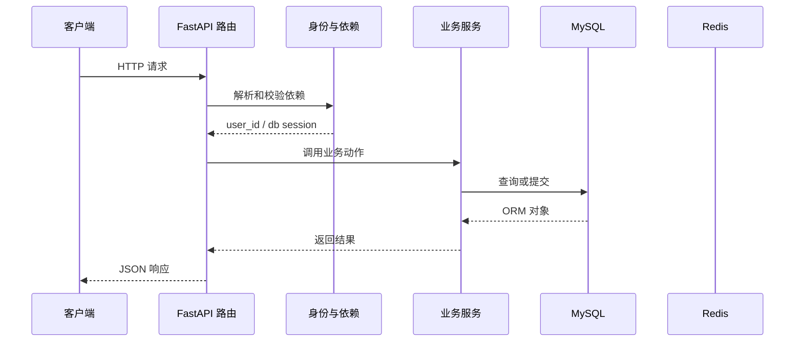

# 第 09 篇：用真实用户身份保护笔记

> 日期：2026-10-20。新版连续复刻教程；对象是有 Python/HTTP/异步基础的学习者。
> 前置：[第 08 篇](08-jwt-login.md)完成后再操作。
> 成果：笔记接口从 JWT 提取账号 ID，拒绝无令牌和失效账号。
> 2026-10-20 正式复刻目录已完成本篇鉴权代码，并在真实 MySQL 上用两个账号验证笔记隔离。Redis 黑名单尚未接入；那是第 10–11 篇的任务。

## 1. 目标与文件变化总览

这一篇围绕 **HTTPBearer、JWT 校验、数据库查用户、请求级依赖缓存**。先看改变了哪些文件，再按路径逐个完成；前端界面暂不参与代码讲解。

本篇核心接口：`/note/list`。

| 标记 | 文件 | 本篇作用 |
|---|---|---|
| 【修改】 | `backend/app/utils/auth_utils.py` | 令牌签发、解码、鉴权与撤销的集中实现。|

**阶段边界：** 旧 learning-user 笔记不会自动归入新账号；不要删表或清卷。

## 2. 从哪个目录开始

本篇唯一修改文件已在正式复刻目录完成，下面保留操作过程供学习和复核。你要求跳过的注册界面继续跳过；第 10 篇应承接本篇最终文件。

终端执行位置：

```text
.
```

```bash
cd "."
pwd
git status --short
```

## 3. 按顺序改文件

先完成依赖和父目录，再逐个编辑下面文件。修改已有文件只给前后对照和整体解释，新建文件才给完整内容；diff 的正负号只供定位，不能复制进源码。

### 步骤 1：【修改】`backend/app/utils/auth_utils.py`

**编辑文件的完整地址：**

```text
./backend/app/utils/auth_utils.py
```

**修改定位与前后对照：**

```diff
--- backend/app/utils/auth_utils.py（修改前）
+++ backend/app/utils/auth_utils.py（修改后）
@@ -1,16 +1,34 @@
 import time
 from uuid import uuid4
 
+from fastapi import Depends, HTTPException
+from fastapi.security import HTTPAuthorizationCredentials, HTTPBearer
 from jose import JWTError, jwt
+from sqlalchemy import select
+from sqlalchemy.ext.asyncio import AsyncSession
 
 from app.core.settings import settings
+from app.db.db_config import get_db
+from app.models.user_model import User, UserStatusChoice
 
-DEMO_USER_ID = "learning-user"
+security = HTTPBearer(auto_error=False)
 
 
-async def get_current_user_id() -> str:
-    # 第 09 篇将这里替换为验证 Bearer token 的依赖。
-    return DEMO_USER_ID
+async def get_current_user_id(
+    credentials: HTTPAuthorizationCredentials | None = Depends(security),
+    db: AsyncSession = Depends(get_db),
+) -> str:
+    if credentials is None:
+        raise HTTPException(status_code=401, detail="缺少 Bearer token")
+    payload = decode_token(credentials.credentials)
+    if payload is None or not isinstance(payload.get("user_id"), str):
+        raise HTTPException(status_code=401, detail="Token 无效或已过期")
+    user_id = payload["user_id"]
+    result = await db.execute(select(User).where(User.uuid == user_id))
+    user = result.scalar_one_or_none()
+    if user is None or user.status != UserStatusChoice.ACTIVE or not user.is_active:
+        raise HTTPException(status_code=401, detail="用户不存在或不可用")
+    return user.uuid
 
 
 def generate_token(user_id: str, username: str, email: str) -> tuple[str, int]:
```

**整体解释：** 认证依赖从 Bearer 令牌解析用户 ID，再查数据库确认账号仍有效，替代先前固定的示例用户。笔记路由把这个 ID 交给服务，所有查询与写入便落进当前用户自己的抽屉。

**保存后检查：**

```bash
test -f "./backend/app/utils/auth_utils.py" && echo "已找到 backend/app/utils/auth_utils.py"
```

## 4. 把这些文件连成一次真实执行

本次例子：带 Bearer token 读取自己的笔记。先记住接口 `/note/list`。下面每一站都写清谁把什么交给谁。

### 先用一个形象场景理解核心机制

第 06 篇以前，所有笔记都贴着同一张 `learning-user` 标签；换上真正的鉴权依赖后，每个请求先拿自己的通行证。`get_current_user_id` 验签成功还不够：它还到 `user_service` 表查一次用户，避免已经被停用的账号仅凭旧 token 继续读笔记。
关键隔离点在 NoteService 的查询条件：`Note.id == note_id` 只能说明“找到了这篇笔记”，还必须同时有 `Note.user_id == user_id` 才说明“这是当前用户的”。列表也是先限定用户，再筛分类和标签。新注册用户看不到历史的 `learning-user` 笔记，是隔离规则生效的结果；旧数据还在库里，不需要删除或改写它。
FastAPI 对同一请求中重复的依赖默认缓存结果。路由的 `db=Depends(get_db)` 和鉴权函数内部的 `db=Depends(get_db)` 可以共用这次请求的会话；请求结束后 `get_db` 的 `async with` 关闭会话。把 JWT 中的 `user_id` 当作未经独立验证的声明，数据库当前状态才决定账号还能否访问。

### 第 1 站：请求进入 note 路由，依赖系统先执行 get_current_user_id。

这一站的输入来自上一层：请求进入 note 路由，依赖系统先执行 get_current_user_id。可在本篇对应的 diff 或新建文件代码中找到相关函数。

观察时分清三种时刻：导入模块时只创建声明；收到 HTTP 请求后才执行路由和依赖；数据库 `commit` 后数据才作为事务结果保存。

### 第 2 站：HTTPBearer 从 Authorization 头取出 token。

这一站的输入来自上一层：HTTPBearer 从 Authorization 头取出 token。可在本篇对应的 diff 或新建文件代码中找到相关函数。

观察时分清三种时刻：导入模块时只创建声明；收到 HTTP 请求后才执行路由和依赖；数据库 `commit` 后数据才作为事务结果保存。

### 第 3 站：decode_token 校验签名与过期时间。

这一站的输入来自上一层：decode_token 校验签名与过期时间。可在本篇对应的 diff 或新建文件代码中找到相关函数。

观察时分清三种时刻：导入模块时只创建声明；收到 HTTP 请求后才执行路由和依赖；数据库 `commit` 后数据才作为事务结果保存。

### 第 4 站：从载荷取出 user_id，再到 user_service 表确认账号仍然有效。

这一站的输入来自上一层：从载荷取出 user_id，再到 user_service 表确认账号仍然有效。可在本篇对应的 diff 或新建文件代码中找到相关函数。

观察时分清三种时刻：导入模块时只创建声明；收到 HTTP 请求后才执行路由和依赖；数据库 `commit` 后数据才作为事务结果保存。

### 第 5 站：返回的 uuid 作为 Note.user_id 条件传给服务层。

这一站的输入来自上一层：返回的 uuid 作为 Note.user_id 条件传给服务层。可在本篇对应的 diff 或新建文件代码中找到相关函数。

观察时分清三种时刻：导入模块时只创建声明；收到 HTTP 请求后才执行路由和依赖；数据库 `commit` 后数据才作为事务结果保存。

### 第 6 站：查询、修改、删除都必须同时满足笔记 ID 和当前用户 ID。

这一站的输入来自上一层：查询、修改、删除都必须同时满足笔记 ID 和当前用户 ID。可在本篇对应的 diff 或新建文件代码中找到相关函数。

观察时分清三种时刻：导入模块时只创建声明；收到 HTTP 请求后才执行路由和依赖；数据库 `commit` 后数据才作为事务结果保存。

### 请求到状态变化的路线图



这张图只表示典型路径。注册尚无当前用户依赖；第 10 篇以后令牌状态检查还会访问 Redis；并非每个请求都会写数据库。

## 5. 运行与验收

先在一个终端启动依赖并等待容器健康，再在另一个终端启动后端；已有服务正在运行时不要重复占用 8100。

```bash
cd "."
docker compose up -d --wait
docker compose ps
```

第二个终端执行：

```bash
cd "./backend"
uv run uvicorn main:app --host 127.0.0.1 --port 8100 --reload
```

先注册/登录并把响应中的 token 放到当前终端变量 `TOKEN`，再运行：

```bash
curl -i http://127.0.0.1:8100/note/list
curl -i http://127.0.0.1:8100/note/list -H "Authorization: Bearer $TOKEN"
```

### 验收时看三层结果

1. **HTTP 状态**：缺少、无效或不对应现存用户的令牌应返回 401；有效令牌访问自己的笔记通常返回 200。
2. **响应 JSON**：创建结果的 `data.user_id` 应等于当前令牌对应的用户编号；访问别人的笔记时，当前接口返回 HTTP 200 和“笔记不存在”。
3. **持久化状态**：自己创建的笔记写入 MySQL 且归属正确；旧 `learning-user` 笔记仍在库中，但新用户列表看不到。

如果某一步报错，先读终端堆栈的第一处项目文件路径，再按本文文件步骤检查导入、配置与先后顺序。

### 已代执行的真实验收（2026-10-20）

- `backend/app/utils/auth_utils.py` 与本篇最终代码一致；8100 后端已重新启动，`/health/live` 和 `/health/ready` 均返回 HTTP 200。
- 不带 Bearer token、使用无效 token、使用签名有效但数据库不存在的用户编号访问 `/note/list`，均返回 HTTP 401。
- 两个本机练习账号均可登录，用户编号不同。账号 A 创建了笔记 `87dba720-884e-403b-86c2-a572ef1e4db4`；数据库记录的 `user_id` 为 A 的编号。
- A 的列表包含这篇笔记，B 的列表不包含。B 对该笔记的详情、修改、置顶和删除请求均得到当前接口约定的“笔记不存在”；A 再次读取时标题和正文保持原值。
- 原有 `learning-user` 的 6 篇笔记仍留在 MySQL，未删除、未归属到新用户。新账号看不到它们是用户隔离的预期结果。

## 6. 故障定位与完成核对

| 现象 | 先查哪里 | 为什么 |
|---|---|---|
| `ModuleNotFoundError` | 本篇依赖安装命令、`backend/.venv` | Python 可能用了另一个虚拟环境。|
| 422 | 请求模型、JSON 字段名、`Content-Type` | 输入在进入业务服务前就被拦截。|
| 401 | Authorization 头、签名密钥、用户状态、黑名单 | 鉴权依赖先于业务函数执行。|
| 503 | `/ready`、MySQL 容器和后端日志 | 本篇仅依赖 MySQL，Redis 到第 10 篇才接入。|
| 500 | 后端终端 traceback 首个项目路径 | 文件导入、表结构或事务操作可能不匹配。|
| Docker daemon 未启动 | Docker Desktop 状态、`docker info` | Compose 需要 Docker 引擎运行。|

本篇实际新增能力：笔记接口从 JWT 提取账号 ID，拒绝无令牌和失效账号。
这一步与参考实现的阶段差异：旧 learning-user 笔记不会自动归入新账号；不要删表或清卷。
核对每个文件的绝对路径、新建文件的完整代码、修改文件的 diff 与本篇接口；确认上一阶段行为仍可用。
本篇代码已写入正式复刻项目；下一篇从这个已验证的状态继续。

