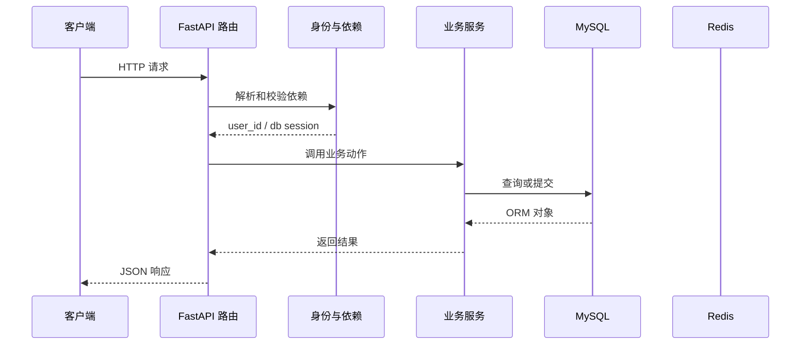

# 第 10 篇：接入 Redis 并扩展就绪检查

> 日期：2026-10-20。新版连续复刻教程；对象是有 Python/HTTP/异步基础的学习者。
> 前置：[第 09 篇](09-protect-notes-with-user.md)完成后再操作。
> 成果：Redis 运行在独立容器，/ready 同时检查 MySQL 和 Redis。
> 本篇已在正式复刻目录代执行并通过真实 MySQL/Redis 验证；具体结果见文末。Passlib 1.7.4 与 bcrypt 4.3.0 首次运行可能打印读取版本的警告；以接口结果判断运行情况。

**技术路线原理与同类比较：** [Q09：Redis 与进程内存、MySQL 状态表](technology-routes/Q09-redis-token-state.md)。

## 1. 目标与文件变化总览

这一篇围绕 **Compose 服务、Redis 连接池、生命周期清理与健康语义**。先看改变了哪些文件，再按路径逐个完成；前端界面暂不参与代码讲解。

本篇核心接口：`/health/ready`。

| 标记 | 文件 | 本篇作用 |
|---|---|---|
| 【修改】 | `.env.example` | 不含真实密钥的本地环境变量样例。|
| 【修改】 | `backend/app/core/lifespan.py` | 启动检查与关闭时的资源释放。|
| 【修改】 | `backend/app/core/settings.py` | 从本机环境读取并验证服务配置。|
| 【新增文件】 | `backend/app/db/redis_config.py` | Redis 客户端与连接池管理。|
| 【修改】 | `backend/app/router/health.py` | 存活和就绪接口。|
| 【修改】 | `docker-compose.yml` | 复刻项目自己的数据库/缓存容器声明。|

**阶段边界：** 此时令牌尚未写入黑名单；第 11 篇才用 Redis 管理注销。

## 2. 从哪个目录开始

本篇已由助手在正式复刻目录完成。下面保留逐文件操作过程供复习；你要求跳过的注册界面继续跳过。后续各篇必须承接上一篇最终文件，不能跳步。

终端执行位置：

```text
.
```

```bash
cd "."
pwd
git status --short
```

### 本篇新增依赖

下面命令在后端项目目录执行。`uv add` 同时维护 `pyproject.toml` 与 `uv.lock`；随后导出兼容 `pip` 的 `requirements.txt`。这些生成文件不要求手工抄写。

```bash
cd "./backend"
uv add 'redis==7.3.0'
uv export --locked --no-dev --no-emit-project --no-hashes --format requirements.txt --output-file requirements.txt
uv sync
```

运行后检查三个文件及环境：

```bash
cd "./backend"
ls -l pyproject.toml uv.lock requirements.txt .venv
uv run python -c "import fastapi, sqlalchemy; print('依赖可导入')"
```

### 同步本机 `.env`

`.env.example` 只是一份样例。已有 `.env` 不要整个覆盖；打开下列本机文件，在末尾补上本篇字段：

```text
./.env
```

```dotenv
REDIS_HOST=127.0.0.1
REDIS_PORT=16379
REDIS_DB=3
```

## 3. 按顺序改文件

先完成依赖和父目录，再逐个编辑下面文件。修改已有文件只给前后对照和整体解释，新建文件才给完整内容；diff 的正负号只供定位，不能复制进源码。

### 步骤 1：【修改】`.env.example`

**编辑文件的完整地址：**

```text
./.env.example
```

**修改定位与前后对照：**

```diff
--- .env.example（修改前）
+++ .env.example（修改后）
@@ -8,3 +8,6 @@
 MYSQL_ROOT_PASSWORD=mindweave_root_change_me
 SECRET_KEY=replace_with_a_random_secret
 ALGORITHM=HS256
+REDIS_HOST=127.0.0.1
+REDIS_PORT=16379
+REDIS_DB=3
```

**整体解释：** Redis 示例配置提供缓存的地址和库编号，后端连接与容器服务使用同一坐标。它像给系统新加一条线路；地址没填对，就绪检查便无法确认这条线路可用。

**保存后检查：**

```bash
test -f "./.env.example" && echo "已找到 .env.example"
```

### 步骤 2：【修改】`backend/app/core/lifespan.py`

**编辑文件的完整地址：**

```text
./backend/app/core/lifespan.py
```

**修改定位与前后对照：**

```diff
--- backend/app/core/lifespan.py（修改前）
+++ backend/app/core/lifespan.py（修改后）
@@ -4,6 +4,7 @@
 from sqlalchemy import text
 
 from app.db.db_config import async_engine, init_db
+from app.db.redis_config import close_redis
 
 
 @asynccontextmanager
@@ -17,4 +18,5 @@
         yield
     finally:
         # 【新增】启动失败或应用正常关闭时，都释放连接池资源。
+        await close_redis()
         await async_engine.dispose()
```

**整体解释：** lifespan 现在同时管理 Redis 和 MySQL：启动时准备依赖，关停时把缓存客户端与数据库引擎妥善关闭。请求借来的连接因此有统一的回收时机。

**保存后检查：**

```bash
test -f "./backend/app/core/lifespan.py" && echo "已找到 backend/app/core/lifespan.py"
```

### 步骤 3：【修改】`backend/app/core/settings.py`

**编辑文件的完整地址：**

```text
./backend/app/core/settings.py
```

**修改定位与前后对照：**

```diff
--- backend/app/core/settings.py（修改前）
+++ backend/app/core/settings.py（修改后）
@@ -28,5 +28,10 @@
     SECRET_KEY: SecretStr = SecretStr("local_dev_only_change_me")
     ALGORITHM: Literal["HS256"] = "HS256"
 
+    # 【新增 C01】本机复刻 Redis 的宿主机访问参数。
+    REDIS_HOST: str = "127.0.0.1"
+    REDIS_PORT: int = Field(default=16379, ge=1, le=65535)
+    REDIS_DB: int = Field(default=3, ge=0)
+
 
 settings = Settings()
```

**整体解释：** settings 集中接收 Redis 地址、端口和库编号，客户端和健康接口只向它索取配置。启动时先核对门牌，避免运行到缓存操作时才发现参数不合法。

**保存后检查：**

```bash
test -f "./backend/app/core/settings.py" && echo "已找到 backend/app/core/settings.py"
```

### 步骤 4：【新增文件】`backend/app/db/redis_config.py`

**编辑文件的完整地址：**

```text
./backend/app/db/redis_config.py
```

父目录如果尚不存在，先创建：

```bash
mkdir -p "./backend/app/db"
```

**完整文件内容：**

```python
from redis.asyncio import ConnectionPool, Redis

from app.core.settings import settings

pool = ConnectionPool(
    host=settings.REDIS_HOST,
    port=settings.REDIS_PORT,
    db=settings.REDIS_DB,
    decode_responses=True,
)


def get_redis() -> Redis:
    return Redis(connection_pool=pool)


async def check_redis_connection() -> bool:
    try:
        return bool(await get_redis().ping())
    except Exception:
        return False


async def close_redis() -> None:
    await pool.disconnect()
```

**文件职责：** Redis 客户端与连接池管理。

**保存后检查：**

```bash
test -f "./backend/app/db/redis_config.py" && echo "已找到 backend/app/db/redis_config.py"
```

### 步骤 5：【修改】`backend/app/router/health.py`

**编辑文件的完整地址：**

```text
./backend/app/router/health.py
```

**修改定位与前后对照：**

```diff
--- backend/app/router/health.py（修改前）
+++ backend/app/router/health.py（修改后）
@@ -3,6 +3,7 @@
 
 from app.core.success_response import success_response
 from app.db.db_config import check_mysql_connection
+from app.db.redis_config import check_redis_connection
 
 health_router = APIRouter(prefix="/health")
 
@@ -20,6 +21,8 @@
     # 【新增 C01】能接请求与能连接业务依赖，是两种不同状态。
     if not await check_mysql_connection():
         raise HTTPException(status_code=503, detail="MySQL连接失败")
+    if not await check_redis_connection():
+        raise HTTPException(status_code=503, detail="Redis连接失败")
     return success_response(
         message="health readiness status",
         data={"status": "ok"},
```

**整体解释：** /ready 连续检查 MySQL 查询与 Redis ping，任一关键依赖断开都返回暂不可用；/live 仍只确认进程能答话。两个接口合起来区分“机器开着”和“业务已经能办理”。

**保存后检查：**

```bash
test -f "./backend/app/router/health.py" && echo "已找到 backend/app/router/health.py"
```

### 步骤 6：【修改】`docker-compose.yml`

**编辑文件的完整地址：**

```text
./docker-compose.yml
```

**修改定位与前后对照：**

```diff
--- docker-compose.yml（修改前）
+++ docker-compose.yml（修改后）
@@ -24,5 +24,20 @@
       retries: 30
       start_period: 20s
 
+  redis:
+    image: redis:7.4
+    restart: unless-stopped
+    ports:
+      - "127.0.0.1:${REDIS_PORT:-16379}:6379"
+    volumes:
+      - redis_data:/data
+    command: ["redis-server", "--appendonly", "yes"]
+    healthcheck:
+      test: ["CMD", "redis-cli", "ping"]
+      interval: 5s
+      timeout: 3s
+      retries: 20
+
 volumes:
   mysql_data:
+  redis_data:
```

**整体解释：** Compose 把 Redis 容器、端口、健康检查和数据卷接进本机环境，好比给后端加一个能巡检的仓库。应用按配置找它，健康检查报告它能否工作，数据卷提供重启后的保存位置。

**保存后检查：**

```bash
test -f "./docker-compose.yml" && echo "已找到 docker-compose.yml"
```

## 4. 把这些文件连成一次真实执行

本次例子：查询依赖服务是否可用。先记住接口 `/health/ready`。下面每一站都写清谁把什么交给谁。

### 先用一个形象场景理解核心机制

MySQL 保存长期笔记与用户资料；Redis 存放需要快速读取、带过期时间的小状态。第 11 篇的注销标记不会为了每次请求都去扫描 MySQL 表，而是根据 token 编号查 Redis 键。这里先把 Redis 服务、配置和连接管理搭好，并让 `/ready` 检查它。
`/live` 像问“柜台还有人在接电话吗”，`/ready` 像问“柜台现在能不能办业务”。Redis 停了但 Python 进程还在，`/live` 可以继续成功；`/ready` 应报告依赖不可用。启动阶段的 `lifespan` 仍先检查 MySQL 和建表；请求阶段的 `/ready` 才同时检查两个依赖，因此启动后的 Redis 中断可以通过 ready 观察到。
`redis.asyncio.Redis` 客户端通常不会因为创建对象就完成网络通信；调用 `PING`、`EXISTS` 或 `SET` 时才真正观察到连接故障。应用关闭时 `close_redis` 释放连接池，避免重载和测试中留下悬挂连接。

### 第 1 站：Docker Compose 启动 MySQL 和 Redis 两个独立服务。

这一站的输入来自上一层：Docker Compose 启动 MySQL 和 Redis 两个独立服务。可在本篇对应的 diff 或新建文件代码中找到相关函数。

观察时分清三种时刻：导入模块时只创建声明；收到 HTTP 请求后才执行路由和依赖；数据库 `commit` 后数据才作为事务结果保存。

### 第 2 站：Settings 从 .env 读取 Redis 主机、端口和 DB。

这一站的输入来自上一层：Settings 从 .env 读取 Redis 主机、端口和 DB。可在本篇对应的 diff 或新建文件代码中找到相关函数。

观察时分清三种时刻：导入模块时只创建声明；收到 HTTP 请求后才执行路由和依赖；数据库 `commit` 后数据才作为事务结果保存。

### 第 3 站：get_redis 在需要时返回连接池对应的客户端。

这一站的输入来自上一层：get_redis 在需要时返回连接池对应的客户端。可在本篇对应的 diff 或新建文件代码中找到相关函数。

观察时分清三种时刻：导入模块时只创建声明；收到 HTTP 请求后才执行路由和依赖；数据库 `commit` 后数据才作为事务结果保存。

### 第 4 站：/health/ready 分别调用数据库 SELECT 1 和 Redis PING。

这一站的输入来自上一层：/health/ready 分别调用数据库 SELECT 1 和 Redis PING。可在本篇对应的 diff 或新建文件代码中找到相关函数。

观察时分清三种时刻：导入模块时只创建声明；收到 HTTP 请求后才执行路由和依赖；数据库 `commit` 后数据才作为事务结果保存。

### 第 5 站：只有两个检查都成功时返回 200；失败的依赖会让就绪检查返回 503。

这一站的输入来自上一层：只有两个检查都成功时返回 200；失败的依赖会让就绪检查返回 503。可在本篇对应的 diff 或新建文件代码中找到相关函数。

观察时分清三种时刻：导入模块时只创建声明；收到 HTTP 请求后才执行路由和依赖；数据库 `commit` 后数据才作为事务结果保存。

### 第 6 站：应用关闭时 lifespan 释放 Redis 客户端与 MySQL 引擎。

这一站的输入来自上一层：应用关闭时 lifespan 释放 Redis 客户端与 MySQL 引擎。可在本篇对应的 diff 或新建文件代码中找到相关函数。

观察时分清三种时刻：导入模块时只创建声明；收到 HTTP 请求后才执行路由和依赖；数据库 `commit` 后数据才作为事务结果保存。

### 请求到状态变化的路线图



这张图只表示典型路径。注册尚无当前用户依赖；第 11 篇开始，令牌状态检查还会访问 Redis；并非每个请求都会写数据库。

## 5. 运行与验收

先在一个终端启动依赖并等待容器健康，再在另一个终端启动后端；已有服务正在运行时不要重复占用 8100。

```bash
cd "."
docker compose up -d --wait
docker compose ps
```

第二个终端执行：

```bash
cd "./backend"
uv run uvicorn main:app --host 127.0.0.1 --port 8100 --reload
```

Redis 就绪可用下列命令检查，不需要交互输入密码：

```bash
cd "."
docker compose exec -T redis redis-cli ping
curl -i http://127.0.0.1:8100/health/live
curl -i http://127.0.0.1:8100/health/ready
```

### 验收时看三层结果

1. **HTTP 状态**：成功请求通常是 200；参数无效、身份无效和依赖故障分别观察对应错误。
2. **响应 JSON**：看公开字段、业务消息和返回的 token/模板列表；密码哈希不应出现在用户响应里。
3. **持久化状态**：注册、修改、密码重置、模板增删改排序要在重启后仍存在；令牌黑名单要遵守 TTL 语义。

如果某一步报错，先读终端堆栈的第一处项目文件路径，再按本文文件步骤检查导入、配置与先后顺序。

## 6. 故障定位与完成核对

| 现象 | 先查哪里 | 为什么 |
|---|---|---|
| `ModuleNotFoundError` | 本篇依赖安装命令、`backend/.venv` | Python 可能用了另一个虚拟环境。|
| 422 | 请求模型、JSON 字段名、`Content-Type` | 输入在进入业务服务前就被拦截。|
| 401 | Authorization 头、签名密钥、用户状态、黑名单 | 鉴权依赖先于业务函数执行。|
| 503 | `/ready`、MySQL/Redis 容器和日志 | 下游依赖不可用或策略选择拒绝继续。|
| 500 | 后端终端 traceback 首个项目路径 | 文件导入、表结构或事务操作可能不匹配。|
| Docker daemon 未启动 | Docker Desktop 状态、`docker info` | Compose 需要 Docker 引擎运行。|

### 已代执行的真实验收（2026-10-20）

- `uv sync --locked`、依赖导出、Python 语法检查和 Compose 配置检查均通过。
- 独立 Redis 容器运行在 `127.0.0.1:16379`，`docker compose exec -T redis redis-cli ping` 返回 `PONG`；MySQL 与 Redis 均为 healthy。
- 两个服务正常时，`/health/live` 和 `/health/ready` 均返回 HTTP 200。
- 只停止 Redis 时，`/health/live` 保持 HTTP 200，`/health/ready` 返回 HTTP 503 和 `Redis连接失败`；启动 Redis 并等待健康后，`/health/ready` 恢复 HTTP 200。
- 本机已有 `redis:7-alpine` 镜像，内部 Redis 版本为 7.4.11。Docker Hub 拉取 `redis:7.4` 时凭据助手未响应，因此将已有镜像在本机标记为 `redis:7.4` 后启动；Compose 文件仍使用文中 `redis:7.4`。本次没有删除数据卷，也没有单独验证容器重建后的 Redis 持久化。

本篇实际新增能力：Redis 运行在独立容器，/ready 同时检查 MySQL 和 Redis。
这一步与参考实现的阶段差异：此时令牌尚未写入黑名单；第 11 篇才用 Redis 管理注销。
核对每个文件的绝对路径、新建文件的完整代码、修改文件的 diff 与本篇接口；确认上一阶段行为仍可用。
本篇已写入正式复刻项目；下一篇从当前文件状态继续。

