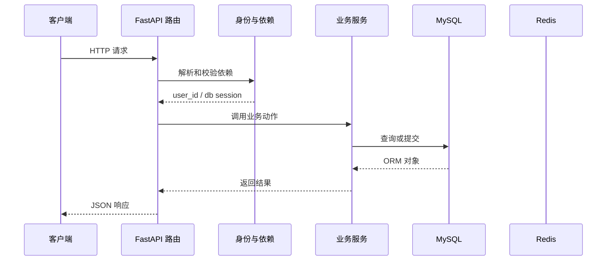

# 第 11 篇：用 Redis 黑名单完成注销

> 日期：2026-10-20。新版连续复刻教程；对象是有 Python/HTTP/异步基础的学习者。
> 前置：[第 10 篇](10-redis-and-readiness.md)完成后再操作。
> 成果：注销后原 JWT 立即失效，服务端检查黑名单。
> 本篇已在正式复刻目录代执行，并用真实 MySQL/Redis 验证注销、TTL、故障与恢复；具体结果见文末。Passlib 1.7.4 与 bcrypt 4.3.0 首次运行可能打印读取版本的警告；以接口结果判断运行情况。

## 1. 目标与文件变化总览

这一篇围绕 **JWT jti、剩余寿命 TTL、Redis 黑名单与故障关闭策略**。先看改变了哪些文件，再按路径逐个完成；前端界面暂不参与代码讲解。

本篇核心接口：`/user/logout/`。

| 标记 | 文件 | 本篇作用 |
|---|---|---|
| 【修改】 | `backend/app/router/user.py` | 用户接口；把 HTTP 参数、依赖、服务和响应接起来。|
| 【修改】 | `backend/app/utils/auth_utils.py` | 令牌签发、解码、鉴权与撤销的集中实现。|

**阶段边界：** 与参考实现的容错取舍不同：Redis 故障时返回 503，避免失效令牌漏过。

## 2. 从哪个目录开始

本篇已由助手在正式复刻目录完成。下面保留逐文件操作过程供复习；你要求跳过的注册界面继续跳过。后续各篇必须承接上一篇最终文件，不能跳步。

终端执行位置：

```text
.
```

```bash
cd "."
pwd
git status --short
```

## 3. 按顺序改文件

先完成依赖和父目录，再逐个编辑下面文件。修改已有文件只给前后对照和整体解释，新建文件才给完整内容；diff 的正负号只供定位，不能复制进源码。

### 步骤 1：【修改】`backend/app/router/user.py`

**编辑文件的完整地址：**

```text
./backend/app/router/user.py
```

**修改定位与前后对照：**

```diff
--- backend/app/router/user.py（修改前）
+++ backend/app/router/user.py（修改后）
@@ -1,10 +1,13 @@
 from fastapi import APIRouter, Depends
+from fastapi.security import HTTPAuthorizationCredentials
 from sqlalchemy.ext.asyncio import AsyncSession
 
 from app.db.db_config import get_db
 from app.schemas.user_schemas import LoginRequest, RegisterRequest, UserResponse
 from app.services.user_service import user_service
-from app.utils.auth_utils import generate_token
+from app.utils.auth_utils import (
+    blacklist_token, generate_token, get_current_user_id, security,
+)
 
 user_router = APIRouter(prefix="/user", tags=["user"])
 
@@ -39,3 +42,12 @@
         "user": UserResponse.model_validate(user).model_dump(mode="json"),
         "token": token,
     }
+
+
+@user_router.post("/logout/")
+async def logout(
+    _user_id: str = Depends(get_current_user_id),
+    credentials: HTTPAuthorizationCredentials = Depends(security),
+) -> dict:
+    await blacklist_token(credentials.credentials)
+    return {"message": "用户注销成功"}
```

**整体解释：** 登出接口先确认当前通行证有效，再把它送进撤销名单。即使客户端保留原令牌字符串，后续认证依赖也会查到它已经作废；账户本身仍留在数据库。

**保存后检查：**

```bash
test -f "./backend/app/router/user.py" && echo "已找到 backend/app/router/user.py"
```

### 步骤 2：【修改】`backend/app/utils/auth_utils.py`

**编辑文件的完整地址：**

```text
./backend/app/utils/auth_utils.py
```

**修改定位与前后对照：**

```diff
--- backend/app/utils/auth_utils.py（修改前）
+++ backend/app/utils/auth_utils.py（修改后）
@@ -4,11 +4,13 @@
 from fastapi import Depends, HTTPException
 from fastapi.security import HTTPAuthorizationCredentials, HTTPBearer
 from jose import JWTError, jwt
+from redis.exceptions import RedisError
 from sqlalchemy import select
 from sqlalchemy.ext.asyncio import AsyncSession
 
 from app.core.settings import settings
 from app.db.db_config import get_db
+from app.db.redis_config import get_redis
 from app.models.user_model import User, UserStatusChoice
 
 security = HTTPBearer(auto_error=False)
@@ -23,6 +25,14 @@
     payload = decode_token(credentials.credentials)
     if payload is None or not isinstance(payload.get("user_id"), str):
         raise HTTPException(status_code=401, detail="Token 无效或已过期")
+    jti = payload.get("jti")
+    if not isinstance(jti, str):
+        raise HTTPException(status_code=401, detail="Token 缺少编号")
+    try:
+        if await get_redis().exists(f"blacklist:{jti}"):
+            raise HTTPException(status_code=401, detail="Token 已注销")
+    except RedisError as exc:
+        raise HTTPException(status_code=503, detail="令牌状态暂不可用") from exc
     user_id = payload["user_id"]
     result = await db.execute(select(User).where(User.uuid == user_id))
     user = result.scalar_one_or_none()
@@ -52,3 +62,17 @@
         )
     except JWTError:
         return None
+
+
+async def blacklist_token(token: str) -> None:
+    payload = decode_token(token)
+    if payload is None:
+        raise HTTPException(status_code=401, detail="Token 无效或已过期")
+    jti, exp = payload.get("jti"), payload.get("exp")
+    if not isinstance(jti, str) or not isinstance(exp, int):
+        raise HTTPException(status_code=401, detail="Token 缺少必要字段")
+    ttl = max(exp - int(time.time()), 1)
+    try:
+        await get_redis().set(f"blacklist:{jti}", "1", ex=ttl)
+    except RedisError as exc:
+        raise HTTPException(status_code=503, detail="注销暂不可用") from exc
```

**整体解释：** JWT 签名正确也可能尚未过期，Redis 黑名单用 jti 标记这张令牌提前作废，并只保存到原到期时间。认证时先查撤销状态；Redis 无法判断时就停止放行，避免已登出的令牌漏过去。

**保存后检查：**

```bash
test -f "./backend/app/utils/auth_utils.py" && echo "已找到 backend/app/utils/auth_utils.py"
```

## 4. 把这些文件连成一次真实执行

本次例子：携带当前令牌退出账号。先记住接口 `/user/logout/`。下面每一站都写清谁把什么交给谁。

### 先用一个形象场景理解核心机制

JWT 一旦签发，服务端通常不能像删除数据库行那样把已经拿到用户手里的字符串收回。`jti` 给每张通行证一个编号；注销时把 `blacklist:<jti>` 写入 Redis。此后每个受保护请求先验签、再查这个编号是否在黑名单里。命中就拒绝。
黑名单只需要活到令牌本身过期：`ttl = exp - now`。令牌过期后 JWT 验证天然失败，再保留 Redis 键只会占空间。这里 `max(..., 1)` 防止临界时刻得到非正 TTL。`EXISTS` 的检查发生在查询用户和笔记之前，所以已注销的令牌到不了业务服务。
本教程在 Redis 故障时返回 503：因为此刻无法确认令牌是否注销，继续放行会破坏注销承诺。这会让 Redis 成为鉴权路径上的可用性依赖，因此部署时要认真监控 Redis。这个取舍与参考实现不同，已经在篇首标出。

### 第 1 站：客户端带原 token 调用 /user/logout/。

这一站的输入来自上一层：客户端带原 token 调用 /user/logout/。可在本篇对应的 diff 或新建文件代码中找到相关函数。

观察时分清三种时刻：导入模块时只创建声明；收到 HTTP 请求后才执行路由和依赖；数据库 `commit` 后数据才作为事务结果保存。

### 第 2 站：先走 get_current_user_id，确认它未过期且未被注销。

这一站的输入来自上一层：先走 get_current_user_id，确认它未过期且未被注销。可在本篇对应的 diff 或新建文件代码中找到相关函数。

观察时分清三种时刻：导入模块时只创建声明；收到 HTTP 请求后才执行路由和依赖；数据库 `commit` 后数据才作为事务结果保存。

### 第 3 站：blacklist_token 解码 jti 和 exp，算出距离过期还剩多少秒。

这一站的输入来自上一层：blacklist_token 解码 jti 和 exp，算出距离过期还剩多少秒。可在本篇对应的 diff 或新建文件代码中找到相关函数。

观察时分清三种时刻：导入模块时只创建声明；收到 HTTP 请求后才执行路由和依赖；数据库 `commit` 后数据才作为事务结果保存。

### 第 4 站：Redis 写入 blacklist:<jti>，TTL 到期自动删除。

这一站的输入来自上一层：Redis 写入 blacklist:<jti>，TTL 到期自动删除。可在本篇对应的 diff 或新建文件代码中找到相关函数。

观察时分清三种时刻：导入模块时只创建声明；收到 HTTP 请求后才执行路由和依赖；数据库 `commit` 后数据才作为事务结果保存。

### 第 5 站：同一个 token 下次访问时，鉴权依赖在黑名单中查到 jti，返回 401。

这一站的输入来自上一层：同一个 token 下次访问时，鉴权依赖在黑名单中查到 jti，返回 401。可在本篇对应的 diff 或新建文件代码中找到相关函数。

观察时分清三种时刻：导入模块时只创建声明；收到 HTTP 请求后才执行路由和依赖；数据库 `commit` 后数据才作为事务结果保存。

### 请求到状态变化的路线图



这张图只表示典型路径。注册尚无当前用户依赖；第 11 篇开始，令牌状态检查还会访问 Redis；并非每个请求都会写数据库。

## 5. 运行与验收

先在一个终端启动依赖并等待容器健康，再在另一个终端启动后端；已有服务正在运行时不要重复占用 8100。

```bash
cd "."
docker compose up -d --wait
docker compose ps
```

第二个终端执行：

```bash
cd "./backend"
uv run uvicorn main:app --host 127.0.0.1 --port 8100 --reload
```

使用第 08 篇获取的 token 放入当前终端变量 `TOKEN`；令牌刷新、资料修改或密码重置成功后请把响应里的新 token 替换进去。下面命令先检查进程和身份：

```bash
curl -i http://127.0.0.1:8100/health/live
curl -i http://127.0.0.1:8100/note/list -H "Authorization: Bearer $TOKEN"
```

本篇核心请求：

```bash
curl -i -X POST http://127.0.0.1:8100/user/logout/ -H "Authorization: Bearer $TOKEN"
```

### 验收时看三层结果

1. **HTTP 状态**：成功请求通常是 200；参数无效、身份无效和依赖故障分别观察对应错误。
2. **响应 JSON**：看公开字段、业务消息和返回的 token/模板列表；密码哈希不应出现在用户响应里。
3. **持久化状态**：注册、修改、密码重置、模板增删改排序要在重启后仍存在；令牌黑名单要遵守 TTL 语义。

如果某一步报错，先读终端堆栈的第一处项目文件路径，再按本文文件步骤检查导入、配置与先后顺序。

## 6. 故障定位与完成核对

| 现象 | 先查哪里 | 为什么 |
|---|---|---|
| `ModuleNotFoundError` | 本篇依赖安装命令、`backend/.venv` | Python 可能用了另一个虚拟环境。|
| 422 | 请求模型、JSON 字段名、`Content-Type` | 输入在进入业务服务前就被拦截。|
| 401 | Authorization 头、签名密钥、用户状态、黑名单 | 鉴权依赖先于业务函数执行。|
| 503 | `/ready`、MySQL/Redis 容器和日志 | 下游依赖不可用或策略选择拒绝继续。|
| 500 | 后端终端 traceback 首个项目路径 | 文件导入、表结构或事务操作可能不匹配。|
| Docker daemon 未启动 | Docker Desktop 状态、`docker info` | Compose 需要 Docker 引擎运行。|

### 已代执行的真实验收（2026-10-20）

- 两处文件与第 10 篇基线一致后完成修改；Python 语法与应用路由导入检查通过。MySQL、Redis 均保持健康。
- 用数据库中已有的活跃用户签发新令牌：注销前访问 `/note/list` 为 HTTP 200；调用 `/user/logout/` 为 200；原令牌再访问笔记和再次注销均为 401。
- Redis 黑名单键的 TTL 实测为 86400 秒左右；同一用户的新令牌仍能访问笔记，证明注销只撤销指定 `jti`。
- 只停 Redis 时，受保护的笔记接口和注销均返回 503，`/health/live` 为 200、`/health/ready` 为 503；恢复 Redis 后，新令牌访问与就绪检查恢复 200，旧令牌仍为 401。
- 测试未新增或删除用户、笔记；Redis 容器停止再启动保留了黑名单。尚未测试删除并重建容器后的持久化。

本篇实际新增能力：注销后原 JWT 立即失效，服务端检查黑名单。
这一步与参考实现的阶段差异：与参考实现的容错取舍不同：Redis 故障时返回 503，避免失效令牌漏过。
核对每个文件的绝对路径、新建文件的完整代码、修改文件的 diff 与本篇接口；确认上一阶段行为仍可用。
本篇已写入正式复刻项目；下一篇从当前文件状态继续。

