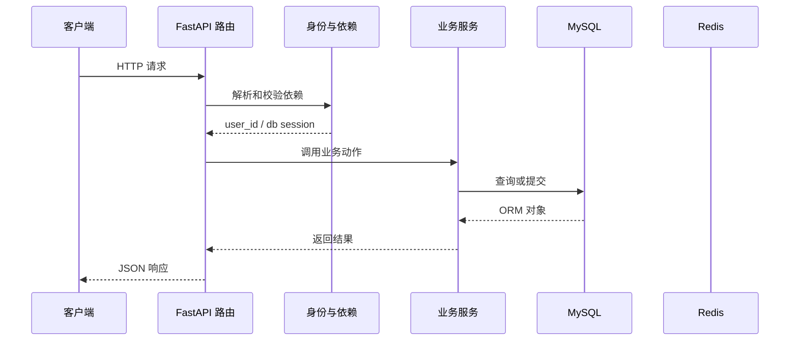

# 第 12 篇：一次性刷新访问令牌

> 日期：2026-10-20。新版连续复刻教程；对象是有 Python/HTTP/异步基础的学习者。
> 前置：[第 11 篇](11-logout-blacklist.md)完成后再操作。
> 成果：旧令牌只能刷新一次，刷新后不可继续访问。
> 本篇已在正式复刻目录代执行，并用真实 MySQL/Redis 验证一次性刷新、并发竞争及故障恢复；具体结果见文末。Passlib 1.7.4 与 bcrypt 4.3.0 首次运行可能打印读取版本的警告；以接口结果判断运行情况。

## 1. 目标与文件变化总览

这一篇围绕 **原子 SET NX EX、令牌轮换、并发请求竞争与错误边界**。先看改变了哪些文件，再按路径逐个完成；前端界面暂不参与代码讲解。

本篇核心接口：`/user/refresh-token/`。

| 标记 | 文件 | 本篇作用 |
|---|---|---|
| 【修改】 | `backend/app/router/user.py` | 用户接口；把 HTTP 参数、依赖、服务和响应接起来。|
| 【修改】 | `backend/app/schemas/user_schemas.py` | HTTP 输入输出边界；验证请求，控制响应公开字段。|
| 【修改】 | `backend/app/utils/auth_utils.py` | 令牌签发、解码、鉴权与撤销的集中实现。|

**阶段边界：** 这里沿参考接口使用访问令牌刷新；后续可再拆分独立 refresh token。

## 2. 从哪个目录开始

本篇已由助手在正式复刻目录完成。下面保留逐文件操作过程供复习；你要求跳过的注册界面继续跳过。后续各篇必须承接上一篇最终文件，不能跳步。

终端执行位置：

```text
.
```

```bash
cd "."
pwd
git status --short
```

## 3. 按顺序改文件

先完成依赖和父目录，再逐个编辑下面文件。修改已有文件只给前后对照和整体解释，新建文件才给完整内容；diff 的正负号只供定位，不能复制进源码。

### 步骤 1：【修改】`backend/app/router/user.py`

**编辑文件的完整地址：**

```text
./backend/app/router/user.py
```

**修改定位与前后对照：**

```diff
--- backend/app/router/user.py（修改前）
+++ backend/app/router/user.py（修改后）
@@ -1,12 +1,17 @@
-from fastapi import APIRouter, Depends
+from fastapi import APIRouter, Depends, HTTPException
 from fastapi.security import HTTPAuthorizationCredentials
+from sqlalchemy import select
 from sqlalchemy.ext.asyncio import AsyncSession
 
 from app.db.db_config import get_db
-from app.schemas.user_schemas import LoginRequest, RegisterRequest, UserResponse
+from app.models.user_model import User, UserStatusChoice
+from app.schemas.user_schemas import (
+    LoginRequest, RegisterRequest, TokenRefreshRequest, UserResponse,
+)
 from app.services.user_service import user_service
 from app.utils.auth_utils import (
-    blacklist_token, generate_token, get_current_user_id, security,
+    blacklist_token, consume_token, decode_token, generate_token,
+    get_current_user_id, security,
 )
 
 user_router = APIRouter(prefix="/user", tags=["user"])
@@ -51,3 +56,21 @@
 ) -> dict:
     await blacklist_token(credentials.credentials)
     return {"message": "用户注销成功"}
+
+
+@user_router.post("/refresh-token/")
+async def refresh_token(
+    payload: TokenRefreshRequest,
+    db: AsyncSession = Depends(get_db),
+) -> dict:
+    claims = decode_token(payload.token)
+    if claims is None or not isinstance(claims.get("user_id"), str):
+        raise HTTPException(status_code=401, detail="Token 无效或已过期")
+    result = await db.execute(select(User).where(User.uuid == claims["user_id"]))
+    user = result.scalar_one_or_none()
+    if user is None or user.status != UserStatusChoice.ACTIVE or not user.is_active:
+        raise HTTPException(status_code=401, detail="用户不存在或不可用")
+    await consume_token(payload.token)
+    new_token, expires_at = generate_token(user.uuid, user.username, user.email)
+    return {"message": "Token刷新成功", "token": new_token,
+            "expire_time": expires_at}
```

**整体解释：** 刷新接口先验证旧令牌及账号，再请刷新逻辑消耗旧票据、签发新票据。客户端用新的继续访问；旧票据已经用过，不能重复提交换出多张新令牌。

**保存后检查：**

```bash
test -f "./backend/app/router/user.py" && echo "已找到 backend/app/router/user.py"
```

### 步骤 2：【修改】`backend/app/schemas/user_schemas.py`

**编辑文件的完整地址：**

```text
./backend/app/schemas/user_schemas.py
```

**修改定位与前后对照：**

```diff
--- backend/app/schemas/user_schemas.py（修改前）
+++ backend/app/schemas/user_schemas.py（修改后）
@@ -31,3 +31,7 @@
     date_joined: datetime | None = None
     last_login: datetime | None = None
     is_active: bool
+
+
+class TokenRefreshRequest(BaseModel):
+    token: str = Field(min_length=1)
```

**整体解释：** 请求模型先保证刷新令牌至少是一段非空字符串，像柜台先确认带了票。票据的签名、期限和是否已经用过，还要交给后续令牌工具与 Redis 判断。

**保存后检查：**

```bash
test -f "./backend/app/schemas/user_schemas.py" && echo "已找到 backend/app/schemas/user_schemas.py"
```

### 步骤 3：【修改】`backend/app/utils/auth_utils.py`

**编辑文件的完整地址：**

```text
./backend/app/utils/auth_utils.py
```

**修改定位与前后对照：**

```diff
--- backend/app/utils/auth_utils.py（修改前）
+++ backend/app/utils/auth_utils.py（修改后）
@@ -76,3 +76,20 @@
         await get_redis().set(f"blacklist:{jti}", "1", ex=ttl)
     except RedisError as exc:
         raise HTTPException(status_code=503, detail="注销暂不可用") from exc
+
+
+async def consume_token(token: str) -> dict:
+    payload = decode_token(token)
+    if payload is None:
+        raise HTTPException(status_code=401, detail="Token 无效或已过期")
+    jti, exp = payload.get("jti"), payload.get("exp")
+    if not isinstance(jti, str) or not isinstance(exp, int):
+        raise HTTPException(status_code=401, detail="Token 缺少必要字段")
+    ttl = max(exp - int(time.time()), 1)
+    try:
+        first_use = await get_redis().set(f"blacklist:{jti}", "1", ex=ttl, nx=True)
+    except RedisError as exc:
+        raise HTTPException(status_code=503, detail="令牌刷新暂不可用") from exc
+    if not first_use:
+        raise HTTPException(status_code=401, detail="Token 已使用或注销")
+    return payload
```

**整体解释：** Redis 的 SET NX EX 像只能盖一次的检票章：并发请求争用同一旧令牌，只有一个能成功写入唯一键，键到期后自动消失。获胜请求签发新令牌，旧令牌被撤销，避免同时换出多张有效票。

**保存后检查：**

```bash
test -f "./backend/app/utils/auth_utils.py" && echo "已找到 backend/app/utils/auth_utils.py"
```

## 4. 把这些文件连成一次真实执行

本次例子：用旧 token 换新 token。先记住接口 `/user/refresh-token/`。下面每一站都写清谁把什么交给谁。

### 先用一个形象场景理解核心机制

刷新令牌像拿旧票换新票。只验证旧票还有效并不够：两个人同时拿同一张票来换，可能各拿到一张新票。`SET key value NX EX ttl` 把“仅当键不存在时写入”和“附带过期时间”放在同一条 Redis 原子命令里。第一位换票成功，第二位看到键已经存在，立即被拒绝。
路由先解码令牌并检查数据库用户当前仍可用，再调用 `consume_token` 抢占旧 `jti`。成功后生成新 `jti` 的 JWT。旧令牌由于黑名单已有键，后续普通请求也会被拒绝。`expire_time` 是 Unix 时间戳，不是“还剩多少秒”；客户端若展示倒计时要减去当前时间。
如果 Redis 写入成功而进程在生成或返回新 token 前崩溃，旧 token 已被消费，用户需要重新登录。这是一次性轮换的真实失败边界。教材选择在此阶段明确暴露这个行为，而不是假装整个网络请求具备跨 Redis 与 HTTP 的原子性。

### 第 1 站：客户端把仍有效的 token 放在 JSON body。

这一站的输入来自上一层：客户端把仍有效的 token 放在 JSON body。可在本篇对应的 diff 或新建文件代码中找到相关函数。

观察时分清三种时刻：导入模块时只创建声明；收到 HTTP 请求后才执行路由和依赖；数据库 `commit` 后数据才作为事务结果保存。

### 第 2 站：路由解码 token，查询用户是否仍可用。

这一站的输入来自上一层：路由解码 token，查询用户是否仍可用。可在本篇对应的 diff 或新建文件代码中找到相关函数。

观察时分清三种时刻：导入模块时只创建声明；收到 HTTP 请求后才执行路由和依赖；数据库 `commit` 后数据才作为事务结果保存。

### 第 3 站：consume_token 以 SET NX EX 尝试抢占旧 jti。

这一站的输入来自上一层：consume_token 以 SET NX EX 尝试抢占旧 jti。可在本篇对应的 diff 或新建文件代码中找到相关函数。

观察时分清三种时刻：导入模块时只创建声明；收到 HTTP 请求后才执行路由和依赖；数据库 `commit` 后数据才作为事务结果保存。

### 第 4 站：第一个请求成功，第二个并发请求因 NX 条件失败。

这一站的输入来自上一层：第一个请求成功，第二个并发请求因 NX 条件失败。可在本篇对应的 diff 或新建文件代码中找到相关函数。

观察时分清三种时刻：导入模块时只创建声明；收到 HTTP 请求后才执行路由和依赖；数据库 `commit` 后数据才作为事务结果保存。

### 第 5 站：成功请求生成带新 jti 和新 exp 的 token。

这一站的输入来自上一层：成功请求生成带新 jti 和新 exp 的 token。可在本篇对应的 diff 或新建文件代码中找到相关函数。

观察时分清三种时刻：导入模块时只创建声明；收到 HTTP 请求后才执行路由和依赖；数据库 `commit` 后数据才作为事务结果保存。

### 第 6 站：旧 token 此后既不能访问受保护接口，也不能再次刷新。

这一站的输入来自上一层：旧 token 此后既不能访问受保护接口，也不能再次刷新。可在本篇对应的 diff 或新建文件代码中找到相关函数。

观察时分清三种时刻：导入模块时只创建声明；收到 HTTP 请求后才执行路由和依赖；数据库 `commit` 后数据才作为事务结果保存。

### 请求到状态变化的路线图



这张图只表示典型路径。注册尚无当前用户依赖；第 11 篇开始，令牌状态检查还会访问 Redis；并非每个请求都会写数据库。

## 5. 运行与验收

先在一个终端启动依赖并等待容器健康，再在另一个终端启动后端；已有服务正在运行时不要重复占用 8100。

```bash
cd "."
docker compose up -d --wait
docker compose ps
```

第二个终端执行：

```bash
cd "./backend"
uv run uvicorn main:app --host 127.0.0.1 --port 8100 --reload
```

使用第 08 篇获取的 token 放入当前终端变量 `TOKEN`；令牌刷新、资料修改或密码重置成功后请把响应里的新 token 替换进去。下面命令先检查进程和身份：

```bash
curl -i http://127.0.0.1:8100/health/live
curl -i http://127.0.0.1:8100/note/list -H "Authorization: Bearer $TOKEN"
```

本篇核心请求：

```bash
curl -i -X POST http://127.0.0.1:8100/user/refresh-token/ -H "Content-Type: application/json" -d "{\"token\":\"$TOKEN\"}"
```

### 验收时看三层结果

1. **HTTP 状态**：成功请求通常是 200；参数无效、身份无效和依赖故障分别观察对应错误。
2. **响应 JSON**：看公开字段、业务消息和返回的 token/模板列表；密码哈希不应出现在用户响应里。
3. **持久化状态**：注册、修改、密码重置、模板增删改排序要在重启后仍存在；令牌黑名单要遵守 TTL 语义。

如果某一步报错，先读终端堆栈的第一处项目文件路径，再按本文文件步骤检查导入、配置与先后顺序。

## 6. 故障定位与完成核对

| 现象 | 先查哪里 | 为什么 |
|---|---|---|
| `ModuleNotFoundError` | 本篇依赖安装命令、`backend/.venv` | Python 可能用了另一个虚拟环境。|
| 422 | 请求模型、JSON 字段名、`Content-Type` | 输入在进入业务服务前就被拦截。|
| 401 | Authorization 头、签名密钥、用户状态、黑名单 | 鉴权依赖先于业务函数执行。|
| 503 | `/ready`、MySQL/Redis 容器和日志 | 下游依赖不可用或策略选择拒绝继续。|
| 500 | 后端终端 traceback 首个项目路径 | 文件导入、表结构或事务操作可能不匹配。|
| Docker daemon 未启动 | Docker Desktop 状态、`docker info` | Compose 需要 Docker 引擎运行。|

### 已代执行的真实验收（2026-10-20）

- 三处文件与第 11 篇基线一致后完成修改；Python 语法与路由导入检查通过。空 token 请求返回 422。
- 使用数据库中已有的活跃用户签发测试令牌：第一次刷新返回 200 和新令牌；旧令牌随后访问笔记为 401、再次刷新为 401，新令牌访问笔记为 200。Redis 中旧令牌黑名单 TTL 实测约 86400 秒。
- 四个请求并发刷新同一令牌，恰好一个返回 200，另外三个返回 401；成功请求拿到的新令牌可访问笔记。已注销或无效令牌刷新返回 401。
- 只停 Redis 时，刷新与受保护笔记接口返回 503，`/health/live` 为 200、`/health/ready` 为 503；恢复 Redis 后，刷新和就绪检查恢复 200，先前消费的旧令牌仍为 401。
- 测试未新增或删除用户、笔记；Redis 容器停止再启动保留了黑名单。尚未测试删除并重建容器后的持久化。

本篇实际新增能力：旧令牌只能刷新一次，刷新后不可继续访问。
这一步与参考实现的阶段差异：这里沿参考接口使用访问令牌刷新；后续可再拆分独立 refresh token。
核对每个文件的绝对路径、新建文件的完整代码、修改文件的 diff 与本篇接口；确认上一阶段行为仍可用。
本篇已写入正式复刻项目；下一篇从当前文件状态继续。

