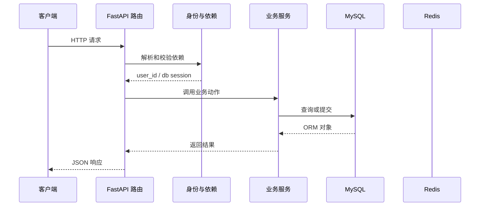

# 第 13 篇：读取和修改个人资料

> 日期：2026-10-20。新版连续复刻教程；对象是有 Python/HTTP/异步基础的学习者。
> 前置：[第 12 篇](12-refresh-token-rotation.md)完成后再操作。
> 成果：详情按当前用户读取，修改成功发新 token 并让旧 token 失效。
> 本篇已在正式复刻目录代执行，并用真实 MySQL/Redis 验证资料读取、修改、令牌撤销与持久化；具体结果见文末。Passlib 1.7.4 与 bcrypt 4.3.0 首次运行可能打印读取版本的警告；以接口结果判断运行情况。

## 1. 目标与文件变化总览

这一篇围绕 **输入可省略字段、ORM 脏数据、提交与重新签发身份声明**。先看改变了哪些文件，再按路径逐个完成；前端界面暂不参与代码讲解。

本篇核心接口：`/user/detail/、/user/update/`。

| 标记 | 文件 | 本篇作用 |
|---|---|---|
| 【修改】 | `backend/app/router/user.py` | 用户接口；把 HTTP 参数、依赖、服务和响应接起来。|
| 【修改】 | `backend/app/schemas/user_schemas.py` | HTTP 输入输出边界；验证请求，控制响应公开字段。|
| 【修改】 | `backend/app/services/user_service.py` | 用户业务动作；查询、校验、哈希、提交由这里协调。|

**阶段边界：** 数据库提交与 Redis 撤销不是同一事务；故障时须重新登录并检查资料。

## 2. 从哪个目录开始

本篇已由助手在正式复刻目录完成。下面保留逐文件操作过程供复习；你要求跳过的注册界面继续跳过。后续各篇必须承接上一篇最终文件，不能跳步。

终端执行位置：

```text
.
```

```bash
cd "."
pwd
git status --short
```

## 3. 按顺序改文件

先完成依赖和父目录，再逐个编辑下面文件。修改已有文件只给前后对照和整体解释，新建文件才给完整内容；diff 的正负号只供定位，不能复制进源码。

### 步骤 1：【修改】`backend/app/router/user.py`

**编辑文件的完整地址：**

```text
./backend/app/router/user.py
```

**修改定位与前后对照：**

```diff
--- backend/app/router/user.py（修改前）
+++ backend/app/router/user.py（修改后）
@@ -6,7 +6,8 @@
 from app.db.db_config import get_db
 from app.models.user_model import User, UserStatusChoice
 from app.schemas.user_schemas import (
-    LoginRequest, RegisterRequest, TokenRefreshRequest, UserResponse,
+    LoginRequest, RegisterRequest, TokenRefreshRequest,
+    UserResponse, UserUpdateRequest,
 )
 from app.services.user_service import user_service
 from app.utils.auth_utils import (
@@ -74,3 +75,34 @@
     new_token, expires_at = generate_token(user.uuid, user.username, user.email)
     return {"message": "Token刷新成功", "token": new_token,
             "expire_time": expires_at}
+
+
+def _user_to_response(user: User) -> dict:
+    data = UserResponse.model_validate(user).model_dump(mode="json")
+    data["user_id"] = user.uuid
+    data["id"] = user.uuid
+    return data
+
+
+@user_router.get("/detail/")
+async def get_user_info(
+    user_id: str = Depends(get_current_user_id),
+    db: AsyncSession = Depends(get_db),
+) -> dict:
+    user = await user_service.get_user(db, user_id)
+    return {"success": True, "message": "获取用户详情成功",
+            "data": _user_to_response(user)}
+
+
+@user_router.put("/update/")
+async def update_user(
+    payload: UserUpdateRequest,
+    user_id: str = Depends(get_current_user_id),
+    credentials: HTTPAuthorizationCredentials = Depends(security),
+    db: AsyncSession = Depends(get_db),
+) -> dict:
+    user = await user_service.update_user(db, user_id, payload)
+    await blacklist_token(credentials.credentials)
+    token, _expires_at = generate_token(user.uuid, user.username, user.email)
+    return {"message": "用户信息更新成功", "user": _user_to_response(user),
+            "token": token}
```

**整体解释：** 资料接口先从令牌确认当前用户，再由服务读取或更新资料。修改提交后撤销旧令牌、签发新令牌，客户端后续使用的身份信息便与数据库的新状态一致。

**保存后检查：**

```bash
test -f "./backend/app/router/user.py" && echo "已找到 backend/app/router/user.py"
```

### 步骤 2：【修改】`backend/app/schemas/user_schemas.py`

**编辑文件的完整地址：**

```text
./backend/app/schemas/user_schemas.py
```

**修改定位与前后对照：**

```diff
--- backend/app/schemas/user_schemas.py（修改前）
+++ backend/app/schemas/user_schemas.py（修改后）
@@ -21,6 +21,8 @@
     model_config = ConfigDict(from_attributes=True)
 
     uuid: str
+    user_id: str | None = None
+    id: str | None = None
     username: str
     email: EmailStr
     telephone: str | None = None
@@ -35,3 +37,11 @@
 
 class TokenRefreshRequest(BaseModel):
     token: str = Field(min_length=1)
+
+
+class UserUpdateRequest(BaseModel):
+    username: str | None = Field(default=None, min_length=1, max_length=150)
+    telephone: str | None = Field(default=None, max_length=11)
+    gender: int | None = None
+    bio: str | None = None
+    avatar: str | None = Field(default=None, max_length=255)
```

**整体解释：** 更新请求列出可修改的资料，响应模型列出可公开的资料；两张清单像进出窗口各自的表格。密码哈希留在数据库内部，不能因为直接返回 ORM 对象而流到客户端。

**保存后检查：**

```bash
test -f "./backend/app/schemas/user_schemas.py" && echo "已找到 backend/app/schemas/user_schemas.py"
```

### 步骤 3：【修改】`backend/app/services/user_service.py`

**编辑文件的完整地址：**

```text
./backend/app/services/user_service.py
```

**修改定位与前后对照：**

```diff
--- backend/app/services/user_service.py（修改前）
+++ backend/app/services/user_service.py（修改后）
@@ -6,7 +6,7 @@
 
 from app.core.failed_response import BusinessException
 from app.models.user_model import User, UserStatusChoice
-from app.schemas.user_schemas import RegisterRequest
+from app.schemas.user_schemas import RegisterRequest, UserUpdateRequest
 
 pwd_context = CryptContext(schemes=["bcrypt"], deprecated="auto")
 
@@ -61,5 +61,30 @@
         await db.refresh(user)
         return user
 
+    async def get_user(self, db: AsyncSession, user_id: str) -> User:
+        user = await db.get(User, user_id)
+        if user is None:
+            raise BusinessException(code=4004, message="用户不存在")
+        return user
+
+    async def update_user(
+        self, db: AsyncSession, user_id: str, payload: UserUpdateRequest
+    ) -> User:
+        user = await self.get_user(db, user_id)
+        changes = payload.model_dump(exclude_unset=True)
+        if "username" in changes and changes["username"] is None:
+            raise BusinessException(code=4005, message="用户名不可清空")
+        if changes.get("telephone"):
+            result = await db.execute(select(User).where(
+                User.telephone == changes["telephone"], User.uuid != user_id
+            ))
+            if result.scalar_one_or_none() is not None:
+                raise BusinessException(code=4002, message="手机号已被注册")
+        for field, value in changes.items():
+            setattr(user, field, value)
+        await db.commit()
+        await db.refresh(user)
+        return user
+
 
 user_service = UserService()
```

**整体解释：** 服务拿到当前用户记录，只应用请求中实际提交的字段，并在写入前检查用户名、手机等冲突。通过后才 commit；空用户名或重复资料被拦下时，原记录仍保持不变。

**保存后检查：**

```bash
test -f "./backend/app/services/user_service.py" && echo "已找到 backend/app/services/user_service.py"
```

## 4. 把这些文件连成一次真实执行

本次例子：查看并修改昵称和简介。先记住接口 `/user/detail/、/user/update/`。下面每一站都写清谁把什么交给谁。

### 先用一个形象场景理解核心机制

详情接口不用客户端提交 user_id，因为请求已经带了 token。鉴权依赖返回经过验签、查黑名单、查数据库后的 uuid；`get_user` 只按这个值取当前用户。这样 A 不能通过改 URL 参数读取 B 的资料。`UserResponse` 在 ORM 对象上读公开字段，路由补上参考接口使用的 `id` 和 `user_id` 别名。
修改资料时，`model_dump(exclude_unset=True)` 会保留“用户到底提交了哪些字段”的信息。例如 body 只有 `{"bio":"学习中"}`，服务只写 bio；没有提交的 username 不会被意外清空。对于 username，显式 null 另行拒绝；手机号要检查是否已被其他用户占用。赋值后的 ORM 对象被会话跟踪，`commit` 把修改写入数据库。
用户名也出现在旧 JWT 载荷里，因此更新后要撤销旧 token，返回写有新用户名的新 token。数据库提交和 Redis 黑名单写入是两个独立系统操作；若第二步故障，资料可能已更新但接口返回 503。此时先重新登录并读取详情确认状态，不要反复盲目提交。

### 第 1 站：带 token 请求 /user/detail/，依赖取当前用户 ID。

这一站的输入来自上一层：带 token 请求 /user/detail/，依赖取当前用户 ID。可在本篇对应的 diff 或新建文件代码中找到相关函数。

观察时分清三种时刻：导入模块时只创建声明；收到 HTTP 请求后才执行路由和依赖；数据库 `commit` 后数据才作为事务结果保存。

### 第 2 站：服务按主键加载 User，响应模型把 ORM 对象转为公开字段。

这一站的输入来自上一层：服务按主键加载 User，响应模型把 ORM 对象转为公开字段。可在本篇对应的 diff 或新建文件代码中找到相关函数。

观察时分清三种时刻：导入模块时只创建声明；收到 HTTP 请求后才执行路由和依赖；数据库 `commit` 后数据才作为事务结果保存。

### 第 3 站：更新请求用 exclude_unset 区分没有提交的字段和明确提交的字段。

这一站的输入来自上一层：更新请求用 exclude_unset 区分没有提交的字段和明确提交的字段。可在本篇对应的 diff 或新建文件代码中找到相关函数。

观察时分清三种时刻：导入模块时只创建声明；收到 HTTP 请求后才执行路由和依赖；数据库 `commit` 后数据才作为事务结果保存。

### 第 4 站：服务改写 User 的受允许属性并 commit。

这一站的输入来自上一层：服务改写 User 的受允许属性并 commit。可在本篇对应的 diff 或新建文件代码中找到相关函数。

观察时分清三种时刻：导入模块时只创建声明；收到 HTTP 请求后才执行路由和依赖；数据库 `commit` 后数据才作为事务结果保存。

### 第 5 站：路由把旧 token 加入黑名单，再用更新后的用户名/邮箱签发新 token。

这一站的输入来自上一层：路由把旧 token 加入黑名单，再用更新后的用户名/邮箱签发新 token。可在本篇对应的 diff 或新建文件代码中找到相关函数。

观察时分清三种时刻：导入模块时只创建声明；收到 HTTP 请求后才执行路由和依赖；数据库 `commit` 后数据才作为事务结果保存。

### 请求到状态变化的路线图



这张图只表示典型路径。注册尚无当前用户依赖；第 11 篇开始，令牌状态检查还会访问 Redis；并非每个请求都会写数据库。

## 5. 运行与验收

先在一个终端启动依赖并等待容器健康，再在另一个终端启动后端；已有服务正在运行时不要重复占用 8100。

```bash
cd "."
docker compose up -d --wait
docker compose ps
```

第二个终端执行：

```bash
cd "./backend"
uv run uvicorn main:app --host 127.0.0.1 --port 8100 --reload
```

使用第 08 篇获取的 token 放入当前终端变量 `TOKEN`；令牌刷新、资料修改或密码重置成功后请把响应里的新 token 替换进去。下面命令先检查进程和身份：

```bash
curl -i http://127.0.0.1:8100/health/live
curl -i http://127.0.0.1:8100/note/list -H "Authorization: Bearer $TOKEN"
```

本篇核心请求：

```bash
curl -i http://127.0.0.1:8100/user/detail/ -H "Authorization: Bearer $TOKEN"
curl -i -X PUT http://127.0.0.1:8100/user/update/ -H "Authorization: Bearer $TOKEN" -H "Content-Type: application/json" -d '{"bio":"正在复刻 RAGNotebook"}'
```

### 验收时看三层结果

1. **HTTP 状态**：成功请求通常是 200；参数无效、身份无效和依赖故障分别观察对应错误。
2. **响应 JSON**：看公开字段、业务消息和返回的 token/模板列表；密码哈希不应出现在用户响应里。
3. **持久化状态**：注册、修改、密码重置、模板增删改排序要在重启后仍存在；令牌黑名单要遵守 TTL 语义。

如果某一步报错，先读终端堆栈的第一处项目文件路径，再按本文文件步骤检查导入、配置与先后顺序。

## 6. 故障定位与完成核对

| 现象 | 先查哪里 | 为什么 |
|---|---|---|
| `ModuleNotFoundError` | 本篇依赖安装命令、`backend/.venv` | Python 可能用了另一个虚拟环境。|
| 422 | 请求模型、JSON 字段名、`Content-Type` | 输入在进入业务服务前就被拦截。|
| 401 | Authorization 头、签名密钥、用户状态、黑名单 | 鉴权依赖先于业务函数执行。|
| 503 | `/ready`、MySQL/Redis 容器和日志 | 下游依赖不可用或策略选择拒绝继续。|
| 500 | 后端终端 traceback 首个项目路径 | 文件导入、表结构或事务操作可能不匹配。|
| Docker daemon 未启动 | Docker Desktop 状态、`docker info` | Compose 需要 Docker 引擎运行。|

### 已代执行的真实验收（2026-10-20）

- 三处文件按第 12 篇基线依次修改，Python 语法与 `/user/detail/`、`/user/update/` 路由导入检查通过。
- 用临时测试账号访问详情返回 200，缺少 Bearer token 返回 401；详情包含 `uuid`、`id`、`user_id`，不包含密码哈希。
- 修改用户名和简介返回 200 与新令牌；原令牌再读详情为 401，新令牌访问详情和笔记为 200。新建数据库会话读到修改后的字段，证明已提交。
- 将用户名显式传为 `null` 返回 HTTP 200、正文业务码 4005，用户名保持原值。这是本项目业务异常的响应约定。
- 测试账号及本次相关 Redis 黑名单键已清理；没有修改原有用户资料。数据库提交与 Redis 撤销之间的故障窗口未做定点注入测试。

本篇实际新增能力：详情按当前用户读取，修改成功发新 token 并让旧 token 失效。
这一步与参考实现的阶段差异：数据库提交与 Redis 撤销不是同一事务；故障时须重新登录并检查资料。
核对每个文件的绝对路径、新建文件的完整代码、修改文件的 diff 与本篇接口；确认上一阶段行为仍可用。
本篇已写入正式复刻项目；第 14 篇已在此基础上继续完成。

