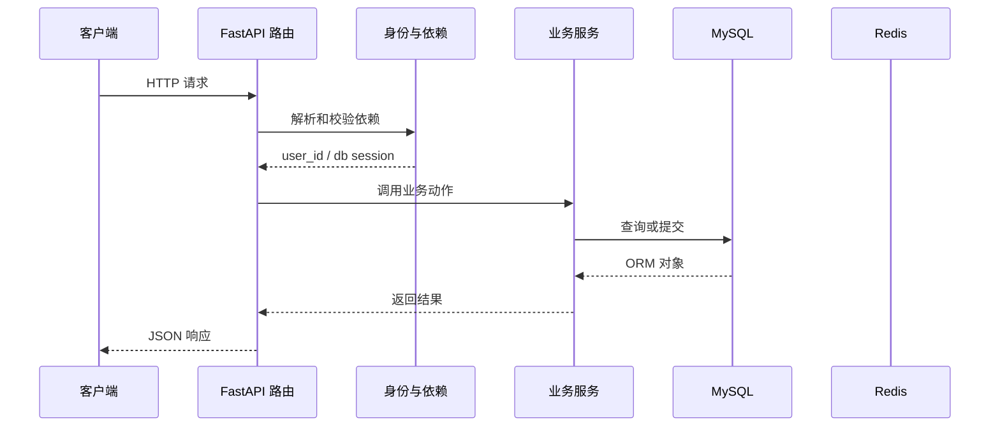

# 第 14 篇：验证旧密码并重置密码

> 日期：2026-10-20。新版连续复刻教程；对象是有 Python/HTTP/异步基础的学习者。
> 前置：[第 13 篇](13-user-profile.md)完成后再操作。
> 成果：旧密码验证通过后写入新哈希，撤销当前令牌并签发新令牌。
> 本篇已在正式复刻目录代执行，并用真实 MySQL/Redis 验证密码重置、登录和当前令牌撤销；具体结果见文末。Passlib 1.7.4 与 bcrypt 4.3.0 首次运行可能打印读取版本的警告；以接口结果判断运行情况。

## 1. 目标与文件变化总览

这一篇围绕 **旧密码校验、新旧密码约束、哈希覆盖与令牌撤销**。先看改变了哪些文件，再按路径逐个完成；前端界面暂不参与代码讲解。

本篇核心接口：`/user/reset-password/`。

| 标记 | 文件 | 本篇作用 |
|---|---|---|
| 【修改】 | `backend/app/router/user.py` | 用户接口；把 HTTP 参数、依赖、服务和响应接起来。|
| 【修改】 | `backend/app/schemas/user_schemas.py` | HTTP 输入输出边界；验证请求，控制响应公开字段。|
| 【修改】 | `backend/app/services/user_service.py` | 用户业务动作；查询、校验、哈希、提交由这里协调。|

**阶段边界：** 数据库提交与 Redis 撤销不是同一事务；故障时先检查新密码登录情况。

## 2. 从哪个目录开始

本篇已由助手在完成第 13 篇后，于正式复刻目录继续完成。下面保留逐文件操作过程供复习；你要求跳过的注册界面继续跳过。后续各篇必须承接上一篇最终文件，不能跳步。

终端执行位置：

```text
.
```

```bash
cd "."
pwd
git status --short
```

## 3. 按顺序改文件

先完成依赖和父目录，再逐个编辑下面文件。修改已有文件只给前后对照和整体解释，新建文件才给完整内容；diff 的正负号只供定位，不能复制进源码。

### 步骤 1：【修改】`backend/app/router/user.py`

**编辑文件的完整地址：**

```text
./backend/app/router/user.py
```

**修改定位与前后对照：**

```diff
--- backend/app/router/user.py（修改前）
+++ backend/app/router/user.py（修改后）
@@ -7,7 +7,7 @@
 from app.models.user_model import User, UserStatusChoice
 from app.schemas.user_schemas import (
     LoginRequest, RegisterRequest, TokenRefreshRequest,
-    UserResponse, UserUpdateRequest,
+    ResetPasswordRequest, UserResponse, UserUpdateRequest,
 )
 from app.services.user_service import user_service
 from app.utils.auth_utils import (
@@ -106,3 +106,16 @@
     token, _expires_at = generate_token(user.uuid, user.username, user.email)
     return {"message": "用户信息更新成功", "user": _user_to_response(user),
             "token": token}
+
+
+@user_router.post("/reset-password/")
+async def reset_password(
+    payload: ResetPasswordRequest,
+    user_id: str = Depends(get_current_user_id),
+    credentials: HTTPAuthorizationCredentials = Depends(security),
+    db: AsyncSession = Depends(get_db),
+) -> dict:
+    user = await user_service.reset_password(db, user_id, payload)
+    await blacklist_token(credentials.credentials)
+    token, _expires_at = generate_token(user.uuid, user.username, user.email)
+    return {"message": "密码重置成功", "token": token}
```

**整体解释：** 重置密码先由服务核对旧密码并提交新哈希，路由再撤销当前令牌、发新令牌。像换锁后给当前登录发一把新钥匙；其他设备的令牌要不要失效属于后续更广范围的撤销机制。

**保存后检查：**

```bash
test -f "./backend/app/router/user.py" && echo "已找到 backend/app/router/user.py"
```

### 步骤 2：【修改】`backend/app/schemas/user_schemas.py`

**编辑文件的完整地址：**

```text
./backend/app/schemas/user_schemas.py
```

**修改定位与前后对照：**

```diff
--- backend/app/schemas/user_schemas.py（修改前）
+++ backend/app/schemas/user_schemas.py（修改后）
@@ -45,3 +45,9 @@
     gender: int | None = None
     bio: str | None = None
     avatar: str | None = Field(default=None, max_length=255)
+
+
+class ResetPasswordRequest(BaseModel):
+    old_password: str = Field(min_length=6, max_length=72)
+    new_password: str = Field(min_length=6, max_length=72)
+    confirm_password: str = Field(min_length=6, max_length=72)
```

**整体解释：** 请求模型先挡住长度不足等明显不完整的密码材料，服务再结合数据库哈希核对旧密码、判断新密码与确认值。入口检查格式，业务层验证事实，两个关口接力完成重置。

**保存后检查：**

```bash
test -f "./backend/app/schemas/user_schemas.py" && echo "已找到 backend/app/schemas/user_schemas.py"
```

### 步骤 3：【修改】`backend/app/services/user_service.py`

**编辑文件的完整地址：**

```text
./backend/app/services/user_service.py
```

**修改定位与前后对照：**

```diff
--- backend/app/services/user_service.py（修改前）
+++ backend/app/services/user_service.py（修改后）
@@ -6,7 +6,9 @@
 
 from app.core.failed_response import BusinessException
 from app.models.user_model import User, UserStatusChoice
-from app.schemas.user_schemas import RegisterRequest, UserUpdateRequest
+from app.schemas.user_schemas import (
+    RegisterRequest, ResetPasswordRequest, UserUpdateRequest,
+)
 
 pwd_context = CryptContext(schemes=["bcrypt"], deprecated="auto")
 
@@ -86,5 +88,20 @@
         await db.refresh(user)
         return user
 
+    async def reset_password(
+        self, db: AsyncSession, user_id: str, payload: ResetPasswordRequest
+    ) -> User:
+        if payload.new_password != payload.confirm_password:
+            raise BusinessException(code=4001, message="两次新密码不一致")
+        if payload.new_password == payload.old_password:
+            raise BusinessException(code=4005, message="新密码不能与旧密码相同")
+        user = await self.get_user(db, user_id)
+        if not verify_password(payload.old_password, user.password):
+            raise BusinessException(code=4002, message="旧密码错误")
+        user.password = hash_password(payload.new_password)
+        await db.commit()
+        await db.refresh(user)
+        return user
+
 
 user_service = UserService()
```

**整体解释：** 服务对照存储哈希核实旧密码，把新密码哈希后提交；此后旧密码无法再登录。若核对失败或新密码不满足规则，提交前就停止，数据库不会留下改了一半的状态。

**保存后检查：**

```bash
test -f "./backend/app/services/user_service.py" && echo "已找到 backend/app/services/user_service.py"
```

## 4. 把这些文件连成一次真实执行

本次例子：用旧密码换新密码。先记住接口 `/user/reset-password/`。下面每一站都写清谁把什么交给谁。

### 先用一个形象场景理解核心机制

改密码不能只靠一个已登录的 token：如果令牌被暂时拿走，旧密码校验是一道额外关卡。请求模型先检查字段是否存在及基本长度；服务再检查新密码两次一致、不能与旧密码相同、旧密码能否通过数据库哈希验证。通过后，新密码重新哈希，覆盖数据库中的旧哈希。
`verify_password(old_password, user.password)` 与 `hash_password(new_password)` 扮演不同角色：前者是“拿钥匙试锁”，后者是“制作新锁芯”。不要把旧密码明文拿去和数据库哈希字符串比较。`db.commit()` 后，下一次用旧密码登录会失败，用新密码登录会成功。
当前请求所带 token 在密码变更后进黑名单，响应同时发新 token。和资料修改一样，MySQL 写入与 Redis 撤销不是一个事务；遇到 503 要先检查新旧密码登录结果，确认状态后再决定重试。更全面的“撤销该用户所有旧 token”需要单独的令牌版本机制，本阶段只撤销当前这一枚。

### 第 1 站：请求带旧密码、新密码、确认密码和 Bearer token。

这一站的输入来自上一层：请求带旧密码、新密码、确认密码和 Bearer token。可在本篇对应的 diff 或新建文件代码中找到相关函数。

观察时分清三种时刻：导入模块时只创建声明；收到 HTTP 请求后才执行路由和依赖；数据库 `commit` 后数据才作为事务结果保存。

### 第 2 站：Pydantic 先验证三个字段的基本长度。

这一站的输入来自上一层：Pydantic 先验证三个字段的基本长度。可在本篇对应的 diff 或新建文件代码中找到相关函数。

观察时分清三种时刻：导入模块时只创建声明；收到 HTTP 请求后才执行路由和依赖；数据库 `commit` 后数据才作为事务结果保存。

### 第 3 站：服务检查确认密码和新密码相同，且新旧密码不同。

这一站的输入来自上一层：服务检查确认密码和新密码相同，且新旧密码不同。可在本篇对应的 diff 或新建文件代码中找到相关函数。

观察时分清三种时刻：导入模块时只创建声明；收到 HTTP 请求后才执行路由和依赖；数据库 `commit` 后数据才作为事务结果保存。

### 第 4 站：verify_password 使用数据库哈希核验旧密码。

这一站的输入来自上一层：verify_password 使用数据库哈希核验旧密码。可在本篇对应的 diff 或新建文件代码中找到相关函数。

观察时分清三种时刻：导入模块时只创建声明；收到 HTTP 请求后才执行路由和依赖；数据库 `commit` 后数据才作为事务结果保存。

### 第 5 站：新密码重新做 bcrypt 哈希，事务提交后覆盖原哈希。

这一站的输入来自上一层：新密码重新做 bcrypt 哈希，事务提交后覆盖原哈希。可在本篇对应的 diff 或新建文件代码中找到相关函数。

观察时分清三种时刻：导入模块时只创建声明；收到 HTTP 请求后才执行路由和依赖；数据库 `commit` 后数据才作为事务结果保存。

### 第 6 站：旧 token 被加入黑名单，路由返回新 token。

这一站的输入来自上一层：旧 token 被加入黑名单，路由返回新 token。可在本篇对应的 diff 或新建文件代码中找到相关函数。

观察时分清三种时刻：导入模块时只创建声明；收到 HTTP 请求后才执行路由和依赖；数据库 `commit` 后数据才作为事务结果保存。

### 请求到状态变化的路线图



这张图只表示典型路径。注册尚无当前用户依赖；第 11 篇开始，令牌状态检查还会访问 Redis；并非每个请求都会写数据库。

## 5. 运行与验收

先在一个终端启动依赖并等待容器健康，再在另一个终端启动后端；已有服务正在运行时不要重复占用 8100。

```bash
cd "."
docker compose up -d --wait
docker compose ps
```

第二个终端执行：

```bash
cd "./backend"
uv run uvicorn main:app --host 127.0.0.1 --port 8100 --reload
```

使用第 08 篇获取的 token 放入当前终端变量 `TOKEN`；令牌刷新、资料修改或密码重置成功后请把响应里的新 token 替换进去。下面命令先检查进程和身份：

```bash
curl -i http://127.0.0.1:8100/health/live
curl -i http://127.0.0.1:8100/note/list -H "Authorization: Bearer $TOKEN"
```

本篇核心请求：

```bash
curl -i -X POST http://127.0.0.1:8100/user/reset-password/ -H "Authorization: Bearer $TOKEN" -H "Content-Type: application/json" -d '{"old_password":"sample123","new_password":"sample456","confirm_password":"sample456"}'
```

### 验收时看三层结果

1. **HTTP 状态**：成功请求通常是 200；参数无效、身份无效和依赖故障分别观察对应错误。
2. **响应 JSON**：看公开字段、业务消息和返回的 token/模板列表；密码哈希不应出现在用户响应里。
3. **持久化状态**：注册、修改、密码重置、模板增删改排序要在重启后仍存在；令牌黑名单要遵守 TTL 语义。

如果某一步报错，先读终端堆栈的第一处项目文件路径，再按本文文件步骤检查导入、配置与先后顺序。

## 6. 故障定位与完成核对

| 现象 | 先查哪里 | 为什么 |
|---|---|---|
| `ModuleNotFoundError` | 本篇依赖安装命令、`backend/.venv` | Python 可能用了另一个虚拟环境。|
| 422 | 请求模型、JSON 字段名、`Content-Type` | 输入在进入业务服务前就被拦截。|
| 401 | Authorization 头、签名密钥、用户状态、黑名单 | 鉴权依赖先于业务函数执行。|
| 503 | `/ready`、MySQL/Redis 容器和日志 | 下游依赖不可用或策略选择拒绝继续。|
| 500 | 后端终端 traceback 首个项目路径 | 文件导入、表结构或事务操作可能不匹配。|
| Docker daemon 未启动 | Docker Desktop 状态、`docker info` | Compose 需要 Docker 引擎运行。|

### 已代执行的真实验收（2026-10-20）

- 三处文件按第 13 篇基线依次修改，Python 语法与 `/user/reset-password/` 路由导入检查通过。
- 临时测试账号输入错误旧密码、两次新密码不一致、新旧密码相同，均返回 HTTP 200 与对应业务码 4002、4001、4005；失败后原令牌仍可用。
- 正确重置返回 200 和新令牌；当前旧令牌再读详情为 401，新令牌读详情为 200。新建数据库会话读到不同的密码哈希，响应未暴露哈希。
- 旧密码登录返回 HTTP 200 与业务码 4002，新密码登录返回 200 和可用令牌，证明数据库提交后认证逻辑已采用新哈希。
- 测试账号及相关 Redis 黑名单键已清理；没有修改原有用户密码。本阶段只撤销当前请求携带的一枚令牌；数据库提交与 Redis 撤销之间的故障窗口未做定点注入测试。

本篇实际新增能力：旧密码验证通过后写入新哈希，撤销当前令牌并签发新令牌。
这一步与参考实现的阶段差异：数据库提交与 Redis 撤销不是同一事务；故障时先检查新密码登录情况。
核对每个文件的绝对路径、新建文件的完整代码、修改文件的 diff 与本篇接口；确认上一阶段行为仍可用。
本篇已写入正式复刻项目；下一篇从当前文件状态继续。

