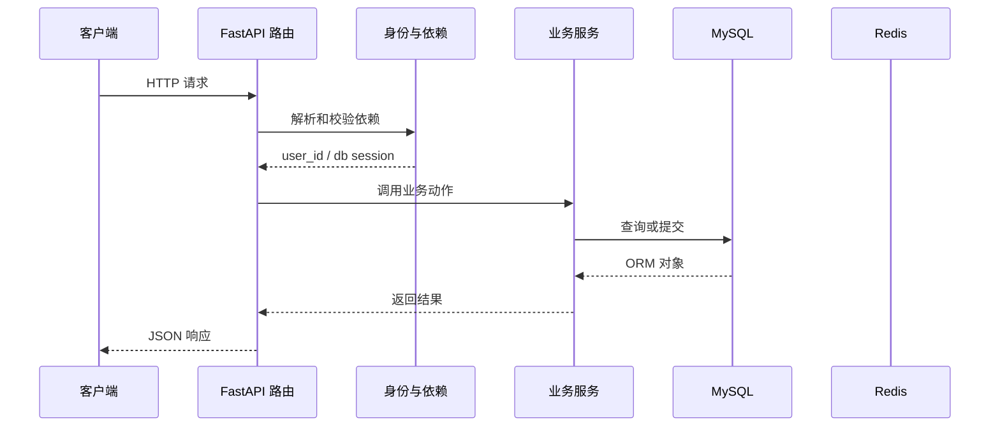

# 第 15 篇：建立笔记模板表与默认模板列表

> 日期：2026-10-20。新版连续复刻教程；对象是有 Python/HTTP/异步基础的学习者。
> 前置：[第 14 篇](14-reset-password.md)完成后再操作。
> 成果：每个账号第一次读取模板时创建六个默认模板。
> 本篇已在正式复刻目录代执行，并用真实 MySQL/Redis 验证建表、默认模板初始化和用户隔离；具体结果见文末。Passlib 1.7.4 与 bcrypt 4.3.0 首次运行可能打印读取版本的警告；以接口结果判断运行情况。

## 1. 目标与文件变化总览

这一篇围绕 **模板 ORM、响应序列化、懒初始化与用户隔离**。先看改变了哪些文件，再按路径逐个完成；前端界面暂不参与代码讲解。

本篇核心接口：`/note-template/list`。

| 标记 | 文件 | 本篇作用 |
|---|---|---|
| 【修改】 | `backend/app/db/db_config.py` | MySQL 引擎、请求级会话和建表入口。|
| 【新增文件】 | `backend/app/models/note_template.py` | 笔记模板在数据库中的表结构。|
| 【新增文件】 | `backend/app/router/note_template_router.py` | 模板 HTTP 路由和用户依赖。|
| 【修改】 | `backend/app/schemas/models.py` | 笔记和模板请求/响应字段校验。|
| 【新增文件】 | `backend/app/services/note_template_service.py` | 默认模板初始化与模板业务操作。|
| 【修改】 | `backend/main.py` | FastAPI 实例与路由总装入口。|

**阶段边界：** 并发首次请求可能重复插入默认模板；后续应补唯一约束或迁移保障。

## 2. 从哪个目录开始

本篇已由助手在正式复刻目录完成。下面保留逐文件操作过程供复习；你要求跳过的注册界面继续跳过。第 16 篇已在此基础上继续完成。

终端执行位置：

```text
.
```

```bash
cd "."
pwd
git status --short
```

## 3. 按顺序改文件

先完成依赖和父目录，再逐个编辑下面文件。修改已有文件只给前后对照和整体解释，新建文件才给完整内容；diff 的正负号只供定位，不能复制进源码。

### 步骤 1：【修改】`backend/app/db/db_config.py`

**编辑文件的完整地址：**

```text
./backend/app/db/db_config.py
```

**修改定位与前后对照：**

```diff
--- backend/app/db/db_config.py（修改前）
+++ backend/app/db/db_config.py（修改后）
@@ -55,6 +55,7 @@
     # 【新增 C01】导入模型完成注册后，统一检查并创建缺失表。
     from app.models.note import Note  # noqa: F401
     from app.models.user_model import User  # noqa: F401
+    from app.models.note_template import NoteTemplate  # noqa: F401
 
     async with async_engine.begin() as connection:
         await connection.run_sync(Base.metadata.create_all)
```

**整体解释：** 本步只给 `init_db()` 增加 `NoteTemplate` 的导入。应用启动时，`lifespan` 调用 `init_db()`；导入使模板类把 `note_templates` 表登记到 `Base.metadata`，随后 `create_all` 才知道需要检查这张表。这里不会在导入时写入六条模板；默认数据要等某个用户第一次请求模板列表时才创建。

**保存后检查：**

```bash
test -f "./backend/app/db/db_config.py" && echo "已找到 backend/app/db/db_config.py"
```

### 步骤 2：【新增文件】`backend/app/models/note_template.py`

**编辑文件的完整地址：**

```text
./backend/app/models/note_template.py
```

父目录如果尚不存在，先创建：

```bash
mkdir -p "./backend/app/models"
```

**完整文件内容：**

```python
from sqlalchemy import JSON, Boolean, Column, DateTime, Integer, String, Text, func

from app.models.base import Base


class NoteTemplate(Base):
    __tablename__ = "note_templates"

    id = Column(String(36), primary_key=True)
    user_id = Column(String(36), index=True, nullable=False)
    name = Column(String(100), nullable=False)
    icon = Column(String(50), default="FileText", nullable=False)
    category = Column(String(50), default="", nullable=False)
    title = Column(String(200), default="", nullable=False)
    content = Column(Text, default="", nullable=False)
    tags = Column(JSON, default=list, nullable=False)
    is_default = Column(Boolean, default=False, nullable=False)
    sort_order = Column(Integer, default=0, nullable=False)
    created_at = Column(DateTime(), server_default=func.now(), nullable=False)
    updated_at = Column(DateTime(), server_default=func.now(), onupdate=func.now(), nullable=False)
```

**文件职责：** 笔记模板在数据库中的表结构。

一行 `NoteTemplate` 表示一张可复用的模板，而不是一篇已经创建的笔记。`user_id` 标明归属，后续查询必须把它放进条件，避免甲用户看到乙用户的模板；`is_default` 让第 16 篇可以保护内置模板，`sort_order` 保存显示顺序。`tags` 用 JSON 字段保存标签列表，服务层传入的 `[]` 会作为列表存入这一列。

**保存后检查：**

```bash
test -f "./backend/app/models/note_template.py" && echo "已找到 backend/app/models/note_template.py"
```

### 步骤 3：【新增文件】`backend/app/router/note_template_router.py`

**编辑文件的完整地址：**

```text
./backend/app/router/note_template_router.py
```

父目录如果尚不存在，先创建：

```bash
mkdir -p "./backend/app/router"
```

**完整文件内容：**

```python
from fastapi import APIRouter, Depends
from fastapi.responses import JSONResponse
from sqlalchemy.ext.asyncio import AsyncSession

from app.core.success_response import success_response
from app.db.db_config import get_db
from app.services.note_template_service import note_template_service
from app.utils.auth_utils import get_current_user_id

note_template_router = APIRouter(prefix="/note-template", tags=["note-template"])


@note_template_router.get("/list")
async def list_templates(
    user_id: str = Depends(get_current_user_id),
    db: AsyncSession = Depends(get_db),
) -> JSONResponse:
    templates = await note_template_service.list_templates(db, user_id)
    return success_response(data=templates)
```

**文件职责：** 模板 HTTP 路由和用户依赖。

请求到达 `/note-template/list` 后，`get_current_user_id` 先验签并检查 Redis 黑名单，再把用户编号交给路由；`get_db` 提供这次请求使用的数据库会话。路由把二者交给 `list_templates`，由服务层决定是否初始化默认模板，最后 `success_response` 把结果包装成现有接口的 JSON 格式。路由不自行拼 SQL，因此用户范围的查询逻辑集中在服务层。

**保存后检查：**

```bash
test -f "./backend/app/router/note_template_router.py" && echo "已找到 backend/app/router/note_template_router.py"
```

### 步骤 4：【修改】`backend/app/schemas/models.py`

**编辑文件的完整地址：**

```text
./backend/app/schemas/models.py
```

**修改定位与前后对照：**

```diff
--- backend/app/schemas/models.py（修改前）
+++ backend/app/schemas/models.py（修改后）
@@ -53,3 +53,20 @@
             if name in self.model_fields_set and getattr(self, name) is None:
                 raise ValueError(f"{name} 不能显式设为 null")
         return self
+
+
+class NoteTemplateResponse(BaseModel):
+    model_config = ConfigDict(from_attributes=True)
+
+    id: str
+    user_id: str
+    name: str
+    icon: str
+    category: str
+    title: str
+    content: str
+    tags: list[str]
+    is_default: bool
+    sort_order: int
+    created_at: datetime | None = None
+    updated_at: datetime | None = None
```

**整体解释：** 这里新增的是输出边界：`NoteTemplateResponse.model_validate(item)` 能从 SQLAlchemy 模板对象的属性读取字段，再交给 FastAPI 编码为 JSON。它明确列出 `name`、`content`、`tags`、`is_default` 和顺序等可以对外展示的字段；数据库对象若以后增加内部字段，不会因为直接返回 ORM 对象而自动公开。

**保存后检查：**

```bash
test -f "./backend/app/schemas/models.py" && echo "已找到 backend/app/schemas/models.py"
```

### 步骤 5：【新增文件】`backend/app/services/note_template_service.py`

**编辑文件的完整地址：**

```text
./backend/app/services/note_template_service.py
```

父目录如果尚不存在，先创建：

```bash
mkdir -p "./backend/app/services"
```

**完整文件内容：**

```python
from uuid import uuid4

from sqlalchemy import func, select
from sqlalchemy.ext.asyncio import AsyncSession

from app.models.note_template import NoteTemplate
from app.schemas.models import NoteTemplateResponse

DEFAULT_TEMPLATES = [
    ("空白笔记", "FileText", "", "", "", []),
    ("会议纪要", "Users", "work", "会议纪要 - ",
     "## 会议信息\n- 时间：\n- 参与人：\n\n## 待办事项\n- [ ] ", ["会议"]),
    ("学习笔记", "GraduationCap", "study", "",
     "## 学习目标\n\n## 核心内容\n\n## 总结与反思\n", ["学习"]),
    ("日记", "BookOpen", "life", "",
     "## 今日记录\n\n## 心情\n\n## 明日计划\n", ["日记"]),
    ("项目计划", "ListTodo", "project", "",
     "## 项目概述\n\n## 目标\n\n## 里程碑\n", ["项目"]),
    ("读书笔记", "BookMarked", "study", "",
     "## 书籍信息\n\n## 核心观点\n\n## 读后感\n", ["读书"]),
]


class NoteTemplateService:
    async def _seed_defaults(self, db: AsyncSession, user_id: str) -> None:
        for order, (name, icon, category, title, content, tags) in enumerate(DEFAULT_TEMPLATES):
            db.add(NoteTemplate(
                id=str(uuid4()), user_id=user_id, name=name, icon=icon,
                category=category, title=title, content=content,
                tags=tags, is_default=True, sort_order=order,
            ))
        await db.commit()

    async def list_templates(
        self, db: AsyncSession, user_id: str
    ) -> list[NoteTemplateResponse]:
        count = await db.scalar(select(func.count(NoteTemplate.id)).where(
            NoteTemplate.user_id == user_id
        ))
        if not count:
            await self._seed_defaults(db, user_id)
        result = await db.execute(
            select(NoteTemplate).where(NoteTemplate.user_id == user_id)
            .order_by(NoteTemplate.sort_order.asc(), NoteTemplate.created_at.asc())
        )
        return [NoteTemplateResponse.model_validate(item) for item in result.scalars().all()]


note_template_service = NoteTemplateService()
```

**文件职责：** 默认模板初始化与模板业务操作。

`list_templates` 先统计**当前用户**的模板数；只有该用户还没有记录，才调用 `_seed_defaults` 新建六条并 `commit`。每条默认模板都写入同一个 `user_id`，编号顺序来自 `enumerate(DEFAULT_TEMPLATES)`。随后再按 `sort_order` 和创建时间查询，所以第一次请求就能读到刚提交的六条，第二次请求只读取而不会重复插入。这里的“为空才初始化”是本阶段的简单策略；多个首次请求同时到达时尚无唯一约束防止重复初始化，后续需要为并发场景补强。

**保存后检查：**

```bash
test -f "./backend/app/services/note_template_service.py" && echo "已找到 backend/app/services/note_template_service.py"
```

### 步骤 6：【修改】`backend/main.py`

**编辑文件的完整地址：**

```text
./backend/main.py
```

**修改定位与前后对照：**

```diff
--- backend/main.py（修改前）
+++ backend/main.py（修改后）
@@ -5,6 +5,7 @@
 from app.core.settings import settings
 from app.router.health import health_router
 from app.router.note_router import note_router
+from app.router.note_template_router import note_template_router
 from app.router.user import user_router
 
 # 【修改 C01】应用启动检查和关闭清理由 lifespan 管理。
@@ -15,6 +16,8 @@
 app.include_router(note_router)
 # 【新增 C01】注册用户相关接口。
 app.include_router(user_router)
+# 【新增 C01】注册笔记模板接口。
+app.include_router(note_template_router)
 register_exception_handlers(app)
 
 
```

**整体解释：** `note_template_router` 文件定义了路径，但只有 `app.include_router(note_template_router)` 执行后，主应用才会把 `/note-template/list` 放进路由表。应用启动仍通过原有 `lifespan` 建表；因此“表已登记”和“HTTP 路径已注册”分别由数据库入口和主应用入口完成，缺少任意一边都会影响本篇功能。

**保存后检查：**

```bash
test -f "./backend/main.py" && echo "已找到 backend/main.py"
```

## 4. 把这些文件连成一次真实执行

本次例子：第一次打开自己的模板列表。先记住接口 `/note-template/list`。下面每一站都写清谁把什么交给谁。

### 先用一个形象场景理解核心机制

模板不是笔记本身，它像一张可以反复复印的空白登记表：`title`、`content`、`tags` 等字段给创建笔记时提供起点；它不直接替你创建 Note。`NoteTemplate` 负责把每张模板保存到 `note_templates` 表，`NoteTemplateResponse` 负责把数据库对象整理成 HTTP JSON。
第一次列模板，服务先数当前用户的记录。数量为零才逐个构造六张默认模板，并一次提交；随后再按排序字段查询并返回。同一用户第二次读取不会继续新增。第二个用户有自己的 user_id，因此也会得到独立的六条，而不会看到第一个人的模板。
`Base.metadata.create_all` 只会创建缺失的表，不会替旧表添加新字段。若你以前手工创建过结构不同的 `note_templates`，建表步骤可能看似成功但后续查询报错，需要比较实际 schema。并发首次读取还有竞争：两个请求都看到 0，可能都插入六条；后续应通过唯一约束或显式初始化事务解决。

### 第 1 站：带 token 请求 /note-template/list。

这一站的输入来自上一层：带 token 请求 /note-template/list。可在本篇对应的 diff 或新建文件代码中找到相关函数。

观察时分清三种时刻：导入模块时只创建声明；收到 HTTP 请求后才执行路由和依赖；数据库 `commit` 后数据才作为事务结果保存。

### 第 2 站：路由依赖先确认用户身份，拿到 user_id。

这一站的输入来自上一层：路由依赖先确认用户身份，拿到 user_id。可在本篇对应的 diff 或新建文件代码中找到相关函数。

观察时分清三种时刻：导入模块时只创建声明；收到 HTTP 请求后才执行路由和依赖；数据库 `commit` 后数据才作为事务结果保存。

### 第 3 站：服务只统计当前 user_id 的模板数量。

这一站的输入来自上一层：服务只统计当前 user_id 的模板数量。可在本篇对应的 diff 或新建文件代码中找到相关函数。

观察时分清三种时刻：导入模块时只创建声明；收到 HTTP 请求后才执行路由和依赖；数据库 `commit` 后数据才作为事务结果保存。

### 第 4 站：若是首次读取，循环创建六个默认模板并 commit。

这一站的输入来自上一层：若是首次读取，循环创建六个默认模板并 commit。可在本篇对应的 diff 或新建文件代码中找到相关函数。

观察时分清三种时刻：导入模块时只创建声明；收到 HTTP 请求后才执行路由和依赖；数据库 `commit` 后数据才作为事务结果保存。

### 第 5 站：再按 sort_order 和 created_at 查询该用户模板。

这一站的输入来自上一层：再按 sort_order 和 created_at 查询该用户模板。可在本篇对应的 diff 或新建文件代码中找到相关函数。

观察时分清三种时刻：导入模块时只创建声明；收到 HTTP 请求后才执行路由和依赖；数据库 `commit` 后数据才作为事务结果保存。

### 第 6 站：NoteTemplateResponse 从 ORM 对象读取字段，返回列表。

这一站的输入来自上一层：NoteTemplateResponse 从 ORM 对象读取字段，返回列表。可在本篇对应的 diff 或新建文件代码中找到相关函数。

观察时分清三种时刻：导入模块时只创建声明；收到 HTTP 请求后才执行路由和依赖；数据库 `commit` 后数据才作为事务结果保存。

### 请求到状态变化的路线图



这张图只表示典型路径。注册尚无当前用户依赖；第 11 篇开始，令牌状态检查还会访问 Redis；并非每个请求都会写数据库。

## 5. 运行与验收

先在一个终端启动依赖并等待容器健康，再在另一个终端启动后端；已有服务正在运行时不要重复占用 8100。

```bash
cd "."
docker compose up -d --wait
docker compose ps
```

第二个终端执行：

```bash
cd "./backend"
uv run uvicorn main:app --host 127.0.0.1 --port 8100 --reload
```

使用第 08 篇获取的 token 放入当前终端变量 `TOKEN`；令牌刷新、资料修改或密码重置成功后请把响应里的新 token 替换进去。下面命令先检查进程和身份：

```bash
curl -i http://127.0.0.1:8100/health/live
curl -i http://127.0.0.1:8100/note/list -H "Authorization: Bearer $TOKEN"
```

本篇核心请求：

```bash
curl -i http://127.0.0.1:8100/note-template/list -H "Authorization: Bearer $TOKEN"
```

### 验收时看三层结果

1. **HTTP 状态**：成功请求通常是 200；参数无效、身份无效和依赖故障分别观察对应错误。
2. **响应 JSON**：看公开字段、业务消息和返回的 token/模板列表；密码哈希不应出现在用户响应里。
3. **持久化状态**：注册、修改、密码重置、模板增删改排序要在重启后仍存在；令牌黑名单要遵守 TTL 语义。

如果某一步报错，先读终端堆栈的第一处项目文件路径，再按本文文件步骤检查导入、配置与先后顺序。

## 6. 故障定位与完成核对

| 现象 | 先查哪里 | 为什么 |
|---|---|---|
| `ModuleNotFoundError` | 本篇依赖安装命令、`backend/.venv` | Python 可能用了另一个虚拟环境。|
| 422 | 请求模型、JSON 字段名、`Content-Type` | 输入在进入业务服务前就被拦截。|
| 401 | Authorization 头、签名密钥、用户状态、黑名单 | 鉴权依赖先于业务函数执行。|
| 503 | `/ready`、MySQL/Redis 容器和日志 | 下游依赖不可用或策略选择拒绝继续。|
| 500 | 后端终端 traceback 首个项目路径 | 文件导入、表结构或事务操作可能不匹配。|
| Docker daemon 未启动 | Docker Desktop 状态、`docker info` | Compose 需要 Docker 引擎运行。|

### 已代执行的真实验收（2026-10-20）

- 六处文件按第 14 篇基线修改或新增；Python 语法、路由导入与 `note_templates` 建表检查通过。
- 未携带令牌请求 `/note-template/list` 返回 401。两个临时账号各自首次读取都得到六条默认模板，归属为各自的 `user_id`，顺序为 0–5，模板 ID 集合互不相交。
- 同一账号第二次读取返回完全相同的六个 ID；MySQL 中每个账号仍只有六行，没有重复初始化。测试账号和模板行已清理，未改动原有用户数据。
- 并发首次读取可能重复初始化是当前实现的已知边界，本次未宣称已解决；后续应增加数据库约束或协调机制。

本篇实际新增能力：每个账号第一次读取模板时创建六个默认模板。
这一步与参考实现的阶段差异：并发首次请求可能重复插入默认模板；后续应补唯一约束或迁移保障。
核对每个文件的绝对路径、新建文件的完整代码、修改文件的 diff 与本篇接口；确认上一阶段行为仍可用。
本篇已写入正式复刻项目；第 16 篇已在此基础上继续完成。

