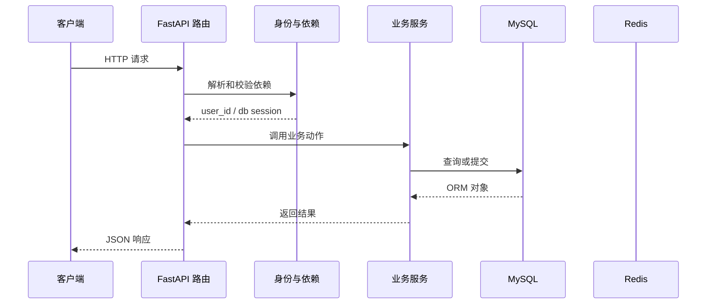

# 第 16 篇：完成笔记模板增删改与排序

> 日期：2026-10-20。新版连续复刻教程；对象是有 Python/HTTP/异步基础的学习者。
> 前置：[第 15 篇](15-note-template-model-and-list.md)完成后再操作。
> 成果：用户可以创建、更新、删除自定义模板，并整体调整顺序。
> 本篇已在正式复刻目录代执行，并用真实 MySQL/Redis 验证模板增删改、用户隔离和整体排序；具体结果见文末。Passlib 1.7.4 与 bcrypt 4.3.0 首次运行可能打印读取版本的警告；以接口结果判断运行情况。

## 1. 目标与文件变化总览

这一篇围绕 **部分更新、所有权过滤、内置模板保护、整体排序校验**。先看改变了哪些文件，再按路径逐个完成；前端界面暂不参与代码讲解。

本篇核心接口：`/note-template/create、/reorder、/{template_id}`。

| 标记 | 文件 | 本篇作用 |
|---|---|---|
| 【修改】 | `backend/app/router/note_template_router.py` | 模板 HTTP 路由和用户依赖。|
| 【修改】 | `backend/app/schemas/models.py` | 笔记和模板请求/响应字段校验。|
| 【修改】 | `backend/app/services/note_template_service.py` | 默认模板初始化与模板业务操作。|

**阶段边界：** 内置模板可更新但不可删除；更新时显式 null 被忽略。

## 2. 从哪个目录开始

本篇已由助手在完成第 15 篇后，于正式复刻目录继续完成。下面保留逐文件操作过程供复习；你要求跳过的注册界面继续跳过。

终端执行位置：

```text
.
```

```bash
cd "."
pwd
git status --short
```

## 3. 按顺序改文件

先完成依赖和父目录，再逐个编辑下面文件。修改已有文件只给前后对照和整体解释，新建文件才给完整内容；diff 的正负号只供定位，不能复制进源码。

### 步骤 1：【修改】`backend/app/router/note_template_router.py`

**编辑文件的完整地址：**

```text
./backend/app/router/note_template_router.py
```

**修改定位与前后对照：**

```diff
--- backend/app/router/note_template_router.py（修改前）
+++ backend/app/router/note_template_router.py（修改后）
@@ -4,6 +4,9 @@
 
 from app.core.success_response import success_response
 from app.db.db_config import get_db
+from app.schemas.models import (
+    NoteTemplateCreate, NoteTemplateReorder, NoteTemplateUpdate,
+)
 from app.services.note_template_service import note_template_service
 from app.utils.auth_utils import get_current_user_id
 
@@ -17,3 +20,48 @@
 ) -> JSONResponse:
     templates = await note_template_service.list_templates(db, user_id)
     return success_response(data=templates)
+
+
+@note_template_router.post("/create")
+async def create_template(
+    payload: NoteTemplateCreate,
+    user_id: str = Depends(get_current_user_id),
+    db: AsyncSession = Depends(get_db),
+) -> JSONResponse:
+    template = await note_template_service.create_template(db, user_id, payload)
+    return success_response(message="模板创建成功", data=template)
+
+
+@note_template_router.put("/reorder")
+async def reorder_templates(
+    payload: NoteTemplateReorder,
+    user_id: str = Depends(get_current_user_id),
+    db: AsyncSession = Depends(get_db),
+) -> JSONResponse:
+    ok = await note_template_service.reorder_templates(db, user_id, payload)
+    return success_response(message="排序成功" if ok else "排序失败，模板ID不匹配")
+
+
+@note_template_router.put("/{template_id}")
+async def update_template(
+    template_id: str,
+    payload: NoteTemplateUpdate,
+    user_id: str = Depends(get_current_user_id),
+    db: AsyncSession = Depends(get_db),
+) -> JSONResponse:
+    template = await note_template_service.update_template(
+        db, user_id, template_id, payload
+    )
+    if template is None:
+        return success_response(message="模板不存在")
+    return success_response(message="模板更新成功", data=template)
+
+
+@note_template_router.delete("/{template_id}")
+async def delete_template(
+    template_id: str,
+    user_id: str = Depends(get_current_user_id),
+    db: AsyncSession = Depends(get_db),
+) -> JSONResponse:
+    deleted = await note_template_service.delete_template(db, user_id, template_id)
+    return success_response(message="模板删除成功" if deleted else "模板不存在或为内置模板")
```

**整体解释：** 这四个新路由都先从 `get_current_user_id` 取得当前用户编号，再把它传给服务层；请求者不能在 JSON 中指定别人的 `user_id`。`/reorder` 写在 `/{template_id}` 前面，确保 `reorder` 被当成固定路径处理；创建、修改、删除的具体数据库动作由服务层执行。服务返回 `None` 或 `False` 时，路由把“模板不存在”“内置模板不可删”等结果写成现有响应格式，不会把别人的模板内容返回给请求者。

**保存后检查：**

```bash
test -f "./backend/app/router/note_template_router.py" && echo "已找到 backend/app/router/note_template_router.py"
```

### 步骤 2：【修改】`backend/app/schemas/models.py`

**编辑文件的完整地址：**

```text
./backend/app/schemas/models.py
```

**修改定位与前后对照：**

```diff
--- backend/app/schemas/models.py（修改前）
+++ backend/app/schemas/models.py（修改后）
@@ -70,3 +70,25 @@
     sort_order: int
     created_at: datetime | None = None
     updated_at: datetime | None = None
+
+
+class NoteTemplateCreate(BaseModel):
+    name: str = Field(min_length=1, max_length=100)
+    icon: str = Field(default="FileText", max_length=50)
+    category: str = Field(default="", max_length=50)
+    title: str = Field(default="", max_length=200)
+    content: str = ""
+    tags: list[str] = Field(default_factory=list)
+
+
+class NoteTemplateUpdate(BaseModel):
+    name: str | None = Field(default=None, min_length=1, max_length=100)
+    icon: str | None = Field(default=None, max_length=50)
+    category: str | None = Field(default=None, max_length=50)
+    title: str | None = Field(default=None, max_length=200)
+    content: str | None = None
+    tags: list[str] | None = None
+
+
+class NoteTemplateReorder(BaseModel):
+    ids: list[str] = Field(min_length=1)
```

**整体解释：** `NoteTemplateCreate` 要求新模板有非空名称，其余字段提供起始值，因此路由拿到的是一份字段齐全的创建数据。`NoteTemplateUpdate` 允许省略字段，服务层会用 `model_dump(exclude_unset=True)` 只处理请求里出现的项；例如只传 `title` 不会抹掉原来的 `content`。`NoteTemplateReorder.ids` 至少要有一个编号，但“是否恰好包含当前用户的全部模板、有没有重复编号”必须结合数据库现状由服务层判断。

**保存后检查：**

```bash
test -f "./backend/app/schemas/models.py" && echo "已找到 backend/app/schemas/models.py"
```

### 步骤 3：【修改】`backend/app/services/note_template_service.py`

**编辑文件的完整地址：**

```text
./backend/app/services/note_template_service.py
```

**修改定位与前后对照：**

```diff
--- backend/app/services/note_template_service.py（修改前）
+++ backend/app/services/note_template_service.py（修改后）
@@ -4,7 +4,10 @@
 from sqlalchemy.ext.asyncio import AsyncSession
 
 from app.models.note_template import NoteTemplate
-from app.schemas.models import NoteTemplateResponse
+from app.schemas.models import (
+    NoteTemplateCreate, NoteTemplateResponse, NoteTemplateReorder,
+    NoteTemplateUpdate,
+)
 
 DEFAULT_TEMPLATES = [
     ("空白笔记", "FileText", "", "", "", []),
@@ -45,5 +48,67 @@
         )
         return [NoteTemplateResponse.model_validate(item) for item in result.scalars().all()]
 
+    async def create_template(
+        self, db: AsyncSession, user_id: str, payload: NoteTemplateCreate
+    ) -> NoteTemplateResponse:
+        await self.list_templates(db, user_id)
+        max_order = await db.scalar(select(func.max(NoteTemplate.sort_order)).where(
+            NoteTemplate.user_id == user_id
+        ))
+        template = NoteTemplate(
+            id=str(uuid4()), user_id=user_id, name=payload.name,
+            icon=payload.icon, category=payload.category, title=payload.title,
+            content=payload.content, tags=payload.tags, is_default=False,
+            sort_order=(max_order if max_order is not None else -1) + 1,
+        )
+        db.add(template)
+        await db.commit()
+        await db.refresh(template)
+        return NoteTemplateResponse.model_validate(template)
+
+    async def update_template(
+        self, db: AsyncSession, user_id: str, template_id: str,
+        payload: NoteTemplateUpdate,
+    ) -> NoteTemplateResponse | None:
+        result = await db.execute(select(NoteTemplate).where(
+            NoteTemplate.id == template_id, NoteTemplate.user_id == user_id
+        ))
+        template = result.scalar_one_or_none()
+        if template is None:
+            return None
+        for field, value in payload.model_dump(exclude_unset=True).items():
+            if value is not None:
+                setattr(template, field, value)
+        await db.commit()
+        await db.refresh(template)
+        return NoteTemplateResponse.model_validate(template)
+
+    async def delete_template(
+        self, db: AsyncSession, user_id: str, template_id: str
+    ) -> bool:
+        result = await db.execute(select(NoteTemplate).where(
+            NoteTemplate.id == template_id, NoteTemplate.user_id == user_id
+        ))
+        template = result.scalar_one_or_none()
+        if template is None or template.is_default:
+            return False
+        await db.delete(template)
+        await db.commit()
+        return True
+
+    async def reorder_templates(
+        self, db: AsyncSession, user_id: str, payload: NoteTemplateReorder
+    ) -> bool:
+        result = await db.execute(select(NoteTemplate).where(
+            NoteTemplate.user_id == user_id
+        ))
+        templates = {item.id: item for item in result.scalars().all()}
+        if len(payload.ids) != len(templates) or set(payload.ids) != set(templates):
+            return False
+        for order, template_id in enumerate(payload.ids):
+            templates[template_id].sort_order = order
+        await db.commit()
+        return True
+
 
 note_template_service = NoteTemplateService()
```

**整体解释：** 创建时先调用 `list_templates`，确保该用户的六条默认模板已经存在，再读取当前最大 `sort_order`，给自定义模板排在末尾。修改和删除都用 `template_id` **同时配合当前 `user_id`** 查表；即使知道别人的模板编号也查不到。删除还检查 `is_default`，因此六条内置模板不能被删除。排序请求先读取当前用户的全部模板，比较提交的 `ids` 与数据库里的编号集合及数量；缺少、重复或混入别人的编号都会返回失败，原有顺序不提交。全部匹配后才按列表位置写回每条记录的 `sort_order` 并一次 `commit`。这就是为什么前端拖拽后需要提交**完整顺序**，而不能只传被移动的一条。

**保存后检查：**

```bash
test -f "./backend/app/services/note_template_service.py" && echo "已找到 backend/app/services/note_template_service.py"
```

## 4. 把这些文件连成一次真实执行

本次例子：创建模板并重新排序。先记住接口 `/note-template/create、/reorder、/{template_id}`。下面每一站都写清谁把什么交给谁。

### 先用一个形象场景理解核心机制

创建模板时先确保默认模板存在，再查询当前用户最大的 `sort_order`，把新模板排在末尾。创建请求即使传入 `user_id`，服务也不从 body 读归属；归属只能来自鉴权依赖。这样客户端无法通过伪造字段把模板写到别人名下。
修改和删除先用“模板 ID + 当前用户 ID”一起查。仅知道别人的模板 ID 不够。内置模板 `is_default=True` 不允许删除；当前实现允许修改它，故障排查时要分清“不可删除”和“完全只读”。部分更新使用 `exclude_unset=True`；显式传 null 会被循环中的 `if value is not None` 忽略，这与用户资料的处理约定并不完全一样，务必照当前接口行为理解。
排序不是只提交需要移动的一项，而是提交本用户**全部**模板 ID 的最终顺序。服务先检查数量相同、集合相同，才逐个写入 0、1、2…… 并统一提交。遗漏、重复或混入别人的 ID 都不能改变顺序。这样一次请求描述的是一个完整列表状态，页面刷新后仍可按 sort_order 还原。

### 第 1 站：创建请求先走身份依赖和 NoteTemplateCreate 验证。

这一站的输入来自上一层：创建请求先走身份依赖和 NoteTemplateCreate 验证。可在本篇对应的 diff 或新建文件代码中找到相关函数。

观察时分清三种时刻：导入模块时只创建声明；收到 HTTP 请求后才执行路由和依赖；数据库 `commit` 后数据才作为事务结果保存。

### 第 2 站：服务确保默认模板存在，再计算当前用户最大 sort_order。

这一站的输入来自上一层：服务确保默认模板存在，再计算当前用户最大 sort_order。可在本篇对应的 diff 或新建文件代码中找到相关函数。

观察时分清三种时刻：导入模块时只创建声明；收到 HTTP 请求后才执行路由和依赖；数据库 `commit` 后数据才作为事务结果保存。

### 第 3 站：新模板写入自己 user_id，提交后返回响应模型。

这一站的输入来自上一层：新模板写入自己 user_id，提交后返回响应模型。可在本篇对应的 diff 或新建文件代码中找到相关函数。

观察时分清三种时刻：导入模块时只创建声明；收到 HTTP 请求后才执行路由和依赖；数据库 `commit` 后数据才作为事务结果保存。

### 第 4 站：修改和删除都用 template_id 加 user_id 双条件查找。

这一站的输入来自上一层：修改和删除都用 template_id 加 user_id 双条件查找。可在本篇对应的 diff 或新建文件代码中找到相关函数。

观察时分清三种时刻：导入模块时只创建声明；收到 HTTP 请求后才执行路由和依赖；数据库 `commit` 后数据才作为事务结果保存。

### 第 5 站：排序请求必须提交本用户所有模板 ID，集合一致后依次写入新顺序。

这一站的输入来自上一层：排序请求必须提交本用户所有模板 ID，集合一致后依次写入新顺序。可在本篇对应的 diff 或新建文件代码中找到相关函数。

观察时分清三种时刻：导入模块时只创建声明；收到 HTTP 请求后才执行路由和依赖；数据库 `commit` 后数据才作为事务结果保存。

### 第 6 站：删除内置模板返回拒绝语义；删除自定义模板提交后消失。

这一站的输入来自上一层：删除内置模板返回拒绝语义；删除自定义模板提交后消失。可在本篇对应的 diff 或新建文件代码中找到相关函数。

观察时分清三种时刻：导入模块时只创建声明；收到 HTTP 请求后才执行路由和依赖；数据库 `commit` 后数据才作为事务结果保存。

### 请求到状态变化的路线图



这张图只表示典型路径。注册尚无当前用户依赖；第 11 篇开始，令牌状态检查还会访问 Redis；并非每个请求都会写数据库。

## 5. 运行与验收

先在一个终端启动依赖并等待容器健康，再在另一个终端启动后端；已有服务正在运行时不要重复占用 8100。

```bash
cd "."
docker compose up -d --wait
docker compose ps
```

第二个终端执行：

```bash
cd "./backend"
uv run uvicorn main:app --host 127.0.0.1 --port 8100 --reload
```

使用第 08 篇获取的 token 放入当前终端变量 `TOKEN`；令牌刷新、资料修改或密码重置成功后请把响应里的新 token 替换进去。下面命令先检查进程和身份：

```bash
curl -i http://127.0.0.1:8100/health/live
curl -i http://127.0.0.1:8100/note/list -H "Authorization: Bearer $TOKEN"
```

本篇核心请求：

```bash
curl -i -X POST http://127.0.0.1:8100/note-template/create -H "Authorization: Bearer $TOKEN" -H "Content-Type: application/json" -d '{"name":"我的学习模板","category":"study","title":"学习记录","content":"## 今天学了什么","tags":["学习"]}'
```

把本篇四个写操作连成一次完整练习。请确认当前 shell 已有有效 `TOKEN`；下面的 `python3` 只解析 JSON，不依赖项目虚拟环境，也不会显示令牌：

```bash
CREATE_JSON=$(curl -sS -X POST http://127.0.0.1:8100/note-template/create \
  -H "Authorization: Bearer $TOKEN" -H 'Content-Type: application/json' \
  -d '{"name":"排序练习模板","title":"初始标题"}')
TEMPLATE_ID=$(printf '%s' "$CREATE_JSON" | python3 -c 'import json,sys; print(json.load(sys.stdin)["data"]["id"])')
printf '新模板 ID: %s\n' "$TEMPLATE_ID"

curl -i -X PUT "http://127.0.0.1:8100/note-template/$TEMPLATE_ID" \
  -H "Authorization: Bearer $TOKEN" -H 'Content-Type: application/json' \
  -d '{"title":"修改后的标题"}'

ORDER_JSON=$(curl -sS http://127.0.0.1:8100/note-template/list \
  -H "Authorization: Bearer $TOKEN" | python3 -c 'import json,sys; rows=json.load(sys.stdin)["data"]; print(json.dumps({"ids":[item["id"] for item in reversed(rows)]}))')
curl -i -X PUT http://127.0.0.1:8100/note-template/reorder \
  -H "Authorization: Bearer $TOKEN" -H 'Content-Type: application/json' \
  -d "$ORDER_JSON"

curl -i -X DELETE "http://127.0.0.1:8100/note-template/$TEMPLATE_ID" \
  -H "Authorization: Bearer $TOKEN"
curl -i http://127.0.0.1:8100/note-template/list -H "Authorization: Bearer $TOKEN"
```

先确认创建响应的 `data.id` 被打印出来；如果为空，别继续修改和删除，先看创建响应。排序请求使用当前用户列表的全部 ID，故意反转顺序；最后列表应不含刚删除的自定义模板，内置六条仍在。

### 验收时看三层结果

1. **HTTP 状态**：成功请求通常是 200；参数无效、身份无效和依赖故障分别观察对应错误。
2. **响应 JSON**：看公开字段、业务消息和返回的 token/模板列表；密码哈希不应出现在用户响应里。
3. **持久化状态**：注册、修改、密码重置、模板增删改排序要在重启后仍存在；令牌黑名单要遵守 TTL 语义。

如果某一步报错，先读终端堆栈的第一处项目文件路径，再按本文文件步骤检查导入、配置与先后顺序。

## 6. 故障定位与完成核对

| 现象 | 先查哪里 | 为什么 |
|---|---|---|
| `ModuleNotFoundError` | 本篇依赖安装命令、`backend/.venv` | Python 可能用了另一个虚拟环境。|
| 422 | 请求模型、JSON 字段名、`Content-Type` | 输入在进入业务服务前就被拦截。|
| 401 | Authorization 头、签名密钥、用户状态、黑名单 | 鉴权依赖先于业务函数执行。|
| 503 | `/ready`、MySQL/Redis 容器和日志 | 下游依赖不可用或策略选择拒绝继续。|
| 500 | 后端终端 traceback 首个项目路径 | 文件导入、表结构或事务操作可能不匹配。|
| Docker daemon 未启动 | Docker Desktop 状态、`docker info` | Compose 需要 Docker 引擎运行。|

### 已代执行的真实验收（2026-10-20）

- 三处文件按第 15 篇基线修改；Python 语法与创建、修改、删除、排序路由导入检查通过。
- 用两个临时账号验证：无令牌创建返回 401；甲创建自定义模板后，即使请求中附带乙的 `user_id`，模板仍归甲，排在六条默认模板之后。
- 甲局部修改名称时，未传的标签保持原值，显式传 `title: null` 被忽略；乙对甲的模板修改和删除都返回“模板不存在”语义，甲的数据未变化。
- 内置模板删除被拒绝。甲提交完整逆序列表后，接口返回成功，重新查询与新建数据库会话中的排序都一致；缺失、重复或混入乙模板 ID 的列表均返回失败，原顺序不变。
- 甲的自定义模板删除后只剩六条默认模板；乙的六条模板不受影响。测试账号与模板行已清理，未改动原有用户数据。

本篇实际新增能力：用户可以创建、更新、删除自定义模板，并整体调整顺序。
这一步与参考实现的阶段差异：内置模板可更新但不可删除；更新时显式 null 被忽略。
核对每个文件的绝对路径、新建文件的完整代码、修改文件的 diff 与本篇接口；确认上一阶段行为仍可用。
本篇已写入正式复刻项目；后续复刻从当前文件状态继续。

