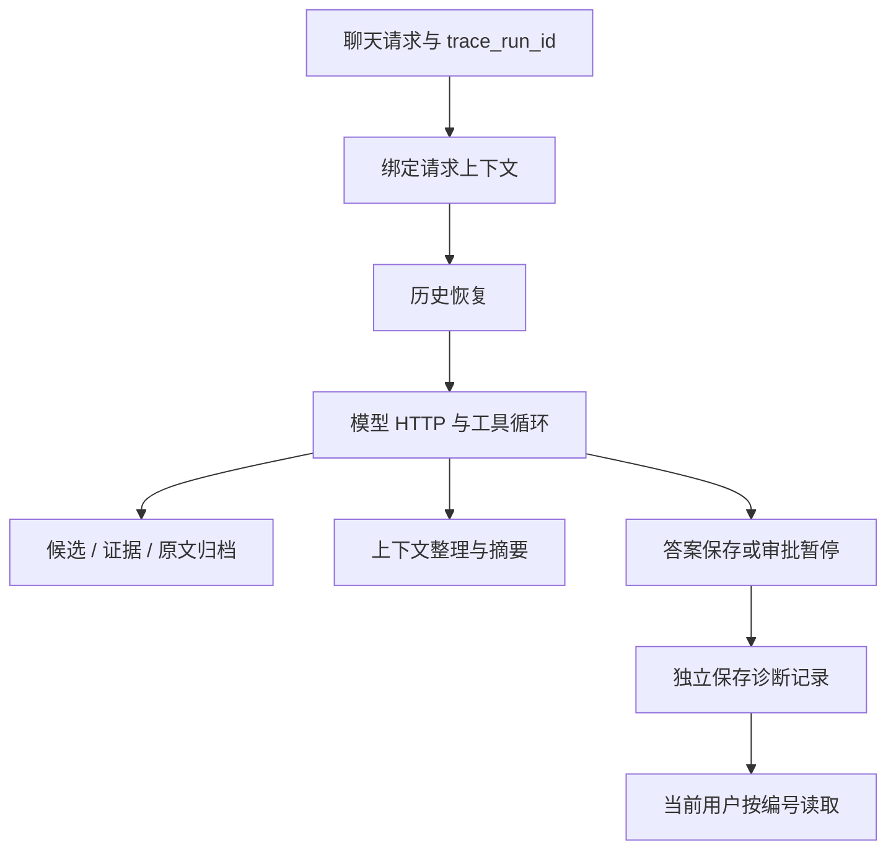

# 第 68 篇：记录每次 Agent 回答的模型、工具、检索和压缩过程

## 1. 本篇要接通的真实能力

第 67 篇已把正式聊天入口改成原生工具循环，能够补查资料、等待写入审批并压缩上下文。现在的问题是：一次回答变差或变慢时，只有终端日志与界面进度，很难把它们串成同一次请求，也不容易确认模型实际看到了什么材料。

本篇给每次主聊天分配独立的诊断编号，用父子事件记录模型 HTTP、工具、检索、压缩与保存阶段，并提供当前用户自己的诊断查询接口。可以追踪“选了哪个工具、传了什么参数”“有没有查到资料”“查到的资料有没有真正进入下一轮输入”“是压缩失败还是保存失败”。这是应用内有界诊断，不采集模型隐藏推理，也不是审批恢复状态。

**真实起点与执行状态：** 以 2026-10-22 第 67 篇已完成的正式代码为起点。本篇只生成操作教程，未修改应用源码，未建表，未运行测试、编译、构建或 HTTP 验证。按步骤应用时沿用现有 Python 3.12 虚拟环境，没有新增依赖。第 69 篇以完成本篇后的代码为起点，必须顺序操作。

路线原理与对比见 [Q31：Agent 诊断、ContextVar 与调用追踪](technology-routes/Q31-agent-trace-and-contextvars.md)。本篇先使用现有 MySQL，避免在入门这条机制时同时引入一个独立观测服务；以后可以把事件导出到 OpenTelemetry 等方案，但本篇没有接入这些 SDK。

本篇默认只记录文本长度和 SHA-256 指纹。`AGENT_TRACE_INCLUDE_TEXT=True` 才额外保存最多 400 字符预览，密钥、HTTP Authorization 与供应商错误正文不进入记录。工具完整输出仍沿用第 67 篇的归档，需要时按 artifact_id 读回。本篇记录 token 使用量，不把它换算成未经核对的费用。



## 2. 文件变化和操作顺序

固定复刻根目录：

```text
.
```

只复用现有 app/models、app/core、app/services、app/agent、app/rag 与 app/router 目录。新增模块先于引用它们的业务文件保存；如果开发服务开启自动重载，应先停止后端，在本篇文件改完后再正常启动，避免导入一半的代码。原文档、笔记和模型凭据不需要改动。

| 顺序 | 操作 | 文件 | 作用 |
|---|---|---|---|
| 1 | 新增文件 | `backend/app/models/agent_trace.py` | 保存一次聊天的诊断结果 |
| 2 | 修改 | `backend/app/core/settings.py` | 设置诊断开关、正文采集和保留期 |
| 3 | 新增文件 | `backend/app/core/agent_trace.py` | 给同一请求中的模型和工具绑定工单号 |
| 4 | 新增文件 | `backend/app/services/agent_trace_store.py` | 将诊断材料单独提交并提供有权限的读取 |
| 5 | 新增文件 | `backend/app/services/model_trace_http.py` | 记录每次真实非流式模型请求的耗时与 usage |
| 6 | 修改 | `backend/app/services/deepseek_client.py` | 把记录接到现有模型客户端 |
| 7 | 修改 | `backend/app/db/db_config.py` | 登记诊断表模型 |
| 8 | 修改 | `backend/app/services/chat_stream_service.py` | 让 SSE 的整个生命周期属于同一诊断请求 |
| 9 | 修改 | `backend/app/agent/chat_loop.py` | 把模型决定与工具执行记录成独立阶段 |
| 10 | 修改 | `backend/app/agent/loop_tools.py` | 把诊断事件与可恢复工具原文关联 |
| 11 | 修改 | `backend/app/services/chat_context.py` | 记录压缩何时触发与压缩后状态 |
| 12 | 修改 | `backend/app/rag/agentic_service.py` | 记录问题规划与最终提供的检索证据 |
| 13 | 修改 | `backend/app/router/chat_router.py` | 提供当前用户自己的诊断查询接口 |
| 14 | 修改 | `backend/app/services/chat_session_service.py` | 删除会话时清理已保存的诊断记录 |


诊断覆盖主聊天及其中的非流式模型调用，不涵盖所有页面、图谱 Worker 或审批恢复的完整执行链。审批产生提案时记录关联的业务运行编号，但尚未把批准后的另一次请求串成同一条完整追踪。

## 3. 按顺序修改文件

### 步骤 1：【新增文件】`backend/app/models/agent_trace.py`

**本步目标：** 保存一次聊天的诊断结果。

**编辑文件的完整地址：**

```text
./backend/app/models/agent_trace.py
```

**新建说明：** 新建文件，复用 app/models 目录。

```python
"""Agent 请求的诊断记录，不承担业务断点恢复。"""
from sqlalchemy import Column, DateTime, Index, Integer, String, Text, func
from sqlalchemy.dialects.mysql import LONGTEXT
from app.models.base import Base


class AgentTrace(Base):
    __tablename__ = "agent_traces"
    __table_args__ = (
        Index("ix_trace_user_session_time", "user_id", "session_id", "created_at"),
    )
    id = Column(String(36), primary_key=True)
    user_id = Column(String(36), nullable=False)
    session_id = Column(String(36), nullable=False)
    status = Column(String(24), nullable=False)
    duration_ms = Column(Integer, nullable=False)
    payload = Column(Text().with_variant(LONGTEXT(), "mysql"), nullable=False)
    created_at = Column(DateTime(), server_default=func.now(), index=True, nullable=False)
```

**整体解释：** 把一次聊天想成一张维修工单：id 是工单号，session_id 是所属会话，payload 是处理过程。它与 agent_runs 的审批业务状态分工不同，也不能用它恢复工具执行。这里不加会话外键，因为有些请求在创建会话之前就因租约冲突失败，也应留下用户自己的错误记录；代价是需要单独删除和保留期管理。组合索引服务于按用户与会话读取近期记录，created_at 索引服务于过期清理。


### 步骤 2：【修改】`backend/app/core/settings.py`

**本步目标：** 设置诊断开关、正文采集和保留期。

**编辑文件的完整地址：**

```text
./backend/app/core/settings.py
```

**修改定位与前后对照：** 定位 AGENT_OUTPUT_TOKENS，在它后面新增配置。 `+` 表示新增，`-` 表示删除，符号不要复制到源码；没有重复提供修改后的完整文件。

```diff
--- backend/app/core/settings.py（修改前）
+++ backend/app/core/settings.py（修改后）
@@ -42,6 +42,11 @@
     AGENT_MAX_STEPS: int = Field(default=10, ge=1, le=20)
     AGENT_INPUT_BYTES: int = Field(default=60000, ge=20000, le=120000)
     AGENT_OUTPUT_TOKENS: int = Field(default=2048, ge=256, le=4096)
+
+    # 【新增】诊断默认只保存指纹，不保存正文。
+    AGENT_TRACE_ENABLED: bool = True
+    AGENT_TRACE_INCLUDE_TEXT: bool = False
+    AGENT_TRACE_KEEP_DAYS: int = Field(default=7, ge=1, le=30)
     # 【新增】只控制最终流式回答，不改变短 JSON 任务的预算。
     CHAT_ANSWER_MAX_TOKENS: int = Field(default=2048, ge=256, le=4096)
 
```

**整体解释：** 默认能看到事件、来源 ID、耗时和文本指纹，正文预览需要显式开启。这样同一句问题可以凭指纹关联，却不会默认把整段私人笔记复制进诊断表。开启正文也只保存受限预览，不能保证自动识别所有敏感信息，因此只在自己可控的本机排错时启用。保留期在后面保存记录时清理；没有新请求时不会准点自动执行。


### 步骤 3：【新增文件】`backend/app/core/agent_trace.py`

**本步目标：** 给同一请求中的模型和工具绑定工单号。

**编辑文件的完整地址：**

```text
./backend/app/core/agent_trace.py
```

**新建说明：** 新建文件，复用 app/core；只使用现有标准库。

```python
"""请求内诊断：ContextVar 关联、父子事件与有界文本元信息。"""
import asyncio
import hashlib
import json
import time
from contextlib import contextmanager
from contextvars import ContextVar
from dataclasses import dataclass, field
from functools import wraps
from uuid import uuid4
from app.core.settings import settings

CURRENT = ContextVar("agent_trace", default=None)
PARENT = ContextVar("agent_trace_parent", default=None)
MAX_EVENTS = 200
MAX_EVENT_BYTES = 6000


def text_info(value: str) -> dict:
    result = {
        "chars": len(value),
        "sha256": hashlib.sha256(value.encode("utf-8")).hexdigest(),
    }
    if settings.AGENT_TRACE_INCLUDE_TEXT:
        result["preview"] = value[:400]
    return result


@dataclass
class TraceBuffer:
    id: str
    user_id: str
    session_id: str
    started: float = field(default_factory=time.perf_counter)
    status: str = "interrupted"
    events: list = field(default_factory=list)
    dropped: int = 0

    def add(self, name: str, **data) -> None:
        if len(self.events) >= MAX_EVENTS:
            self.dropped += 1
            return
        encoded = json.dumps(data, ensure_ascii=False)
        if len(encoded.encode("utf-8")) > MAX_EVENT_BYTES:
            data = {"omitted": True, **text_info(encoded)}
        self.events.append({
            "seq": len(self.events) + 1, "name": name,
            "at_ms": round((time.perf_counter() - self.started) * 1000),
            "parent_id": PARENT.get(), "data": data,
        })

    def payload(self) -> dict:
        return {"schema_version": 1, "events": self.events, "dropped": self.dropped}


def emit(name: str, **data) -> None:
    trace = CURRENT.get()
    if trace is not None:
        trace.add(name, **data)


@contextmanager
def bind(trace: TraceBuffer):
    token = CURRENT.set(trace)
    parent_token = PARENT.set(None)
    try:
        yield
    finally:
        PARENT.reset(parent_token)
        CURRENT.reset(token)


@contextmanager
def span(name: str, **attributes):
    identifier = str(uuid4())
    result = {}
    started = time.perf_counter()
    emit(name + ".start", span_id=identifier, **attributes)
    token = PARENT.set(identifier)
    status = "ok"
    try:
        yield result
    except BaseException as exc:
        status = "cancelled" if isinstance(exc, (asyncio.CancelledError, GeneratorExit)) else "error"
        result["error_type"] = type(exc).__name__
        raise
    finally:
        PARENT.reset(token)
        emit(name + ".end", span_id=identifier, status=status,
             duration_ms=round((time.perf_counter() - started) * 1000), **result)


def observe(name: str):
    def decorate(function):
        @wraps(function)
        async def wrapper(*args, **kwargs):
            with span(name) as details:
                value = await function(*args, **kwargs)
                if isinstance(value, bool):
                    details["changed"] = value
                return value
        return wrapper
    return decorate
```

**整体解释：** ContextVar 像工作人员胸前的工单夹：代码调用到更深处时仍能拿到当前请求的记录，不用把 trace_id 穿过每个参数。普通全局变量会把两个同时聊天的用户混在一起，ContextVar 让异步上下文各自保留绑定；其中的 TraceBuffer 仍是同一个可变对象，后续若并发启动子任务，事件写入顺序只代表发生顺序。span 在开始和结束记录时间并关联父事件，observe 是异步函数的简便包装。正文只经 text_info 处理，异常只存类型，不存可能夹带密钥的整段异常正文。200 个事件和单事件字节限制防止诊断材料无限增长。

**工程面试思考：两个用户同时聊天会不会串记录？** CURRENT 与 PARENT 绑定在异步上下文中，请求结束恢复 token；它们不使用单个全局 current_run_id。未来若并发子任务共享 TraceBuffer，事件顺序可能交错，父 span_id 比单纯时间排序更可靠。ContextVar 本身也不是跨进程传播协议。


### 步骤 4：【新增文件】`backend/app/services/agent_trace_store.py`

**本步目标：** 将诊断材料单独提交并提供有权限的读取。

**编辑文件的完整地址：**

```text
./backend/app/services/agent_trace_store.py
```

**新建说明：** 新建文件，复用 app/services。

```python
"""诊断落库与用户范围读取；落库失败不替换已完成的业务结果。"""
import asyncio
import json
import logging
import time
from datetime import UTC, datetime, timedelta
from fastapi import HTTPException
from sqlalchemy import delete, select
from app.core.agent_trace import TraceBuffer
from app.core.settings import settings
from app.db.db_config import AsyncSessionLocal
from app.models.agent_trace import AgentTrace

logger = logging.getLogger("mindweave.agent_trace")
_pending = set()


async def _save(trace: TraceBuffer) -> None:
    try:
        async with asyncio.timeout(2):
            async with AsyncSessionLocal() as db:
                cutoff = datetime.now(UTC).replace(tzinfo=None) - timedelta(days=settings.AGENT_TRACE_KEEP_DAYS)
                await db.execute(delete(AgentTrace).where(AgentTrace.created_at < cutoff))
                db.add(AgentTrace(
                    id=trace.id, user_id=trace.user_id, session_id=trace.session_id,
                    status=trace.status,
                    duration_ms=round((time.perf_counter() - trace.started) * 1000),
                    payload=json.dumps(trace.payload(), ensure_ascii=False),
                ))
                await db.commit()
    except Exception as exc:
        logger.warning("agent_trace_save_failed run_id=%s error_type=%s", trace.id, type(exc).__name__)


async def save_trace(trace: TraceBuffer) -> None:
    task = asyncio.create_task(_save(trace), name="save-agent-trace")
    _pending.add(task)
    task.add_done_callback(_pending.discard)
    # 外部取消不立即打断落库；进程崩溃仍可能丢失，不能当持久消息队列。
    await asyncio.shield(task)


async def list_traces(db, user_id: str, session_id: str) -> list[dict]:
    rows = (await db.execute(select(AgentTrace).where(
        AgentTrace.user_id == user_id, AgentTrace.session_id == session_id,
    ).order_by(AgentTrace.created_at.desc(), AgentTrace.id.desc()).limit(30))).scalars().all()
    return [{"run_id": row.id, "status": row.status, "duration_ms": row.duration_ms,
             "created_at": row.created_at} for row in rows]


async def get_trace(db, user_id: str, run_id: str) -> dict:
    row = await db.scalar(select(AgentTrace).where(
        AgentTrace.id == run_id, AgentTrace.user_id == user_id,
    ))
    if row is None:
        raise HTTPException(404, "诊断记录不存在")
    return {"run_id": row.id, "session_id": row.session_id, "status": row.status,
            "duration_ms": row.duration_ms, "created_at": row.created_at,
            **json.loads(row.payload)}
```

**整体解释：** 业务写入和诊断保存不绑成一个事务。用户的答案已经保存后，诊断库短暂故障不应把已完成的聊天伪装成失败。保存有两秒截止时间，失败只写受控日志；因此它是一版尽力保存的本地诊断，不是审计级持久队列。读取时同时按 run_id 和 user_id 过滤，不能只因为知道工单号就读取别人的记录。清理过期记录放在保存时执行，小规模项目足够直观，记录量增大后应独立分批清理，避免每次请求都做大量删除。

**工程面试思考：诊断库挂了要不要让聊天失败？** 本篇选择尽力记录并在失败时告警，正常业务结果继续保留。代价是进程崩溃或数据库故障时可能缺少诊断。需要强持久审计时应改成持久队列或事务事件表，不能只把 asyncio.shield 当成可靠消息系统。


### 步骤 5：【新增文件】`backend/app/services/model_trace_http.py`

**本步目标：** 记录每次真实非流式模型请求的耗时与 usage。

**编辑文件的完整地址：**

```text
./backend/app/services/model_trace_http.py
```

**新建说明：** 新建文件，复用 app/services。

```python
"""只包装非流式模型 HTTP 调用，不改变主备密钥选择。"""
import json
from app.core.agent_trace import CURRENT, span, text_info


async def post_model(client, url: str, *, headers: dict, json_body: dict, key_slot: int):
    if CURRENT.get() is None:
        return await client.post(url, headers=headers, json=json_body)
    messages = json.dumps(json_body.get("messages", []), ensure_ascii=False)
    with span("llm.http", model=json_body.get("model"), key_slot=key_slot,
              max_tokens=json_body.get("max_tokens"),
              message_count=len(json_body.get("messages", [])),
              tools_count=len(json_body.get("tools", [])), input=text_info(messages)) as details:
        response = await client.post(url, headers=headers, json=json_body)
        details["http_status"] = response.status_code
        if response.is_success:
            try:
                payload = response.json()
                usage = payload.get("usage") or {}
                details["usage"] = {
                    key: usage[key] for key in (
                        "prompt_tokens", "completion_tokens", "total_tokens",
                        "prompt_cache_hit_tokens", "prompt_cache_miss_tokens",
                    ) if isinstance(usage.get(key), int)
                }
                choice = (payload.get("choices") or [{}])[0]
                details["finish_reason"] = choice.get("finish_reason")
                details["output"] = text_info(json.dumps(choice.get("message", {}), ensure_ascii=False))
            except (ValueError, TypeError, IndexError, AttributeError):
                details["decode_error"] = True
        response.raise_for_status()
        return response
```

**整体解释：** 把记录放在 HTTP 请求外侧，而不是只包完整 Agent，可以看见“主密钥返回错误、备用密钥成功”这样的两次尝试。只保存 key_slot 编号，不存 Authorization 头，也不保存供应商错误正文。usage 取供应商实际返回的整数；缺失时保留缺失，不根据字符数伪造 token，更不按固定单价计算账单。HTTP 成功但业务协议不合格时，该 HTTP 事件可能成功，而外层 agent.model 事件失败，两层共同说明故障位置。本篇不接入旧 stream_chat 的增量 usage，因此范围是主循环及其调用的非流式规划、摘要等模型请求。

**工程面试思考：两个密钥都请求过，费用怎么记？** 一次供应商响应有 usage 就记录一次，失败响应没有 usage 则记“未知”，不假设失败就绝对不计费。token 数也不能直接相加变成金额，价格、缓存计费和供应商账单需要另一层规则。


### 步骤 6：【修改】`backend/app/services/deepseek_client.py`

**本步目标：** 把记录接到现有模型客户端。

**编辑文件的完整地址：**

```text
./backend/app/services/deepseek_client.py
```

**修改定位与前后对照：** 定位两个非流式 client.post：complete_turn 与 chat；stream_chat 的 client.stream 保留。 `+` 表示新增，`-` 表示删除，符号不要复制到源码；没有重复提供修改后的完整文件。

```diff
--- backend/app/services/deepseek_client.py（修改前）
+++ backend/app/services/deepseek_client.py（修改后）
@@ -9,6 +9,7 @@
 
 from app.core.settings import settings
 from app.agent.loop_protocol import AssistantTurn, ContextLimitError
+from app.services.model_trace_http import post_model
 
 FALLBACK_HTTP_STATUSES = {401, 402, 429, 500, 502, 503, 504}
 
@@ -43,9 +44,10 @@
         async with httpx.AsyncClient(timeout=httpx.Timeout(60, connect=5)) as client:
             for index, key in enumerate(keys):
                 try:
-                    response = await client.post(
-                        settings.DEEPSEEK_BASE_URL.rstrip("/") + "/chat/completions",
-                        headers={"Authorization": f"Bearer {key}"}, json=body,
+                    response = await post_model(
+                        client, settings.DEEPSEEK_BASE_URL.rstrip("/") + "/chat/completions",
+                        headers={"Authorization": f"Bearer {key}"},
+                        json_body=body, key_slot=index,
                     )
                     response.raise_for_status()
                     break
@@ -151,10 +153,10 @@
         async with httpx.AsyncClient(timeout=timeout) as client:
             for index, key in enumerate(keys):
                 try:
-                    response = await client.post(
-                        settings.DEEPSEEK_BASE_URL.rstrip("/") + "/chat/completions",
+                    response = await post_model(
+                        client, settings.DEEPSEEK_BASE_URL.rstrip("/") + "/chat/completions",
                         headers={"Authorization": f"Bearer {key}"},
-                        json=body,
+                        json_body=body, key_slot=index,
                     )
                     response.raise_for_status()
                     break
```

**整体解释：** 替换的只是发送请求的接线点，原有主备切换、超时和输出校验继续由 DeepSeekClient 负责。post_model 抛出的仍是 httpx.HTTPStatusError，原来的备用逻辑可以继续识别。它没有再次调用模型，所以不会因为采集诊断多生成一份答案。没有绑定 TraceBuffer 的其他请求只会走空记录路径，不会莫名归到上一位用户。


### 步骤 7：【修改】`backend/app/db/db_config.py`

**本步目标：** 登记诊断表模型。

**编辑文件的完整地址：**

```text
./backend/app/db/db_config.py
```

**修改定位与前后对照：** 定位 init_db 中 ChatArtifact 的模型导入。 `+` 表示新增，`-` 表示删除，符号不要复制到源码；没有重复提供修改后的完整文件。

```diff
--- backend/app/db/db_config.py（修改前）
+++ backend/app/db/db_config.py（修改后）
@@ -60,6 +60,7 @@
     from app.models.review_record import ReviewRecord  # noqa: F401
     from app.models.chat_history import ChatSession, ChatMessage  # noqa: F401
     from app.models.chat_artifact import ChatArtifact  # noqa: F401
+    from app.models.agent_trace import AgentTrace  # noqa: F401
     from app.models.agent_run import AgentRun  # noqa: F401
     from app.models.agent_checkpoint import (  # noqa: F401
         AgentCheckpoint,
```

**整体解释：** 新模型登记到统一 Base 后，后续正常启动中的 create_all 才知道需要创建 agent_traces。只把模型文件放进目录不会自动登记。这一步仅新增表，没有修改旧表列；本次教程生成不连接数据库、不执行建表，实际应用后由已有启动流程处理。


### 步骤 8：【修改】`backend/app/services/chat_stream_service.py`

**本步目标：** 让 SSE 的整个生命周期属于同一诊断请求。

**编辑文件的完整地址：**

```text
./backend/app/services/chat_stream_service.py
```

**修改定位与前后对照：** 先把现有 chat_events 改名 _chat_events，再在文件末尾新增包装入口。 `+` 表示新增，`-` 表示删除，符号不要复制到源码；没有重复提供修改后的完整文件。

```diff
--- backend/app/services/chat_stream_service.py（修改前）
+++ backend/app/services/chat_stream_service.py（修改后）
@@ -1,5 +1,6 @@
 """SSE 适配：运行原生工具循环，保持前端事件契约。"""
 import asyncio
+from uuid import uuid4
 import json
 from collections.abc import AsyncIterator
 from fastapi import HTTPException
@@ -8,21 +9,26 @@
 from app.agent.run_store import approval_payload, save_pending
 from app.agent.session_lease import session_lease
 from app.services.chat_memory_store import ChatMemoryStore
+from app.core.agent_trace import TraceBuffer, bind, emit, span, text_info
+from app.core.settings import settings
+from app.services.agent_trace_store import save_trace
 
 
 def frame(payload: dict) -> str:
     return "data: " + json.dumps(payload, ensure_ascii=False) + "\n\n"
 
 
-async def chat_events(
+async def _chat_events(
     user_id: str, query: str, session_id: str, existing_id: str | None,
 ) -> AsyncIterator[str]:
     try:
         async with session_lease(user_id, session_id):
             async with asyncio.timeout(180):
                 store = ChatMemoryStore(user_id, session_id)
-                await store.start(existing_id, query)
-                context = await store.load(POLICY.read_text(encoding="utf-8"), TOOLS)
+                with span("memory.start"):
+                    await store.start(existing_id, query)
+                with span("memory.load"):
+                    context = await store.load(POLICY.read_text(encoding="utf-8"), TOOLS)
                 async for event in run_loop(context, store, query):
                     if event["type"] == "proposal":
                         run = await save_pending(
@@ -33,7 +39,8 @@
                             "run_id": run.id, "payload": approval_payload(event["proposal"]),
                         })
                     elif event["type"] == "answer":
-                        await store.finish(query, event["content"], context)
+                        with span("memory.finish"):
+                            await store.finish(query, event["content"], context)
                         yield frame({"type": "response", "content": event["content"], "session_id": session_id})
                     else:
                         yield frame(event)
@@ -46,3 +53,34 @@
     except Exception:
         yield frame({"type": "error", "content": "本轮未完成，请刷新会话后重试"})
     yield frame({"type": "done", "session_id": session_id})
+
+
+async def chat_events(
+    user_id: str, query: str, session_id: str, existing_id: str | None,
+    *, run_id: str | None = None,
+) -> AsyncIterator[str]:
+    if not settings.AGENT_TRACE_ENABLED:
+        async for chunk in _chat_events(user_id, query, session_id, existing_id):
+            yield chunk
+        return
+    trace = TraceBuffer(run_id or str(uuid4()), user_id, session_id)
+    try:
+        with bind(trace):
+            emit("request.start", query=text_info(query))
+            async for chunk in _chat_events(user_id, query, session_id, existing_id):
+                payload = json.loads(chunk.removeprefix("data: ").strip())
+                event_type = payload.get("type")
+                if event_type == "response":
+                    trace.status = "completed"
+                    emit("answer.saved", answer=text_info(payload.get("content", "")))
+                elif event_type == "interrupt":
+                    trace.status = "waiting_approval"
+                    emit("approval.pending", approval_run_id=payload.get("run_id"))
+                elif event_type == "error":
+                    trace.status = "error"
+                    emit("request.error", message=text_info(payload.get("content", "")))
+                payload["trace_run_id"] = trace.id
+                yield frame(payload)
+            emit("request.end", status=trace.status)
+    finally:
+        await save_trace(trace)
```

**整体解释：** 先保留原业务函数，再给它套一层记录外壳：每条 SSE 事件携带同一个 run_id，回答、审批暂停、错误与客户端中断进入不同终态。整个异步迭代都必须放在 bind 里，只记录创建生成器的那一行抓不到真正执行的模型调用。最终在 finally 保存，普通异常与取消都能走到这里；进程被强杀仍可能丢记录。


### 步骤 9：【修改】`backend/app/agent/chat_loop.py`

**本步目标：** 把模型决定与工具执行记录成独立阶段。

**编辑文件的完整地址：**

```text
./backend/app/agent/chat_loop.py
```

**修改定位与前后对照：** 定位主循环的 complete_turn、dispatch 和 pack_result。 `+` 表示新增，`-` 表示删除，符号不要复制到源码；没有重复提供修改后的完整文件。

```diff
--- backend/app/agent/chat_loop.py（修改前）
+++ backend/app/agent/chat_loop.py（修改后）
@@ -5,6 +5,7 @@
 from app.agent.loop_protocol import TOOLS, ContextLimitError
 from app.agent.loop_tools import dispatch, pack_result
 from app.services.deepseek_client import deepseek_client
+from app.core.agent_trace import emit, span, text_info
 
 POLICY = Path(__file__).resolve().parents[1] / "prompt/agent_loop.txt"
 
@@ -20,7 +21,8 @@
             yield {"type": "thinking", "stage": "agentic_plan", "content": "已整理旧上下文，原文保留在会话归档"}
         yield {"type": "thinking", "stage": "agentic_plan", "content": f"正在处理第 {step + 1} 轮"}
         try:
-            message = await deepseek_client.complete_turn(context.request_messages(system), TOOLS)
+            with span("agent.model", step=step + 1, input_bytes=context.input_bytes(system, TOOLS)):
+                message = await deepseek_client.complete_turn(context.request_messages(system), TOOLS)
         except ContextLimitError:
             if recovered or not await context.prepare(system, TOOLS, store.archive, force=True):
                 raise
@@ -48,13 +50,17 @@
         if counts[signature] > 2:
             raise ValueError("工具重复调用过多，请调整问题")
         yield {"type": "thinking", "stage": "tool_start", "content": f"正在调用 {name}", "details": {"tool": name}}
-        result = ({"result": {"error": "arguments 必须是合法 JSON 对象"}}
-                  if arguments is None else await dispatch(name, arguments, store))
+        with span("agent.tool", tool=name, arguments=text_info(call["function"]["arguments"])) as details:
+            result = ({"result": {"error": "arguments 必须是合法 JSON 对象"}}
+                      if arguments is None else await dispatch(name, arguments, store))
+            details["proposal"] = bool(result.get("proposal"))
+            details["business_error"] = isinstance(result.get("result"), dict) and "error" in result["result"]
         if result.get("proposal"):
             # 待审批的未完成调用不写入持久消息链；AgentRun 保存原请求与提案。
             yield {"type": "proposal", "proposal": result["proposal"]}
             return
         packed = await pack_result(store, name, result["result"])
+        emit("tool.packed", tool=name, model_payload=text_info(packed))
         context.messages.extend([message, {
             "role": "tool", "tool_call_id": call["id"], "content": packed,
         }])
```

**整体解释：** HTTP 层回答请求是否成功，agent.model 还会覆盖协议校验，agent.tool 记录工具阶段。工具函数有时把错误转成正常字典返回，Python 没有抛异常，所以额外记录 business_error，避免看到 status=ok 就误以为业务成功。tool.packed 的指纹指向真正交给下一轮模型的内容；检索结果已经查到但在预览中丢失，可以通过原始结果与 packed 输入的差异定位。


### 步骤 10：【修改】`backend/app/agent/loop_tools.py`

**本步目标：** 把诊断事件与可恢复工具原文关联。

**编辑文件的完整地址：**

```text
./backend/app/agent/loop_tools.py
```

**修改定位与前后对照：** 定位 pack_result 中 store.archive 返回的位置。 `+` 表示新增，`-` 表示删除，符号不要复制到源码；没有重复提供修改后的完整文件。

```diff
--- backend/app/agent/loop_tools.py（修改前）
+++ backend/app/agent/loop_tools.py（修改后）
@@ -7,6 +7,7 @@
 from app.db.db_config import AsyncSessionLocal
 from app.rag.agentic_service import collect_evidence
 from app.services.chat_context import serialize
+from app.core.agent_trace import emit, text_info
 
 
 async def dispatch(name: str, arguments: dict, store) -> dict:
@@ -44,6 +45,7 @@
 async def pack_result(store, name: str, result) -> str:
     raw = result if isinstance(result, str) else serialize(result)
     artifact_id = await store.archive("tool", raw)
+    emit("tool.archived", tool=name, artifact_id=artifact_id, original=text_info(raw))
     # 读回已经按 2000 字符分页；再次截断会丢失 next_offset 和原文。
     preview = raw if name == "read_artifact" else raw[:2500]
     # 只缩减模型输入；完整结果已持久保存，恢复工具每页 2000 字符。
```

**整体解释：** 原文继续保存在第 67 篇已有的会话归档，本篇只把 artifact_id 记进诊断。就像维修工单上写“材料在 7 号柜”，不用把整柜资料复印进工单。预览不足时可以沿归档 ID 找原文；读取仍由原有工具做用户与会话归属校验。


### 步骤 11：【修改】`backend/app/services/chat_context.py`

**本步目标：** 记录压缩何时触发与压缩后状态。

**编辑文件的完整地址：**

```text
./backend/app/services/chat_context.py
```

**修改定位与前后对照：** 定位 AgentContext.prepare 与成功替换摘要的位置。 `+` 表示新增，`-` 表示删除，符号不要复制到源码；没有重复提供修改后的完整文件。

```diff
--- backend/app/services/chat_context.py（修改前）
+++ backend/app/services/chat_context.py（修改后）
@@ -6,6 +6,7 @@
 from pydantic import BaseModel, Field
 from app.core.settings import settings
 from app.services.deepseek_client import deepseek_client
+from app.core.agent_trace import emit, observe, text_info
 
 SUMMARY_PROMPT = Path(__file__).resolve().parents[1] / "prompt/context_summary.txt"
 ShortText = Annotated[str, Field(max_length=180)]
@@ -47,7 +48,9 @@
             "messages": self.request_messages(system), "tools": tools,
         }).encode("utf-8"))
 
+    @observe("context.prepare")
     async def prepare(self, system: str, tools: list[dict], archive, *, force=False) -> bool:
+        emit("context.budget", input_bytes=self.input_bytes(system, tools), force=force)
         limit = settings.AGENT_INPUT_BYTES
         if not force and self.input_bytes(system, tools) <= limit:
             return False
@@ -67,6 +70,7 @@
                     "artifact_id": artifact_id,
                     "status": "archived; use read_artifact for exact content",
                 })
+                emit("context.tool_shrunk", artifact_id=artifact_id)
                 changed = True
         if not force and self.input_bytes(system, tools) <= limit:
             return changed
@@ -103,6 +107,8 @@
         self.messages = candidate_context.messages
         self.summary = summary
         self.archives = candidate_context.archives
+        emit("context.compacted", archive_id=archive_id,
+             input_bytes=self.input_bytes(system, tools), summary=text_info(serialize(summary)))
         return True
 
 
```

**整体解释：** 预算事件说明这一轮为什么需要整理；prepare 的 span 记录整个过程花了多久，摘要内部的模型 HTTP span 会成为它的子阶段。只有成功替换工作台后才发 context.compacted，摘要请求返回了 JSON 却未通过最终预算检查时不能冒充压缩成功。摘要预览仍受正文开关控制，完整压缩前快照沿 archive_id 恢复。


### 步骤 12：【修改】`backend/app/rag/agentic_service.py`

**本步目标：** 记录问题规划与最终提供的检索证据。

**编辑文件的完整地址：**

```text
./backend/app/rag/agentic_service.py
```

**修改定位与前后对照：** 定位 collect_evidence，增加装饰器以及计划/返回前事件。 `+` 表示新增，`-` 表示删除，符号不要复制到源码；没有重复提供修改后的完整文件。

```diff
--- backend/app/rag/agentic_service.py（修改前）
+++ backend/app/rag/agentic_service.py（修改后）
@@ -13,6 +13,7 @@
 from app.schemas.models import RetrievalHit
 from app.services.deepseek_client import deepseek_client
 from app.services.retrieval_policy import format_context
+from app.core.agent_trace import emit, observe, text_info
 
 PLAN = Path(__file__).resolve().parents[1] / "prompt" / "retrieval_plan.txt"
 
@@ -22,6 +23,7 @@
     queries: list[str] = Field(min_length=1, max_length=3)
 
 
+@observe("rag.collect")
 async def collect_evidence(
     db: AsyncSession, user_id: str, question: str,
     *, history: list[dict[str, str]] | None = None,
@@ -48,6 +50,7 @@
         # 规划失败只退回原问题；本地检索本身仍会按第 46 篇规则降级。
         pass
 
+    emit("rag.plan", question=text_info(resolved_question), queries=[text_info(q) for q in queries])
     unique: dict[tuple[str, str], RetrievalHit] = {}
     for planned_query in queries:
         graph_hits = await search_graph(user_id, planned_query)
@@ -71,4 +74,9 @@
     hits = sorted(
         fused.values(), key=lambda hit: (-hit.score, hit.source_id),
     )[:10]
-    return hits, format_context(hits), answerability, bool(web_hits)
+    context = format_context(hits)
+    emit("rag.evidence", answerable=answerability.answerable, used_web=bool(web_hits),
+         sources=[{"kind": hit.source_kind, "id": hit.source_id, "score": hit.score,
+                   "snippet": text_info(hit.snippet)} for hit in hits],
+         model_context=text_info(context))
+    return hits, context, answerability, bool(web_hits)
```

**整体解释：** 检索前的问题与规划后的查询都留下指纹，最后还记录被选中的来源及真正整理出的上下文。这样能区分“没有召回”和“召回了但没进入模型材料”。这里先记录当前流程，第 69 篇会扩展候选集、记录重排和片段级来源；生成本篇并没有让检索质量自动提高。

**工程面试思考：答案来源卡有资料，为什么模型还说不知道？** 要比较 rag.evidence、tool.archived 和 tool.packed：前者是检索整理结果，中间是原始归档，后者才是本轮交给模型的实际包装。第 69 篇专门修复统一短预览可能丢掉后续证据的问题。


### 步骤 13：【修改】`backend/app/router/chat_router.py`

**本步目标：** 提供当前用户自己的诊断查询接口。

**编辑文件的完整地址：**

```text
./backend/app/router/chat_router.py
```

**修改定位与前后对照：** 定位 query_stream，再在文件末尾新增诊断列表和详情路由。 `+` 表示新增，`-` 表示删除，符号不要复制到源码；没有重复提供修改后的完整文件。

```diff
--- backend/app/router/chat_router.py（修改前）
+++ backend/app/router/chat_router.py（修改后）
@@ -19,6 +19,7 @@
 from app.services.chat_session_service import chat_session_service
 from app.services.chat_stream_service import chat_events
 from app.utils.auth_utils import get_current_user_id
+from app.services.agent_trace_store import get_trace, list_traces
 
 chat_router = APIRouter(prefix="/chat", tags=["chat"])
 chat_rate_limit = rate_limit("chat", settings.RATE_LIMIT_CHAT_PER_MINUTE)
@@ -50,10 +51,11 @@
         await chat_session_service.owned(db, user_id, payload.session_id)
         await db.rollback()
     chosen_id = payload.session_id or str(uuid4())
+    trace_run_id = str(uuid4())
     return StreamingResponse(
-        chat_events(user_id, payload.query, chosen_id, payload.session_id),
+        chat_events(user_id, payload.query, chosen_id, payload.session_id, run_id=trace_run_id),
         media_type="text/event-stream",
-        headers={"Cache-Control": "no-cache"},
+        headers={"Cache-Control": "no-cache", "X-Agent-Run-ID": trace_run_id},
     )
 
 
@@ -138,3 +140,20 @@
 ) -> JSONResponse:
     await chat_session_service.delete(db, user_id, session_id)
     return success_response(message="会话已删除")
+
+
+@chat_router.get("/session/{session_id}/traces")
+async def session_traces(
+    session_id: str, user_id: str = Depends(get_current_user_id),
+    db: AsyncSession = Depends(get_db),
+) -> JSONResponse:
+    await chat_session_service.owned(db, user_id, session_id)
+    return success_response(data=await list_traces(db, user_id, session_id))
+
+
+@chat_router.get("/traces/{trace_run_id}")
+async def trace_detail(
+    trace_run_id: str, user_id: str = Depends(get_current_user_id),
+    db: AsyncSession = Depends(get_db),
+) -> JSONResponse:
+    return success_response(data=await get_trace(db, user_id, trace_run_id))
```

**整体解释：** HTTP 响应头与 SSE 字段都使用同一个诊断编号，刷新后可以按会话列出最近 30 次请求，再按编号读取详情。诊断列表只返回状态和耗时，避免一次把所有正文材料下载到浏览器。第 67 篇审批卡已有自己的 run_id，本篇刻意使用 trace_run_id 和 X-Agent-Run-ID 区分两种 ID，不能拿诊断 ID 去批准写操作。

**接口语义：** GET /chat/session/{session_id}/traces 读取当前用户该会话最近 30 次诊断概况；GET /chat/traces/{trace_run_id} 返回自己的一次详细记录。两者都依赖现有 JWT 鉴权。刚开始流式请求或关闭采集时可能还没有落库记录，响应头里有编号不等于记录已经提交。暂不新增前端页面。


### 步骤 14：【修改】`backend/app/services/chat_session_service.py`

**本步目标：** 删除会话时清理已保存的诊断记录。

**编辑文件的完整地址：**

```text
./backend/app/services/chat_session_service.py
```

**修改定位与前后对照：** 定位 ChatSessionService.delete，在删除会话前清理该用户该会话诊断。 `+` 表示新增，`-` 表示删除，符号不要复制到源码；没有重复提供修改后的完整文件。

```diff
--- backend/app/services/chat_session_service.py（修改前）
+++ backend/app/services/chat_session_service.py（修改后）
@@ -4,10 +4,11 @@
 from uuid import uuid4
 
 from fastapi import HTTPException
-from sqlalchemy import select
+from sqlalchemy import delete, select
 from sqlalchemy.ext.asyncio import AsyncSession
 
 from app.models.chat_history import ChatMessage, ChatSession
+from app.models.agent_trace import AgentTrace
 from app.schemas.models import ChatSessionDetail, ChatSessionResponse
 from app.services.chat_context import bounded_history
 
@@ -66,6 +67,9 @@
 
     async def delete(self, db: AsyncSession, user_id: str, session_id: str) -> None:
         session = await self.owned(db, user_id, session_id)
+        await db.execute(delete(AgentTrace).where(
+            AgentTrace.user_id == user_id, AgentTrace.session_id == session_id,
+        ))
         await db.delete(session)
         await db.commit()
         try:
```

**整体解释：** 诊断表没有外键，删除会话时需要主动清理已有记录。删除和聊天并发的极端情况下，仍可能在删除之后保存一条失败诊断，这类记录由保留期回收；本篇没有把会话删除也改成带租约的长事务。异常记录可保留排错价值，但它不再出现在已不存在会话的列表接口。

