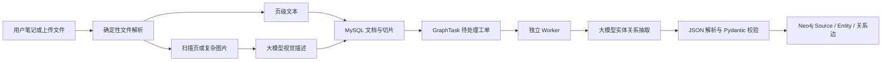

# 文档、大模型与 Neo4j 到底是什么关系

## 0. 先用一句话建立整体认识

在这套 RAGNotebook 里，最稳定的分工是：

> **原始笔记和文档负责保存事实，MySQL 负责保存业务数据和处理工单，大模型负责产生“候选理解”，Neo4j 负责保存经过校验的实体关系，检索和问答再把这些材料组织成上下文。**

可以把它们想成一家图书馆：

| 角色 | 图书馆里的类比 | 在本项目里的作用 |
|---|---|---|
| 原始文档、笔记 | 真正的书和手稿 | 事实源，保存用户最初写下的或上传的内容 |
| MySQL | 借阅登记册、目录柜、待办工作单 | 保存用户、笔记、文档、切片、聊天记录和图构建任务 |
| 大模型 | 一位读得很快、但可能看错的助理 | 描述扫描页、抽取实体关系、生成回答、标签、题目和续写 |
| Neo4j | 一张“谁和谁有关”的关系地图 | 保存 Source、Entity、MENTIONS 和 RELATED，不负责保存全部原文 |
| Worker | 专门整理地图的工作人员 | 读取 MySQL 工单，调用大模型，校验结果，再写入 Neo4j |

最重要的边界是：

> **大模型不会直接拥有数据，也不会直接决定权限。它输出的是候选结果，必须经过结构化校验，再由受控代码写入数据库。**

---

## 1. 系统全景：一份资料如何进入知识系统

下面是一条完整的处理链路：



这里面有一条很容易被误解的界线：

- **TXT、Markdown、PDF 文字层、DOCX、PPTX 的文本读取**主要是确定性程序完成的。
- 只有扫描页、图片说明、图表这类文字层不足的内容，才交给大模型做视觉描述。
- 大模型抽取实体和关系时，读取的是 MySQL 中已经保存的正文，不重新解析原始文件。
- 大模型输出实体关系后，程序还要检查实体数量、名称、关系两端是否存在。
- 最后写入 Neo4j 的是程序，不是模型直接连接数据库。

---

## 2. MySQL 和 Neo4j 不是互相替代

### 2.1 MySQL 保存“原文和业务事实”

知识文档主要保存在两张表里：

- `knowledge_documents`：保存一份文档的完整内容、文件名、MD5、用户 ID。
- `knowledge_chunks`：保存文档切片，并记录页码和图片 URL。

例如上传一份 PDF 后，MySQL 中可能出现：

| 表 | 示例内容 |
|---|---|
| `knowledge_documents` | `id=doc-100`，`filename=Python教程.pdf`，`user_id=u1` |
| `knowledge_chunks` | `document_id=doc-100`，`index=0`，`page=3`，`content=FastAPI 是基于 Python 的 Web 框架……` |

用户阅读原文、查看页码、查看图片、删除文档，仍然主要依赖 MySQL 和文件系统。

### 2.2 Neo4j 保存“实体之间怎么相连”

Neo4j 不保存整篇 PDF。它保存的是从文档中抽取出来的关系网络，例如：

```text
(Source: 文档《Python教程》)
    -[:MENTIONS]->
(Entity: FastAPI)
    -[:RELATED {relation_type: "基于"}]->
(Entity: Python)
```

它擅长回答：

- 这份文档提到了哪些实体？
- `FastAPI` 和 `Python` 有什么关系？
- 哪些文档同时提到了 `FastAPI`？
- 从一个概念出发，一到三跳还能找到哪些概念？

它不适合单独回答：

- 文档第 3 页第 2 段的完整原文是什么？
- 用户上传文件时使用的编码是否合法？
- 这份文档是否属于当前用户？
- 删除文档时哪些图片文件需要一起删除？

这些问题仍然要回 MySQL、文件系统和权限代码。

### 2.3 两者之间为什么需要任务队列

保存文档和写 Neo4j 是两个不同的数据库操作，不能假设它们天然同时成功。

例如：

1. 用户保存一篇笔记，MySQL 提交成功。
2. 大模型抽取实体时超时。
3. Neo4j 这次没有写入。

如果要求 MySQL 和 Neo4j 必须同时成功，那么用户保存笔记就可能被模型服务拖失败，这是不合理的。

所以项目采用最终一致：

```text
笔记正文写入 MySQL
    + GraphTask(status=pending)
    -> Worker 认领
    -> status=running
    -> 大模型抽取
    -> 校验
    -> 写 Neo4j
    -> status=completed
```

如果失败：

```text
失败一次 -> status=pending, attempts=1
失败两次 -> status=pending, attempts=2
失败三次 -> status=failed, error_message=真实错误摘要
```

这就是“正文先可用，图谱稍后更新”的最终一致模型。

---

## 3. “文档”在系统里有三种不同身份

理解下面的区分非常重要，因为中文里的“文档”经常同时指三样东西。

### 身份一：用户看到的原始资料

这可能是一份 PDF、Word、PPT、Markdown，也可能是一篇笔记。

它的特点：

- 是事实源。
- 可能很长，不能整篇塞进模型。
- 需要权限校验。
- 需要保留页码、文件名、用户归属。

### 身份二：MySQL 中的文档和切片

上传后，系统会把它转成文本并切片。

例如：

```text
原文 3000 字
    -> chunk 0: 第 0 到 1000 字
    -> chunk 1: 第 800 到 1800 字
    -> chunk 2: 第 1600 到 2600 字
```

相邻切片故意重叠 200 字，避免句子刚好落在边界时被完全切断。

切片的主要用途是：

- 检索时只取相关段落。
- 限制送入模型的上下文长度。
- 显示命中位置。
- 保存 PDF 页码和图片 URL。

### 身份三：Neo4j 中的 Source 节点

在 Neo4j 里，笔记和文档都会被抽象成 `Source`：

```text
(Source {
    user_id: "u1",
    kind: "note" 或 "doc",
    id: "原始笔记或文档 ID",
    title: "展示标题"
})
```

`Source` 表示“这份关系是从哪份资料来的”，但它不保存完整正文。

一段关系可以这样理解：

> `Source(教程.pdf)` 提到 `Entity(FastAPI)`；
> `Entity(FastAPI)` 经过一条带来源 ID 的 `RELATED` 边指向 `Entity(Python)`。

因此，Neo4j 中的关系始终可以追回到笔记或文档 ID，而不是一张脱离来源的孤立知识图。

---

## 4. 大模型在这套系统里具体做了什么

当前代码中，大模型主要参与六类工作。

| 场景 | 输入 | 模型输出 | 输出是否直接成为事实 |
|---|---|---|---|
| PDF 页面视觉描述 | 页面 PNG 和提示词 | 页面中的文字、表格、图表说明 | 否，属于派生理解 |
| 实体关系抽取 | 当前来源正文 | 实体和关系 JSON | 否，需要 Pydantic 校验 |
| 聊天回答 | 检索到的笔记或切片 | 自然语言答案 | 否，是带上下文的生成结果 |
| 笔记自动补全 | 光标前文本 | 一小段续写 | 否，是建议 |
| 笔记自动标签 | 标题和正文 | 1 到 5 个标签 JSON | 校验后才保存 |
| 复习题目生成 | 笔记正文 | 结构化选择题 JSON | 校验后才返回 |

下面分别举例。

---

## 5. 例子一：普通 PDF 的文字层提取不需要大模型

假设 PDF 中有可复制的文字：

```text
FastAPI 是一个用于构建 Python Web API 的框架。
```

处理过程：

1. `document_extract.py` 用 PyMuPDF 读取第 1 页文字。
2. 得到 `(1, "FastAPI 是一个用于构建 Python Web API 的框架。")`。
3. 文本进入 MySQL 文档和切片。
4. 后续 Worker 再把这段正文交给大模型抽取实体关系。

这里有两个不同的大模型使用阶段：

```text
PDF 文字层 -> 程序提取 -> MySQL 正文
MySQL 正文 -> 大模型抽取 -> 实体关系候选
```

注意：**读取 PDF 文字层**和**抽取实体关系**不是同一件事。

如果 PDF 本身有文字，模型并不参与把 PDF 变成文本；模型参与的是后续语义加工。

---

## 6. 例子二：扫描 PDF 才需要视觉模型

假设上传的是一页拍照或扫描的教材：

```text
页面上只有一张图片，没有可复制文字。
```

处理过程：

1. PDF 文字层读取结果为空。
2. 系统判断这一页可能需要视觉理解。
3. 程序把页面渲染成 `page-1.png`。
4. 图片以 base64 形式交给视觉模型。
5. 模型返回类似：

```text
页面顶部标题为“Python Web 开发”，正文包含 FastAPI、路由、依赖注入三个概念，
右侧表格对比了 Flask 和 FastAPI。
```

6. 这段描述与页面图片 URL 一起进入 MySQL 切片。
7. 之后 Worker 再用这段描述和文字继续抽取实体关系。

这里的大模型作用是：

- 看懂图片中的文字和布局。
- 把视觉内容转成可检索的文字线索。
- 补充纯文字提取拿不到的信息。

它不能保证逐字准确，所以视觉描述不能冒充原始扫描文字。

当前复刻实现还会把这些描述直接并入文档正文。工程上应把它视为“模型生成的派生内容”，而不是原始 PDF 的逐字转录。更严格的生产系统应把模型描述单独保存，并标注 `source=vision`、模型名、版本和置信度。

另一个边界是：当前只处理前 10 页需要视觉理解的页面。超出的页面仍然可以保留已有文字，但不会自动做视觉描述。

---

## 7. 例子三：模型把一段文字抽成实体关系 JSON

假设 Worker 从 MySQL 读到：

```text
FastAPI 是一个用于构建 Python Web API 的框架。
```

模型可能返回：

```json
{
  "entities": [
    {
      "name": "FastAPI",
      "type": "框架",
      "description": "用于构建 Python Web API 的框架"
    },
    {
      "name": "Python Web API",
      "type": "技术概念",
      "description": "Python Web API"
    }
  ],
  "relations": [
    {
      "source": "FastAPI",
      "target": "Python Web API",
      "relation_type": "用于构建"
    }
  ]
}
```

这只是“候选草稿”，程序还要检查：

- 实体名称是否为空。
- 实体数量是否超过 30。
- 关系数量是否超过 60。
- 是否有两个名称在大小写归一化后重复。
- 关系两端是否都出现在实体列表中。

例如下面这种关系会被拒绝：

```json
{
  "entities": [
    {"name": "FastAPI"}
  ],
  "relations": [
    {
      "source": "FastAPI",
      "target": "Django",
      "relation_type": "替代"
    }
  ]
}
```

原因是 `Django` 没有出现在 `entities` 中，这是一条悬空关系。

下面这种也会被拒绝：

```json
{
  "entities": [
    {"name": "FastAPI"},
    {"name": "fastapi"}
  ],
  "relations": []
}
```

原因是图存储会按 `casefold()` 归一化名称，两个实体最终会得到同一个稳定 ID。必须在写图前拒绝，而不是让后一个实体覆盖前一个。

---

## 8. 例子四：同一实体可以连接多份资料

假设同一个用户有两份资料。

资料 A：

```text
FastAPI 是一个 Python Web 框架。
```

资料 B：

```text
FastAPI 支持 Pydantic 数据校验。
```

抽取后，Neo4j 中可能出现：

```text
(Source A)-[:MENTIONS]->(Entity FastAPI)
(Source A)-[:MENTIONS]->(Entity Python)
(Entity FastAPI)-[:RELATED {source_id: A, relation_type: "基于"}]->(Entity Python)

(Source B)-[:MENTIONS]->(Entity FastAPI)
(Source B)-[:MENTIONS]->(Entity Pydantic)
(Entity FastAPI)-[:RELATED {source_id: B, relation_type: "支持"}]->(Entity Pydantic)
```

这里 `FastAPI` 节点可以被两份资料共同引用，但两条关系分别记录了来源 ID。

用户可以从 `FastAPI` 出发看到：

- 一份资料说它与 Python 有关。
- 另一份资料说它与 Pydantic 有关。
- 每条关系来自哪份资料。

这比把所有文本都塞进一个模型上下文更容易解释来源。

需要注意：当前复刻版的实体 `description` 和 `entity_type` 会在每次来源写入时更新。也就是说，多份资料提到同一个实体时，后写入的描述可能覆盖先前的描述。真正可靠的证据仍然是 `MENTIONS` 和带 `source_id` 的 `RELATED` 边，而不是只看实体摘要。

---

## 9. 例子五：更新一篇笔记时，图不是累加边，而是替换来源

假设原始笔记是：

```text
FastAPI 使用 Python。
```

图中已有：

```text
(Source note-1)-[:MENTIONS]->(FastAPI)
(Source note-1)-[:MENTIONS]->(Python)
(FastAPI)-[:RELATED {source_id: note-1}]->(Python)
```

用户把笔记改成：

```text
FastAPI 使用 Pydantic。
```

MySQL 事务会做两件事：

1. 更新笔记正文。
2. 把同一来源的 `GraphTask` 重置为 `pending`。

Worker 随后执行：

1. 删除 `Source note-1` 原有的 `MENTIONS` 边。
2. 删除 `source_id=note-1` 的 `RELATED` 边。
3. 创建或合并新的 `FastAPI`、`Pydantic` 实体。
4. 写入新的 `MENTIONS` 和 `RELATED`。

最终不会再保留 `FastAPI -> Python` 这条来自旧版本笔记的关系。

这就是“按来源替换”，而不是“每次都往图里加一条边”。

如果只追加不替换，用户修改十次笔记后，图里就会混有十个历史版本的错误关系。

---

## 10. 例子六：删除笔记或文档时，图边如何清理

删除一份文档时，系统会：

1. 删除 MySQL 中的文档和切片。
2. 把对应 `GraphTask` 重置为 `pending`。
3. Worker 发现原始来源已经不存在。
4. 调用 `delete_source()`。
5. 删除这份来源的 `RELATED` 边。
6. 删除 `Source` 节点及它的 `MENTIONS` 边。

一个共享实体不会因为某一份来源删除而被直接删除，因为其他资料可能仍然提到它。

例如：

```text
Source A -> Entity FastAPI
Source B -> Entity FastAPI
```

删除 Source A 后，FastAPI 仍然由 Source B 引用。

这类“孤立实体”以后可以由清理任务回收，但当前实现优先保证不误删其他来源仍在引用的节点。

---

## 11. 例子七：为什么要按用户隔离

假设用户 A 和用户 B 都上传了包含 `FastAPI` 的文档。

实体 ID 不是单纯由名称决定，而是由：

```text
user_id + ":" + 规范化名称
```

共同生成稳定的 UUID。

因此：

```text
用户 A 的 FastAPI 实体 ID != 用户 B 的 FastAPI 实体 ID
```

即使两个用户上传了完全相同的 PDF，也不会共享图节点。

这样做有三个好处：

1. 用户 A 不能通过猜测 `entity_id` 访问用户 B 的实体。
2. 两个用户可以给同名实体保存不同类型和描述。
3. 删除或重建一个用户的图不会影响其他用户。

权限不能只靠图查询的入口检查。当前 Cypher 在 `Source`、`Entity` 和 `RELATED` 边上都带有 `user_id` 条件。

---

## 12. 例子八：大模型答错时，系统如何避免污染数据库

假设模型输出了合法 JSON，但关系端点不存在：

```json
{
  "entities": [
    {"name": "FastAPI"}
  ],
  "relations": [
    {
      "source": "FastAPI",
      "target": "Django",
      "relation_type": "包含"
    }
  ]
}
```

处理结果：

1. JSON 能解析。
2. Pydantic 业务校验失败。
3. Worker 得到异常。
4. 本次不写 Neo4j。
5. 任务记录错误并重试。
6. 第三次仍失败后标记为 `failed`。

因此，模型说错话不会直接变成一条图关系。

可以把这条规则记成：

> **模型负责提出候选，代码负责检查结构，数据库只接收通过检查的结果。**

但还要进一步区分：

- JSON 合法，不等于关系真实。
- 关系两端存在，不等于文中真的支持这条关系。
- 结构校验能挡住悬空边和格式错误，不能完全挡住模型幻觉。

要评价抽取质量，仍然需要人工抽样、证据句、固定测试集和准确率/召回率评估。

---

## 13. 例子九：聊天回答里的大模型和 Neo4j 分别做什么

当前聊天检索主要使用 MySQL 字面匹配：

```text
用户问题
    -> 查找当前用户的笔记标题、正文
    -> 查找当前用户的文档切片
    -> 取最多 5 条候选
    -> 拼接背景资料
    -> 大模型生成答案
```

例如用户问：

```text
FastAPI 依赖什么语言？
```

MySQL 可能命中切片：

```text
FastAPI 是一个用于构建 Python Web API 的框架。
```

大模型收到：

```text
背景资料：
FastAPI 是一个用于构建 Python Web API 的框架。

问题：
FastAPI 依赖什么语言？
```

模型可以回答：

```text
根据当前资料，FastAPI 与 Python 相关，资料将它描述为构建 Python Web API 的框架。
```

这里：

- MySQL 负责找候选原文。
- 大模型负责理解问题和组织语言。
- Neo4j 当前不直接参与这次聊天检索。

这是当前实现的重要边界。不要因为系统已经有 Neo4j，就误以为每次聊天都会走图查询。

未来如果接入图检索，可以增加类似路线：

```text
问题中的 FastAPI
    -> Neo4j 找到关联的 Python、Pydantic
    -> 回 MySQL 取相关原文
    -> 大模型基于原文回答
```

即使未来接入图检索，Neo4j 仍然负责“找关系”，MySQL 和原文仍然负责“提供证据”，大模型仍然负责“组织答案”。

---

## 14. 大模型没有做什么

下面这些工作如果交给大模型，会增加不确定性，当前系统主要用确定性代码完成：

| 工作 | 当前由谁完成 | 为什么不用大模型 |
|---|---|---|
| 识别文件后缀是否支持 | 程序 | 规则明确，不需要语义判断 |
| 限制文件大小 | 程序 | 必须稳定执行 |
| 判断 JWT 属于哪个用户 | 认证代码 | 权限不能由模型猜测 |
| 防止路径穿越 | 固定路径校验 | 安全边界必须确定 |
| 计算 MD5 去重 | 程序 | 需要稳定哈希 |
| 提取 PDF 文字层 | PyMuPDF | 有原始文字时无需模型 |
| 文本切片 | 固定窗口算法 | 可重复、可测试 |
| 保存 MySQL 数据 | SQLAlchemy | 需要事务和约束 |
| 写入 Neo4j | 受控 Cypher | 需要用户隔离和固定事务 |
| 判断关系是否真实 | 结构校验加人工/评估 | 模型输出不能自动视为事实 |
| 生成任务状态 | MySQL | 需要持久化和可观察性 |

一个很实用的判断方法是：

> 规则能够稳定判断的事情，不要交给模型；需要理解自然语言或图片，并且可以容忍候选结果时，再使用模型。

---

## 15. 大模型、Embedding 模型和 Neo4j 向量索引的区别

后面如果继续做向量检索，还会出现另一类模型：Embedding 模型。

它不是聊天大模型，而是把文字变成向量：

```text
"FastAPI 是 Python 框架"
    -> Embedding 模型
    -> [0.12, -0.31, 0.08, ...]
```

向量可以用来找“说法不同但语义相近”的文本。

三者的分工是：

| 技术 | 主要解决什么问题 |
|---|---|
| 聊天大模型 | 理解问题、组织答案、抽取实体关系 |
| Embedding 模型 | 把文本变成可比较的向量 |
| Neo4j 图 | 保存显式实体关系和来源 |
| Neo4j 向量索引 | 保存向量并做近邻搜索 |

当前复刻主链路尚未把 Embedding 向量检索接入聊天。文档里出现“向量”时，不要把“文本切片”误认为“已经生成向量”。

切片只是把长文拆短；向量化是另一条处理链。

---

## 16. 一次完整案例：从 PDF 到图，再到问答

假设用户上传一份 20 页的 PDF，文件名是 `Web框架对比.pdf`。

### 第一阶段：读取文件

1. 校验用户身份。
2. 校验文件大小不超过 10 MB。
3. 校验后缀是支持的格式。
4. PyMuPDF 读取每页文字。
5. 对文字很少或含图片的前 10 页做视觉描述。

### 第二阶段：写入原文

1. 把每页文字按 1000 字切片。
2. 每段保留页码。
3. 保存图片 URL。
4. 写入 `knowledge_documents` 和 `knowledge_chunks`。
5. 创建 `GraphTask(source_kind="doc", status="pending")`。

### 第三阶段：抽取图

1. Worker 认领任务。
2. 读取文档完整正文的前 6000 字符。
3. 调用大模型做实体关系抽取。
4. 校验 JSON 和关系端点。
5. 在同一个 Neo4j 事务里替换该来源的旧边。
6. 把任务状态改为 `completed`。

### 第四阶段：用户提问

用户问：

```text
这份资料认为 FastAPI 和 Python 是什么关系？
```

当前聊天路径会：

1. 在 MySQL 中按关键词查找当前用户的切片。
2. 找到包含 `FastAPI` 或 `Python` 的片段。
3. 把片段作为背景资料交给大模型。
4. 大模型生成带上下文的答案。

未来如果接入图检索，可以先从 `FastAPI` 节点找到相关实体，再回 MySQL 取原始证据。

---

## 17. 什么时候会看到“图已经更新”的不一致窗口

因为 MySQL 和 Neo4j 不是同一个事务，所以会出现短暂窗口：

```text
时间 T1：笔记正文已保存到 MySQL
时间 T2：GraphTask 仍是 pending
时间 T3：Worker 调用了模型
时间 T4：Neo4j 图才写入新关系
```

在 T1 到 T4 之间：

- 笔记详情是新的。
- 图可能还是旧的。
- 聊天检索可能已经看到新正文。
- 任务状态可以告诉前端“图仍在构建”。

这不是简单的代码 bug，而是跨数据库最终一致的正常状态。

关键是系统必须：

- 把任务状态持久化。
- 失败可重试。
- 图查询显示状态。
- 不把 `pending` 谎称为 `completed`。

---

## 18. 当前实现中值得记住的限制

1. 图谱抽取读取的是文档完整正文的前 6000 字符，不是所有切片逐段抽取。
2. PDF 视觉描述当前最多处理前 10 页需要视觉理解的页面。
3. 视觉描述会并入文档正文，当前没有单独的来源类型字段。
4. Neo4j 主要保存 Source、Entity、MENTIONS、RELATED，不是完整原文数据库。
5. 当前聊天检索以 MySQL 字面匹配为主，尚未把图检索和向量检索真正接入问答。
6. 同一实体被多个来源提及时，描述字段可能被后写来源覆盖，来源边更可靠。
7. Worker 失败三次后标记为 `failed`，不会无限重试。
8. 跨系统崩溃仍可能留下需要恢复的任务，例如图写完但状态还没回写。

这些限制并不否定整体设计，而是说明“能跑通”和“生产级可靠”之间还有距离。

---

## 19. 对应代码位置

| 功能 | 代码文件 |
|---|---|
| PDF、DOCX、PPTX 文字提取 | `backend/app/services/document_extract.py` |
| PDF 页面视觉描述 | `backend/app/services/pdf_vision.py` |
| 文档、切片和入队 | `backend/app/services/knowledge_service.py` |
| 笔记和入队 | `backend/app/services/note_service.py` |
| 实体关系模型校验 | `backend/app/graph/schemas.py` |
| 大模型抽取边界 | `backend/app/graph/extractor.py` |
| 任务登记 | `backend/app/graph/task_queue.py` |
| 独立 Worker | `backend/app/graph/worker.py` |
| Neo4j 写入和来源替换 | `backend/app/graph/graph_store.py` |
| Neo4j 驱动和约束 | `backend/app/graph/neo4j_client.py` |
| 图视图转换 | `backend/app/graph/views.py` |
| MySQL 字面检索 | `backend/app/services/knowledge_retrieval.py` |
| 聊天回答流 | `backend/app/services/chat_stream_service.py` |
| 笔记补全和自动标签 | `backend/app/services/note_ai_service.py` |
| 复习题目生成 | `backend/app/services/review_service.py` |

---

## 20. 最后用五句话总结

1. **文档和笔记是事实源，MySQL 是正文、切片、权限和任务账本。**
2. **Neo4j 是关系地图，保存实体、来源和关系，不替代原文数据库。**
3. **大模型擅长理解和生成，但它的输出必须经过 JSON 解析、业务校验和受控代码写入。**
4. **Worker 把“保存正文”和“更新图”分开，通过 MySQL 工单实现可重试的最终一致。**
5. **当前聊天主要靠 MySQL 检索加大模型回答；Neo4j 已有存储和来源关系，但还没有成为每次问答的必经路径。**
