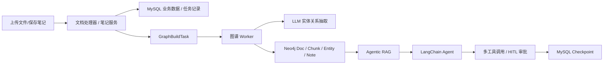
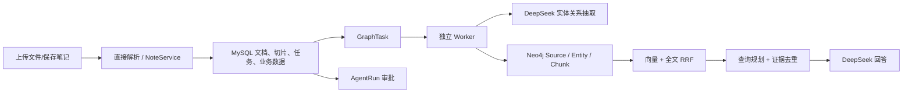

# RAGNotebook 参考项目与复刻项目差异审计

> 审计日期：2026-10-21  
> 参考项目：本仓库根目录 `backend/`、`front/`  
> 复刻项目：`RAGNotebook-rebuild/`  
> 目标：说明两套实现的结构差异、行为差异，以及复刻项目相对参考项目仍未完成的部分。

---

## 0. 先给结论

复刻项目已经覆盖了大量核心功能：

- 用户、JWT、Redis 黑名单和刷新令牌。
- 笔记 CRUD、批量操作、分类、标签、导出。
- 回顾记录与间隔复习。
- TXT、Markdown、PDF、DOCX、PPTX 导入。
- Neo4j 图谱、手工实体/类型/关系、任务 Worker 和恢复。
- 可切换的本地/远程 Embedding、向量索引、全文索引、RRF 混合检索；当前线上使用 QwenCloud `text-embedding-v4`。
- Agentic RAG 查询规划与证据卡。
- 工具白名单、审批提案、待办恢复和幂等执行。

但它还不是参考项目的完整 1:1 克隆。最大的差距不在“有没有一个聊天接口”，而在下面四个方向：

1. **参考项目是图谱驱动的 Agentic RAG，复刻项目目前是文本混合检索驱动的受控 Agent。**
2. **参考项目的 Agent 可以连续选择和调用多个工具，并带完整 LangGraph checkpoint；复刻项目主要是一次工具选择加一次检索。**
3. **参考项目的知识文档和图谱以 Neo4j 为主要检索存储；复刻项目以 MySQL 保存文档与切片，Neo4j 保存索引副本。**
4. **参考项目有更完整的文档解析、视觉批处理、去重、图 Chunk 提及、双链、系统类型、运维治理和测试覆盖。**

可以用一张表概括：

| 能力 | 参考项目 | 复刻项目 | 判断 |
|---|---|---|---|
| 笔记 CRUD、用户隔离 | 完整 | 完整 | 基本对齐 |
| 回顾与间隔算法 | 完整 | 完整 | 基本对齐 |
| 普通关键词搜索 | 有 | 有 | 对齐 |
| 笔记语义搜索 | Neo4j Chunk 向量 + 全文 | MySQL `LIKE` 子串 | **未对齐** |
| 新笔记自动标签/分类 | 后台自动生成 | 只能调用手动 auto-tag | **未对齐** |
| 文档持久化 | Neo4j Doc/Chunk + MySQL 注册/MD5 | MySQL 文档/切片 + Neo4j 索引 | **架构不同** |
| PDF 多模态 | 批处理、图哈希去重、可配置视觉模型 | 单页描述、前 10 页、固定 DeepSeek | **部分实现** |
| 图实体/关系编辑 | 完整 | 完整 | 基本对齐 |
| Chunk 级图提及 | 有 | 无 | **未实现** |
| 笔记双链 `[[...]]` | 有 | 无 | **未实现** |
| 图谱实体搜索 | 有 | 无独立 RAG graph tool | **部分实现** |
| 向量 + 全文混合检索 | 有 | 有 | 基本对齐 |
| 图谱扩展检索 | 有 | 无 | **未实现** |
| 可答性评估与联网兜底 | 有 | 无 | **未实现** |
| 多工具 Agent | LangChain `create_agent` | 两节点受控流程 | **部分实现** |
| LangGraph checkpoint | MySQL checkpoint 两表 | 只保存审批提案 | **架构不同** |
| 人工审批 | 官方 HITL middleware | 自定义 AgentRun 状态机 | 可用但不同 |
| 云端 rerank | 可配置 rerank API | 本地 BGE 余弦 | 行为不同 |
| 文件头像上传 | 有 | 无 | **未实现** |
| 限流、日志、后台预热 | 有 | 基本没有 | **未实现** |
| 容器部署代码 | 完整 | 已写，未完成全量构建验收 | **部分完成** |
| 测试覆盖 | 源码中约 837 个测试函数定义 | 46 个测试函数定义 | **明显不足** |

---

## 1. 审计方法与限制

本次不是只看 README，而是交叉检查了：

- FastAPI 路由装饰器。
- SQLAlchemy 表模型。
- 实际服务实现。
- 前端 endpoint 和页面调用。
- Dockerfile、Compose、Nginx。
- 测试文件数量和覆盖领域。

注意两点：

1. 参考项目根目录的 `backend/openapi.json` 已经落后于实际代码，缺少笔记、图谱等大量路径，因此不能把它当作完整 API 清单。
2. 当前参考项目工作区处于修改状态，`backend/app/core/failed_response.py` 被删除，参考后端无法直接从当前工作区完整导入运行。本次差异判断以当前代码文件和静态路由扫描为准，不代表参考仓库干净提交无法运行。

---

## 2. 总体架构差异

### 2.1 参考项目



参考项目的主要中心是：

- MySQL 保存用户、笔记、任务、日志、审批状态和 checkpoint。
- Neo4j 保存 Doc、Chunk、Entity、Note、关系、向量和全文索引。
- Agentic RAG 先做规划和图/文本检索，再把上下文交给 LangChain Agent。
- Agent 内部可以按模型决策连续调用多个工具。

### 2.2 复刻项目



复刻项目的主要中心是：

- MySQL 是文档正文、切片和业务数据的权威来源。
- Neo4j 是可检索的关系图和向量索引副本。
- 聊天先做一次工具选择，再做本地检索和回答。
- 写入工具通过自定义 AgentRun 提案与审批执行。

这不是单纯“代码多少”的差别，而是系统权威数据的位置不同。

---

## 3. 数据模型差异

### 3.1 表清单

参考项目当前有 16 张表：

```text
agent_checkpoint_writes
agent_checkpoints
chat_messages
chat_sessions
graph_build_tasks
graph_docs
graph_entities
graph_entity_notes
graph_entity_types
graph_extract_logs
graph_note_edges
graph_relations
note_templates
notes
review_records
user_service
```

复刻项目当前有 10 张表：

```text
agent_runs
chat_messages
chat_sessions
graph_tasks
knowledge_chunks
knowledge_documents
note_templates
notes
review_records
user_service
```

### 3.2 缺失或替代关系

| 参考表 | 复刻对应 | 差异 |
|---|---|---|
| `graph_build_tasks` | `graph_tasks` | 参考保存 payload、内容哈希、force、标题；复刻只有来源和状态 |
| `graph_docs` | `knowledge_documents` | 参考只登记文档，正文在 Neo4j；复刻正文在 MySQL |
| `graph_extract_logs` | 无独立表 | 复刻从 `graph_tasks` 推导状态，缺少历史抽取日志 |
| `graph_entities` | Neo4j `Entity` | 参考有 MySQL 镜像；复刻没有 MySQL 图实体表 |
| `graph_relations` | Neo4j `RELATED` / `MANUAL_RELATION` | 参考使用 `RELATES_TO`；复刻没有 MySQL 关系表 |
| `graph_entity_notes` | Neo4j `MENTIONS` | 参考存 mention_count/context；复刻边更简单 |
| `graph_entity_types` | Neo4j `EntityType` | 参考有 MySQL 类型表与系统预置类型；复刻只有 Neo4j 用户类型 |
| `graph_note_edges` | 无 | 复刻没有笔记双链表 |
| `agent_checkpoints` | 无 | 复刻没有完整 LangGraph 状态快照 |
| `agent_checkpoint_writes` | 无 | 复刻只能在 `agent_runs` 保存提案和结果 |
| 无 | `knowledge_documents` | 复刻新增 MySQL 权威文档表 |
| 无 | `knowledge_chunks` | 复刻新增 MySQL 切片表 |
| 无 | `agent_runs` | 复刻新增自己的审批状态机 |

### 3.3 影响

- 参考项目能恢复 Agent 的完整 LangGraph 执行现场。
- 复刻项目只能恢复“待审批工具提案”，不能恢复任意 Agent 中间状态。
- 参考项目能保存图谱抽取历史计数、内容哈希和失败原因。
- 复刻项目能保存当前任务状态，但缺少历史抽取审计。
- 参考项目能实现笔记双链和图谱画布中的 WIKI 边。
- 复刻项目没有双链数据模型。

---

## 4. API 差异

通过当前代码静态扫描，参考项目有而复刻项目没有的真实端点如下：

| 方法 | 路径 | 作用 | 影响 |
|---|---|---|---|
| GET | `/chat/session/{session_id}/approval` | 读取最近审批快照，包括已完成审批 | 复刻只能看 pending |
| POST | `/file/upload/` | 上传头像文件并更新用户资料 | 复刻头像上传不可用 |
| POST | `/knowledge/add/multiple` | 非流式多文件上传 | 复刻只有流式多文件 |
| GET | `/knowledge/images/all/{md5}` | 一次返回文档全部图片 base64 | 复刻需逐张请求 |
| DELETE | `/knowledge/md5/clear` | 可只清 MD5，也可连带删文档 | 复刻没有该控制粒度 |
| GET | `/knowledge/md5/{md5_value}` | 查询单条 MD5 详情 | 复刻只能列全部 |
| GET | `/note/{note_id}/export` | 单独导出接口 | 复刻只有 download，前端当前主要用 download |

注意：

- `/chat/sessions/{user_id}` 和 `/chat/sessions/{path_user_id}` 是路径参数命名不同，功能等价。
- `/knowledge/image/{md5}/{filename}` 和 `/knowledge/image/{md5_value}/{filename}` 也是参数命名不同，功能等价。
- `/chat/rag/query` 只存在于旧的 `openapi.json`，当前参考代码中已没有对应装饰器，不计为缺失。

复刻项目额外有：

- `/health` 简单健康接口。
- FastAPI 自动 `/docs`、`/redoc`、`/openapi.json`。

---

## 5. Agent 差异

### 5.1 参考项目

参考项目使用 LangChain `create_agent`：

- 工具列表包含：
  - `what_time_is_now`
  - `get_user_info_tools`
  - `search_notes_tool`
  - `get_note_stats_tool`
  - `get_today_reviews_tool`
  - `mark_reviewed_tool`
  - `create_note_tool`
  - `get_related_notes_tool`
  - `search_rag`
- 模型可以在一次回答中连续选择多个工具。
- `HumanInTheLoopMiddleware` 对白名单工具发起审批。
- `ModelRetryMiddleware`、`ToolRetryMiddleware`、`ToolCallLimitMiddleware` 提供重试和调用上限。
- 中间件记录模型耗时、token 用量和慢调用。
- MySQL 自定义 checkpointer 保存完整 state 与 pending writes。
- 支持 `Command(resume=...)` 恢复审批。
- 聊天历史会构造成 Human/AI 消息后交给 Agent。

### 5.2 复刻项目

复刻项目是自定义两节点 LangGraph：

```text
choose -> resolve
```

它只能：

- 选择一个工具。
- 执行一个只读工具，或产生一个写入提案。
- 然后结束工具流程。

复刻工具白名单只有：

```text
none
search_notes
note_stats
today_reviews
create_note
mark_reviewed
```

### 5.3 未完成

- 没有 `what_time_is_now`。
- 没有用户信息工具。
- 没有相关笔记工具。
- 没有让 Agent 主动调用 RAG 的工具。
- 没有在一次请求中连续调用多个工具。
- 没有工具调用重试和总调用次数限制。
- 没有 token 用量统计和慢模型告警。
- 没有完整 checkpoint，不能恢复“模型刚才已经调用过哪些工具”的中间状态。
- 没有把聊天历史完整交给工具选择节点。

### 5.4 用户可见例子

用户说：

```text
先看看我今天有哪些回顾，再帮我创建一篇总结笔记。
```

参考 Agent 可以：

1. 调 `get_today_reviews_tool`。
2. 根据结果生成总结。
3. 调 `create_note_tool`。
4. 进入审批。

复刻项目大概率只会选择其中一个工具，不能稳定完成整条多步骤任务。

---

## 6. Agentic RAG 差异

### 6.1 规划能力

| 能力 | 参考项目 | 复刻项目 |
|---|---|---|
| 判断是否需要检索 | 有 `need_retrieval` | 无，总是走检索 |
| 问候语短路 | 有 | 无 |
| 选择检索工具 | `search_notes`、`search_knowledge_base`、`search_graph`、`hybrid_search` | 只有统一 hybrid search |
| 多步骤工具计划 | 有 | 只有多个短查询 |
| 规划超时 | 有 | 只有普通异常回退 |
| 结构化输出重试 | 有 | 无 |
| 规划模型独立配置 | 有 `PLANNER_*` | 固定复用 DeepSeek 主客户端 |

### 6.2 本地检索

参考项目的本地检索包括：

- Chunk 向量候选。
- Chunk 全文候选。
- RRF 融合。
- `search_graph` 实体匹配。
- 命中实体的描述、别名、类型和来源。
- 命中实体关联的 Chunk。
- 单步失败时继续其他步骤。

复刻项目包括：

- Chunk 向量候选。
- Chunk 全文候选。
- RRF 融合。
- 用户过滤。

缺少：

- 从问题抽取实体候选词。
- 图实体搜索。
- 从实体回查 Chunk。
- 图证据与文本证据合并。
- “某个来源失败但其他检索步骤继续”的分步降级。

### 6.3 可答性与联网

参考项目有：

- `AnswerabilityEvaluator`。
- 判断本地证据是否真正回答问题。
- 检测“最新、今天、价格、版本”等新鲜度词。
- Tavily / Serper 联网搜索。
- 本地与 Web 证据合并。
- `answerability`、`web_search`、`evidence_fusion`、`context_ready` 等 thinking 阶段。

复刻项目没有：

- 可答性评估。
- 联网搜索配置和客户端。
- Web 来源。
- 证据相关性阈值。

### 6.4 用户可见例子

用户问：

```text
FastAPI 和 Pydantic 是什么关系？
```

参考项目可以：

1. 规划 `search_graph` 和 `hybrid_search`。
2. 从图里找实体及关系。
3. 从 Chunk 找原文。
4. 合并成证据。

复刻项目目前只会：

1. 把问题拆成若干短查询。
2. 对每个查询做向量和全文检索。
3. 合并文本 Chunk。

图数据库虽然在运行，但当前聊天不会主动沿图遍历。

---

## 7. 检索与重排差异

### 7.1 笔记搜索

参考项目：

- `/note/search` 调用 `NoteService.search_notes()`。
- 使用 Neo4j Chunk 向量 + 全文检索。
- 先从 Chunk 得到 note ID，再回 MySQL 取完整笔记。

复刻项目：

- `/note/search` 使用 SQL `LIKE`/`contains`。
- 只匹配标题和正文中的字面字符串。

结果：

- 输入“请求作用域数据库会话”可以找到“每个请求独立连接”的参考实现，复刻项目可能找不到。
- 搜索功能当前没有真正接入第 45、46 篇的语义能力。

### 7.2 全文索引

参考项目：

- 优先使用 CJK analyzer。
- 不支持时降级 standard。
- 显式设置 `eventually_consistent=false`。

复刻项目：

- 创建默认全文索引。
- 没有显式 CJK analyzer。
- 中文分词和召回质量可能明显弱于参考项目。

### 7.3 重排

参考项目：

- 可配置 SiliconFlow / Jina / Cohere 兼容 rerank API。
- 调用失败时保持原顺序并 similarity 为 0。

复刻项目：

- 使用本地 BGE 余弦相似度。
- 无外部 rerank 依赖。
- 相同分数保持原序。

两者都能“重排”，但模型、分数尺度和降级行为不同。复刻项目不会得到参考项目 reranker 的真实相关性分数。

---

## 8. 图谱差异

### 8.1 图节点和关系

参考项目：

- 节点：`Doc`、`Chunk`、`Entity`、`Note`。
- 关系：`MENTIONS`、`RELATES_TO`、`WIKI`。
- Chunk 也有向量、页码、图片路径和实体 `MENTIONS`。
- Note 支持 `[[双链]]`。
- 实体类型支持系统预置和用户自定义。

复刻项目：

- 节点：`Source`、`Entity`、`Chunk`。
- 关系：`MENTIONS`、`RELATED`、`MANUAL_RELATION`。
- `Source.kind` 区分 note/doc。
- Entity 与 Chunk 之间没有提及边。
- 没有 WIKI 双链。
- EntityType 只存在 Neo4j，没有系统预置类型表。

### 8.2 抽取完整度

参考抽取管线：

- 解析笔记 `[[双链]]`。
- LLM 实体关系抽取。
- 保存实体描述、别名、置信度和来源。
- 保存 mention context 和 mention_count。
- 按内容哈希幂等。
- 保存抽取日志。
- 清理旧来源不再关联的实体。
- 清扫孤儿实体。
- 写入 Chunk 及 Chunk 级 MENTIONS。

复刻抽取管线：

- LLM 实体关系 JSON。
- Pydantic 结构校验。
- 替换 Source 的 MENTIONS 和 RELATED。
- 构建 Chunk 向量索引。

缺少：

- 双链解析。
- mention context。
- mention_count。
- Chunk 级 MENTIONS。
- 抽取日志历史。
- 内容哈希增量判重。
- 孤儿实体清扫。
- Wiki 边。

### 8.3 Worker

参考项目：

- 后端进程内后台启动 Graph Worker。
- 也有独立 Worker 测试和任务表。
- 任务保存 payload，避免 Worker 必须重新猜上传切片。

复刻项目：

- Compose 中单独启动 Worker。
- 任务只保存 source_kind/source_id。
- Worker 再读 MySQL 正文并重新切片做索引。

复刻设计更简单，但：

- 不能保留上传阶段的页面图片元数据到 Chunk 关系。
- MySQL 结构变化会影响 Worker 重建。
- 缺少抽取日志审计。

---

## 9. 文档导入与视觉差异

### 9.1 限制

| 项目 | 参考 | 复刻 |
|---|---:|---:|
| 单文件上限 | 20 MB | 10 MB |
| 多文件总上限 | 200 MB | 5 个文件，每个 10 MB |
| 非流式多文件接口 | 有 | 无 |
| MIME + 扩展名校验 | 有 | 主要看扩展名 |
| Chunk 重叠 | 20 字符 | 200 字符 |
| 视觉页数 | 可处理整份 PDF | 前 10 个视觉页 |
| 视觉批处理 | 有 | 无 |
| 图片哈希去重 | 有 | 无 |
| 视觉模型独立配置 | 有 | 固定复用 DeepSeek |

复刻项目没有 `python-magic`、`unstructured`、`imagehash`、`shortuuid` 等参考依赖。

### 9.2 存储

参考：

- 文档正文和 Chunk 在 Neo4j。
- MySQL `graph_docs` 只负责上传登记。
- MD5 记录由独立 `MD5Store` 管理。

复刻：

- 文档和切片在 MySQL。
- Neo4j Chunk 是检索副本。
- 文档删除要同时清 MySQL、图片和 GraphTask。

复刻的好处是详情和事务更直观；代价是与参考项目的数据备份、查询和运维路径不同。

---

## 10. 笔记与回顾差异

### 10.1 自动标签与分类

参考项目保存笔记后：

- 如果用户没有提供 tags/category，后台任务调用 LLM。
- 自动生成 1 到 5 个标签和分类。
- 再创建或更新回顾记录。

复刻项目：

- 创建笔记时同步创建回顾记录。
- 不会自动生成标签或分类。
- 只有用户主动调用 `/note/{id}/auto-tag` 才更新标签。

未完成：

- 新笔记自动标签。
- 自动分类。
- 更新正文后的后台重分类。

### 10.2 置顶排序

参考 `list_notes` 使用：

```text
ORDER BY is_pinned DESC, 用户选择的排序字段
```

复刻 `list_notes` 没有先按 `is_pinned` 排序。

影响：

- 复刻前端即使成功置顶，列表也不会像参考项目一样把置顶笔记放在最前。

### 10.3 关系与清理

参考更新笔记时只在正文变化时触发图谱重抽。

复刻更新笔记时只要请求包含任何可修改字段就触发 `enqueue_graph`，包括置顶、分类等不一定影响实体关系的字段。

影响：

- 会产生不必要的图任务。
- 增加模型调用和 Worker 负载。
- 与“正文变化才重抽”的参考行为不同。

---

## 11. 安全、会话与运维差异

### 11.1 参考项目有、复刻项目缺少

- Redis 按 IP 限流。
- 聊天接口 60 秒 10 次、重排接口 60 秒 20 次等限制。
- 请求耗时 `X-Process-Time` 中间件。
- CORS 中间件。
- `/media` 头像静态目录。
- 结构化日志模块。
- 后台模型预热。
- 配置文件驱动 prompt 和切片参数。
- 默认测试用户 `admin / admin1234` 自动创建。

### 11.2 复刻项目有、参考项目不同

- 前端 axios 拦截业务 `code != 200` 并转成错误。
- 后端统一 `BusinessException`。
- Graph Cypher 中更显式地带 `user_id`。
- 本地 BGE 不依赖外部 embedding API。
- 独立 Worker 容器。

### 11.3 认证和登录差异

参考项目：

- 前端注册页可用。
- 存在本地开发用 `LocalAutoLogin`。
- 后端自动创建 admin 测试用户。

复刻项目：

- `/register` 被重定向到 `/login`。
- 后端注册接口仍存在。
- 不自动创建管理员用户。
- 没有 `LocalAutoLogin`。

这是当前复刻项目的有意定制，不一定是缺陷，但会改变首次启动体验。

---

## 12. 前端差异

复刻前端基本复制参考源码，主要差异只有 7 个文件：

```text
App.tsx
api/client.ts
pages/AIChat.tsx
pages/Login.tsx
pages/Profile.tsx
router/index.tsx
components/LocalAutoLogin.tsx
```

实际变化：

- 复刻移除 `LocalAutoLogin`。
- 复刻 `/register` 变为跳转登录。
- 复刻 axios 增加统一业务错误拦截。
- 复刻 401 时调用 Zustand `logout()`。
- 复刻 AIChat 增加 `create_note` 和 `mark_reviewed` 审批工具显示。
- Login/Profile 有本地化适配差异。

前端 endpoint 表仍包含参考项目接口。当前后端缺口会导致部分将来页面接入时调用失败：

- 头像上传 `/file/upload/`。
- 非流式多文件上传。
- MD5 单条详情和 clear。
- 全量图片接口。

---

## 13. 部署差异

### 13.1 参考项目

- 后端镜像使用 `uv sync --frozen`。
- Graph Worker 默认运行在 FastAPI 后台初始化中。
- Compose 有 MySQL、Redis、Neo4j、backend、frontend。
- Neo4j 有 healthcheck。
- backend 用 `backend/.env` 注入模型配置。
- media/logs/data 使用宿主机 bind mount。

### 13.2 复刻项目

- 后端镜像从 `requirements.txt` 安装。
- 特别过滤 CUDA 包，并在 Docker 中安装 CPU 版 PyTorch。
- API 和 Worker 共用镜像，但拆成两个服务。
- Compose 有 MySQL、Redis、Neo4j、backend、worker、front。
- API 端口 8100，前端 3100。
- PDF 图片和模型缓存使用命名卷。
- Neo4j 目前只有 `service_started`，没有容器 healthcheck。

### 13.3 当前完成度

- `docker compose config --quiet` 已通过。
- 前端生产构建已通过。
- 后端全量测试已通过。
- 完整后端镜像构建曾在下载依赖时被人工中止，因此“从零重新构建全部容器并启动”尚未完成最终验收。

因此第 53 篇应记为：

```text
部署代码已写
配置解析已通过
全量容器构建和重启持久化尚未最终确认
```

---

## 14. 测试与质量差异

当前源码文本统计：

| 项目 | 测试函数定义数量 |
|---|---:|
| 参考项目 | 约 837 |
| 复刻项目 | 46 |

这不是说参考项目 837 个测试全部通过，而是说明参考项目覆盖了更多领域。复刻项目缺少的系统性测试包括：

- 用户注册并发、锁定、状态切换。
- Redis 限流。
- 配置加载优先级。
- 后台初始化顺序。
- 文档 MIME 检测。
- 多线程切片队列。
- 图片提取与哈希去重。
- 多模态批处理。
- Graph 事件总线。
- 图类型系统预置。
- 双链解析。
- Chunk 匹配实体。
- 图孤儿清理。
- 完整 Agent 多工具链。
- MySQL checkpoint 恢复。
- 工具中间件重试和调用上限。
- 可答性评估。
- Web search 降级。
- Compose 重启持久化。

复刻项目当前测试优势：

- 每章代码都有最小回归。
- 文档格式提取有真实样例。
- Neo4j 用户隔离有真实集成测试。
- 审批幂等有真实 MySQL 验证。

复刻项目测试优势是“章节能验证”，参考项目测试优势是“系统级覆盖更广”。

---

## 15. 复刻项目已经完成到什么程度

按当前代码，可以认为以下能力已经完成：

### 15.1 基础业务

- FastAPI 应用、统一响应和异常处理。
- MySQL、Redis、JWT、用户、刷新令牌、注销。
- 笔记 CRUD、批量删除、批量分类、批量置顶、Markdown/ZIP。
- 模板列表、创建、修改、删除、排序。
- 回顾列表、完成回顾、AI 回顾题。

### 15.2 知识与检索

- TXT/MD/PDF/DOCX/PPTX 文本导入。
- 页码和切片。
- PDF 前 10 个视觉页描述。
- 本地 BGE 512 维向量。
- Neo4j 向量索引和全文索引。
- 向量 + 全文 RRF。
- MySQL 字面检索降级。
- 关联片段和本地重排。
- 查询规划、证据卡和按来源去重。

### 15.3 图谱

- Source/Entity/Chunk。
- MENTIONS/RELATED/MANUAL_RELATION。
- 实体、类型、关系手工编辑。
- 合并实体。
- 图总览、邻居、来源、搜索、SSE。
- GraphTask、独立 Worker、失败重试、超时回收。

### 15.4 Agent

- 工具白名单。
- 只读工具。
- 写入提案。
- LangGraph 两节点流程。
- AgentRun 持久化。
- pending 恢复。
- approve/reject。
- 行锁防重复认领。

### 15.5 部署

- 后端 Dockerfile。
- API/Worker 分容器。
- 前端 Nginx。
- 持久卷定义。
- Compose 配置可解析。

---

## 16. 仍未完成的功能清单

下面按用户可见影响排序。

### P0：如果不补，核心体验仍明显弱于参考项目

#### 1. 笔记语义搜索

当前复刻的 `/note/search` 仍是 SQL 字面子串。

应改为：

```text
查询 Embedding
    -> Neo4j Chunk 向量 + 全文
    -> 得到 note ID
    -> MySQL 回填完整笔记
```

否则第 45、46 篇的向量能力只影响聊天，不影响笔记搜索。

#### 2. 新笔记自动标签和分类

参考项目保存笔记后会异步生成 tags/category。

复刻项目需要补：

```text
创建笔记
    -> 后台任务
    -> LLM 输出 tags + category
    -> 更新 MySQL
```

#### 3. GraphRAG 接入聊天

复刻项目已有 Neo4j 图，但聊天只查 Chunk。

需要补：

- 从问题抽取实体。
- `search_graph`。
- 实体描述与关系证据。
- 命中实体关联的 Chunk。
- 与 hybrid search 合并。

#### 4. 可答性与联网兜底

参考项目会判断本地证据是否真的能回答问题，并允许 Web 搜索。

复刻项目缺：

- Answerability evaluator。
- Tavily/Serper 客户端。
- Web evidence。
- 本地/Web 证据融合。

#### 5. 完整 Agent 多工具链

复刻项目目前一次只选择一个工具。

需要决定是否：

- 迁移到 LangChain `create_agent`。
- 或扩展 LangGraph 为循环调用、工具结果回填、再次决策。

#### 6. 完整 checkpoint

如果目标是完整对齐参考项目，需要增加：

- `agent_checkpoints`
- `agent_checkpoint_writes`
- `BaseCheckpointSaver` 实现。

如果只需要当前审批提案，现有 AgentRun 足够，但不能恢复任意中间状态。

### P1：明显功能缺口

#### 7. 头像上传与媒体目录

缺 `/file/upload/`、`/media` 静态挂载和用户头像更新。

#### 8. 知识库端点补齐

- 非流式多文件上传。
- MD5 单条查询。
- MD5 clear。
- 文档全部图片 base64。

#### 9. PDF 视觉对齐

参考支持：

- 整份 PDF 的视觉页批处理。
- 图片感知哈希去重。
- 视觉模型独立配置。

复刻当前只有前 10 页逐页描述。

#### 10. 图 Chunk 提及和双链

- Chunk `MENTIONS`。
- `[[笔记双链]]`。
- WIKI 边。
- mention context/count。

#### 11. 系统图类型

参考有系统预置类型和用户自定义类型。复刻目前只有用户创建的 EntityType。

#### 12. 抽取日志与孤儿清理

- 独立 `graph_extract_logs`。
- 内容哈希判重。
- 来源移出后撤销旧实体关联。
- 清扫孤儿实体。

### P2：行为一致性与工程质量

#### 13. 置顶优先排序

复刻 `list_notes` 应增加 `is_pinned DESC` 作为第一排序条件。

#### 14. 只对相关改动重抽

建议只在这些字段变化时入队：

- 标题。
- 正文。

置顶、分类、标签等不必触发实体抽取，除非图展示依赖它们。

#### 15. 中文全文 analyzer

复刻应参考使用 `cjk`，不可用时降级 `standard`。

#### 16. 限流

参考有 Redis 限流：

- 登录。
- 聊天。
- 上传。
- 重排。

复刻目前没有。

#### 17. 日志和请求指标

- 结构化日志。
- 请求耗时 header。
- 模型耗时。
- token 用量。
- 慢调用告警。

#### 18. 配置和 prompt 管理

参考有 YAML 配置和 12 个 prompt 文件。复刻只有 4 个 prompt，许多规则内联在代码。

#### 19. 默认用户和前端入口

参考自动创建 `admin/admin1234` 并开放注册页。复刻禁用了注册展示，也没有默认管理员。

这可以是安全或学习场景的有意选择，但必须在部署说明里明确。

#### 20. 完整测试覆盖

优先补：

- Agent 多工具。
- checkpoint/resume。
- 文档 MIME 和多线程。
- PDF 视觉去重。
- graph mention/双链。
- 语义笔记搜索。
- 可答性和 Web fallback。
- Compose 重启持久化。

---

## 17. 建议补齐顺序

### 阶段 A：让前端搜索和写入体验对齐

1. 把 `/note/search` 切到 Neo4j Chunk 混合检索。
2. 修复置顶优先排序。
3. 新笔记自动标签和分类。
4. 只在正文相关变更时重抽。

### 阶段 B：把已有 Neo4j 真正用于聊天

1. 新增查询实体候选抽取。
2. 新增 graph search tool。
3. 将图证据与 Chunk 证据融合。
4. 增加 answerability。
5. 增加 Web search 兜底。

### 阶段 C：Agent 能力对齐

1. 工具补全：时间、用户信息、相关笔记、RAG。
2. 支持多工具循环。
3. 增加工具调用上限和重试。
4. 根据目标选择完整 LangGraph checkpoint 或继续使用 AgentRun。

### 阶段 D：文档和图谱深度对齐

1. PDF 视觉批处理与去重。
2. 双链与 WIKI 边。
3. Chunk 级 MENTIONS。
4. 图抽取日志和孤儿清扫。
5. 系统类型预置。

### 阶段 E：部署与验收

1. 完整构建 backend/worker/front 镜像。
2. 启动全套 Compose。
3. 验证 8100/3100。
4. 重启 API/Worker/front。
5. 验证 MySQL、Neo4j、PDF 图片、模型缓存和未决审批仍然存在。
6. 补齐限流、日志和 Neo4j healthcheck。

---

## 18. 做到什么程度才算“完整复刻”

建议用下面的验收标准，而不是只看代码文件是否都在。

### 18.1 搜索

- 查询不含原文精确词，也能通过语义找到正确笔记。
- 结果不出现其他用户来源。
- 置顶笔记始终优先。

### 18.2 文档

- 五种格式都能上传。
- 超限、MIME 错误、损坏文件都有明确错误。
- PDF 图片可在详情和切片中显示。
- 删除文档后 Neo4j、MySQL、图片全部收敛。

### 18.3 图谱

- 自动抽取生成 Entity、关系、来源和 Chunk 提及。
- 手工编辑、合并、删除不会留下悬空边。
- 两条笔记双链能显示 WIKI 边。
- 图服务停机时主业务不受影响。

### 18.4 RAG

- 图检索和文本检索都能单独失败而不拖垮整个回答。
- 本地证据不足时会显示不可答或用 Web 兜底。
- 每条答案证据可追溯到来源 ID。
- 同一来源不会重复塞入上下文。

### 18.5 Agent

- 一次请求可连续调用多个工具。
- 白名单外工具不可执行。
- 同一会话不能并行启动两个冲突 run。
- approve 只执行一次。
- reject 不写业务数据。
- 进程重启后仍有正确的待审批或运行状态。

### 18.6 部署

- 全部服务能从空镜像构建。
- 浏览器通过 3100 访问完整前端。
- 后端 8100 health/ready 正常。
- Worker 消费任务。
- 重启后数据和待审批仍然存在。

---

## 19. 一句话总结

复刻项目已经完成“可运行的个人知识管理 + 图谱 + 混合检索 + 受控 Agent”主骨架；但相对参考项目，**语义笔记搜索、自动标签、GraphRAG、可答性/Web 兜底、多工具 Agent、完整 checkpoint、双链和 Chunk 级图提及、文档多模态深度、运维治理、测试覆盖**仍没有完成。

如果你把目标定义为“能演示主要页面和核心流程”，复刻项目已经接近可用。

如果你把目标定义为“与 RAGNotebook 参考项目 1:1 对齐”，当前仍有明显差距，尤其集中在 Agentic RAG、图谱深度和数据模型。
