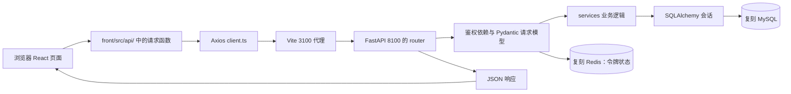

# 前端直接接入记录：我改了什么，前后端怎样协作

> 更新：2026-10-21。本文记录已经完成的接入工作，并解释当前真实代码的调用关系。它是架构说明，不要求你逐个创建前端文件，也不替代后续后端教程。

## 1. 这次交付的范围

正式复刻前端位于：

```text
./front
```

我从参考仓库提交 `7445eb31dba2a9d07a1a5d4b7dd477d099a476f4` 提取了**已提交的完整 `front/` 目录**，包括 React 页面、路由、API 请求模块、状态管理、编辑器、图谱组件、样式、静态资源、构建配置和 `package-lock.json`。这样保留了原项目的界面与交互基础。参考工作区中未提交的 `LocalAutoLogin.tsx` 和本地改动没有进入复刻目录；本机环境文件、`node_modules` 与构建产物也没有从参考目录复制。原仓库的 MIT `LICENSE` 已复制到复刻根目录。

在复刻副本中做了以下本地适配：

| 文件 | 实际变化 | 原因 |
|---|---|---|
| `front/vite.config.ts` | 开发端口 `3000 → 3100`；代理目标 `8000 → 8100`；监听 `127.0.0.1` | 与复刻项目的独立端口对应，避免连到参考后端 |
| `front/src/router/index.tsx` | 移除注册页面导入，把 `/register` 改为跳转 `/login` | 按之前的要求跳过注册界面，旧地址也不会落到空白页 |
| `front/src/pages/Login.tsx` | 移除注册入口和原项目的 `admin/admin1234` 演示账号填充按钮；显示后端返回的登录错误 | 不暗示复刻数据库已有演示账号，也避免把错误说成成功 |
| `front/src/api/client.ts` | 收到 HTTP 200、但正文 `code` 非 200 时，将其作为错误抛出；HTTP 401 时同步清空 Zustand 登录状态与本地 token | 识别当前后端的业务异常，并避免过期会话仍被前端标记为已登录 |
| `front/src/pages/Profile.tsx` | 改密失败时可显示实际错误信息 | 后端错误正文不是原页面预期的 `detail` 结构 |
| `front/tailwind.config.cjs` | 将导出写法改成 CommonJS 的 `module.exports` | `.cjs` 文件需要与其模块格式一致，避免构建时配置加载警告 |

`Register.tsx` 仍保留在复制来的源码里，但没有路由指向它；打开旧的 `/register` 地址会跳到登录页。**后端 `/user/register/` 接口仍存在**：它属于账号能力，不等于前端必须展示注册界面。DeepSeek 密钥没有写进前端；未来模型调用应由后端读取本地秘密配置。

## 2. 先看完整请求路径



浏览器地址是 `http://127.0.0.1:3100`。例如它向同一来源发送 `GET /note/list?page=1`；Vite 根据 `vite.config.ts` 的 `/note/` 规则把请求转给 `http://127.0.0.1:8100/note/list?page=1`。浏览器不需要知道 MySQL 的地址，也不直接连接数据库。Vite 代理只负责转发，真正决定“能否访问、查谁的数据”的是 FastAPI 后端。开发代理只在 Vite 开发服务器运行时生效；部署构建产物时还需要相应的反向代理或同源 API 配置。

后端从 `backend/main.py` 的 `app.include_router(...)` 获得用户、笔记、模板和健康检查路由。可以把 `main.py` 想成总机：它登记哪些分机存在；每个 `router` 接请求和参数；`service` 完成业务判断和数据库读写。前端 `api/endpoints.ts` 是“分机号码簿”，集中写 URL；`api/*.ts` 则把页面要做的动作翻译为 HTTP 请求。

## 3. 登录：前端怎样得到用户身份

打开 `/login` 时，`front/src/router/index.tsx` 选择 `pages/Login.tsx`。用户填写用户名和密码并提交后，调用链是：

```text
Login.handleLogin
  → authApi.login(username, password)
  → client.post('/user/login/', { username, password })
  → Vite /user 代理
  → backend/app/router/user.py:login
  → user_service.authenticate(db, username, email, password)
  → generate_token(user.uuid, ...)
  → { message, user, token }
  → useUserStore.login(token, user)
```

前端的表单只收集输入；它**不能判断密码是否正确**。后端的 `LoginRequest` 先验证请求形状，`user_service.authenticate` 到 MySQL 找用户并校验密码哈希。成功后，`generate_token` 生成带 `user_id`、到期时间和唯一 `jti` 的 JWT；响应把 token 与用户信息交回前端。`useUserStore` 保存当前界面的登录状态，同时把 token 写到浏览器 `localStorage` 的 `jwt_token` 键。此后受保护页面才会出现。

具体例子：假设用户名为 `alice`，登录成功的响应里有 `token: "eyJ..."` 和 `user.username: "alice"`。前端保存令牌、进入 `/notes`。用户以后打开笔记列表，`client.ts` 的请求拦截器会从 `localStorage` 读出同一个令牌，加入 `Authorization: Bearer eyJ...`。**浏览器保存令牌只是携带通行证；后端每个受保护请求还要重新验签和查状态。**

登录失败有一个容易误读的地方：当前后端的 `BusinessException` 会返回 HTTP 200，但正文是 `{"code":4002,"message":"用户名或密码错误","data":null}`。Axios 只看 HTTP 状态时本来会把它当成功。此次在 `client.ts` 加的响应检查会发现 `code !== 200`，抛出带后端 `message` 的错误，因此 `Login.tsx` 不会执行 `useUserStore.login(...)`，而是在表单上显示“用户名或密码错误”。缺字段等 Pydantic 校验错误走 HTTP 422，属于另一条错误路径。

`MainLayout.tsx` 读取 `useUserStore.isLogin`，未登录时重定向到 `/login`。这道页面门禁改善交互，但**不是数据安全边界**；真正的边界在后端 `get_current_user_id()`：它验证 Bearer token、检查 Redis 黑名单、读取 MySQL 中的有效用户，并返回可信的 `user_id`。

## 4. 笔记：页面动作怎样变成 MySQL 数据

### 列表和详情

`pages/NoteList.tsx` 在页面加载时调用 `notesApi.list({ page, page_size, category })`，对应 `GET /note/list`。后端 `note_router.list_notes` 接收分页和筛选参数，通过 `Depends(get_current_user_id)` 获得当前用户身份，再让 `note_service.list_notes` 查询。服务一开始就放入 `Note.user_id == user_id` 条件，所以即使浏览器自己改了查询参数，也不会从其他用户那里读到笔记。响应的 `data.notes` 是当前页，`data.total_count` 是当前筛选范围的总数；页面据此绘制卡片和判断是否还有下一页。

点击某张卡片进入 `/notes/:id`，`NoteEditor.tsx` 调用 `notesApi.get(id)`，对应 `GET /note/{id}`。后端服务用**笔记 ID 和当前用户 ID 两个条件**查一条记录。页面 URL 中的 `id` 只是“想看的笔记编号”，不是访问许可；后端仍按当前用户校验归属。

### 新建、修改、删除和置顶

在新建编辑器点保存，`NoteEditor.handleSave` 调用 `notesApi.create`，发出 `POST /note/create`，正文包含 `title`、`content`、`category`、`tags`。后端 `NoteCreate` 校验字段，`note_service.create_note` 自己生成笔记 ID，把**鉴权依赖得到的 `user_id`** 放进 `Note`，然后 `db.add(note)`、`await db.commit()` 和 `await db.refresh(note)`。提交后 MySQL 中才有这篇笔记；响应中的 `data.id` 又让前端导航到 `/notes/{id}`。前端没有也不应该在正文里决定笔记属于哪个用户。

修改时，前端发送 `PUT /note/{id}`；后端 `NoteUpdate` 只接受允许修改的字段，服务用 `model_dump(exclude_unset=True)` 只更新请求明确给出的内容，再提交事务。删除用 `DELETE /note/{id}`，置顶用 `PUT /note/{id}/pin`；它们都先按当前用户读取目标，再执行变化。这解释了为什么“知道别人笔记的 ID”并不能修改那篇笔记。

新建页面还有一个与后端无关的动作：它把未保存的草稿暂存在浏览器 `localStorage`。草稿留在本机浏览器，不等于 MySQL 已保存；只有成功收到创建响应后，页面才移除草稿并进入正式笔记地址。

## 5. 模板：前端列表与后端默认数据怎样接上

`NoteEditor.tsx` 的模板区域调用 `front/src/api/noteTemplates.ts`。五个操作分别对应后端的 `GET /note-template/list`、`POST /note-template/create`、`PUT /note-template/{id}`、`DELETE /note-template/{id}`、`PUT /note-template/reorder`。

第一次读取某用户模板列表时，后端 `note_template_service.list_templates` 先查这个用户已有多少条模板。若为 0，`_seed_defaults` 为他写入六个默认模板，再按 `sort_order` 返回。前端只收到模板数组并绘制选择界面；它没有在浏览器里建 MySQL 记录。用户新增自定义模板时，前端发送名称和内容，后端补上 `user_id`、`id`、`sort_order` 再提交。修改或删除时，服务仍用模板 ID + 当前用户 ID 查询；内置模板不可删除。排序接口要求提交**该用户全部模板 ID 的完整顺序**，后端校验集合一致后才写入新顺序。

前端“把模板内容应用到新笔记”最初只是在编辑器里填入标题、正文、分类和标签；等用户点保存，才会走上一节的笔记创建接口。**选中模板、编辑草稿、保存笔记，是三个不同的时刻。**

## 6. 资料、密码与注销：令牌怎样接续或失效

个人资料页 `Profile.tsx` 在有 token 时调用 `authApi.getProfile()`，对应 `GET /user/detail/`；显示的是后端根据当前用户返回的资料。保存资料时调用 `PUT /user/update/`。后端更新 MySQL 用户记录后，把旧 token 加入 Redis 黑名单，并签发新 token；前端收到 `res.token` 后调用 `useUserStore.setToken`，下一个请求会带新 token。这样姓名等令牌内信息变更后，页面仍能继续访问受保护接口。

修改密码调用 `POST /user/reset-password/`，正文含旧密码、新密码和确认密码。后端检查旧密码、写入新密码哈希，撤销当前 token，并返回新 token。前端保存新 token；旧 token 再用于请求会被 `get_current_user_id()` 查 Redis 黑名单时拒绝。页面中的“新旧密码是否相同”等即时提示只是用户体验，最终规则由后端验证。

侧栏的退出按钮调用 `POST /user/logout/`。后端把令牌 `jti` 写进 Redis 黑名单，存活时间为 JWT 剩余有效期；前端随后清除本地 token 和用户状态并回到 `/login`。清除本地状态让这台浏览器退出，Redis 黑名单使被撤销的旧 token 在有效期内也不能再次通过后端鉴权。当前原项目侧栏即使后端注销请求失败，也会清理本地状态；此时服务端撤销未必成功，应以实际接口结果判断。

## 7. 哪些页面现在能接上，哪些还等待后端

复制的是**完整参考前端**，复刻后端现已接入第 01–26 篇对应能力。页面存在仍不代表所有服务都已建好。下面按现有 `backend/main.py` 登记的路由核对：

| 前端区域 | 当前情况 | 对应事实 |
|---|---|---|
| 登录、退出 | 后端接口已存在；代理已验证登录校验请求到达后端 | `/user/login/`、`/user/logout/` |
| 笔记列表、详情、新建、修改、删除、置顶 | 核心接口已存在；需用有效账号进行浏览器端到端验收 | `/note/list`、`/note/create`、`/note/{id}`、`/note/{id}/pin` |
| 模板读取、新建、修改、删除、排序 | 后端接口已存在；模板后端流程此前已在 MySQL 验证 | `/note-template/...` |
| 个人资料与改密 | 后端接口已存在；后端流程此前已验证 | `/user/detail/`、`/user/update/`、`/user/reset-password/` |
| 设置中的明暗主题和语言 | 前端本地状态可工作 | 目前不请求后端 |
| 列表搜索、分类统计、批量操作、笔记下载 | 后端路由已接入并通过 HTTP/MySQL 检查；浏览器操作尚未单独验收 | `/note/search`、`/note/stats`、`/note/batch/...`、`/note/{id}/download` |
| 知识库 TXT/MD 上传、列表、详情与删除 | 后端路由已接入并通过 HTTP/MySQL 检查；前端文件选择框仍允许 PDF 等尚未支持的格式，这些文件会收到错误事件 | `/knowledge/add/multiple/stream`、`/knowledge/list`、`/knowledge/detail`、`/knowledge/delete/filename` 等 |
| 自动补全、聊天、会话、回顾、图谱 | 对应后端能力尚未接通或未验收 | 例如 `/chat/...`、`/review/...`、`/api/graph/...` |

这不是“前端文件没复制完整”，而是当前复刻进度的真实边界。`NoteList.tsx` 使用的 `/note/stats` 和搜索等接口现已接通；知识库页面可请求 TXT/MD 上传、列表和详情。PDF/Office、向量与图谱尚未接入，聊天等页面仍可能收到 404。后续后端章节应继续以这些实际 URL 和响应结构为契约补齐服务，避免靠前端静态假数据掩盖缺口。浏览器页面交互尚未单独验收，不能据此把所有页面标成已完成。

还有一点现有行为值得留意：后端某些“记录不存在/排序失败”分支返回 `code: 200` 搭配失败消息，而前端通用响应检查只识别非 200 的业务码；这类分支不能仅凭 HTTP 成功判断操作已完成。此次已让 HTTP 401 同时清理 token 和 Zustand 用户状态，但浏览器中过期会话的完整交互仍待真实账号验收。

## 8. 安装、运行和本次实际验证

已在复刻前端目录执行 `npm ci --no-audit --no-fund`，按复制来的锁文件安装 587 个包；又执行 `npm run build` 和 `npm run lint`。TypeScript/Vite 构建成功，修正 `.cjs` 导出后不再出现该配置警告；lint 为 **0 个错误、6 个参考源码已有的 Hook 依赖警告**。构建器还提示图谱模块的分块较大；这不阻止构建。

前端开发服务器已启动在 `http://127.0.0.1:3100/`。通过**前端端口**请求 `/health/live` 和 `/health/ready`，均获得后端 HTTP 200；通过前端端口发送缺密码的 `POST /user/login/`，获得后端 HTTP 422 和指出缺失 `password` 的错误；用不存在的用户名和错误密码请求，获得 HTTP 200、正文 `code: 4002` 与“用户名或密码错误”。这些结果证明代理确实到了复刻后端，也证明为什么前端必须读业务 `code`。

如果以后需要自行重启前端，在复刻项目 `front` 目录执行 `npm run dev -- --host 127.0.0.1 --port 3100` 即可。后端应在 8100，MySQL 和 Redis 应可用；可先从前端端口访问 `/health/ready` 判断基础依赖。补充验证：已为本地练习建立用户名 `123` 和 `456` 的两个账号，并经前端 3100 代理分别完成登录；两次响应都返回对应用户名与 JWT，携带各自 JWT 请求 `/note/list` 均获 HTTP 200、业务 `code: 200`。密码没有写入本文件或前端源码。当前仍未在浏览器中用这些账号完成笔记、模板、资料点击操作；后端单独验证、代理请求验证和浏览器视觉验收是不同范围，不能据此声称所有页面已经端到端通过。

后续关于文件、知识库、检索、聊天、Agent、图谱与回顾的教材将继续**详细讲后端**。现有前端 API 模块和页面可以成为明确的对接目标，无需再让你逐文件复刻前端。
